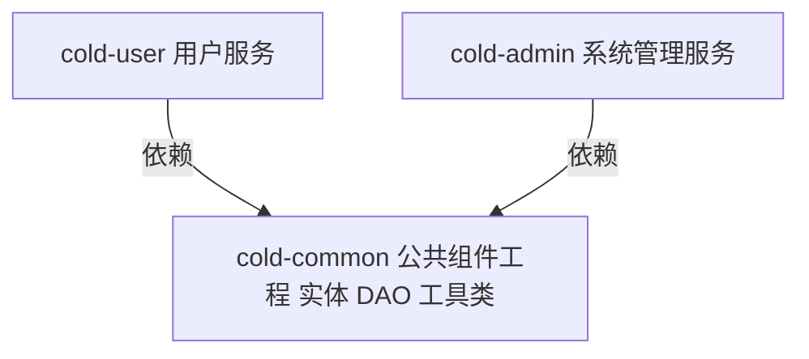

# 公共组件工程：实体、DAO 与工具类的统一收口

平台里的服务多了，会撞上一个不高不低的尴尬：用户服务要用 `SysUserEntity`，系统管理服务也要用 `SysUserEntity`，同一个实体类放谁家？放用户服务，系统管理就得把整个用户工程引过来，就为了一个类背上全部代码；反过来也一样，依赖关系绕成一团。冷链监控平台的解法是单独建一个公共组件工程 `cold-common`，实体、DAO、工具类统一收口，谁需要谁依赖它。

## 先给结论

- `cold-common` 是一个普通的 Maven jar 工程，不启动服务，只作为依赖被引用，收口三类内容：实体与 DAO、统一返回、工具类。
- 实体和 DAO 放公共层的前提是业务流转相对简单；系统复杂时 DAO 可以下沉到各服务，按复杂度选型。
- 统一返回 `Result` 与公共异常 `MyException` 定义在这里，全平台向前端的返回形状、异常语义各只有一套。
- 工具类各管一段：分页、序列化、容器取 Bean、参数校验、读 yml、Redis 连接池，全部静态化，JVM 启动即初始化。
- 使用路径是先 `mvn clean install` 装进本地仓库，其他服务再以 jar 依赖引入，`cold-user`、`cold-admin` 的 `pom.xml` 都是这么写的。

## 一、实体与 DAO 为什么单独成工程

把实体类放公共层还是放业务服务里，取决于服务之间的引用关系。设想实体只放在用户服务里，系统管理服务要用这个实体，就得依赖整个用户工程，反之亦然，服务之间互相背着对方的全部代码，边界彻底糊掉。收进公共工程之后，引用关系变成一颗干净的星形：所有业务服务只指向公共工程，服务彼此之间零依赖。



公共层里放什么、放多少，没有唯一答案。实体与 DAO 放在一起是本平台的选择：`SysUserEntity` 与 `SysUserDao` 成对出现，用户服务、系统管理服务各自扫描引用。也有不少项目把 DAO 下沉到各服务里，只把实体留在公共层，或者干脆实体都下沉。判断依据是系统的复杂程度：业务流转复杂、服务自治要求高的，公共组件往细里拆，DAO 归各服务；本平台业务流转相对简单，就统一收进一个公共工程，换取结构上的简洁。

## 二、工程里有什么：两类内容的清单

打开工程，它就是一个普通 Maven 工程，没有启动类，内容分两类。

**实体与 DAO。** 按业务域分包：系统管理域有公司、主机、表计、仓库、监控等实体与对应 DAO；用户域有 `SysUserEntity`、`SysUserDao`、`SysLoginForm` 等；定时任务域有 `ScheduleJobEntity` 与日志实体；设备接入域还有消息实体。各服务的业务对象只要跨服务出现，实体就定义在这里。

**工具与公共类。** `utils` 包里有统一返回 `Result`、分页 `PageUtils`、序列化 `SerializeUtil`、容器工具 `SpringContextUtils`、校验工具 `ValidatorUtils`、配置读取 `YmlUtil`、Redis 客户端 `JedisUtil`，另有 `TokenGenerator`、常量类；`exception` 包里是自定义异常 `MyException`。

day1 的系统介绍部分已经给过这个工程的定位与内容概览，重在认识它是什么；这一节往下落一层，讲每个类封装了什么、工程怎么构建、怎么被其他服务用起来。

## 三、统一返回与公共异常

`Result` 是全平台向前端返回数据的唯一形状，核心实现如下：

```java
package com.study.coldchain.common.utils;

public class Result extends HashMap<String, Object> {

    public Result() {
        put("code", 0);
        put("msg", "success");
    }

    public static Result error(int code, String msg) {
        Result result = new Result();
        result.put("code", code);
        result.put("msg", msg);
        return result;
    }

    public static Result ok() {
        return new Result();
    }

    public Result put(String key, Object value) {
        super.put(key, value);
        return this;
    }
}
```

它继承 `HashMap`，换来一个很实用的能力：链式 `put` 往返回体里塞任意附加字段。分页场景就是受益者，把 `totalCount`、`currPage` 这些键值对直接放进去，前端拿到的就是一个完整的 JSON。这也呼应了接口规范里的约定：返回体固定有 code 与消息文本，其余字段按需附加，形状由这个类统一保证。顺带留意一处真实工程的细节，规范示例里成功码是 200，这里的默认成功码是 0，两种都成立，重要的是全平台只有一种约定。

公共异常 `MyException` 与 `Result` 配套：它继承 `RuntimeException`，携带 msg 与默认为 500 的 code，业务代码里校验不过、数据有问题，直接抛它；工具层校验失败也抛它，异常语义全平台一致，上层只需按同一套规则转成 `Result.error` 返回。

## 四、工具类封装要点

其余工具类各自堵住一个重复造轮子的口子。

**分页。** `PageUtils` 对接 MyBatis-Plus：传入 `IPage`，拆出总记录数、每页条数、总页数、当前页与列表数据，总页数由总数除以每页条数向上取整算出，业务服务不再各写一遍分页换算。

**序列化。** `SerializeUtil` 提供对象与字节流的互转。数据在网络中传输走的是字节流，Java 对象、C++ 对象、PHP 对象各不相同，但传输层必须一致；发送端把对象序列化成二进制流，接收端反序列化还原，这就是序列化与反序列化的意义，公共工程里备好静态方法，Redis 存取对象时直接用。

**容器取 Bean。** `SpringContextUtils` 实现 `ApplicationContextAware`，把 Spring 容器的引用存进静态变量，之后任何位置都能按名字取出容器里的组件。容器里放的是被 Spring 管理的公共组件与服务，这个工具类相当于给了你一把随取随用的钥匙。

**参数校验。** `ValidatorUtils` 基于 hibernate-validator，静态块里构建好 `Validator`，`validateEntity` 校验实体上标注的约束，不通过就把所有错误信息拼起来抛 `MyException`，校验逻辑从业务代码里剥离。

**配置读取。** `YmlUtil` 基于 snakeyaml，按文件名加载 `application.yml` 并缓存，随后用点分 key 逐层取值，不经过 Spring 的注入也能读到配置项。

**Redis 客户端。** `JedisUtil` 用单例加连接池封装 Jedis，池参数集中设置最大连接数、空闲连接、借出校验等，对外提供字符串、列表、哈希、集合各类操作的入口，写数据进 Redis 或取数据都走它。

这些类清一色是静态工具，JVM 启动时即完成初始化，任何工程方法随取随用，这也是公共工具类的通用做法。

## 五、构建与安装：让其他服务用起来

公共工程要被引用，先得变成仓库里的 jar。在 `cold-common` 目录下执行构建命令，把 SNAPSHOT 包安装到本地 Maven 仓库：

```bash
# 在 cold-common 工程目录执行，安装到本地仓库供其他服务依赖
mvn clean install
```

之后业务服务按 Maven 坐标引入，`cold-user` 的 `pom.xml` 里就是这样一个依赖：

```xml
<dependency>
    <groupId>com.study.coldchain</groupId>
    <artifactId>cold-common</artifactId>
    <version>0.0.1-SNAPSHOT</version>
</dependency>
```

`cold-admin` 以同样方式引入。依赖进来之后，`Result`、`PageUtils`、各实体与 DAO 在业务工程里直接 import 使用；公共工程 `pom.xml` 里声明的 web、MyBatis-Plus、Jedis 等依赖也会随 jar 传递过来，使用方不必关心底下的依赖细节。构建顺序要记住：公共工程有改动，先重新 install，再构建依赖它的服务，否则业务服务编译用的还是仓库里的旧包。

## 常见误区

- **把公共工程当垃圾场。** 错例是只被一个服务用的实体也塞进 common，公共工程无限膨胀，所有人被迫依赖无关代码。正解是跨服务共用的才上收，私有的留在自己服务里。
- **改了公共工程忘记重新 install。** 错例是 common 里加了字段，业务服务一编译还是旧接口。正解是先 `mvn clean install` 刷新本地仓库，再构建下游服务。
- **返回形状绕开 Result。** 错例是某个接口图方便直接返回实体对象，前端解析逻辑与别处不一致。正解是一律经 `Result` 包装，附加字段用链式 put 补。
- **把 Spring 容器工具当万能取件箱。** 错例是 `SpringContextUtils.getBean` 到处乱用，依赖关系全被藏进运行时。正解是优先构造器注入，容器工具只用在拦截器、工具类这些拿不到注入的场景。

## 面试可能被问到的问题

1. 面试官追问：「为什么要单独建公共组件工程，实体放在业务服务里不行吗？」
   答：单个实体被多个服务共用时，放在任何一家都会逼其他服务依赖整个工程，服务间耦合混乱。公共工程把实体、DAO、工具类收口，所有服务只依赖它一个，依赖关系呈星形，边界清晰。是否上收、上收到什么程度，看系统复杂度。
2. 面试官追问：「DAO 层放公共工程和放各服务里，各适合什么场景？」
   答：业务流转简单、表结构全域共用的，DAO 与实体一起放公共层，各服务直接用，代码最省；服务自治要求高、数据库按服务隔离的，DAO 下沉到服务内，公共层只留实体。本平台业务相对简单，选择了前者。
3. 面试官追问：「统一返回 Result 为什么设计成继承 HashMap？」
   答：接口规范要求返回体有 code 与消息，但分页等场景还要附加字段。继承 HashMap 让 Result 具备任意键值扩展能力，配合链式 put 写法简洁，同时静态 ok、error 工厂方法把默认形状钉死，扩展性与统一性兼得。
4. 面试官追问：「公共工程改动了，其他服务怎么拿到新代码？」
   答：公共工程以 SNAPSHOT 包安装进 Maven 仓库，改动后要在其目录重新执行 `mvn clean install` 刷新本地仓库，再构建依赖它的服务。跳过这一步，下游编译期拿到的仍是旧包，这是多工程协作最常见的坑。
5. 面试官追问：「序列化与反序列化解决什么问题？」
   答：网络传输的载体是字节流，与具体语言无关，而内存里操作的是各语言的对象。序列化把对象转成字节流以便传输或存入 Redis，反序列化在接收端还原成对象，两端约定一致的转换规则，跨语言、跨进程的数据交换才成立。

## 配套资料

- 代码：`materials/code/06/day1 背景介绍与系统介绍/`，公共组件工程 `cold-common` 的 `pom.xml` 与 `Result`、`PageUtils`、`MyException`、`SerializeUtil`、`SpringContextUtils`、`ValidatorUtils`、`YmlUtil`、`JedisUtil` 等均为真实随包文件。
- 代码：`materials/code/06/day2 微服务框架与基础服务/`，`cold-user`、`cold-admin` 的 `pom.xml` 展示对公共工程的真实依赖引入。
- 说明：引用路径截至 `materials/code/06/` 的 day 目录层级；包名与 groupId 已改写为 `com.study.coldchain`；`mvn clean install` 构建命令为按本课写法补全的示例。
