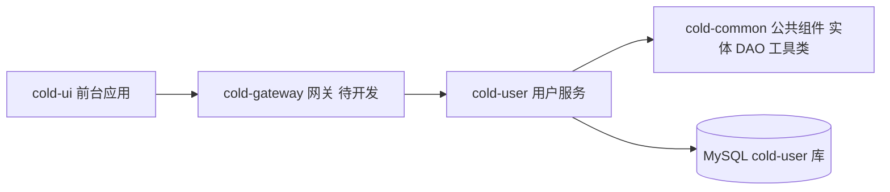

# 用户服务需求设计：两张表撑起登录与鉴权

注册中心跑通之后，平台要落的第一个业务工程是用户服务 `cold-user`。它在冷链监控平台当前版本里承担的职责相当克制：用户登录与登录状态校验。工程不大，却是整个平台 API 服务的一个标准模板，数据模型、分层结构、统一返回这几件事在这一节定下来，后面的服务都照此办理。

## 先给结论

- 用户服务处在调用链的网关之后：前台应用请求先过网关，再转发到 `cold-user`；网关尚未开发，先把用户服务本身做出来。
- 当前版本的需求只有两组：登录（校验用户名与密码）与鉴权（验证已登录用户是否合法）。
- 数据模型只有两张表：`sys_user` 存账号，`sys_user_token` 存登录凭证，以 `user_id` 关联。
- 密码绝不存明文：入库前用盐值 salt 混入后做不可逆哈希；登录成功发一个 token，前端放进请求头 `token` 字段，后端查 `sys_user_token` 验证。
- 代码结构是平台通用模板：Controller 调 Service，实体与 DAO 收口在 `cold-common`，统一返回与分页工具也来自公共工程。

## 一、用户服务在架构里的位置

先看它站在哪。系统微服务体系里，前台应用 `cold-ui` 的请求并不直连业务服务，而是先到网关服务，由网关按规则转发到用户服务、系统管理服务等后端成员。顺序上有一个现实问题：网关还没开发，而登录是所有前端页面的前置条件，所以先把用户服务做出来，网关随后补上，两者通过注册中心解耦。



图上要抓两件事：用户服务对上是 `cold-ui` 经网关而来的 API 调用，对下是 `cold-common` 与数据库。实体和 DAO 不在本工程里，而是放公共组件工程，这一点在 day1 已经定过，用户服务只是引用方。

## 二、数据模型：sys_user 与 sys_user_token

整个用户服务的数据模型就两张表，建表语句来自随包 SQL：

```sql
CREATE TABLE `sys_user` (
  `user_id` bigint(20) NOT NULL AUTO_INCREMENT COMMENT '用户ID',
  `username` varchar(50) NOT NULL COMMENT '用户名',
  `password` varchar(100) DEFAULT NULL COMMENT '密码',
  `salt` varchar(20) DEFAULT NULL COMMENT '盐',
  `email` varchar(100) DEFAULT NULL COMMENT '邮箱',
  `mobile` varchar(100) DEFAULT NULL COMMENT '手机号',
  `status` tinyint(4) DEFAULT NULL COMMENT '状态 0：禁用 1：正常',
  `create_user_id` bigint(20) DEFAULT NULL COMMENT '创建者ID',
  `create_time` datetime DEFAULT NULL COMMENT '创建时间',
  PRIMARY KEY (`user_id`),
  UNIQUE INDEX `username`(`username`)
) COMMENT = '系统用户';

CREATE TABLE `sys_user_token` (
  `user_id` bigint(20) NOT NULL COMMENT '用户ID',
  `token` varchar(100) NOT NULL COMMENT 'token',
  `expire_time` datetime DEFAULT NULL COMMENT '过期时间',
  `update_time` datetime DEFAULT NULL COMMENT '更新时间',
  PRIMARY KEY (`user_id`),
  UNIQUE INDEX `token`(`token`)
) COMMENT = '系统用户Token';
```

`sys_user` 里最要紧的是三个字段。`username` 是用户名，加了唯一索引，账号天然不重；`password` 存的不是明文，而是哈希结果；`salt` 是盐值，一个混淆字符串。做法是：计算密码摘要时把 salt 一起喂进去，同样的明文密码配上不同的盐，得到的结果完全不同，彩虹表里预先算好的那一套就对不上了。哈希本身不可逆，库里那串字符谁也还原不出原始密码，校验方式只能是拿用户输入的密码加同一个盐再算一遍，比对两次结果是否一致。

`sys_user_token` 是鉴权的落点。登录成功后，服务端生成一个 token 字符串，连同 `user_id` 与过期时间写进这张表；前端把它放在请求头里，字段名就叫 `token`。之后每个请求到达后端，后端拿请求头里的 token 去查 `sys_user_token`，查得到且未过期，就认定这是一个已认证用户；退出登录把这一行删掉，token 立即失效。表上给 token 加了唯一索引，按 token 查询就是一次索引命中。

## 三、接口清单

需求落在接口上，用户服务对外提供三个 API（端口 8185，`context-path` 为 `/cold`）：

| 接口 | 方法 | 路径 | 入参 | 返回 |
|---|---|---|---|---|
| 登录 | POST | `/cold/sys/user/login` | JSON：username、password | `Result`，成功附加 token 与 expire |
| 退出 | POST | `/cold/sys/user/logout` | 请求头：token | `Result` |
| 用户信息 | GET | `/cold/sys/user/info` | 无 | `Result`，附用户名等基础信息 |

返回形状由公共工程 `cold-common` 里的 `Result` 统一：固定带 code 与 msg，成功默认 code 为 0，失败走 500；附加字段用链式 put 补进去，token 与 expire 就是这么加上去的。`PageUtils` 是公共工程里的分页工具，扩展了 MyBatis-Plus 的分页能力，用户服务当前用不上分页，但其他服务的列表接口全靠它。`TokenGenerator` 负责生成 token，取一个 UUID 再做 MD5 摘要转十六进制，得到 32 位字符串。

## 四、代码结构：公共工程之上的薄薄一层

分层路径固定：`cold-ui` 发起的请求打在 `cold-user` 的 Controller 上，Controller 调 Service 接口，Service 的实现类再经实体与 DAO 访问数据库；实体、DAO、`Result`、`TokenGenerator` 都在 `cold-common` 里，`cold-user` 只是一个引用方。这样安排的结果是，登录这条链路上 `cold-user` 自己要写的代码非常少，一个控制器、两个服务接口加实现，数据库访问全部交给 MyBatis-Plus 的通用能力。

后面两节就沿这条链路逐层拆代码，再把工程跑起来联调。

## 常见误区

- **把密码明文入库或只做一次普通哈希。** 错例是 `password` 字段直接存用户输入，或对所有用户用同一个固定摘要。正解是每用户独立 salt，存加盐后的不可逆哈希，比对时重算。
- **把 token 发出去就不管过期。** 错例是只发 token 不记 `expire_time`，凭证永久有效。正解是 `sys_user_token` 里记录过期时间，后端校验时一并检查。
- **鉴权逻辑每个服务各写一遍。** 错例是每个业务服务都查一遍 token。正解是这类横切关注点收口到网关的过滤器里统一做，用户服务只负责签发与删除凭证。
- **表设计漏掉唯一索引。** 错例是 username 与 token 都不加索引，登录与鉴权每次全表扫描。正解是两个查重字段都建唯一索引，既保证不重又加速查询。

## 面试可能被问到的问题

1. 面试官追问：「salt 盐值在密码存储里起什么作用？」
   答：盐是一段与用户绑定的混淆字符串，计算密码摘要时拼进去一起哈希。同样的明文配不同的盐结果不同，攻击者预先算好的彩虹表无法直接命中，即使用户用了弱密码，破解成本也大幅提高。盐本身可以明文存在库里，因为校验靠重算而不是靠保密。
2. 面试官追问：「登录成功后 token 为什么要落库，放内存或 Redis 行不行？」
   答：落进 `sys_user_token` 是本平台的实现，好处是凭证可持久化，服务重启后仍然有效，也便于按用户维度管理。放 Redis 完全可行且读写更快，许多项目这么做；关键不在存哪里，而在服务端要能按 token 反查用户并控制过期。
3. 面试官追问：「为什么密码哈希要不可逆？」
   答：可逆意味着库里数据一旦泄露就能还原全部明文密码；不可逆哈希只能比对，泄露后攻击者仍需逐个爆破。本平台用加盐 SHA-256，工程上更推荐 bcrypt、scrypt 这类专门为密码设计的慢哈希，进一步抬高爆破成本。
4. 面试官追问：「实体和 DAO 为什么要放在公共工程里？」
   答：用户实体与 token 实体会被多个服务共用，比如网关、系统管理服务都可能引用。放在公共工程里，各服务只依赖 `cold-common` 一个 jar，依赖关系呈星形，避免服务之间互相背着对方的代码。
5. 面试官追问：「登录和鉴权的职责边界怎么划？」
   答：登录负责身份核验与凭证签发，发生在用户服务；鉴权负责验证后续请求携带的凭证是否合法，通常由网关统一拦截校验，业务服务保持无状态。两者共用 `sys_user_token` 这份凭证数据。

## 配套资料

- 代码：`materials/code/06/day2 微服务框架与基础服务/`，用户服务工程 cold-user 的 `pom.xml`、控制器 `SysLoginController`、服务 `SysUserServiceImpl` 与 `SysUserTokenServiceImpl`、`application.yml`、`application-dev.yml`，以及资料目录下 `doc/sql/cold-user.sql` 建表脚本，均为真实随包文件。
- 代码：`materials/code/06/day1 背景介绍与系统介绍/`，公共组件工程 cold-common 的 `SysUserEntity`、`SysUserTokenEntity`、`SysLoginForm`、`Result`、`PageUtils`、`TokenGenerator`。
- 说明：引用路径截至 `materials/code/06/` 的 day 目录层级；包名与 groupId 已改写为 `com.study.coldchain`；主机名以 `example.com` 占位。
