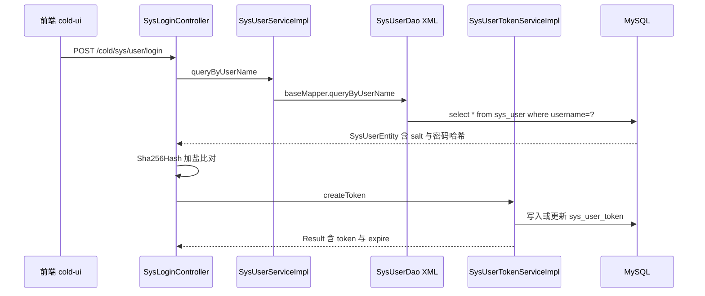

# 用户服务代码逐层拆解：从 Controller 到 mapper XML

数据模型和接口清单定了，接下来把 `cold-user` 的代码按调用链从头走到尾。这条链路是平台所有 API 服务的样板：启动类与配置文件、Controller、Service、DAO 与 mapper XML，一层一层对上号，之后看任何服务都不会陌生。

## 先给结论

- 启动类两个注解：`@SpringBootApplication` 声明应用，`@EnableDiscoveryClient` 把服务注册进 Eureka。
- `application.yml` 管通用配置（端口 8185、`context-path: /cold`、服务名、MyBatis-Plus），环境差异放 `application-dev.yml` 与 `application-test.yml`，靠 `spring.profiles.active` 切换。
- MyBatis-Plus 两处关键配置：`id-type` 定主键策略，`column-underline` 打开驼峰与下划线的自动转换。
- Controller 用 `@RestController` 加 `@RequestMapping("sys/user")`，登录地址是多段拼起来的：`/cold` + `/sys/user` + `/login`，前面再补 IP 与端口。
- DAO 只是接口，SQL 写在 mapper XML 里，`<select>` 的 id 必须与接口方法名一致，返回类型对准实体全限定名。

## 一、启动类与两套配置文件

启动类 `UserApplication` 非常短：

```java
@SpringBootApplication
@EnableDiscoveryClient
public class UserApplication {

    public static void main(String[] args) {
        SpringApplication.run(UserApplication.class, args);
    }
}
```

`@SpringBootApplication` 让它成为 Spring Boot 应用；这个服务要注册到注册中心，所以再加 `@EnableDiscoveryClient`，启动后自动向 `application-dev.yml` 里 `defaultZone` 指向的 Eureka 报到。

配置文件分两层，是读懂这个工程的第一把钥匙。`application.yml` 放与环境无关的通用配置：

```yaml
server:
  port: 8185
  servlet:
    context-path: /cold

spring:
  application:
    name: cold-user
  profiles:
    active: dev   # 环境 dev|test|prod

mybatis-plus:
  mapper-locations: classpath*:/mapper/*.xml          # DAO 的 XML 位置
  typeAliasesPackage: com.study.coldchain.common.user.entity.*
  global-config:
    db-config:
      id-type: INPUT              # 主键策略，由程序指定 ID
      field-strategy: NOT_NULL
      column-underline: true      # 驼峰与下划线自动转换
      logic-delete-value: -1
      logic-not-delete-value: 0
  configuration:
    map-underscore-to-camel-case: true
    cache-enabled: false
```

`context-path` 给整个工程加了一个 `/cold` 前缀，所有接口都挂在它下面；`spring.application.name` 是注册中心里显示的服务名。MyBatis-Plus 的配置值得逐项看：`mapper-locations` 指向 mapper 目录下的 XML，纯增删改查可以不写 XML，一旦有自定义 SQL 就要按这个名字对上；`typeAliasesPackage` 声明实体扫描包路径，注意实体在公共工程里，扫的是 common 包下的 entity；`id-type` 决定主键怎么来，`AUTO` 交给数据库自增，`INPUT` 由程序自己生成，`ID_WORKER` 是全局唯一数字 ID，还可以换成 `UUID`。

`column-underline: true` 是最容易被忽略的一处。实体 `SysUserEntity` 的字段是驼峰写法 `userId`、`createUserId`，表里对应的是全小写下划线 `user_id`、`create_user_id`，打开这个开关，MyBatis-Plus 自动完成双向映射，代码里写驼峰，SQL 里落成下划线，谁也不用手工对字段。

环境相关的配置（数据库地址、账号、Eureka 地址）放独立的 profile 文件：

```yaml
# application-dev.yml
eureka:
  client:
    service-url:
      defaultZone: http://eureka.example.com:8001/eureka

spring:
  datasource:
    type: com.alibaba.druid.pool.DruidDataSource
    druid:
      driver-class-name: com.mysql.jdbc.Driver
      url: jdbc:mysql://localhost:3306/cold-user?allowMultiQueries=true&useUnicode=true&characterEncoding=UTF-8&useSSL=false
      username: cold
      password: cold123
      initial-size: 10
      max-active: 100
      max-wait: 60000
```

`spring.profiles.active` 写着 dev，启动时就把 `application-dev.yml` 叠加进配置；改成 test，就加载 `application-test.yml`，里面可以指向另一套 Eureka 与数据库。服务名、MyBatis-Plus 这些通用项两个环境完全一致，变化的只有地址类配置，profile 机制把「不变的」与「随环境变的」干净分开。数据源用的是 Druid 连接池，最大连接数、等待超时这些参数直接配在 `druid` 块里。

## 二、Controller：多段拼出来的接口地址

控制器扛下了登录、退出、用户信息三个接口：

```java
@RestController
@RequestMapping("sys/user")
public class SysLoginController {

    @Autowired
    private SysUserService sysUserService;
    @Autowired
    private SysUserTokenService sysUserTokenService;

    /**
     * 登录
     */
    @PostMapping("/login")
    public Map<String, Object> login(@RequestBody SysLoginForm form) throws IOException {
        // 用户信息
        SysUserEntity user = sysUserService.queryByUserName(form.getUsername());

        // 账号不存在、密码错误
        if (user == null || !user.getPassword().equals(new Sha256Hash(form.getPassword(), user.getSalt()).toHex())) {
            return Result.error("账号或密码不正确");
        }

        // 生成 token，并保存到数据库
        Result r = sysUserTokenService.createToken(user.getUserId());
        return r;
    }

    /**
     * 退出
     */
    @PostMapping("/logout")
    public Result logout(@RequestHeader(value = "token") String token) {
        sysUserTokenService.logout(token);
        return Result.ok();
    }
}
```

`@RestController` 表明这是一个 API 控制器，方法返回值直接序列化成 JSON；`@RequestMapping("sys/user")` 是类级前缀。完整的登录地址由几部分拼出来：`application.yml` 里的 `/cold`，类上的 `/sys/user`，方法上的 `/login`，合起来是 `/cold/sys/user/login`，最前面再补 IP 与端口。同一个类里加 `/logout` 方法，前缀不变、尾段不同，地址就互不干扰；另有 `GET /sys/user/info` 返回用户名等基础信息，实现同样直观，代码从略。

登录逻辑一眼能看穿。入参 `SysLoginForm` 是公共工程里的表单对象，含 `username` 与 `password`；用 `@RequestBody` 接住前端提交的 JSON 字符串。HTTP 方法用 `@PostMapping` 声明，对应 RESTful 规范里「提交数据用 POST」的约定，Spring Boot 也提供 `@GetMapping` 等成对注解按方法区分。业务上先按用户名查用户，查不到或密码对不上都返回 `Result.error`；密码比对的方式是把用户输入的明文连同库里的 salt 再做一次 SHA-256，与存储的哈希值比较，两次计算一致才放行，然后调用 token 服务签发凭证。

## 三、Service 与 DAO：XML 里一行 SQL 的来龙去脉

Service 层是接口加实现的结构：

```java
public interface SysUserService extends IService<SysUserEntity> {
    /**
     * 根据用户名，查询系统用户
     */
    SysUserEntity queryByUserName(String username);
}

@Service("sysUserService")
public class SysUserServiceImpl extends ServiceImpl<SysUserDao, SysUserEntity> implements SysUserService {

    @Override
    public SysUserEntity queryByUserName(String username) {
        return baseMapper.queryByUserName(username);
    }
}
```

实现类标注 `@Service` 后，Spring Boot 启动时把这个 Bean 装进容器，Controller 里用 `@Autowired` 就能注入，全程不用 new。基类 `ServiceImpl` 带着两个类型参数：DAO 与实体，MyBatis-Plus 的通用增删改查方法全在里面，`baseMapper` 就是注入进来的 DAO 实例。

DAO 同样只是接口，SQL 落在 mapper XML 里：

```java
@Mapper
public interface SysUserDao extends BaseMapper<SysUserEntity> {
    SysUserEntity queryByUserName(String username);
}
```

```xml
<mapper namespace="com.study.coldchain.common.user.dao.SysUserDao">
    <select id="queryByUserName" resultType="com.study.coldchain.common.user.entity.SysUserEntity">
        select * from sys_user where username = #{username}
    </select>
</mapper>
```

三个对齐关系要记牢。XML 的 `namespace` 指向 DAO 接口全限定名；`<select>` 的 `id` 必须与接口方法名一字不差，方法叫 `queryByUserName`，XML 里也叫 `queryByUserName`，运行时靠这个名字绑定；`resultType` 写实体全限定名，查询结果的列按驼峰映射规则灌进实体字段。token 那条链同理，`SysUserTokenDao.xml` 里有按 token 查询与按 token 删除两条语句，退出登录用的就是删除那条。至于实体 `SysUserEntity` 与 `SysUserTokenEntity`，`@TableName` 注解分别对准 `sys_user` 与 `sys_user_token`，它们连同 DAO 一起住在 `cold-common`，用户服务只是使用方。

登录这条链路画出来是这样：



读图的抓手在两次入库：查用户走 `sys_user`，签发凭证走 `sys_user_token`，两张表各司其职，中间的密码比对全部发生在内存里。

## 常见误区

- **mapper XML 的 id 与方法名对不上。** 错例是接口方法改名后 XML 没同步，调用时报绑定失败。正解是 namespace 指向接口、id 与方法名一致、resultType 对准实体，三个对齐关系一个都不能松。
- **实体扫描包写成本工程。** 错例是 `typeAliasesPackage` 扫 `cold-user` 自己的包，实体在公共工程里根本扫不到。正解是扫 `cold-common` 的 entity 包路径。
- **驼峰映射忘了开。** 错例是实体 `createUserId` 与表列 `create_user_id` 对不上，查询结果字段为 null。正解是 `column-underline` 与 `map-underscore-to-camel-case` 保持开启。
- **配置改错 profile 文件。** 错例是环境相关参数改在 `application.yml` 里，或者把 dev 的地址写进 test 文件。正解是通用配置进主文件，地址类配置进对应 profile 文件，`spring.profiles.active` 决定加载谁。

## 面试可能被问到的问题

1. 面试官追问：「@EnableDiscoveryClient 在这里起什么作用？」
   答：把服务标记为服务发现的客户端，配合 classpath 里的 eureka client 依赖，启动时自动向配置的注册中心注册自己并维持心跳。没有它，服务照样能跑，但注册中心里看不到这个实例，网关也就无法按服务名路由过来。
2. 面试官追问：「application.yml 和 application-dev.yml 的分工是什么？」
   答：主文件放与环境无关的通用配置，如端口、服务名、MyBatis-Plus；profile 文件放随环境变化的配置，如数据库与注册中心地址。`spring.profiles.active` 指到 dev 就加载 `application-dev.yml`，指到 test 就加载 `application-test.yml`，同一份代码不改动即可切换环境。
3. 面试官追问：「MyBatis-Plus 的 id-type 有哪些取值，分别什么含义？」
   答：`AUTO` 依赖数据库自增；`INPUT` 由程序在插入前指定主键值；`ID_WORKER` 生成全局唯一数字 ID；`UUID` 生成全局唯一字符串。选型要看业务对主键可读性、有序性、分库分表扩展的要求。
4. 面试官追问：「自定义 SQL 为什么写在 XML 而不是注解里？」
   答：XML 与 DAO 接口按 namespace 与方法 id 绑定，SQL 复杂时（动态条件、结果映射、多表关联）XML 更好维护，也便于统一审阅。简单语句用注解也行，本平台的约定是统一放 mapper 目录的 XML。
5. 面试官追问：「Controller 里为什么注入的是接口而不是实现类？」
   答：面向接口编程让 Controller 只依赖契约，实现类替换、代理增强（事务、AOP）都不影响调用方。实现类标注 `@Service` 注册进容器后，`@Autowired` 按类型找到对应实现完成注入。

## 配套资料

- 代码：`materials/code/06/day2 微服务框架与基础服务/`，用户服务工程 cold-user 的启动类 `UserApplication`、`SysLoginController`、`SysUserService`、`SysUserServiceImpl`、`application.yml`、`application-dev.yml`、mapper 目录下 `SysUserDao.xml` 与 `SysUserTokenDao.xml`，均为真实随包文件。
- 代码：`materials/code/06/day1 背景介绍与系统介绍/`，公共组件工程 cold-common 的 `SysUserEntity`、`SysUserTokenEntity`、`SysLoginForm`、`SysUserDao`、`SysUserTokenDao`。
- 说明：引用路径截至 `materials/code/06/` 的 day 目录层级；包名与 groupId 已改写为 `com.study.coldchain`；主机名以 `example.com` 占位，数据库地址按实际环境配置，示例以 localhost 占位。
