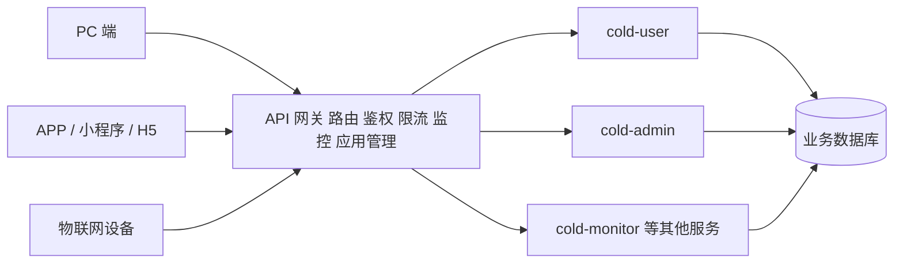

# API 网关概述：统一入口解决五类问题

用户服务跑通之后，前端直连 `localhost:8185` 的调用方式该收一收了。前端不该知道每个服务的地址，认证也不该在每个服务里重复写。网关服务 `cold-gateway` 就是为此准备的子系统，这一节讲清楚它为什么存在、该干什么，再看主流网关实现里平台为什么选了 Spring Cloud Gateway。

## 先给结论

- API 网关是介于客户端与服务器端之间的中间层，外部请求一律先经过它，再分发到后台微服务。
- 直连模式有五类问题：客户端复杂、跨域难处理、认证重复建设、服务重构牵连前端、协议不一致无法直达。
- 网关的职责收口在一处：路由分发、统一认证、流量控制、API 监控与应用管理，后台服务得以保持无状态。
- 网关按服务对象分 API 网关（PC 端）、APP 网关（移动端、小程序、物联网）与内部网关（服务间调用），数量与分类随系统复杂度演进。
- 平台选用 Spring Cloud Gateway，按服务名路由到 `cold-user` 等服务，登录之外的请求在网关层统一校验 token。

## 一、为什么需要网关：直连模式的五类问题

微服务体系里服务会越来越多，Spring Cloud 体系、Dubbo 体系各有大量成员，不同的微服务有不同的网络地址，对外暴露不同的接口。客户端要完成一个业务，往往要调用多个服务的接口，让它直接与每个微服务通信，问题立刻显形：

**第一，客户端复杂度暴涨。** PC、Web、APP、H5 每一端都要维护一整套服务地址清单，服务一变，所有端跟着改。

**第二，跨域请求难处理。** 各服务域名端口不同，浏览器侧的跨域问题在多个服务上重复出现，处理逻辑分散在各处。

**第三，认证重复建设。** 成百上千个微服务，每个接口都要做认证鉴权，客户端调用复杂，服务端也得各自开发认证代码。

**第四，服务重构难以实施。** 项目迭代中服务经常拆分合并，客户端直连微服务时，后台一变前端就得重新开发或调整，重构成本被放大。

**第五，协议不一致。** 后台服务可能用 RPC 协议封装（比如内部走 TCP 的 Dubbo 或 gRPC），而前端只会发 HTTP 请求，两者之间没有翻译层就接不上，硬要接还得开发额外代码。

这些问题可以全部交给 API 网关解决：它统一收口外部请求，把安全、监控、性能这些横切关注点从业务里剥离出来，业务服务只管业务逻辑，灵活性与安全性两不误。

## 二、网关是什么：统一入口与职责清单

API 网关是介于客户端和服务器端之间的一个中间层，所有外部请求先到它这里，再由它路由到后台服务。



职责逐项看。**路由分发**是本职：按请求路径或服务名把请求转发到对应微服务，多实例之间的负载均衡也在这一层完成。**统一认证**：鉴权逻辑只在网关写一遍，后台服务不再各自处理登录态，服务端与客户端的交互层次随之减少，内网服务之间可以放心直连。**流量控制**：对访问频率过高的 API 做限流，保护后台。**API 监控**：在统一位置收集调用信息，分析哪些 API 访问频率异常、哪些正在被攻击；发现攻击时不必急着升级后台服务，网关层临时把该 API 关闭或拦截出去，后台就不受大的冲击。**应用管理**：API 的注册、分发、监控、权限在网关一处纳管。

架构收益可以用两个「易于」概括：一是易于监控，统一入口让调用数据天然汇聚到一处；二是易于认证，认证收口后后台服务彻底无状态，扩容、重启都不影响登录态的校验。

## 三、网关的分类与演进

网关不是一开始就有的，它跟着系统复杂度生长。单体应用时代，一个应用包打天下，前面加个负载均衡就够了；服务逐渐增多，对外暴露的 API 需要统一管理，API 网关或外部网关出现；内部服务之间调用关系越来越复杂，负责服务间互调的内部网关出现；移动端兴起后，专门为 APP、微信小程序甚至物联网设备封装的 APP 网关也会出现。

于是网关按服务对象分成三类：面向 PC 端的 API 网关、面向 APP 与小程序及物联网的 APP 网关、负责内部服务互调的内部网关。一个公司上几种网关、每种部署多少，取决于服务的复杂程度，没有统一答案。网关用什么语言实现、承担什么功能与业务语言无关，它关注的是路由、鉴权这类通用能力，所以可选的实现非常多。

## 四、常用网关实现与平台选型

常见的几类实现各有分工：

- **Nginx**：最常用来做负载均衡与反向代理，前端请求经它按策略分发到后台多台服务器，均匀分或按权重分都可配；要往上加鉴权等逻辑，可以用 Lua 语言写脚本扩展。
- **Zuul**：Netflix 出品，分 1 与 2 两代。Zuul 1 基于 Servlet 的阻塞式 IO，实现简单但高并发下线程开销大；Zuul 2 改用 Netty 异步非阻塞，但与 Spring Cloud 的官方集成一直不温不火。
- **Spring Cloud Gateway**：Spring Cloud 官方网关，基于 Spring Boot 2 与 WebFlux、Netty 的非阻塞模型，路由（Route）、断言（Predicate）、过滤器（Filter）三件套与注册中心体系集成度高，按服务名 `lb://` 路由天然支持负载均衡。本平台用的就是它。
- **Kong、Tyk**：独立的网关产品，插件生态丰富，适合多语言异构环境。

选型的落点看集成度：平台整条技术栈是 Spring Boot 加 Spring Cloud，网关自然选与这套体系咬合最紧的 Spring Cloud Gateway。真实工程里，`cold-gateway` 的路由配置把网关职责落到了纸面上：

```yaml
spring:
  cloud:
    gateway:
      discovery:
        locator:
          enabled: true   # 基于注册中心的服务发现路由
      routes:
      - id: cold-user-router
        uri: lb://cold-user          # 按服务名负载均衡转发
        predicates:
        - Path=/cold/sys/user/**     # 路径断言
      - id: cold-admin-router
        uri: lb://cold-admin
        predicates:
        - Path=/cold/admin/**
```

每条 route 三要素：id 标识、uri 指向目标、predicates 写匹配条件。`lb://cold-user` 的含义是把请求负载均衡转发到注册中心里名为 `cold-user` 的服务实例，注册中心负责把名字解析成地址，这正是「网关必须依赖注册中心」的原因。

鉴权也在网关层有了雏形，工程里的全局过滤器统一校验请求头：

```java
public class TokenFilter implements GlobalFilter, Ordered {

    @Override
    public Mono<Void> filter(ServerWebExchange exchange, GatewayFilterChain chain) {
        // 登录接口放行，其余请求必须携带 token 请求头
        if (!exchange.getRequest().getPath().value().equals("/cold/sys/user/login")) {
            String token = exchange.getRequest().getHeaders().getFirst("token");
            if (token == null || token.isEmpty()) {
                exchange.getResponse().setStatusCode(HttpStatus.UNAUTHORIZED);
                return exchange.getResponse().setComplete();
            }
        }
        return chain.filter(exchange);
    }

    @Override
    public int getOrder() {
        return -100;
    }
}
```

`GlobalFilter` 作用于所有路由，登录接口之外的请求没带 token 就直接回 401，不再往后端走；`getOrder` 返回负值让过滤器尽量早执行。这段代码与用户服务的关系一望即知：网关校验的 token，正是用户服务登录时签发、落在 `sys_user_token` 表里的那一个。鉴权收口在网关，签发与吊销留在用户服务，职责就此分开。

## 常见误区

- **把网关当负载均衡器用。** 错例是只让网关做 Nginx 式转发，鉴权、限流照旧散在各服务里。正解是网关定位是 API 统一入口，路由只是基础能力，认证、限流、监控都该往这层收。
- **网关里写业务逻辑。** 错例是图省事在过滤器里拼业务数据，网关跟着业务频繁发布。正解是网关只做横切关注点，业务留在业务服务。
- **路由写死 IP。** 错例是 uri 直接配 `http://192.168.1.10:8185` 这类固定地址。正解是配 `lb://服务名`，交给注册中心解析，实例增减与迁移无需改网关配置。
- **认为 Zuul 2 与 Spring Cloud Gateway 等价。** 错例是只看「都是异步非阻塞」就互相替代。正解是 Spring Cloud Gateway 原生适配 Spring Cloud 的服务发现、断言与过滤器体系，在这套技术栈里集成成本最低，选型看生态咬合度而非单点功能。

## 面试可能被问到的问题

1. 面试官追问：「为什么微服务架构需要 API 网关？」
   答：客户端直连各微服务会带来客户端复杂、跨域、认证重复、重构牵连前端、协议不一致五类问题。网关作为统一中间层收口外部请求，路由、鉴权、限流、监控在一处完成，业务服务只保留业务逻辑，前后端解耦，服务重构不再波及客户端。
2. 面试官追问：「网关统一认证和每个服务自己鉴权有什么区别？」
   答：网关统一认证把登录态校验集中在一层，后台服务无状态，不用重复开发认证代码；请求进入内网后服务间互信调用，链路层次更少。代价是网关成为关键路径，本身要高可用，且细粒度的权限控制还需下沉到服务内做二级校验。
3. 面试官追问：「Zuul 与 Spring Cloud Gateway 有什么区别？」
   答：Zuul 1 基于 Servlet 阻塞 IO，高并发下线程开销大；Zuul 2 虽改为 Netty 非阻塞，但与 Spring Cloud 官方集成薄弱。Spring Cloud Gateway 基于 Spring Boot 2 与 WebFlux 的非阻塞模型，路由、断言、过滤器体系完整，与注册中心、负载均衡天然整合，在 Spring Cloud 技术栈里是默认之选。
4. 面试官追问：「网关路由里的 lb:// 前缀是什么意思？」
   答：lb 即 load balance，表示按服务名从注册中心取实例列表并做负载均衡转发，而不是直连固定地址。实例扩容、下线、换端口都由注册中心感知，网关配置保持稳定。
5. 面试官追问：「API 遭受攻击时网关层能做什么？」
   答：监控发现某 API 访问异常后，网关可以临时关闭或拦截该 API，把流量挡在后台之外，为后台修复争取时间；配合限流策略区分正常流量与攻击流量，避免后台服务被拖垮。
6. 面试官追问：「单体应用有必要上网关吗？」
   答：多数没必要。单体时代一个负载均衡已经够用，网关的价值建立在多服务、多端的架构复杂度上；服务增多、客户端多元之后再引入，避免为了架构而架构。

## 配套资料

- 代码：`materials/code/06/day2 微服务框架与基础服务/`，网关工程 cold-gateway 的 `pom.xml`、启动类 `GatewayApplication`、`application.yaml`（路由配置）、`TokenFilter` 全局过滤器、`CorsConfig` 与 `GatewayConfig`，均为真实随包文件。
- 说明：引用路径截至 `materials/code/06/` 的 day 目录层级；包名与 groupId 已改写为 `com.study.coldchain`；Zuul 与 Spring Cloud Gateway 的版本对比、网关分类演进的展开部分为按主流写法补全；示例主机名以 `example.com` 占位。
