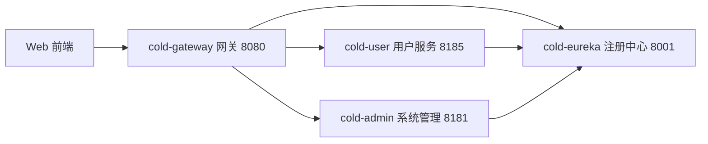

# 搭建网关服务：给冷链监控平台装上统一入口

注册中心跑起来之后，用户服务已经挂了上去，但前端要调用的不止一个服务：登录找用户服务，企业、仓库、主机、设备的管理又是另一个服务，端口和地址各不相同。让前端记一串 IP 加端口，改一次环境就要发一遍版，也没法在统一的位置做鉴权、跨域和监控，这正是网关要解决的问题。这一节把网关工程 `cold-gateway` 从建工程、写配置到注册进注册中心完整走一遍。

## 先给结论

- 网关本身也是一个普通的 Spring Boot 工程，引入 `spring-cloud-starter-gateway` 与 Eureka client 两个依赖，启动类加 `@EnableDiscoveryClient`，就具备了接入注册中心的能力。
- 配置集中在 `application.yml`：端口 8080、服务名 `cold-gateway`、注册中心地址 `defaultZone`，再加一组 Tomcat 运行参数。
- 版本底座与注册中心工程完全一致：Spring Boot 2.1.8.RELEASE 加 Spring Cloud Greenwich.SR2，由 `dependencyManagement` 锁定。
- 验收标准很明确：网关进程启动后，注册中心 Dashboard 的实例表里出现 `COLD-GATEWAY` 一行。此刻它还只是一个空入口，路由规则与鉴权拦截在后续两节补上。

## 网关在架构里的位置

API 网关是所有外部请求进入微服务集群的第一道门：前端只认识网关一个地址，网关根据请求特征把流量分发到后面的各个服务。常见的候选有 Nginx、Zuul、Spring Cloud Gateway、Kong，冷链监控平台选了 Spring Cloud Gateway，理由有二：它基于 WebFlux 响应式模型，非阻塞 IO 在高并发转发场景下不占线程；它与 Spring Cloud 体系天然打通，注册发现、负载均衡开箱即用，不用额外胶水代码。

网关、业务服务与注册中心三者的关系如下。



图里值得看的一条线是网关指向注册中心：网关自己也要注册进去，变成注册中心眼里的一个普通服务，这样它的实例状态可观测，后续按服务名转发时也复用同一套服务列表。业务服务扩容、换端口，网关的接入配置一行都不用改。

## 建工程：两个依赖定身份

建工程流程与注册中心那篇一致：在 Spring 骨架生成器里选 Maven 工程、Java 语言，填好 Group 与 Artifact（Artifact 取名 `cold-gateway`），依赖只勾两个，一个是 Gateway，一个是 Eureka Discovery Client，前者提供网关本体，后者提供服务注册发现。生成压缩包下载解压后，以 Maven 工程的形式导入 IDE，再把自动生成的 `application.properties` 重命名成 `application.yml`，层次化配置写起来舒服得多。

真实工程的 `pom.xml` 关键片段如下：

```xml
<parent>
    <groupId>org.springframework.boot</groupId>
    <artifactId>spring-boot-starter-parent</artifactId>
    <version>2.1.8.RELEASE</version>
    <relativePath/>
</parent>

<properties>
    <java.version>1.8</java.version>
    <spring-cloud.version>Greenwich.SR2</spring-cloud.version>
</properties>

<dependencies>
    <dependency>
        <groupId>org.springframework.cloud</groupId>
        <artifactId>spring-cloud-starter-gateway</artifactId>
    </dependency>
    <dependency>
        <groupId>org.springframework.cloud</groupId>
        <artifactId>spring-cloud-starter-netflix-eureka-client</artifactId>
    </dependency>
    <dependency>
        <groupId>org.springframework.boot</groupId>
        <artifactId>spring-boot-starter-test</artifactId>
        <scope>test</scope>
    </dependency>
</dependencies>

<dependencyManagement>
    <dependencies>
        <dependency>
            <groupId>org.springframework.cloud</groupId>
            <artifactId>spring-cloud-dependencies</artifactId>
            <version>${spring-cloud.version}</version>
            <type>pom</type>
            <scope>import</scope>
        </dependency>
    </dependencies>
</dependencyManagement>
```

课程演示时骨架生成器里选的是更高的 2.2.2 版本，随包工程实际落在 2.1.8.RELEASE 加 Greenwich.SR2，与 `cold-eureka`、`cold-user` 共用同一个底座，整平台版本统一，联调时不会出现序列化和依赖冲突类的问题。

## 启动类：一行注解接入服务发现

网关工程的启动类只有十几行：

```java
package com.study.coldchain.gateway;

import org.springframework.boot.SpringApplication;
import org.springframework.boot.autoconfigure.SpringBootApplication;
import org.springframework.cloud.client.discovery.EnableDiscoveryClient;

@SpringBootApplication
@EnableDiscoveryClient
public class GatewayApplication {

    public static void main(String[] args) {
        SpringApplication.run(GatewayApplication.class, args);
    }
}
```

`@SpringBootApplication` 把它声明为 Spring Boot 应用；`@EnableDiscoveryClient` 把当前进程注册为服务发现客户端，启动后自动向 `defaultZone` 指向的注册中心注册并发送心跳。Gateway 依赖本身自带路由转发的引擎，但「把网关自己挂到注册中心」这件事要靠 Eureka client 依赖加这道注解完成，两者缺一不可。

## application.yml：服务身份与运行参数

网关的全部基础配置集中在 `application.yml`，真实工程内容如下（注册中心主机名以示例域名占位，路由部分下篇展开）：

```yaml
server:
  tomcat:
    uri-encoding: UTF-8
    max-threads: 1000
    min-spare-threads: 30
  port: 8080
  connection-timeout: 50000ms
  servlet:
    context-path: /cold

eureka:
  client:
    service-url:
      defaultZone: http://eureka.example.com:8001/eureka

spring:
  application:
    name: cold-gateway

  # spring.cloud.gateway 的路由规则在路由配置一篇展开
```

逐项拆开看。`server.port` 取 8080，作为整个平台的对外端口；`spring.application.name` 起名 `cold-gateway`，这个名字会出现在注册中心实例表里，也是后续其他服务按名找到它的依据。`eureka.client.service-url.defaultZone` 指向 8001 的注册中心，注意它是 `service-url` 下面的 `defaultZone`，缩进错一层配置就不生效，课程讲解时特意强调过层次结构的重要性。

Tomcat 一组参数是网关这类入口服务的常见调优点：`uri-encoding` 固定 UTF-8，避免中文参数乱码；`max-threads` 与 `min-spare-threads` 分别是最大工作线程数与最小空闲线程数，保证突发流量时有线程可用；`connection-timeout` 设 50 秒，连接建立后长时间不发送请求就断开。这些值对演示环境够用，压测时再按机器规格调。

`server.servlet.context-path` 这一项要单独说明：网关工程里保留了它，但 Spring Cloud Gateway 跑在 WebFlux 上，这个 servlet 风格的配置在网关侧并不真正承担前缀匹配，外部请求的前缀由路由断言决定，路径怎么对齐放到路由配置一篇讲透。

## 启动与验收

直接运行 `GatewayApplication`，控制台输出启动日志并看到注册中心的注册动作后，浏览器打开 8001 的 Dashboard，实例表里出现 `COLD-GATEWAY`、状态 UP，验收就算通过。此时从 8080 发任何业务请求都得不到正确响应，因为路由规则还没配；网关的角色目前只是「一个已注册的空门卫」，下一节给它配上按服务名转发的路由，这一扇门才算真正通向各个房间。

## 常见误区

- **网关工程误引 `spring-boot-starter-web`。** 错例是按普通 Web 工程的习惯把 web starter 加进来。正解是 Spring Cloud Gateway 基于 WebFlux 响应式栈，与 servlet 栈的 web starter 冲突，启动直接报错，只引 `spring-cloud-starter-gateway` 即可。
- **`defaultZone` 层级写错。** 错例是把 `defaultZone` 与 `service-url` 写成同级。正解是它挂在 `eureka.client.service-url` 下面，YAML 是靠缩进表达层级的，错一层注册动作就不发生。
- **漏掉 `@EnableDiscoveryClient` 或服务名。** 错例是依赖都引了，Dashboard 里却看不到实例。正解是启动类注解与 `spring.application.name` 缺一不可，没有服务名，注册中心无从登记。
- **把 `context-path` 当成对外前缀的来源。** 错例是以为网关配了 `/cold`，所有请求就要自动多拼一层路径。正解是网关是 WebFlux 应用，servlet 的 context-path 在这里不承担路由匹配，前缀逻辑看路由断言。

## 面试可能被问到的问题

1. 面试官追问：「微服务架构里为什么一定要有网关？」
   答：网关把「外部请求怎么进来」收敛到一个入口，统一处理路由转发、认证鉴权、跨域、限流与监控埋点，前端不再感知后端有多少个服务、各在什么端口。没有网关，这些横切逻辑就要在每个服务里各写一遍，客户端与微服务的交互次数也降不下来。
2. 面试官追问：「Spring Cloud Gateway 和 Zuul 怎么选？」
   答：Zuul 1 基于 servlet 阻塞模型，每个请求占一个线程；Spring Cloud Gateway 基于 WebFlux 与 Netty，非阻塞 IO，转发性能更好，且路由断言、过滤器体系与 Spring Cloud 的注册发现、负载均衡直接整合。新项目尤其是已经用 Eureka 的体系，选 Gateway 的集成成本最低。
3. 面试官追问：「网关自己要不要注册到注册中心？」
   答：要。网关同时是服务提供方和消费方：注册后实例状态可以在 Dashboard 观测，也能被其他设施按服务名找到；它做 `lb://` 负载均衡转发时依赖的也是注册中心的同一份服务列表，接入方式与业务服务完全一样，加 client 依赖、配 `defaultZone`、起服务名。
4. 面试官追问：「网关工程为什么不能引入 spring-boot-starter-web？」
   答：Spring Cloud Gateway 构建在 Spring WebFlux 与 Reactor 之上，要求响应式编程模型；web starter 会把应用拉到 servlet 栈上，两套容器模型冲突，启动时直接失败。网关工程只需要 gateway starter 加注册发现相关依赖。
5. 面试官追问：「网关的 Tomcat 参数里你关注哪几项？」
   答：最大线程数与最小空闲线程数决定并发承载能力，入口服务一般调大；URI 编码固定 UTF-8，避免中文请求参数乱码；连接超时控制僵尸连接的回收节奏。这些参数要结合压测数据调，不能拍脑袋抄大厂配置。

## 配套资料

- 代码：`materials/code/06/day2 微服务框架与基础服务/`，网关工程 `cold-gateway` 的 `pom.xml`、启动类 `GatewayApplication`、`application.yaml` 均为真实随包文件。
- 说明：引用路径截至 `materials/code/06/` 的 day 目录层级；包名已改写为 `com.study.coldchain`，注册中心主机名以 `example.com` 占位；Tomcat 参数以随包工程实际值为准。
