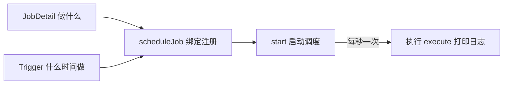

# Quartz 示例：二十行代码跑一个每秒执行的定时任务

Quartz 的四个核心概念在文档里各占一行，真到自己动手，它们怎么配合还是要跑一遍才有体感。这一课的演示是刻意保持最小：一个普通 Maven 工程，一个任务类，一个主程序，控制台每秒打印一行「定时任务正在执行...」。跑通这个最小闭环，再看平台工程里把 cron 挪进数据库的写法，框架的扩展点就都露出来了。

## 先给结论

- 依赖只需要一个 `org.quartz-scheduler:quartz`，课程示例用 2.3.0 版本，不依赖 Spring 也能运行。
- 任务类实现 Job 接口，execute 方法里写业务；主程序按「建 JobDetail、建 Trigger、交给 Scheduler」三步装配，最后调用 start。
- 示例触发器用 SimpleScheduleBuilder 的 repeatSecondlyForever，效果是每秒执行一次；平台工程里换成 CronTrigger，表达式来自 schedule_job 表。
- 工程化场景下 JobDetail 固定指向一个通用入口类，从 JobDataMap 里取任务记录、反射调用 Spring 容器里的业务 Bean，任务增删改全在数据库层完成。

## 工程与依赖

普通 Maven 工程即可，不需要勾任何 Spring 骨架。演示工程取名 quartz-demo，groupId 按平台包名写作 `com.study.coldchain`，`pom.xml` 的依赖只有一段：

```xml
<dependencies>
    <dependency>
        <groupId>org.quartz-scheduler</groupId>
        <artifactId>quartz</artifactId>
        <version>2.3.0</version>
    </dependency>
</dependencies>
```

Quartz 对运行环境不挑，纯 Java 程序里就能跑，这一点用最小工程刚好可以验证。

## 任务类：实现 Job 接口

```java
package com.study.coldchain.quartz.demo;

import org.quartz.Job;
import org.quartz.JobExecutionContext;
import org.quartz.JobExecutionException;

public class QuartzJob implements Job {

    public void execute(JobExecutionContext jobExecutionContext) throws JobExecutionException {
        System.out.println("定时任务正在执行...");
        //执行我们自己的业务任务
    }
}
```

execute 方法就是概念篇里说的「做什么」。这里只打印一句话占位，真实项目里换成发报文、跑报表等具体逻辑。

## 主程序：三步装配

```java
package com.study.coldchain.quartz.demo;

import org.quartz.*;
import org.quartz.impl.StdSchedulerFactory;

public class QuartzDemo {
    public static void main(String[] args) {
        //1. 创建一个任务对象： 做什么
        JobDetail job = JobBuilder.newJob(QuartzJob.class).build();

        //2. 创建触发对象，trigger： 什么时间做
        Trigger trigger = TriggerBuilder.newTrigger().withSchedule(SimpleScheduleBuilder.repeatSecondlyForever()).build();

        //3. 创建任务调度，scheduler： 任务调度
        try {
            Scheduler scheduler = StdSchedulerFactory.getDefaultScheduler();
            scheduler.scheduleJob(job, trigger);
            scheduler.start();
        }
        catch (SchedulerException e) {
            e.printStackTrace();
        }
    }
}
```

逐步拆开看。第一步 `JobBuilder.newJob(QuartzJob.class)` 把任务实现类包成 JobDetail，对应「任务单」这个角色。第二步 `TriggerBuilder.newTrigger` 配上 `SimpleScheduleBuilder.repeatSecondlyForever()`，含义是每一秒重复一次、永远执行，构建出触发器，对应「什么时间做」。第三步通过 `StdSchedulerFactory.getDefaultScheduler()` 拿到默认调度器，`scheduleJob(job, trigger)` 把任务与触发器绑定注册进容器，`start()` 让调度真正运转起来。

运行 main 方法，控制台按秒打印：

```text
定时任务正在执行...
定时任务正在执行...
```

十几行代码里四个核心概念全部到场：QuartzJob 是 Job，newJob 的产物是 JobDetail，newTrigger 的产物是 Trigger，getDefaultScheduler 拿到的是 Scheduler。

## 演示工程处在哪种运行环境

概念篇列过 Quartz 的四种运行环境：嵌入另一个独立式应用、在应用服务器或 servlet 容器内实例化、作为独立程序运行、作为项目集群节点。这个 main 方法示例就是第一种：Quartz 作为库嵌在普通 Java 进程里，随 main 方法启动、随进程结束而停止，`StdSchedulerFactory` 读取 classpath 下的默认配置创建调度器，不需要任何外部容器支撑。

平台工程对应的是第二种思路的延伸：调度器由 Spring 容器托管，任务定义来自数据库，执行留痕也走数据库。两种形态共享同一套 API，差别只在谁创建 Scheduler、谁提供任务清单，理解了演示工程，工程化的那层壳就不难拆。



## 从演示到平台：cron 放进数据库

演示工程把触发规则写死在代码里，改一次频率就要改代码重新编译。平台工程的做法是把规则挪进 schedule_job 表：beanName 指向 Spring 容器里的任务 Bean，cron_expression 存节奏，status 控制暂停与恢复。

```sql
CREATE TABLE `schedule_job` (
  `job_id` bigint(20) NOT NULL AUTO_INCREMENT COMMENT '任务id',
  `bean_name` varchar(200) COMMENT 'spring bean名称',
  `params` varchar(2000) COMMENT '参数',
  `cron_expression` varchar(100) COMMENT 'cron表达式',
  `status` tinyint(4) COMMENT '任务状态 0：正常 1：暂停',
  `remark` varchar(255) COMMENT '备注',
  `create_time` datetime COMMENT '创建时间',
  PRIMARY KEY (`job_id`)
) ENGINE = InnoDB COMMENT = '定时任务';
```

把表记录真正变成 Quartz 任务的是工具类 ScheduleUtils，创建任务的核心几行：

```java
public static void createScheduleJob(Scheduler scheduler, ScheduleJobEntity scheduleJob) {
    //构建 job 信息，任务实现类统一是 ScheduleJob
    JobDetail jobDetail = JobBuilder.newJob(ScheduleJob.class)
            .withIdentity(getJobKey(scheduleJob.getJobId())).build();

    //按表里的 cron 表达式构建触发器，错过的触发点不补偿
    CronScheduleBuilder scheduleBuilder = CronScheduleBuilder
            .cronSchedule(scheduleJob.getCronExpression())
            .withMisfireHandlingInstructionDoNothing();

    CronTrigger trigger = TriggerBuilder.newTrigger()
            .withIdentity(getTriggerKey(scheduleJob.getJobId()))
            .withSchedule(scheduleBuilder).build();

    //把任务记录放进 JobDataMap，运行时取参数用
    jobDetail.getJobDataMap().put(ScheduleJobEntity.JOB_PARAM_KEY, scheduleJob);

    scheduler.scheduleJob(jobDetail, trigger);
}
```

与演示工程的差异一目了然：触发器从 SimpleScheduleBuilder 换成 CronScheduleBuilder，表达式来源从代码常量换成表字段。JobDetail 统一指向入口类 ScheduleJob，它继承 Spring 提供的 QuartzJobBean，执行时从 JobDataMap 取出整条任务记录，按 beanName 从 Spring 容器拿到业务 Bean，反射调用它的 run 方法，最后把任务状态 0 成功或 1 失败、失败信息与耗时写进 schedule_job_log。日志表的价值不在存而在查：某台模拟设备最近有没有上报、一次执行耗了几毫秒、失败在哪一轮，按 job_id 一查便知。任务的更新、暂停、恢复、删除对应工具类里的 updateScheduleJob、pauseJob、resumeJob、deleteScheduleJob，全都围绕同一个 Scheduler 实例操作，改表记录即可生效，不用重启应用。

## 常见误区

- **注册完忘了 start。** 错例是 `scheduleJob(job, trigger)` 之后以为任务会自己跑。正解是注册只是建立绑定关系，start 之后调度线程才启动，两者缺一不可。
- **触发器建了却没绑定。** 错例是 newTrigger 构建完就丢弃，没有传给 scheduleJob。正解是 JobDetail 与 Trigger 必须成对交给调度器，孤立对象不会被调度。
- **在 Job 成员变量里攒状态。** 错例是给 QuartzJob 加个计数器字段想统计执行次数。正解是每次触发都新建实例，字段值不跨执行保留，跨次状态走 JobDataMap 或落库。
- **异常只 printStackTrace。** 错例是 catch SchedulerException 后什么也不做，调度起不来却毫无线索。正解至少要记日志，生产环境应让启动失败尽快暴露。

## 面试可能被问到的问题

1. 面试官追问：「描述一下用 Quartz 开发一个定时任务的步骤。」
   答：实现 Job 接口写业务；用 JobBuilder.newJob 构造 JobDetail 定义做什么；用 TriggerBuilder 配 SimpleScheduleBuilder 或 CronScheduleBuilder 构造 Trigger 决定什么时间做；从 StdSchedulerFactory 拿 Scheduler，调 scheduleJob 绑定两者，再 start 启动调度。
2. 面试官追问：「SimpleTrigger 和 CronTrigger 有什么区别？」
   答：SimpleTrigger 按固定间隔或固定次数重复，适合每 N 秒一次这类简单规则；CronTrigger 用 cron 表达式描述，能表达每天凌晨两点、工作日整点这类日历型规则，改表达式也比改代码灵活。
3. 面试官追问：「cron 表达式存在表里，怎么让 Quartz 生效？」
   答：启动或保存任务记录时，用 CronScheduleBuilder.cronSchedule 解析表达式字段构建 CronTrigger，与 JobDetail 一起注册进 Scheduler；修改记录后调 rescheduleJob 用新表达式重建触发器即可，全程不需要重启应用。
4. 面试官追问：「misfire 是什么，怎么处理？」
   答：调度器停机或线程池占满导致触发点被错过的情形叫 misfire。Quartz 提供多种补偿策略，比如立即补跑一次、按周期快进，以及 withMisfireHandlingInstructionDoNothing 表示错过的不再补偿、等下一个触发点，选哪种取决于业务能否容忍漏跑。
5. 面试官追问：「任务参数怎么传给 Job？」
   答：塞进 JobDetail 的 JobDataMap，execute 方法里通过 context.getMergedJobDataMap 取出。演示工程没传参，平台工程把整条任务记录放进去，Job 执行时据此拿到 beanName 与参数，再反射调用真正的业务 Bean。

## 配套资料

- 代码：`materials/code/06/day2 微服务框架与基础服务/`，quartz-demo 工程的 QuartzJob、QuartzDemo 与 `pom.xml`，`cold-jobs.sql` 含 schedule_job 与 schedule_job_log 两张表；`materials/code/06/day3 数据采集服务/` 的 cold-jobs 工程含 ScheduleUtils 与任务入口类 ScheduleJob；公共工程 cold-common 的 ScheduleJobEntity 在 day1 目录，均为真实随包文件。
- 说明：引用路径截至 day 目录层级；包名与 groupId 已统一改写为 `com.study.coldchain`；`materials/docs/06/` 无讲义目录。
