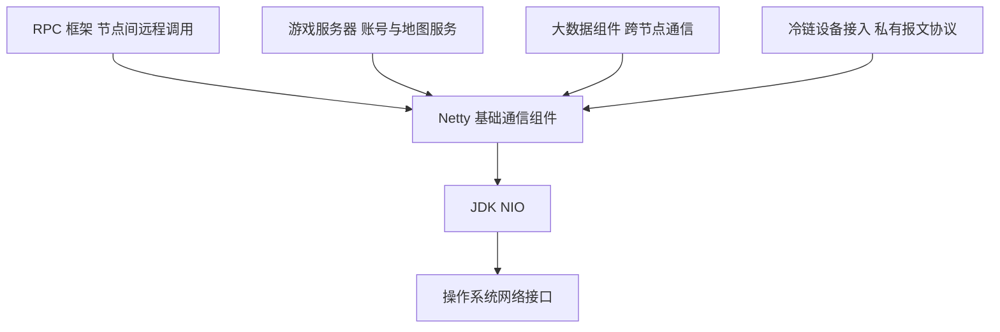

# Netty 的五个特点，与它垫在底下的那些场景

给冷链设备做接入服务，摆在面前的路有两条：用 JDK 原生 NIO 自己拼一套，或者选一个成熟框架。原生 NIO 的 API 繁琐与空轮询的坑，决定了自己拼这条路并不好走，Netty 就是在那个缺口上长出来的框架，几乎所有高性能网络程序都把它垫在底下。选它不是因为名声大，而是它的特点逐条对得上设备接入的痛点。

这堂课把 Netty 的五个特点拆开看，再扫一遍它撑起来的三类典型行业场景，最后回到冷链监控平台本身：设备接入为什么非它不选。

## 先给结论

- Netty 是对 JDK NIO 的封装，五个特点概括为：设计优雅、使用方便、高性能、安全、社区活跃。
- 异步事件驱动加可定制线程模型，是它扛高并发的架构底子；减少不必要的内存复制，是它省资源的细节保障。
- 阻塞与非阻塞 Socket 用统一 API 操作，传输类型可替换，业务代码不必绑死在某种 IO 实现上。
- RPC 框架、游戏服务器、大数据组件的节点间通信，底下大多垫着 Netty。
- 冷链设备接入选 Netty，看中私有协议定制、TCP 长连接与海量连接下的低资源消耗这三点。

## 一、五个特点，逐条对上接入服务的痛点

**设计优雅。** Netty 对阻塞与非阻塞 Socket 提供统一 API，适用于各种传输类型，也提供对无连接数据报套接字 UDP 的真正支持。事件模型灵活且可扩展，把「网络事件到达」与「业务如何响应」的关注点清晰分离；线程模型高度可定制，单线程、多线程、线程池随场景切换，同一套业务代码不用重写。

**使用方便。** 文档、用户指南与示例文件齐全，依赖少到只有 JDK 本身。随包示例工程的依赖清单可以作证，核心依赖就一个：

```xml
<dependencies>
    <!-- 整个示例工程只依赖 netty-all，不需要任何其他框架 -->
    <dependency>
        <groupId>io.netty</groupId>
        <artifactId>netty-all</artifactId>
        <version>4.1.10.Final</version>
    </dependency>
</dependencies>
```

引入依赖、写一个启动类，一个接入端口就能跑起来，入门成本比直接操作原生 NIO 低一个量级。

**高性能。** 吞吐量更高、延迟更低、资源消耗更少。来源常被归到两处：一是异步事件驱动的事件模型加可定制的线程模型，让少量线程伺候大量连接；二是零拷贝设计，减少不必要的内存复制。前者由 IO 模型与线程处理模型两部分原理支撑，后者体现在字节缓冲的搬运细节里，都是后文要拆的硬货。

**安全。** 完整的 SSL 与 TLS 支持，包括 StartTLS。设备上报的数据关联着仓储位置与企业经营信息，接入通道在生产环境里加密不是可选项，框架原生支持省去大量自研加密层的工作。

**社区活跃。** 版本迭代快，发现的 bug 能被及时修复，新功能持续合入。出了问题能查到大量现成案例，这一点在排障时的价值不亚于前四条。

## 二、垫在高性能程序底下的那个组件

Netty 最常见的出场方式不是直接当业务服务器，而是当基础通信组件。三类行业场景最有代表性。

**互联网行业。** 分布式系统各节点之间需要远程调用，高性能 RPC 框架往往把 Netty 作为基础通信组件。典型如 Dubbo，节点间通信走 Dubbo 协议，该协议默认用 Netty 实现各进程节点之间的内部通信。RPC 关心的是调用语义，底层报文怎么高效收发，交给 Netty。

**游戏行业。** 手游服务器端与大型网络游戏的开发里 Netty 应用广泛。它对 TCP、UDP、HTTP 都有支持，方便定制私有协议栈，账号登录服务器、地图服务器都可以建在它上面，高性能通信由框架兜底。

**大数据领域。** Hadoop 生态里高性能通信与序列化组件 Avro，其 RPC 框架用的就是 Netty，做跨节点通信；在大数据组件内部，基于 Netty 二次封装的通信层也常出现在各种服务之间。

把这些场景画在一张图上，层次一目了然：



关键路径：四类业务形态各异，但都停在 Netty 这一层，Netty 再落到 JDK NIO 与操作系统网络接口上。行业不同，底座相同。

这张图还能反过来读：要开发自己的服务器，用 Netty 定义好客户端与服务端的通讯协议，基于 TCP、UDP 或 HTTP 都能落地。冷链监控平台的接入服务就是这么干的。设备不会说 HTTP，报文是 SHT 开头、竖线分段、版本串结尾的私有文本格式，报文头、字段顺序、结尾校验都由设备厂商定义，Netty 对这种定制的支持几乎零阻力。

## 三、为什么冷链采集选 Netty

**第一，私有协议要顺手。** 设备报文是定长分隔的文本串，解析逻辑要挂在数据到达事件上。Netty 的处理器管线正好按事件组织代码，报文一到就进 `channelRead`，切分、还原实体、转发，一路写下来清晰。

**第二，长连接要扛得住。** 成千上万台设备常驻连接，一连接一线程的模式根本养不起。Netty 的线程模型用少量 IO 线程管理海量连接，连接数上涨时线程数不动，这一点是选型的决定性理由。

**第三，代码要薄。** 随包采集工程的服务端启动核心就这么多：

```java
// 接收连接与处理 IO 的两组线程池
EventLoopGroup boss = new NioEventLoopGroup();
EventLoopGroup worker = new NioEventLoopGroup();

ServerBootstrap bootstrap = new ServerBootstrap();
bootstrap.group(boss, worker)
        .channel(NioServerSocketChannel.class)   // NIO 通道类型
        .childHandler(new ChannelInitializer<SocketChannel>() {
            @Override
            protected void initChannel(SocketChannel ch) {
                ch.pipeline().addLast(new ServerHandler()); // 报文处理器
            }
        })
        .option(ChannelOption.SO_BACKLOG, 128)
        .childOption(ChannelOption.SO_KEEPALIVE, true);  // TCP 长连接保活

// 绑定 10010 端口，启动服务
ChannelFuture f = bootstrap.bind(10010).sync();
f.channel().closeFuture().sync();
```

十来行代码起一个生产级接入端口，`SO_KEEPALIVE` 配合设备心跳把长连接稳住，剩下的精力全花在报文解析与业务转发上。封装的价值就在这里：复杂度被框架吃掉，业务代码保持很薄。

## 常见误区

- **把 Netty 当应用服务器。** 错例是拿它与 Tomcat 类比，期待部署 war 包、自动管理请求生命周期。正解是 Netty 是网络通信框架，协议语义、报文格式、线程安排都要自己定义，它提供的是高性能收发能力。
- **认为用了 Netty 就自动高并发。** 错例是引入依赖就高枕无忧。正解是框架给的是线程模型与事件机制，处理器里塞一段同步慢逻辑，照样把 IO 线程拖死，高并发要靠模型与业务边界共同守住。
- **把零拷贝理解成完全不复制。** 错例是以为数据从网卡到业务对象一步到位。正解是零拷贝指减少不必要的内存复制，比如堆内与直接内存之间的反复搬运，该有的复制环节依然存在。
- **以为 Netty 依赖一堆中间件。** 错例是担心引入它会拖上消息队列或缓存。正解是核心依赖只有 netty-all 与 JDK，SSL/TLS、日志等按需引入，示例工程的依赖清单就是证明。

## 面试可能被问到的问题

1. 面试官追问：「Netty 有哪些主要特点？」
   答：设计优雅，阻塞与非阻塞 Socket 统一 API、事件模型灵活可扩展、线程模型高度可定制、支持无连接 UDP；使用方便，文档示例齐全、只依赖 JDK；高性能，高吞吐低延迟低资源消耗、减少不必要的内存复制；安全，完整支持 SSL/TLS 与 StartTLS；社区活跃，迭代快、修复及时。
2. 面试官追问：「为什么说 Netty 是异步事件驱动的？」
   答：它把网络交互抽象成事件，连接建立、数据可读、可写都是事件，由事件模型统一派发给处理器响应，线程不会被某一条连接阻塞等待，事件到达即处理，这就是异步事件驱动的核心。
3. 面试官追问：「举几个把 Netty 当基础通信组件的例子。」
   答：RPC 领域如 Dubbo，节点间通信默认走 Netty 实现；游戏行业的账号登录、地图等服务器用它定制私有协议栈；大数据领域 Avro 的 RPC 框架基于 Netty 做跨节点通信。共同点是行业不同、底座相同。
4. 面试官追问：「设备接入为什么选 Netty 而不是 Tomcat？」
   答：设备走 TCP 私有报文长连接，不是 HTTP 请求响应语义，Tomcat 面向 HTTP 且连接管理按请求计；Netty 原生支持自定义协议、长连接保活与海量并发连接管理，线程模型还能按连接规模定制，所以接入层选 Netty。
5. 面试官追问：「Netty 的高性能来自哪里？」
   答：宏观上是两个车轮，IO 模型决定数据如何收发，采用多路复用让少量线程服务大量连接；线程处理模型决定数据如何处理，采用主从 Reactor 多线程分工。细节上还有零拷贝减少内存复制、可定制线程模型按需伸缩。

## 配套资料

- 代码：`materials/code/06/day3 数据采集服务/`，随包示例工程 `nettydemo` 的依赖清单仅含 `io.netty:netty-all`，服务端、客户端与处理器各有完整实现；采集工程 `cold-netty` 提供 `NettyServer` 启动类与报文处理器 `ServerHandler`、Kafka 发送器 `KafkaSender`，均为真实随包代码。
- 说明：引用路径截至 `materials/code/06/` 的 day 目录层级；XML 依赖片段与 Java 启动代码按随包工程摘录，包名统一改写为 `com.study.coldchain`；特点归纳与三类行业场景按本课讲解整理，零拷贝解释结合主流知识补写。
