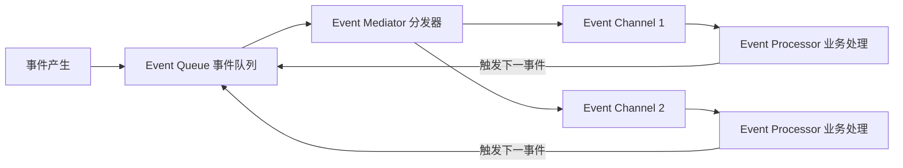
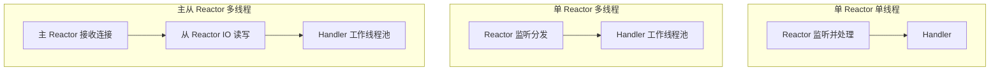

# 线程处理模型：从事件驱动到主从 Reactor

IO 模型解决了数据怎么进来，下一个问题是进来的数据由谁、按什么节奏处理。同一个监听端口，同样的连接量，线程怎么分工，性能能差出一个量级。报文读进来怎么存、怎么解码、解码后怎么分发，每一步落在哪种线程上，都是线程处理模型要回答的事。这堂课从事件驱动模型说起，过 Reactor 模式的两个角色与三种变种，最后落到 Netty 的主从 Reactor 多线程模型，以及冷链采集服务里 boss 与 worker 的实际分工。

## 先给结论

- 事件驱动是把「跑去问结果」换成「处理完被通知」，四个基本组件：事件队列、分发器、事件通道、事件处理器。
- Reactor 模式是多路复用加统一分发，两个关键角色：Reactor 负责监听与分发，Handler 负责执行非阻塞的处理逻辑。
- 按 Reactor 数量与线程数量分三种变种：单 Reactor 单线程、单 Reactor 多线程、主从 Reactor 多线程。
- Netty 采用主从 Reactor 多线程的改良版：主 Reactor 管接收，从 Reactor 管 IO 读写，业务重活入队交给工作线程。
- 反映到代码就是 boss 与 worker 两个 EventLoopGroup，boss 接连接，worker 干 IO 与轻量处理。

## 一、事件驱动：从「跑去问」到「等着叫」

提交材料给某个政府部门办理，怎么知道事情办完了？两种方式。轮询是每隔一段时间跑去问一次：办好了吗？没好，过几天再问。事件驱动是留个电话，对方办完主动通知你来取。轮询把等待成本压在发起方，事件驱动把发起方从等待里解放出来，只在通知到达时才投入动作。

服务端的事件驱动是同一套思路的经典图：事件产生后进入事件队列，分发器把事件分发到不同的事件通道，各通道的事件处理器执行实际业务，处理完再发出新事件触发下一步操作。



关键路径：事件先排队，分发器统一派发，通道各接各的，处理器干完活还能触发新事件，闭环就形成了。拆开看是四个基本组件：事件队列负责收容，分发器负责派发，事件通道负责分类，事件处理器负责真正干活。

## 二、Reactor：多路复用之上的统一分发

Reactor 模式，中文叫反应堆模式，是事件驱动思想在服务端的工程化：一个或多个输入同时传给服务处理器，服务器把多路请求同步分发给对应的处理线程。它本质上是事件驱动，但做了关键优化：用 IO 多路复用统一监听事件，收到事件后统一分发，所以也叫 Dispatcher 模式。这套统一监听、统一分发的组合，是编写高性能网络服务器的基石技术。

两个关键组成各司其职：

- **Reactor。** 在单独的线程中运行，负责监听客户端提交的请求，并把事件分发给合适的 Handler 处理。像电话公司的接线员：接听来电，把线路转给合适的联系人。
- **Handler。** 事件处理程序，对 IO 事件做反应，执行非阻塞的操作，相当于客户真正要谈事的公司职员。

按 Reactor 的数量与处理线程的数量组合，Reactor 模型有三种变种：



三种变种的差异一目了然：第一种全在一个线程里，监听与处理互相牵制；第二种把重活交给线程池，监听不再被业务拖住；第三种再把监听拆成主从两层，接收与 IO 读写各归其位。

## 三、Netty 的答案：主从改良版

Netty 在主从 Reactor 多线程模型基础上做了修改与封装。主 Reactor 只做一件事：接收客户端请求；然后把连接转移给从 Reactor，一对一或一对多；从 Reactor 负责通道管理与 IO 读写；非 IO 的工作，也就是具体的业务处理逻辑，写入队列，等待工作线程执行处理。

主 Reactor 挡在最前面，等于在客户端与 IO 处理之间加了一层隔离，客户端请求能被更快受理，这是它响应快的根本原因。对应到 Netty 的组件名：主 Reactor 是 boss 线程组里的 EventLoop，从 Reactor 是 worker 线程组里的 EventLoop；NioEventLoop 内部聚合了 Selector，IO 事件的监听与执行都发生在它身上。

随包采集工程的启动类就是这套模型的直接落地：

```java
// 接收连接请求的线程组，对应主 Reactor
EventLoopGroup boss = new NioEventLoopGroup();
// 处理具体 IO 工作的线程组，对应从 Reactor
EventLoopGroup worker = new NioEventLoopGroup();

ServerBootstrap bootstrap = new ServerBootstrap();
bootstrap.group(boss, worker);
bootstrap.option(ChannelOption.SO_BACKLOG, 128);          // 连接排队容量
bootstrap.childOption(ChannelOption.SO_KEEPALIVE, true);  // 长连接保活
bootstrap.channel(NioServerSocketChannel.class);
bootstrap.childHandler(new ChannelInitializer<SocketChannel>() {
    @Override
    protected void initChannel(SocketChannel socketChannel) throws Exception {
        socketChannel.pipeline().addLast(new ServerHandler());
    }
});

// 绑定 10010 端口、启动服务，退出时两组线程各自优雅关闭
ChannelFuture f = bootstrap.bind(10010).sync();
f.channel().closeFuture().sync();
```

`group(boss, worker)` 一行就把主从两个 Reactor 都指定了，监听与 IO 各走各的线程组。

## 四、落到采集服务：boss 与 worker 的分工边界

采集服务的链路里，设备报文进来后要解析成实体、转 JSON、投递消息队列、给硬件回写应答，这些活全部发生在 worker 的 EventLoop 线程里。随包工程的报文处理器：

```java
@Override
public void channelRead(ChannelHandlerContext ctx, Object msg) {
    ByteBuf in = (ByteBuf) msg;
    try {
        // 接收报文：字节转文本，SHT 开头竖线分段的私有格式
        byte[] req = new byte[in.readableBytes()];
        in.readBytes(req);
        String body = new String(req, "UTF-8");

        // 解析报文：还原实体再转 JSON
        MessageEntity message = this.parseMessage(body);
        String jsonString = JSON.toJSONString(message);

        // 发送至 Kafka 队列
        KafkaSender sender = (KafkaSender) SpringContextUtils.getBean("kafkaSender");
        sender.send(MSG_TOPIC, jsonString);

        // 向硬件回送响应
        ByteBuf buf = ctx.alloc().buffer();
        buf.writeBytes("SHT|true|\0".getBytes());
        ctx.writeAndFlush(buf);
    } catch (Exception e) {
        logger.error(e.getMessage());
    } finally {
        // ByteBuf 用完主动释放，否则内存一直在占用，容易泄漏
        ReferenceCountUtil.release(msg);
    }
}
```

这段代码运行在 worker 的 EventLoop 线程里。解析与一次消息投递都是轻量操作，放在 EventLoop 里没有问题；真正的边界在耗时上：凡是明显耗时的操作，批量写库、复杂计算、调用慢下游，都要移出 EventLoop，交给独立的业务线程池，否则一个慢报文会拖住这个 EventLoop 背后成百上千条连接的处理节奏。课程线程模型图里专门画了 Thread Pool 与排队任务，指的就是这条业务出口。

boss 与 worker 的分工可以用一句话记：boss 是前台，只负责把客人领进门；worker 是服务生，负责点单上菜。前台通常一个线程就够，因为一个端口同时只有一次 accept；worker 数量与 CPU 核数挂钩，盲目加大只会增加上下文切换。

## 常见误区

- **把耗时业务压进 EventLoop。** 错例是在 `channelRead` 里直接同步调用数据库或慢接口。正解是 IO 线程只做收发与快速解析，重活交给业务线程池，保持 EventLoop 的每次执行都短促。
- **以为 handler 慢只影响当前连接。** 错例是认为一个连接的处理器慢无所谓。正解是一个 EventLoop 线程服务大量连接，一个慢处理会拖累它名下所有连接，隔离不是无限保险。
- **忘记释放 ByteBuf。** 错例是处理完不释放引用计数，靠 GC 兜底却等不来回收。正解是在 finally 里调用 `ReferenceCountUtil.release(msg)`，随包代码的注释专门点明了这条。
- **以为线程组越大越好。** 错例是 boss、worker 都开几十个线程图个心安。正解是 boss 一个线程足够监听一个端口，worker 按核数取默认值，线程多了上下文切换反而吃掉吞吐。

## 面试可能被问到的问题

1. 面试官追问：「事件驱动和轮询有什么区别？」
   答：轮询由发起方反复查询结果，等待成本在发起方；事件驱动由处理方完成后主动通知，发起方在通知到达前可以去做别的事。服务端采用事件驱动后，线程不再为某条连接空转等待，而是按事件到来即处理。
2. 面试官追问：「Reactor 模式的两个关键角色是什么？」
   答：Reactor 在单独线程中运行，监听客户端请求并把事件分发给合适的处理器，像接线员；Handler 对 IO 事件做反应，执行非阻塞操作，像实际办事的职员。多路复用统一监听、收到后统一分发，所以 Reactor 模式也叫 Dispatcher 模式。
3. 面试官追问：「三种 Reactor 变种的区别在哪？」
   答：区分维度是 Reactor 数量与处理线程数量。单 Reactor 单线程全部工作在一个线程里，监听与业务互相牵制；单 Reactor 多线程把业务交给工作线程池，监听不再被拖住；主从 Reactor 多线程再把监听拆成主从两层，主管接收、从管 IO 读写，伸缩性最好。
4. 面试官追问：「Netty 的线程模型是怎么改良主从 Reactor 的？」
   答：主 Reactor 只负责接收连接并转移给从 Reactor，从 Reactor 管理通道与 IO 读写，非 IO 的业务逻辑写入队列交工作线程执行。主从之间多出的隔离层让客户端请求被更快受理，事件驱动加 Reactor 加改良分工，共同构成 Netty 的高并发能力。
5. 面试官追问：「boss 与 worker 各干什么？boss 为什么一般只要一个线程？」
   答：boss 对应主 Reactor，负责 accept 新连接；worker 对应从 Reactor，负责已建立连接的读写与处理器执行。一个监听端口同一时刻只有一次 accept，boss 一个线程足够；worker 按 CPU 核数取默认值，多了反而增加上下文切换。
6. 面试官追问：「处理器里有耗时操作怎么办？」
   答：默认情况下业务处理运行在 worker 的 EventLoop 线程里，轻量逻辑可以直接做；耗时操作要移交给独立业务线程池异步执行，EventLoop 立即返回继续服务其他通道，必要时通过队列回传结果再响应客户端。

## 配套资料

- 代码：`materials/code/06/day3 数据采集服务/`，采集工程 `cold-netty` 的 `NettyServer` 启动类（boss 与 worker 双线程组、SO_KEEPALIVE）与报文处理器、Kafka 发送器 `KafkaSender` 为真实随包代码；示例工程另有 Netty 版 `Server`、`ServerHandler`、`Client`、`ClientHandler` 可对照学习。
- 说明：引用路径截至 `materials/code/06/` 的 day 目录层级，包名统一改写为 `com.study.coldchain`；启动类与处理器代码按真实工程摘录并省略日志等次要语句；事件驱动四组件、Reactor 三变种与工作线程池出口的衔接说明按本课画面与讲解整理。
