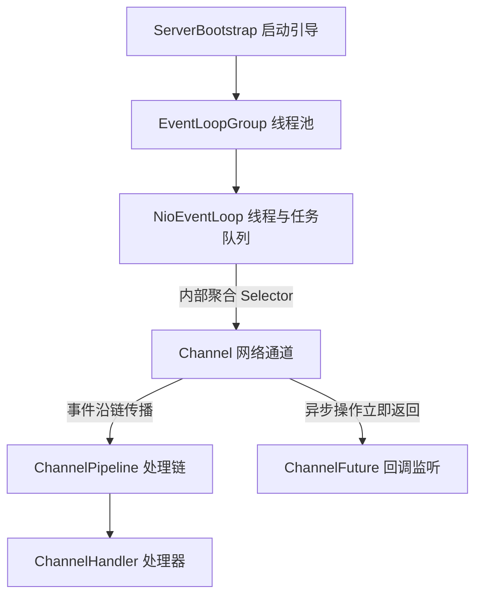

# Netty 核心类逐个拆：Bootstrap、Channel、EventLoopGroup 各管哪一段

看任何一份 Netty 示例代码，几乎都会同时蹦出 Bootstrap、EventLoopGroup、Channel、ChannelHandler、ChannelFuture 这几个名字。它们之间的分工没理清，代码就只能照抄不能改。这堂课按职责把 Netty 的核心类逐个拆开讲，读完再回头看示例工程，每一行都能对上号，包括冷链监控平台采集服务里那几段装配代码。

## 先给结论

- Bootstrap 与 ServerBootstrap 是启动引导类，负责配置整个 Netty 程序、串联各个组件；客户端用 Bootstrap，服务端用 ServerBootstrap。
- Netty 基于 Selector 实现 IO 多路复用，一个线程可以监听多个 Channel 的事件，这是高并发的底座。
- Channel 是网络 IO 的操作入口：查状态、配参数、发起异步 IO 操作，异步调用立即返回一个 ChannelFuture。
- NioEventLoop 维护一个线程和任务队列，IO 任务与非 IO 任务按 ioRatio 分配执行时间，默认各占 50%；NioEventLoopGroup 管理一组 EventLoop，可以理解为线程池。
- ChannelHandler 处理 IO 事件或拦截 IO 操作，并沿 ChannelPipeline 传给下一个处理器；Future 与 ChannelFuture 是异步结果的回调监听入口。

## 一、Bootstrap 与 ServerBootstrap：一切从引导开始

Bootstrap 意思是引导。一个 Netty 应用通常由一个 Bootstrap 开始，它的主要作用是配置整个 Netty 程序，把线程组、通道类型、处理器这些组件串联起来。可以把它理解成一张装配单：程序怎么起、用几个线程、收到数据交给谁，都先写在这张单子上；bind 或 connect 被调用之前随便改，调完之后这张装配单就生效了。

Netty 里这个角色有两个类：Bootstrap 是客户端程序的启动引导类，ServerBootstrap 是服务端启动引导类。服务端要多管一件接收连接的事，所以类名前多了 Server，内部配置项也比客户端多一层。

## 二、Selector：一个线程盯住一批通道

Netty 基于 Selector 对象实现 IO 多路复用：通过 Selector，一个线程可以监听多个连接的 Channel 事件。向 Selector 注册 Channel 之后，其内部机制会自动不断地查询（select）这些注册的 Channel 是否有就绪的 IO 事件，例如可读、可写、网络连接完成等。这样程序就可以用一个线程高效地管理多个 Channel，而不是一条连接养一个线程。

Selector 在 Netty 里不是一个需要单独 new 的组件，它被聚合进了 NioEventLoop 内部，注册动作由 Netty 自己完成，开发者感知不到它的存在，只管写处理器。这是下一节 EventLoop 的前置知识。

## 三、Channel：网络 IO 的操作入口

Channel 是 Netty 网络通信的组件，用于执行网络 IO 操作。它为使用者提供四类能力：

1. **通道状态。** 当前网络连接的通道处于什么状态，例如是否打开、是否已连接。
2. **配置参数。** 网络连接的配置参数可以直接在 Channel 上设置，例如接收缓冲区大小。
3. **异步的网络 IO 操作。** 建立连接、读写、绑定端口都属于这一类。异步调用意味着任何 IO 调用都立即返回，并且不保证在调用返回时所需的 IO 操作已经完成。
4. **返回 ChannelFuture。** 调用立即返回一个 ChannelFuture 实例，往上面注册监听器，IO 操作成功、失败或取消时都会回调通知调用方。

不同协议、不同阻塞类型的连接都有不同的 Channel 类型对应，常用的有这几类：

| Channel 类型 | 用途 |
| --- | --- |
| NioSocketChannel | 异步的客户端 TCP Socket 连接 |
| NioServerSocketChannel | 异步的服务器端 TCP Socket 连接 |
| NioDatagramChannel | 异步的 UDP 连接 |
| NioSctpChannel | 异步的 Sctp 连接 |
| NioSctpServerChannel | 异步的 Sctp 服务器端连接 |

这些通道涵盖了 UDP、TCP 网络 IO 以及文件 IO。冷链监控平台的服务端监听用 NioServerSocketChannel，设备侧发起连接用 NioSocketChannel，正是前两行。

## 四、NioEventLoop 与 NioEventLoopGroup：线程与线程池

NioEventLoop 中维护了一个线程和一个任务队列，支持异步提交执行任务。线程启动时会调用 NioEventLoop 的 run 方法，执行两类任务：

- **IO 任务。** 即 selectionKey 中就绪的事件，如 accept、connect、read、write，由 processSelectedKeys 方法触发。
- **非 IO 任务。** 添加到 taskQueue 里的任务，如 register、bind 这类逻辑处理任务，由 runAllTasks 方法触发。

两类任务的执行时间比由变量 ioRatio 控制，默认为 50，表示分配给 IO 任务的时间与非 IO 任务相等。

NioEventLoopGroup 主要管理 EventLoop 的生命周期，可以理解为一个线程池：内部维护了一组线程，每个线程（一个 NioEventLoop）负责处理多个 Channel 的事件，而一个 Channel 只对应于一个线程。后半句是排查问题的钥匙：同一条连接上的事件永远在同一个线程里串行执行，处理器里不加锁也不会乱序；反过来也意味着一个慢处理器会拖住它名下所有连接。

## 五、ChannelHandler 与 ChannelPipeline：事件由谁处理

ChannelHandler 是一个接口，作用是处理 IO 事件或拦截 IO 操作，并转发到 ChannelPipeline（业务处理链）中的下一个处理器。接口只定骨架，具体逻辑要写实现类，复写 channelRead、channelReadComplete、exceptionCaught 这类回调方法。多个 Handler 按加入顺序串成一条链，数据进来像过流水线：解码的管解码，业务的管业务，谁也不挤在一步里做完。

处理器方法里都会带一个 `ctx` 参数，它就是 ChannelHandlerContext，处理器在链上的上下文句柄：拿它写数据、刷缓冲、关连接都行，后面服务端与客户端的示例代码里会反复用到。

## 六、Future 与 ChannelFuture：异步结果怎么拿

Netty 中所有的 IO 操作都是异步的，不能立刻得知消息是否被正确处理。想拿到结果有两条路：监听等待执行完成，或者直接注册一个监听器。具体实现就是 Future 与 ChannelFuture，操作执行成功或失败时，注册的监听事件会自动触发。

用办事来类比：把材料交给某个部门处理，处理完对方要通知你，就得提前把电话号码留给对方。这个电话号码就是注册到 ChannelFuture 上的监听器，事情办成办不成，电话都会打过来，省得自己一趟趟跑去问。

## 七、一张图串起六组类

这张图讲的是核心类在程序里的装配与事件走向。



关键路径：引导类把线程池、通道、处理器串起来；真正的 IO 事件由 NioEventLoop 里的 Selector 监听到，再沿 ChannelPipeline 交给 ChannelHandler；每一次异步调用都会留下一个 ChannelFuture 供回调确认。

把这些名字对回代码，随包示例工程的启动骨架是这样的，每一行都对应前面一个小节：

```java
// ServerBootstrap：启动引导，负责串联下面所有组件
ServerBootstrap bootstrap = new ServerBootstrap();
// EventLoopGroup：线程池，boss 收连接，worker 干 IO
EventLoopGroup boss = new NioEventLoopGroup();
EventLoopGroup worker = new NioEventLoopGroup();
bootstrap.group(boss, worker)
        // Channel：指定通道类型
        .channel(NioServerSocketChannel.class)
        // ChannelHandler：业务逻辑挂上处理链
        .childHandler(new ChannelInitializer<SocketChannel>() {
            @Override
            protected void initChannel(SocketChannel ch) throws Exception {
                ch.pipeline().addLast(new ServerHandler());
            }
        });
// ChannelFuture：bind 是异步调用，立即返回一个 future
ChannelFuture f = bootstrap.bind(10010).sync();
```

异步结果除了 `sync()` 阻塞等待，更 Netty 风格的用法是挂监听器：

```java
// 监听器写法为按本课写法补全的示例
f.addListener(future -> {
    if (future.isSuccess()) {
        System.out.println("端口绑定成功");
    } else {
        System.out.println("端口绑定失败：" + future.cause());
    }
});
```

六组类各司其职地咬合起来，才撑起了 Netty 的高并发能力：Selector 撑起一个线程管多条连接，EventLoopGroup 撑起多线程分摊，Handler 链撑起逻辑分层，ChannelFuture 撑起异步不阻塞。

## 常见误区

- **把启动引导类当成连接对象用。** 错例是拿着 ServerBootstrap 去 connect，或者拿 Bootstrap 去 bind 服务端口。正解是引导类只负责装配，客户端连接调 Bootstrap 的 connect，服务端监听调 ServerBootstrap 的 bind。
- **以为一条 Channel 会被多个线程处理。** 错例是给处理器里的共享变量加锁，怕并发乱序。正解是一个 Channel 的所有事件固定由一个 NioEventLoop 线程串行处理，单连接内不需要锁；真正要同步的是多个 Channel 共享的数据。
- **想自己 new Selector 注册通道。** 错例是照着 NIO 的写法在业务代码里开 Selector、注册 Channel。正解是 NioEventLoop 内部已经聚合 Selector，注册由 Netty 完成，开发者只写 Handler。
- **把异步当同步写。** 错例是调完 bind 立刻假设端口已就绪。正解是异步调用立即返回，要么 sync 等待完成，要么注册 ChannelFuture 监听器回调确认，两种方式选一种。

## 面试可能被问到的问题

1. 面试官追问：「Netty 的核心组件有哪些，各自什么职责？」
   答：Bootstrap 与 ServerBootstrap 负责启动引导与组件装配；Selector 实现 IO 多路复用；Channel 是网络 IO 的入口，提供通道状态、配置参数与异步 IO 操作；NioEventLoop 维护线程和任务队列并聚合 Selector；NioEventLoopGroup 管理一组 EventLoop，相当于线程池；ChannelHandler 承载业务逻辑并沿 ChannelPipeline 传播；Future 与 ChannelFuture 负责异步结果的回调监听。
2. 面试官追问：「Channel 提供了哪些能力？」
   答：四类：当前网络连接的通道状态，如是否打开、是否已连接；网络连接的配置参数，如接收缓冲区大小；异步的网络 IO 操作，如建立连接、读写、绑定端口，调用立即返回；立即返回一个 ChannelFuture 实例，注册监听器可在操作成功、失败或取消时得到回调。
3. 面试官追问：「NioEventLoop 里都跑些什么？ioRatio 是干什么的？」
   答：NioEventLoop 的 run 方法执行两类任务：IO 任务是 selectionKey 中就绪的事件，如 accept、connect、read、write，由 processSelectedKeys 触发；非 IO 任务是 taskQueue 里的任务，如 register、bind，由 runAllTasks 触发。ioRatio 控制两类任务的执行时间比，默认 50，即各占一半。
4. 面试官追问：「一个 Channel 会被几个线程处理？」
   答：一个 Channel 只对应一个 NioEventLoop 线程，生命周期内的所有事件都在这一个线程里串行执行；反过来一个 EventLoop 线程会服务多个 Channel。这保证了单连接内无需加锁，也解释了为什么处理器里不能放耗时任务。
5. 面试官追问：「Netty 的 IO 操作是异步的，结果怎么拿？」
   答：调用立即返回一个 ChannelFuture，两种方式拿结果：调 sync 阻塞等待完成，或注册监听器，操作成功、失败、取消时自动回调。服务常驻场景更推荐监听器方式，让调用线程不被挡住。
6. 面试官追问：「ChannelHandler 和 ChannelPipeline 是什么关系？」
   答：ChannelHandler 是处理 IO 事件或拦截 IO 操作的接口，具体逻辑写在实现类里；ChannelPipeline 是业务处理链，把多个 Handler 按顺序串起来，事件进来后依次传播，每个处理器做完自己的事再交给下一个，处理器上下文 ChannelHandlerContext 负责在链上读写与转发。

## 配套资料

- 代码：`materials/code/06/day3 数据采集服务/`，示例工程 nettydemo 的 `Server`、`ServerHandler`、`Client`、`ClientHandler` 与 `pom.xml`（依赖 io.netty:netty-all:4.1.10.Final）为真实随包代码；采集工程 `cold-netty` 的 `NettyServer` 与 `ServerHandler` 可对照核心类的实际用法。
- 说明：引用路径截至 `materials/code/06/` 的 day 目录层级，包名统一改写为 `com.study.coldchain`；ChannelFuture 监听器一小段为按本课写法补全的示例，其余组件职责与 ioRatio 默认值等细节按本课讲解与真实代码整理。
