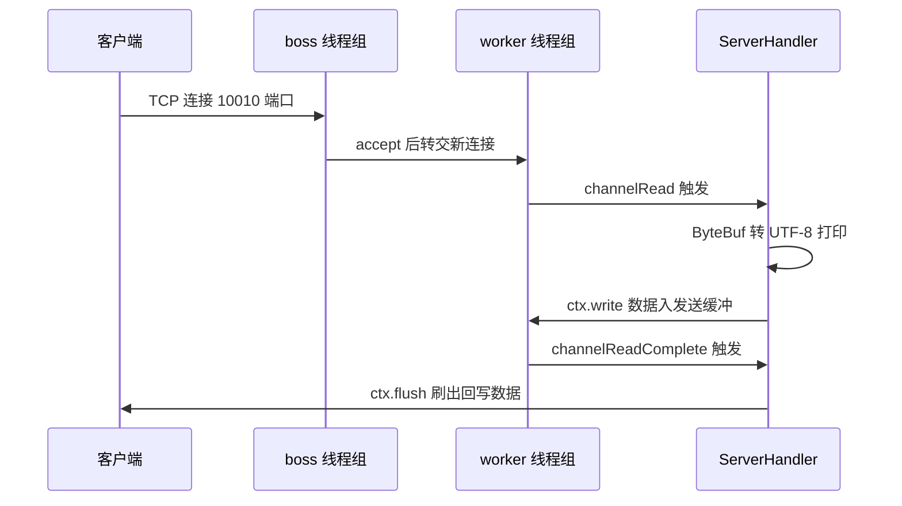

# Netty 服务端实战：从空 Maven 工程到 10010 端口跑起来

IO 模型、线程模型、核心类、开发步骤都铺完之后，这一节把所有积木拼成一个能跑的服务端：一个空 Maven 工程、一个依赖、两个类，监听 10010 端口，把客户端发来的数据打印并回写。代码全部来自随包示例工程，可以边读边对照，冷链监控平台采集服务的启动类也是同一套骨架。

## 先给结论

- 一个 Netty 服务端的最小实现只要两样：一个 Server 启动类加一个 ServerHandler 处理器，依赖只有一个 io.netty:netty-all。
- 启动类干五件事：定义 boss 与 worker 两个 NioEventLoopGroup、new ServerBootstrap、装配 group/channel/childHandler 与两个 option、bind 端口并 sync、finally 里优雅关闭线程组。
- 处理器继承 ChannelInboundHandlerAdapter，复写 channelRead、channelReadComplete、exceptionCaught 三个方法就够用。
- SO_BACKLOG 配在 option 上管监听通道的连接排队，SO_KEEPALIVE 配在 childOption 上管每条连接的长连接保活，层级不能混。
- bind 返回 ChannelFuture，sync 等绑定完成，closeFuture 的 sync 让服务常驻，这两个 sync 是服务不闪退的关键。

## 一、工程与依赖

新建一个普通 Maven 工程，pom 里只加一个依赖：

```xml
<dependencies>
    <dependency>
        <groupId>io.netty</groupId>
        <artifactId>netty-all</artifactId>
        <version>4.1.10.Final</version>
    </dependency>
</dependencies>
```

netty-all 把核心类一课提到的 ServerBootstrap、Channel、Handler 等类全部打包在内。依赖就位后打开这个 jar，能直接找到 ServerBootstrap 与 Bootstrap 这一对启动类，说明服务端、客户端两套引导都在同一个包里，不用再引别的。

## 二、Server 启动类：逐行对五步

```java
package com.study.coldchain.netty.demo.netty;

import io.netty.bootstrap.ServerBootstrap;
import io.netty.channel.ChannelFuture;
import io.netty.channel.ChannelInitializer;
import io.netty.channel.ChannelOption;
import io.netty.channel.EventLoopGroup;
import io.netty.channel.nio.NioEventLoopGroup;
import io.netty.channel.socket.SocketChannel;
import io.netty.channel.socket.nio.NioServerSocketChannel;

public class Server {
    private int port;

    public Server(int port) {
        this.port = port;
    }

    public static void main(String[] args) throws Exception {
        new Server(10010).run();
    }

    public void run() throws Exception {
        //1. netty 辅助的启动类
        ServerBootstrap bootstrap = new ServerBootstrap();

        //2. 定义线程池
        //线程池，用来处理接收连接请求的线程池
        EventLoopGroup boss = new NioEventLoopGroup();
        //线程池，用来处理具体的工作
        EventLoopGroup worker = new NioEventLoopGroup();

        //3. 设置启动类的属性
        bootstrap.group(boss, worker)
                .channel(NioServerSocketChannel.class)
                .childHandler(new ChannelInitializer<SocketChannel>() {

                    @Override
                    protected void initChannel(SocketChannel socketChannel) throws Exception {
                        //注册 handler
                        socketChannel.pipeline().addLast(new ServerHandler());
                    }
                })
                .option(ChannelOption.SO_BACKLOG, 128)
                .childOption(ChannelOption.SO_KEEPALIVE, true);
        try {
            //4. 绑定端口
            ChannelFuture f = bootstrap.bind(port).sync();
            f.channel().closeFuture().sync();
        } finally {
            boss.shutdownGracefully();
            worker.shutdownGracefully();
        }
    }
}
```

**端口与入口。** 成员变量 port 配一个构造函数，创建 Server 实例时把端口传进来。启动入口在 main：`new Server(10010).run()`，监听 10010 端口。run 这个名字不是必须的，叫 start 也行，但要一眼能看出是启动方法。main 与 run 都要往上抛 Exception，bind、sync 这类方法声明了受检异常，不抛编译不过，写的时候 IDE 会直接标红提醒。

**两个线程组。** boss 是接收连接请求的线程组，worker 是干具体活的线程组，对应主从 Reactor 的两个角色：新连接由 boss accept 下来，之后的读写全交给 worker。

**装配属性。** `group(boss, worker)` 把两个线程组挂上；`channel(NioServerSocketChannel.class)` 指定通道类型为服务端 TCP 通道；`childHandler` 里 new 一个 ChannelInitializer，复写 initChannel，在里面把 ServerHandler 注册到该连接的 pipeline，处理器与引导类就在这一行建立了关联。

**两个 option。** `option(ChannelOption.SO_BACKLOG, 128)` 设置通道队列的长度，也就是连接排队的容量，128 是经验值，设成 256 或其他数字都行，量大可以调大；`childOption(ChannelOption.SO_KEEPALIVE, true)` 保持长连接。注意两者挂的层级不一样：SO_BACKLOG 作用于监听通道所以用 option，SO_KEEPALIVE 作用于每条新建立的连接所以用 childOption。

**绑定与收尾。** `bind(port).sync()` 把端口绑定起来，sync 让当前线程等到绑定动作真正完成；`f.channel().closeFuture().sync()` 从 future 拿到通道，等它关闭，主线程停在这一行，服务因此常驻不退出；finally 里对 boss、worker 各调一次 shutdownGracefully，程序退出时两组线程优雅关闭。

## 三、ServerHandler：三个回调方法

```java
package com.study.coldchain.netty.demo.netty;

import io.netty.buffer.ByteBuf;
import io.netty.channel.ChannelHandlerContext;
import io.netty.channel.ChannelInboundHandlerAdapter;
import io.netty.util.CharsetUtil;

public class ServerHandler extends ChannelInboundHandlerAdapter {

    @Override
    public void channelRead(ChannelHandlerContext ctx, Object msg) throws Exception {
        ByteBuf buf = (ByteBuf) msg;
        System.out.println("服务端接收：" + buf.toString(CharsetUtil.UTF_8));
        ctx.write(buf);
    }

    @Override
    public void channelReadComplete(ChannelHandlerContext ctx) throws Exception {
        ctx.flush();
    }

    @Override
    public void exceptionCaught(ChannelHandlerContext ctx, Throwable cause) throws Exception {
        ctx.close();
    }
}
```

**channelRead。** 通道里来数据就触发。参数 msg 是 ByteBuf，Netty 的字节容器，先强转，再用 `buf.toString(CharsetUtil.UTF_8)` 按 UTF-8 解码成字符串打印；随后 `ctx.write(buf)` 通过上下文把数据往回写，写进发送缓冲但还不发出去。这个 ctx 是 ChannelHandlerContext，处理器在链上的上下文句柄，读写、刷缓冲、关连接都通过它。

**channelReadComplete。** 一批数据读完时触发，这里只做一件事：`ctx.flush()` 把缓冲里攒着的数据真正刷出去。write 与 flush 拆成两步是常见手法，攒一批刷一次，减少系统调用。

**exceptionCaught。** 读取出现异常时触发，示例里直接 `ctx.close()` 关掉这条连接，坏连接不挂着占资源。

这个处理器没做任何业务加工，收什么回什么，是一个回声服务，正好用来验证链路通不通。冷链采集服务的真实处理器在同一个位置做报文解析、投递 Kafka、回写应答，骨架一模一样。

## 四、启动流程串起来看

这张时序图讲的是从客户端发起连接到收到回写的完整路径。



关键路径：连接进 boss，数据走 worker，处理器只在 worker 线程里被回调；打印与回写在 channelRead 完成，真正出网要等 channelReadComplete 里的 flush。

## 常见误区

- **bind 完不等结果就往下走。** 错例是 `bootstrap.bind(port);` 之后直接打印启动完成。正解是 bind 返回 ChannelFuture，绑定是异步的，要 `sync()` 等它真正完成，否则端口可能还没绑上主线程就继续跑了。
- **option 与 childOption 配反。** 错例是把 SO_KEEPALIVE 写进 option。正解是 option 作用于监听通道（如 SO_BACKLOG），childOption 作用于 accept 出来的连接通道（如 SO_KEEPALIVE），配反了参数落错对象。
- **只 write 不 flush。** 错例是 channelRead 里 write 完就不管，客户端永远等不到回写。正解是 flush 负责真正出网，示例把它放在 channelReadComplete 里；数据量小或要即时响应时用 writeAndFlush 一步到位。
- **exceptionCaught 里什么都不做。** 错例是空着或只打印一句日志。正解是至少 close 掉出问题的连接，防止异常连接长期占用线程与内存。

## 面试可能被问到的问题

1. 面试官追问：「描述一下 Netty 服务端的启动流程？」
   答：定义 boss 与 worker 两个 NioEventLoopGroup；创建 ServerBootstrap；装配 group、channel（NioServerSocketChannel）、childHandler（ChannelInitializer 里注册处理器）以及 option 与 childOption；bind 端口并 sync 等待完成；closeFuture 的 sync 阻塞常驻，finally 里对两个线程组 shutdownGracefully 优雅关闭。
2. 面试官追问：「SO_BACKLOG 是什么？配在哪一级？」
   答：它是监听通道的连接排队容量，服务端 accept 不过来时新连接先在队列里等，示例设为 128，也可按并发量调大。它属于监听通道的参数，所以配在 ServerBootstrap 的 option 上，而不是 childOption。
3. 面试官追问：「channelRead 里的 msg 是什么？怎么取内容？」
   答：默认是 ByteBuf，Netty 的引用计数字节容器。强转后用 buf.toString(CharsetUtil.UTF_8) 这类方法按指定字符集解码；如果链路上配了解码器，msg 也可能已经是业务对象，按实际类型处理。
4. 面试官追问：「write 与 writeAndFlush 有什么区别？」
   答：write 只把数据放入发送缓冲区，flush 才触发真正写出；writeAndFlush 是两步合一。示例把 write 放在 channelRead、flush 放在 channelReadComplete，一批数据读完统一刷出；要即时响应时用 writeAndFlush 更直接。
5. 面试官追问：「initChannel 什么时候被调用？」
   答：新连接建立、通道初始化时由 Netty 回调，每条连接调一次，作用是把该连接的处理器链装进 pipeline。它保证每条连接拿到独立配置的处理器，而不是共享同一份装配结果。
6. 面试官追问：「为什么要在 finally 里 shutdownGracefully？」
   答：closeFuture 的 sync 返回意味着服务要退出了，此时线程组里可能还有未执行完的任务，shutdownGracefully 会通知关闭、等存量任务处理完再释放资源，避免线程泄漏和请求被硬掐断。

## 配套资料

- 代码：`materials/code/06/day3 数据采集服务/`，示例工程 nettydemo 的 `Server`、`ServerHandler` 与 `pom.xml`（io.netty:netty-all:4.1.10.Final）为真实随包代码，正文逐行摘录；采集工程 `cold-netty` 的 `NettyServer` 是同一套骨架的工程化版本，处理器里多了报文解析与 Kafka 投递。
- 说明：引用路径截至 `materials/code/06/` 的 day 目录层级，包名统一改写为 `com.study.coldchain`；SO_BACKLOG 数值可调、run 方法命名建议等表述按本课讲解整理，main 与 run 的异常声明为真实代码原样保留。
