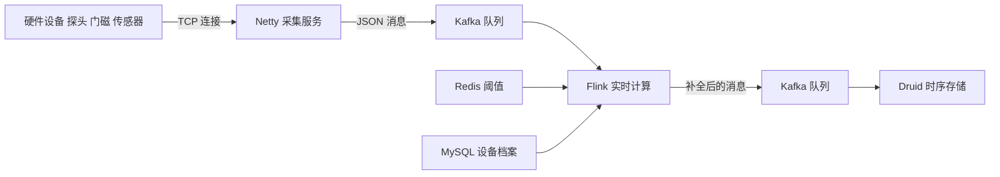

# 设备数据处理需求分析：一条 SHT 报文从设备到 Kafka 的旅程

冷链监控平台的采集服务 cold-netty 要干的活看起来只有「收发消息」四个字，但动手写代码之前必须把两件事想透：设备报文到底长什么样，服务端收到之后要把它变成什么、送到哪里去。报文格式想错一个字段，后面的解析、计算、存储全要返工。这一节先把需求与数据链路铺清楚，再进代码。

## 先给结论

- 物联网采集的范围很广：冷链温湿度、交通探头的车速与视频、家用设备的状态上报，本质都是设备按约定格式把数据推给服务端。
- 采集服务由 Netty 充当，职责是三步：收报文、解析成 MessageEntity、序列化为 JSON 转发到 Kafka。
- SHT 报文用竖线分隔字段，协议头协议尾夹着设备编码、温湿度、状态、经纬度和采集时间。
- 中间转一道 JSON 是为了与下游对齐：JSON 与 Java 对象互转工具成熟，加字段只改实体，不牵动协议解析。
- 阈值比较与预警标记不在采集服务做，Flink 消费队列后结合 Redis 里的阈值补全，采集服务只管搬运。

## 采集只是链条的第一环

物联网数据采集的范围比直觉宽得多。冷链设备定时上报温湿度是一种；高速公路探头采集车辆速度与通行视频是一种；家里的可穿戴设备、电视、空调、热水器把开关与运行状态提交上来，同样是物联网采集。共同点在于：设备把一定格式的数据提交上来，服务端负责收集与转化，再交给后续服务处理。

落到冷链监控平台，整条数据链路是这样的：



关键路径上每一段的数据形态都不同：设备到 Netty 是自定义的 SHT 文本报文，Netty 到第一段 Kafka 是 JSON 字符串，Flink 结合 Redis 的阈值与 MySQL 侧的设备档案算出预警标记，把内容更丰富的 JSON 写回 Kafka，供 Druid 摄取做时序存储。采集服务的边界很清楚：只负责从设备到第一个队列这一段。

## SHT 报文：内存与带宽逼出来的简单协议

设备端内存小、带宽有限，报文必须精简。平台约定设备报文用竖线分隔字段，协议头 `SHT` 开头，固件版本 `SH5lb1.2.1R` 收尾：

```text
SHT|HE00120931|29|76|1|null|null|20190802125717|SH5lb1.2.1R
```

按竖线拆开，中间七个字段依次是：设备编码 `HE00120931`，温度 `29`，湿度 `76`，设备状态 `1`，经度与纬度（示例里为 null），采集时间 `20190802125717`。一句话概括这条报文：什么时间、哪个设备、温度湿度多少、状态如何、位于哪里。报文样例同时会写进服务端解析代码的注释里，作为协议的活文档。

## 解析目标：MessageEntity 实体

服务端收到报文后的解析目标，是公共工程里定义好的消息实体。它把报文字段和下游要用的字段收在一起（节选）：

```java
@Data
public class MessageEntity implements Serializable {
    private static final long serialVersionUID = 1L;

    private String metercode;   // 设备编码
    private int tem;            // 温度
    private int hum;            // 湿度
    private int state;          // 状态：1 在用，0 停用，2 异常
    private String lon;         // 经度
    private String lat;         // 纬度
    private String curtime;     // 采集时间

    // 完整版还预留了设备档案字段与阈值字段，采集阶段保持默认值
    private int maxtem;         // 温度上限
    private int maxhum;         // 湿度上限
    private int temalert;       // 温度状况：1 高温，0 正常，-1 低温
    private int humalert;       // 湿度状况：1 高湿，0 正常，-1 低湿
}
```

`@Data` 注解来自 Lombok，实体不用手写 get 与 set 方法。采集工程里保留了一份字段一致的精简副本，供本服务单独编译使用。温度上限、湿度上限、预警标记此刻全是默认值：采集服务只拿到了设备提交的数据，还没有任何阈值信息可填。

## 为什么中间要转一道 JSON

**第一，报文是面向传输的，对象是面向处理的。** 竖线分隔的字符串没有结构，直接用下标取值写业务，split 调用会散落得到处都是。转成 MessageEntity 之后字段有名有姓，下游拿到的是对象而不是一串字符。

**第二，JSON 与 Java 对象互转成本最低。** 手写解析把竖线串转成结构化对象很费事，而 JSON 字符串与对象是一一对应的关系，fastjson 一行完成，工具生态成熟。以后协议要加一个字段，只需要在实体上加属性、在解析处补一行赋值，序列化代码完全不动。

**第三，队列里流动的消息统一成 JSON，上下游才能对齐。** 采集服务只填报文里有的字段，产出第一份 JSON；Flink 监听同一个队列后，从 Redis 取出该设备的温湿度阈值，从设备档案补齐公司、仓库、主机信息，比较当前读数与阈值，把 `temalert`、`humalert` 置为 1、0 或 -1，产出第二份内容更丰富的 JSON 写回 Kafka，供 Druid 摄取。两段加工互不感知，采集侧改协议、计算侧改规则，各自独立演进。

## 服务端三件事与 Netty 的两个模型

回到采集服务本身，它要做的就三件事：接收设备提交的报文；把报文转换成 JSON 对象；发送到 Kafka 队列。后两步合起来是数据处理，第一步是数据接收。

这套分工正好对上 Netty 的两个核心模型。IO 模型负责接收数据，对应主从线程组里 boss 接连接、worker 管读写的那条路；线程处理模型负责处理数据，对应 ServerHandler 里解析与转发的逻辑。Netty 对这两个模型的优化，是它能扛住大量设备长连接的原因。线程组的定义是所有服务端代码的起点，也是画面里反复出现的两行：

```java
private EventLoopGroup bossGroup = new NioEventLoopGroup();
private EventLoopGroup workerGroup = new NioEventLoopGroup();
```

一个线程组其实就能完成所有功能，Netty 建议用两个线程组分开职责：boss 专管接受连接，worker 专管读写与业务处理。这个设计在通信层面保证了收报文不被业务处理阻塞。

## 设备从哪里来：模拟端与定时任务

课程环境没有真实硬件，设备侧用一个模拟发送程序代替，核心就是往服务端发报文。手工执行一次 main 函数能发一条，但监控数据要持续产生，所以把发送报文的程序包装成任务 bean，交给分布式定时任务按 cron 表达式反复调用，任务定义与执行记录落库管理。定时任务只承担「到点执行」的职责，核心仍然是构造报文并发送这个动作本身。模拟只是教学手段，报文格式与真实设备完全一致，服务端代码不需要任何改动；模拟端的具体实现与定时任务的接线方式，紧随其后展开。

## 常见误区

- **把预警计算塞进采集服务。** 错例是 Netty 收到报文就查 Redis 比阈值。正解是采集只负责收、转、发，预警属于计算层的活，Flink 消费队列后再做，两边改代码互不牵连。
- **解析写死字段个数。** 错例是解析代码假定报文永远九个字段，设备固件升级加一个字段就整个崩掉。正解是按协议头协议尾定位、按竖线拆分并校验长度，实体预留扩展字段。
- **混淆设备时间与服务端时间。** 报文里携带的是设备侧采集时间，演示工程里 `curtime` 直接用服务端当前时间填充，两者存在传输延迟偏差；严肃场景应保留设备原值，服务端时间另立字段。
- **把队列当存储。** 错例是消息发进 Kafka 就当数据落库了。正解是 Kafka 消息有保留期，消费失败要靠重试与位移管理兜底，还要监控消费延迟。

## 面试可能被问到的问题

1. 面试官追问：「设备报文为什么不直接设计成 JSON？」
   答：设备端内存与带宽受限，竖线分隔的纯文本最短，嵌入式侧拼一个字符串即可，解析开销最小。JSON 主要用于平台内部消息流转，传输用极简协议、处理用结构化对象，两边各取所长。
2. 面试官追问：「Netty 收到报文后到消息进入 Kafka，中间经历哪些步骤？」
   答：ByteBuf 读出字节转 UTF-8 字符串，按竖线拆字段封装 MessageEntity，fastjson 序列化为 JSON，通过发送组件送入报文主题，最后回送 `SHT|true|` 应答并在 finally 里释放 ByteBuf。
3. 面试官追问：「采集服务为什么要把报文转成 JSON 再进队列？」
   答：JSON 与 Java 对象互转工具成熟、字段一一对应，加字段只需改实体；下游 Flink 与 Druid 都能直接消费 JSON，协议变化被隔离在解析层，不会向下游扩散。
4. 面试官追问：「阈值校验为什么不放在采集服务做？」
   答：阈值在 Redis、设备档案在 MySQL，采集服务要保持无状态、高吞吐，只做收转发；把比较计算后移到 Flink，还能复用它的窗口与状态管理能力，两端独立扩容。
5. 面试官追问：「SHT 协议怎么应对 TCP 粘包拆包？」
   答：协议头与固件版本尾把报文夹住，字段用竖线分隔，解析前先校验结构；更严格的做法是在 pipeline 里接长度头解码器或分隔符解码器，先把字节流切分成完整报文再做字段解析。

## 配套资料

- 代码：`materials/code/06/day3 数据采集服务/`，采集工程 cold-netty 的 NettyServer、ServerHandler、KafkaSender 与 MessageEntity，公共实体与定时任务实体在 `materials/code/06/day1 背景介绍与系统介绍/` 的 cold-common 工程，均为真实随包文件。
- 说明：引用路径截至 day 目录层级，内层目录不再展开；包名与 groupId 已统一改写为 `com.study.coldchain`；`materials/docs/06/` 无讲义目录。
