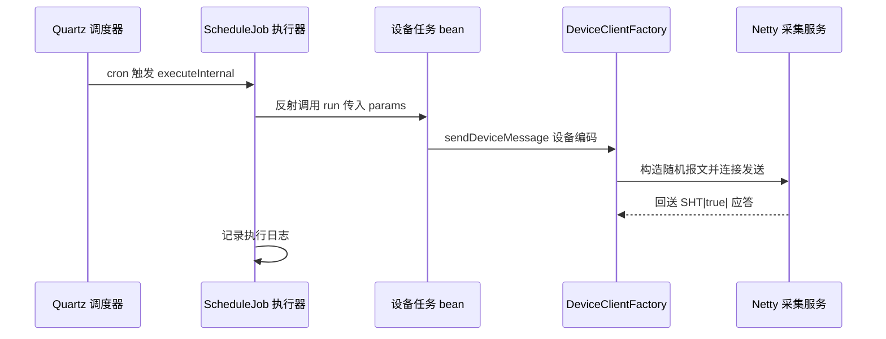

# 设备模拟端开发：用 Quartz 定时构造随机温湿度报文

服务端还没联调就卡在「没有报文进来」：课程环境里没有真实硬件，监控链路又必须靠持续的设备数据才能验证。解法是先造一个假的设备端，它要满足三个条件，报文格式与真实设备完全一致，温湿度读数每次不同，还能自己定时上报。这一节把模拟端从报文构造到定时发送完整写出来。

## 先给结论

- 模拟端本质是一个 Netty 客户端：连上采集服务，在 `channelActive` 里把报文写出去，收到应答后关闭连接。
- 报文构造靠 MessageEntity：填设备编码、随机温湿度、随机状态、当前时间，再由实体的 `deviceMessage` 方法拼成竖线报文。
- 随机数取区间值的思路是 `nextInt(宽度) + min`，温度取 -100 到 100，湿度取 0 到 100，状态对 3 取余映射到 0、1、2。
- 实体用 Lombok 的 `@Data` 省掉 get 与 set，报文拼装方法收在实体内部，模拟端与服务端共用同一份格式定义。
- 定时上报把发送程序注册成 bean，Quartz 按 cron 反射调用 run 方法，任务定义存 `schedule_job` 表，执行记录落日志表。

## 模拟端要发一条什么样的报文

需求分析里已经定过格式：协议头 `SHT` 打头，固件版本 `SH5lb1.2.1R` 收尾，中间竖线分隔设备编码、温度、湿度、状态、经纬度、采集时间。最原始的写法是把整条报文写死在代码里：

```java
String msg = "SHT|HE00120931|29|76|1|null|null|20190802125717|SH5lb1.2.1R";
```

写死只能发出一条永远不变的数据，联调几次就露馅。模拟的价值在「像」：温度湿度每次要不同，状态要在合法值里轮转，时间跟着真实时钟走，设备编码还要能切换，因为一台模拟程序要能扮演系统里登记过的任意一台设备。逐项分析下来，固定的只有协议头尾，可变的是业务字段，时间取当前时刻，设备编码作为参数由外部传入。

## 依赖与实体：报文格式的唯一出处

模拟端需要两个依赖。Lombok 提供的 `@Data` 注解自动生成 get 与 set，实体类省掉大段模板代码；fastjson 负责对象与 JSON 字符串互转，转换动作在服务端用，但实体是两端共享的，依赖跟着实体走。

报文拼装方法直接写在 MessageEntity 里，把对象的字段按协议顺序拼回字符串：

```java
/**
 * 把当前对象拼装成设备报文
 */
public String deviceMessage() {
    StringBuffer sb = new StringBuffer();
    sb.append("SHT");
    sb.append("|").append(this.getMetercode());
    sb.append("|").append(this.getTem());
    sb.append("|").append(this.getHum());
    sb.append("|").append(this.getState());
    sb.append("|").append(this.getLon());
    sb.append("|").append(this.getLat());
    sb.append("|").append(this.getCurtime());
    sb.append("|").append("SH5lb1.2.1R");
    return sb.toString();
}
```

拼装收敛到实体里有个直接的好处：模拟端拼报文、服务端解析报文，两端共用同一个类的同一份字段顺序，不会出现模拟端一个格式、解析端另一个格式的低级错位。

## 随机数据构造：一次填充五个字段

构造方法接收设备编码，其余字段随机生成（来自 cold-jobs 工程的真实实现）：

```java
private String getRandomMsg(String meterCode) {
    MessageEntity me = new MessageEntity();
    me.setMetercode(meterCode);

    // 设置随机温度
    me.setTem(getRandom(-100, 100));
    // 设置随机湿度
    me.setHum(getRandom(0, 100));
    // 设置随机状态
    int state = Integer.valueOf(getRandom(0, 100)) % 3;
    me.setState(state);

    // 设置当前时间，格式 yyyyMMddHHmmss
    SimpleDateFormat formatter = new SimpleDateFormat("yyyyMMddHHmmss");
    Date date = new Date(System.currentTimeMillis());
    me.setCurtime(formatter.format(date));

    return me.deviceMessage();
}

private int getRandom(int min, int max) {
    Random random = new Random();
    return random.nextInt(max) % (max - min + 1) + min;
}
```

温度区间给到 -100 到 100，覆盖冷库的低温场景；湿度 0 到 100；状态随机出一个 0 到 100 的数再对 3 取余，落到 0、1、2 三个合法值上。时间用 `System.currentTimeMillis()` 取毫秒级当前时刻，再按协议要求的 `yyyyMMddHHmmss` 格式化，这是 `SimpleDateFormat` 的标准用法。

区间随机数有个隐藏陷阱：教程里这行 `random.nextInt(max) % (max - min + 1) + min`，当区间是 -100 到 100 时，`nextInt(100)` 只会产生 0 到 99，对 201 取余仍是 0 到 99，加上 -100 之后结果永远落在 -100 到 -1，正温度一个都出不来。更稳的写法是 `random.nextInt(max - min + 1) + min`，宽度加一才能覆盖上界。

## 发送：带报文的客户端 Handler

客户端 Handler 把要发的报文通过构造函数带进来，连接建立瞬间就发出去：

```java
public class ClientDeviceHandler extends ChannelInboundHandlerAdapter {
    private static final Logger logger = LoggerFactory.getLogger(ClientDeviceHandler.class);
    private String msg;

    public ClientDeviceHandler(final String msg) {
        this.msg = msg;
    }

    @Override
    public void channelActive(ChannelHandlerContext ctx) {
        // 连接建立即发送报文
        ctx.writeAndFlush(Unpooled.copiedBuffer(msg, CharsetUtil.UTF_8));
    }

    @Override
    public void channelRead(ChannelHandlerContext ctx, Object msg) {
        this.logger.info("平台响应:{}", msg);
    }

    @Override
    public void exceptionCaught(ChannelHandlerContext ctx, Throwable cause) throws Exception {
        cause.printStackTrace();
        ctx.close();
    }
}
```

连接逻辑由单例工厂 DeviceClientFactory 负责：新建 `Bootstrap` 与 `NioEventLoopGroup`，通道类型 `NioSocketChannel`，选项 `TCP_NODELAY` 保证小报文立即发出；pipeline 里挂 `StringDecoder` 与 `StringEncoder` 做字符串编解码，再挂上面的 Handler；`connect(host, port).sync()` 建立连接，`closeFuture().sync()` 等待关闭，最后优雅释放线程组。服务端地址没有写死，从配置文件读 `netty.host` 与 `netty.port`，换环境只改配置。

## 从 main 函数到 Quartz 定时任务

手工执行 main 能发一条，监控数据需要按节奏持续上报。把发送动作包成任务 bean，一台设备对应一个：

```java
@Component("deviceM101001002")
public class DeviceM101001002 implements ITask {
    @Override
    public void run(String params) {
        if (params == null || params.isEmpty()) {
            params = "M101001002";
        }
        DeviceClientFactory.getInstance().sendDeviceMessage(params);
    }
}
```

定时侧的接线靠两个真实类。任务定义实体 ScheduleJobEntity 存在 `schedule_job` 表里，核心字段是 `beanName`（Spring 容器里的任务 bean 名）、`cronExpression`（cron 表达式）、`params`（传给任务的参数）与 `status`。管理后台新增一台「设备」，本质是插入一条任务记录：beanName 填设备任务 bean 的名字，cron 决定上报频率。执行器 ScheduleJob 继承 `QuartzJobBean`，到点被调度：

```java
@Override
protected void executeInternal(JobExecutionContext context) throws JobExecutionException {
    ScheduleJobEntity scheduleJob = (ScheduleJobEntity) context.getMergedJobDataMap()
            .get(ScheduleJobEntity.JOB_PARAM_KEY);
    // 按 beanName 从容器取任务对象，反射调用统一的 run 方法
    Object target = SpringContextUtils.getBean(scheduleJob.getBeanName());
    Method method = target.getClass().getDeclaredMethod("run", String.class);
    method.invoke(target, scheduleJob.getParams());
}
```

真实类在反射调用之外还记录了执行时长、成功状态与异常信息到日志表，失败可追溯。整条定时链路串起来是这样：



关键路径看清楚一点：定时任务只是触发器，核心仍然是构造报文并发送这个动作，定时器挂了或任务停了，发送程序本身随时可以手工执行。

## 联调验证

先启动采集服务端，再启动模拟端。服务端控制台打印收到的报文内容与解析结果，模拟端打印平台响应 `SHT|true|`，链路即通。给几台设备配不同的 cron，就能看到多台设备按各自节奏并发上报的效果，服务端日志里交替出现不同设备编码的报文。

## 常见误区

- **区间随机数写错。** 错例是 `nextInt(max) % (max - min + 1) + min`，负数区间只能取到负值段。正解是 `nextInt(max - min + 1) + min`，宽度加一才覆盖上界。
- **状态值越界。** 错例是随机出一个 0 到 100 的数直接塞进状态字段，下游按 1、0、2 解释就乱了。正解是对 3 取余，把取值收敛到协议约定的合法状态。
- **报文拼装两端各写一套。** 错例是模拟端手工拼字符串、服务端另写一份解析顺序，字段一加就错位。正解是拼装方法收敛到实体的 `deviceMessage`，两端共用。
- **时间直接用 Date 的默认格式。** 错例是 `new Date()` 的 toString 是英文长串，协议解析对不上。正解是 `SimpleDateFormat` 按协议格式 `yyyyMMddHHmmss` 格式化。

## 面试可能被问到的问题

1. 面试官追问：「为什么要专门做一个设备模拟端？」
   答：硬件不可得或成本高，模拟端按协议构造报文即可验证服务端全链路；报文格式与真实设备一致，服务端零改动，真实设备接入时直接替换，模拟端还能长期作为压测与回归工具。
2. 面试官追问：「Quartz 任务是怎么和 Spring Bean 关联起来的？」
   答：任务定义存 `schedule_job` 表，beanName 字段对应容器里的任务 bean；执行器从 JobDataMap 取出定义，按 beanName 从容器取对象，反射调用统一的 run 方法并把 params 传入，新增任务只是新增记录加一个 bean。
3. 面试官追问：「channelActive 和 channelRead 的区别是什么？」
   答：channelActive 在连接建立后触发一次，适合客户端在握手的时机主动发数据；channelRead 每次收到数据都会触发，服务端在这里解析报文，客户端在这里接收应答。
4. 面试官追问：「模拟端的报文为什么要通过构造函数传给 Handler？」
   答：Handler 由 pipeline 的初始化回调创建，每次连接都可能携带不同报文，构造函数传入让同一个 Handler 类可以服务任何设备任务，报文与连接生命周期绑定，不需要全局变量。
5. 面试官追问：「设备编码为什么做成参数而不是常量？」
   答：一台模拟程序要能扮演登记过的任意设备，编码来自设备档案；参数化之后多台设备就是多条定时任务，复用同一段发送逻辑，参数还能承担分组、批次等扩展信息。

## 配套资料

- 代码：`materials/code/06/day3 数据采集服务/`，模拟设备侧 cold-jobs 工程的 DeviceClientFactory、ClientDeviceHandler、DeviceM101001002 与 Quartz 执行器 ScheduleJob，公共实体 MessageEntity 与 ScheduleJobEntity 在 `materials/code/06/day1 背景介绍与系统介绍/` 的 cold-common 工程，均为真实随包文件。
- 说明：引用路径截至 day 目录层级，内层目录不再展开；包名与 groupId 已统一改写为 `com.study.coldchain`；`materials/docs/06/` 无讲义目录。
