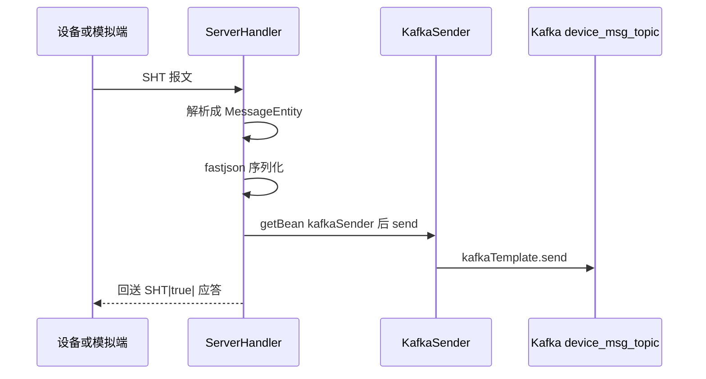

# 采集服务收官：Spring 上下文工具类与 Kafka 发送封装

ServerHandler 里要用 KafkaTemplate 发消息，第一反应是在字段上加 `@Autowired`，但这个 Handler 是 Netty 在初始化回调里 `new` 出来的，根本不归 Spring 容器管，注解不会有任何效果，运行时拿到的是 null。打通「容器里的组件」与「容器外的代码」需要两个工具类：KafkaSender 把发送动作封装成组件，SpringContextUtils 给容器外的代码一条按名字取 bean 的通道。这两个类写完，报文进 Kafka 的链路就通了，day3 的采集服务就此收官。

## 先给结论

- KafkaSender 用 `@Component` 注册成组件，内部注入 `KafkaTemplate`，send 方法收 topic 与消息，异常返回 false，成功返回 true。
- SpringContextUtils 实现 `ApplicationContextAware`，容器启动时把上下文引用存进静态字段，任何代码都能按 bean 名字取对象。
- Netty 的 Handler 不在容器里，字段注入无效，只能在 channelRead 里手动 getBean，这是 Netty 与 Spring 结合的经典套路。
- 报文处理四步收口：解析实体、JSON 序列化、getBean 取 KafkaSender 发送到 `device_msg_topic`、回送 `SHT|true|` 应答。
- 至此 day3 全链路跑通：模拟端定时发报文，Netty 收报文转 JSON 进 Kafka，消费侧交棒 Flink。

## 为什么 Handler 里注不进来

Spring 的依赖注入只发生在容器创建 bean 的过程中：容器读到 `@Autowired`，在初始化阶段把依赖塞进去。ServerHandler 的创建者是 ChannelInitializer，由 Netty 的连接回调触发，这条路完全绕开了容器，注解自然没人处理。

解法是反过来，不把 bean 塞给 Handler，而是给所有容器外代码一个随时取 bean 的入口。Spring 提供的 `ApplicationContextAware` 回调正是为此设计的：实现该接口的组件在初始化时会把 ApplicationContext 本身传进来，把它存到静态字段，静态方法就成了全局取件口。整个机制只有「容器回传引用」和「静态保存引用」两个动作。

## KafkaSender：发送动作收口成一个组件

发送 Kafka 的细节不希望散落在报文处理代码里，收口到一个组件（来自 cold-netty 工程的真实代码）：

```java
@Component
public class KafkaSender {

    @Autowired
    private KafkaTemplate<String, String> kafkaTemplate;

    public boolean send(String topic, String message) {
        try {
            kafkaTemplate.send(topic, message);
        } catch (Exception e) {
            e.printStackTrace();
            return false;
        }
        return true;
    }
}
```

三个设计点值得留意。**第一，泛型定为 String 与 String**，key 与 value 都是字符串，报文的 JSON 直接当 value 发，序列化器在配置里指定 StringSerializer。**第二，返回 boolean**，Kafka 发送异常被吞掉打日志，调用方拿到 false 可以记一笔失败报文，不至于让单条消息的失败打断设备连接的读写。**第三，发送逻辑全工程只有这一处**，换主题、加回调、加重试都只改这个类。命名上 KafkaSender 或 KafkaManager 都行，关键是职责单一；这个组件由容器在启动时注册，bean 名字默认是 `kafkaSender`。

KafkaTemplate 本身由 spring-kafka 自动配置生成，连接地址与生产者参数来自 `application-dev.yml`：

```yaml
spring:
  kafka:
    bootstrap-servers: 172.17.0.143:9092
    listener:
      concurrency: 5
    producer:
      retries: 3
      batch-size: 10000
      buffer-memory: 33554432
      key-serializer: org.apache.kafka.common.serialization.StringSerializer
      value-serializer: org.apache.kafka.common.serialization.StringSerializer
```

配置里顺带看到 listener 的并发线程数，这是给消费侧预留的参数，本服务只做生产者。

## SpringContextUtils：容器外的取件口

```java
@Component
public class SpringContextUtils implements ApplicationContextAware {

    public static ApplicationContext applicationContext;

    @Override
    public void setApplicationContext(ApplicationContext applicationContext) throws BeansException {
        SpringContextUtils.applicationContext = applicationContext;
    }

    public static Object getBean(String name) {
        return applicationContext.getBean(name);
    }
}
```

机制逐步拆开：容器扫描到这个 `@Component` 并实例化，发现它实现了 `ApplicationContextAware`，初始化阶段回调 `setApplicationContext`，把容器引用传进来；静态字段接住这份引用；`getBean` 静态方法按名字取 bean。此后任何不在容器管理范围里的代码，包括 Netty 的 Handler、静态工具方法，都能一行拿到容器里的对象。

按名字取的前提是名字真实存在：`@Component` 不显式指定名字时，默认取类名首字母小写，KafkaSender 对应 `kafkaSender`。这个工具类自己也必须挂 `@Component`，否则没有实例化就没有回调，静态字段永远是 null。两个类都放在工程的 common 包下，作为全服务共用的基础设施。

## 报文进 Kafka：链路收口

ServerHandler 的 channelRead 把前面所有零件串起来（真实代码节选）：

```java
// 接收报文
byte[] req = new byte[in.readableBytes()];
in.readBytes(req);
String body = new String(req, "UTF-8");

// 解析报文，封装成消息实体并序列化
MessageEntity message = this.parseMessage(body);
String jsonString = JSON.toJSONString(message);

// 发送至 Kafka 队列
KafkaSender sender = (KafkaSender) SpringContextUtils.getBean("kafkaSender");
sender.send(MSG_TOPIC, jsonString);

// 向硬件回送应答
String responseText = "SHT|true|\0";
ByteBuf buf = ctx.alloc().buffer();
buf.writeBytes(responseText.getBytes());
ctx.writeAndFlush(buf);
```

主题常量 `MSG_TOPIC` 定义为 `device_msg_topic`，消费侧监听同一个主题。ByteBuf 的释放在 finally 里用 `ReferenceCountUtil.release(msg)` 完成，Netty 的堆外内存靠引用计数管理，不释放就泄漏；连接级异常由 `exceptionCaught` 统一关闭。整条转发链路画出来是：



关键路径值得品一下：报文从字节流到 JSON 全部在 Handler 内完成，Kafka 的客户端细节被 KafkaSender 挡在门外，Handler 里看不到任何 Kafka API，未来换消息中间件只动一个类。

## day3 收官

到这里，day3 的采集服务完整落地：模拟端按 Quartz 的节奏构造随机报文发往 10010；NettyServer 以 Spring Boot 服务的身份拉起并注册 Eureka；ServerHandler 收报文、解析实体、序列化 JSON，经 KafkaSender 送进 `device_msg_topic` 并回送应答，失败报文有 boolean 可查，ByteBuf 有 finally 兜底。设备侧与消费侧通过队列彻底解耦，采集服务的全部职责到此完成。下一棒交给 Flink：监听队列、从 Redis 取阈值、计算预警标记，产出信息更完整的消息进入存储与展示层。

## 常见误区

- **在 Handler 字段上 @Autowired 以为能用。** 错例是给 ServerHandler 加注入字段，运行时直接空指针。正解是 Handler 不归容器管，在 channelRead 里用工具类按名字取 bean。
- **把 SpringContextUtils 当普通静态类却不加 @Component。** 错例是只保留静态方法，没有组件实例就没有 setApplicationContext 回调，getBean 必然抛空指针。正解是类上挂 `@Component` 让容器回调注入上下文。
- **发送异常直接冒泡。** 错例是 KafkaTemplate 抛出的异常一路传回 channelRead，一次发送失败影响整个连接的处理。正解是 try catch 收敛成 boolean 返回，让调用方按业务决策。
- **发完消息不释放 ByteBuf。** 错例是只在正常分支处理，异常路径的 ByteBuf 没人管。正解是 finally 里统一 `ReferenceCountUtil.release`，引用计数不归零，堆外内存随报文量持续累积。

## 面试可能被问到的问题

1. 面试官追问：「ApplicationContextAware 的原理是什么？」
   答：容器实例化 bean 后检测到它实现了该接口，就回调 setApplicationContext 把上下文引用传入；把引用存进静态字段后，容器外代码即可按名字取 bean，这是打通非 Spring 代码与容器的标准做法。
2. 面试官追问：「为什么 Netty 的 Handler 里 @Autowired 无效？」
   答：依赖注入发生在容器创建 bean 的过程中，Handler 由 ChannelInitializer 直接 new 出来，不经过容器，注解没有机会被处理，字段保持 null；解法是容器外手动 getBean 或把 Handler 注册成 bean 后由容器创建。
3. 面试官追问：「getBean 按名字取，名字从哪里来？」
   答：`@Component` 不指定名字时默认为类名首字母小写，KafkaSender 即 kafkaSender；也可以在注解里显式命名，定时任务组件就按设备号命名，方便 Quartz 按 beanName 反射调用。
4. 面试官追问：「KafkaSender 的 send 为什么返回 boolean 而不是抛异常？」
   答：报文处理在 IO 线程里，单条发送失败属于可容忍的业务异常，收敛成 false 能避免影响连接读写；需要强一致的场景可以改异步回调记录失败并重发，或由上层批量补偿。
5. 面试官追问：「采集服务到 Kafka 这一段怎么保证消息不丢？」
   答：发送失败返回 false 后记录日志并保留报文以便补发，生产者侧配置 retries，对可靠性要求高再调 acks 与副本数；监控场景通常以消费侧重算与补偿兜底，配合消费延迟告警。

## 配套资料

- 代码：`materials/code/06/day3 数据采集服务/`，cold-netty 工程的 KafkaSender、SpringContextUtils、ServerHandler 与 `application-dev.yml`，均为真实随包文件。
- 说明：引用路径截至 day 目录层级，内层目录不再展开；包名与 groupId 已统一改写为 `com.study.coldchain`；`materials/docs/06/` 无讲义目录。
