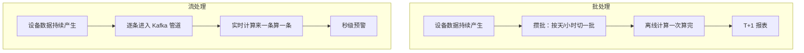

# 数据流与流计算：冷链监控为什么必须边流边算

采集服务把报文推进 Kafka 之后，如果套用老思路处理：写个定时任务，每天凌晨把昨天的温湿度数据聚合一遍出报表，温度超标发生在凌晨三点，报表要等到第二天才能看见，冷库里的货早就出问题了。延迟从哪里来、什么样的数据处理方式能把延迟压到秒级，是这一课要回答的问题。数据流与流计算这一对概念讲清楚之后，Flink 在冷链监控平台里的位置就顺理成章了。

## 先给结论

- 数据流是持续产生、没有固定头尾的数据集合，处理它的方式是流式计算：来一条处理一条。
- 批处理攒一批算一次，吞吐高但延迟等于批间隔；流处理延迟低到秒级，代价是扩展、持久化、容错都要自己解决。
- 有界数据流有头有尾适合批处理，无界数据流持续不断只能流式处理。
- 工具谱系四代演进：MapReduce、Hive 与 Tez、Storm、Flink；Flink 做到来一条处理一条，是真流式引擎。
- 冷链监控平台的分工：Kafka 做缓冲管道，Flink 做流式计算，两者不是同类工具，缺一不可。

## 数据流是什么

数据流可以借水流理解：水管一端持续进水，另一端看到的就是连续不断的水流；河流、车流也是同样的意象，流动的东西没有明确的起点和终点。数据也一样，设备不停地产生读数、用户不停地产生点击、交易不停地发生，这串持续到来的数据就是数据流。

流式数据的典型来源有个共同特征：以远小于一秒到几秒的间隔持续产生。传感器监测读数、客户端点击事件、电商交易请求、物联网设备上报都属于这一类。冷链监控平台里，每台温湿度主机每隔几秒发一条 SHT 报文，对平台来说就是一条不会干涸的溪流。处理流式数据的计算方式，就叫流式计算。

## 批处理与流处理的分野

传统上数据是攒起来批处理的：按固定时间间隔，比如一天，把这一批数据整体抓取过来计算。批处理的代码长这样（来自 flink-demo 工程的真实代码）：

```java
public static void main(String[] args) throws Exception {
    //批处理环境
    final ExecutionEnvironment env = ExecutionEnvironment.createLocalEnvironment();
    env.setParallelism(2);

    //有界数据源：一份固定的文本
    DataSet<String> text = WordCountData.getDefaultTextLineDataSet(env);

    //切词、分组、求和，跑完出结果
    DataSet<Tuple2<String, Integer>> counts =
            text.flatMap(new Tokenizer())
            .groupBy(0)
            .sum(1);

    counts.writeAsCsv("d:\\dataset-test", "\n", " ");
    env.execute("WordCount Example");
}
```

`ExecutionEnvironment` 与 `DataSet` 是批处理 API 的标志：数据源是固定的文件，计算跑完输出结果，进程结束。同样一份数据也可以用流式 API 处理（同一工程的真实代码）：

```java
public static void main(String[] args) throws Exception {
    //流处理环境
    StreamExecutionEnvironment env = StreamExecutionEnvironment.getExecutionEnvironment();

    //数据源：一个集合，被视为有界流
    ArrayList<Integer> data = new ArrayList<>();
    data.add(10);
    data.add(20);
    data.add(30);
    data.add(40);
    DataStreamSource<Integer> dataStreamSource = env.fromCollection(data);

    //逐条流过算子
    DataStream<Integer> dataStream = dataStreamSource.map(new MapFunction<Integer, Integer>() {
        @Override
        public Integer map(Integer integer) throws Exception {
            return integer * 2;
        }
    });

    dataStream.print().setParallelism(1);
    env.execute();
}
```

两种形态的差别画出来更直观：



**第一，数据形态不同。** 批处理面对有界数据流：有头有尾、算完不再变化，历史文件、昨日全量报表都是这一类；流处理面对无界数据流：没有尽头，程序启动后就要一直跑下去。**第二，延迟与吞吐的取舍不同。** 批处理一次处理一大批，摊到每条数据的成本极低，吞吐量可以做得很大，但结果延迟等于批间隔，批间隔一天结果就晚一天；流处理逐条处理，延迟可以压到毫秒到秒级，代价是集群资源被长期占用，逐条处理的开销也更高，所以工程上常在前面加一道 Kafka 缓冲削峰，用并行度把吞吐补回来。**第三，适用场景不同。** 时间序列与实时监控类需求几乎没有第二种选择，冷链平台的超温预警就是典型；历史数据洞察、月度经营报表则是批处理的主场。

## 流计算的真实场景

数据流整合技术的解决方案在行业里早已铺开。金融行业实时跟踪市场变化，根据股价的实时波动决定买入卖出时机，调整客户资产组合；电网监控吞吐量，负荷超限立即报警并触发动作；可穿戴设备把心率、步数等健康数据源源不断送到服务端，服务端边收边做统计分析；网站与 App 的点击流持续汇总，实时算出用户兴趣，决定推荐哪一类内容。

冷链设备监控平台属于物联网监控这一类：温控设备上报的数据持续流入，平台实时做统计与预警。这些场景共享同一个判断标准：数据的价值随时间快速衰减，晚了再算就失去了意义。

## 数据流带来的三大挑战

流数据持续不断、体量巨大，处理它的技术挑战集中在三处。

**第一，可扩展性。** 系统从支撑一千台设备涨到一万台，架构必须能横向扩容。扩容带来一个直接问题：实时处理任务分布在哪台机器上执行，执行的结果是否一致。流式计算框架用并行数据流回答这个问题：数据流被切分成多个分区，同一个算子在多个节点上各算各的分区，扩容就是加节点加并行度。

**第二，数据持久化。** 数据量巨大且持续写入，放进 MySQL 这类关系型数据库既写不动也查不起，必须按场景选型：内存数据库抗热数据读写，列式存储与时序数据库承接分析查询，体量再大就落到大数据平台的存储层。选型没有标准答案，按数据量、查询模式与成本权衡。

**第三，容错。** 机器多了故障就是常态，存储层与处理层都要有容错机制，数据不能丢，计算结果不能错。批处理时代重跑一次就解决，流处理 7×24 运行，重启后从哪续算、统计会不会重复，是流计算框架的核心竞争力，也是后面 Flink 检查点机制要回答的问题。

## 流数据管理工具谱系

常用的流数据管理工具里，Kafka 是绕不开的一个。它是消息队列，最直接的作用是系统解耦：生产端把数据推进队列，消费端按自己的节奏取。更大的价值在吞吐：大量数据瞬间涌进队列，Kafka 依然平稳运行，这个高吞吐缓冲能力正好补上流处理「逐条处理怕洪峰」的短板，是流式架构的标准前置管道。

计算引擎这一侧按代际演进：


第一代是 Hadoop 体系里的 MapReduce，把计算拆成 map 与 reduce 两个阶段跑批。第二代以 Hive、Tez 为代表，把作业编排成 DAG 有向无环图，按依赖关系分阶段调度，本质仍是定时批处理。第三代 Apache Storm 是分布式实时计算系统，数据预处理速度极快，把批处理的时间间隔越缩越短，趋近实时但还没有真正达到。第四代 Apache Flink 做到了来一条处理一条：一条数据到达立即参与计算，分布式可扩展，支持对接各类持久化存储，容错能力也强。冷链监控平台选 Flink，看中的正是第四代的真流式语义。

## 冷链监控平台的落点

把概念放回项目：设备报文经采集服务进 Kafka，是数据流管道这一环；从队列消费、按设备统计温湿度、对照阈值打预警标记，是流式计算这一环，由 Flink 承担；算完的消息再交给存储与展示。批处理与流处理在平台里并存：实时消息与预警走流式，历史报表走批式，选择依据就是上面的数据形态与延迟标准。下一课正式介绍 Flink 的架构与特性。

## 常见误区

- **认为流处理可以全面替代批处理。** 错例是把所有离线跑批都改成实时任务，集群常年满载。正解是有界数据用批处理吞吐高、成本低，流处理只解决实时性问题，两者按场景并存。
- **把 Kafka 当成流计算框架。** 错例是觉得数据进了 Kafka 就算完成实时处理。正解是 Kafka 只做缓冲与解耦，不含计算逻辑，统计与预警要靠 Flink 这类计算引擎。
- **认为数据流没有边界就无法统计。** 错例是面对无界流束手无策，觉得只能落库后跑 SQL。正解是窗口机制给无界流切出统计边界，按时间或条数滚动聚合，无界流上照样出指标。
- **认为低延迟必然牺牲吞吐。** 错例是要么选 Storm 类逐条低吞吐方案，要么选高延迟跑批。正解是靠并行度扩展吞吐、靠前置队列削峰，延迟与吞吐可以在合理范围内兼得。

## 面试可能被问到的问题

1. 面试官追问：「批处理和流处理的本质区别是什么？」
   答：本质区别在数据形态与延迟。批处理面对有界数据集，攒批计算，吞吐高、延迟等于批间隔；流处理面对无界数据流，来一条算一条，延迟秒级以下，但要求框架具备状态管理、容错与持续运行能力。
2. 面试官追问：「有界流和无界流怎么区分？」
   答：有界流有明确的开始与结束，数据落定不再变化，典型如文件与历史数据集，适合批处理；无界流持续产生没有尽头，典型如设备上报、点击流，只能流式处理，聚合要依赖窗口或增量计算。
3. 面试官追问：「冷链监控平台为什么用流计算而不是定时跑批？」
   答：温湿度数据的价值随时间快速衰减，超温超湿必须秒级发现并预警，T+1 的批处理结果没有业务价值；同时设备上报间隔只有几秒，数据天然是无界流，处理方式只能选择流式计算。
4. 面试官追问：「Kafka 在流式架构里承担什么角色？」
   答：一是解耦，采集与计算的速率互不牵制；二是缓冲削峰，突发流量先进队列再被平稳消费；三是可回放，消费失败或逻辑升级时按偏移量重新消费。它自身不做计算，计算交给 Flink 这类引擎。
5. 面试官追问：「计算引擎四代演进分别解决了什么问题？」
   答：MapReduce 建立大规模批处理范式；Hive 与 Tez 补上 SQL 表达与 DAG 任务编排；Storm 把延迟压到准实时；Flink 用真流式模型做到逐条处理、有状态、可容错，兼得低延迟、高吞吐与 exactly-once 语义。

## 配套资料

- 代码：`materials/code/06/day4 Flink基础与流数据处理/`，flink-demo 工程的 batch/WordCount、Streaming/StreamFromCollection、Streaming/SocketWordCount 与 `pom.xml`（Flink 1.8.0），均为真实随包文件。
- 说明：引用路径截至 day 目录层级，内层目录不再展开；包名与 groupId 已统一改写为 `com.study.coldchain`；`materials/docs/06/` 无讲义目录。
