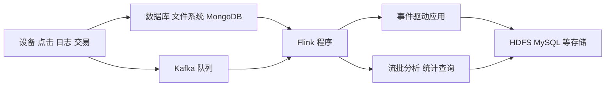
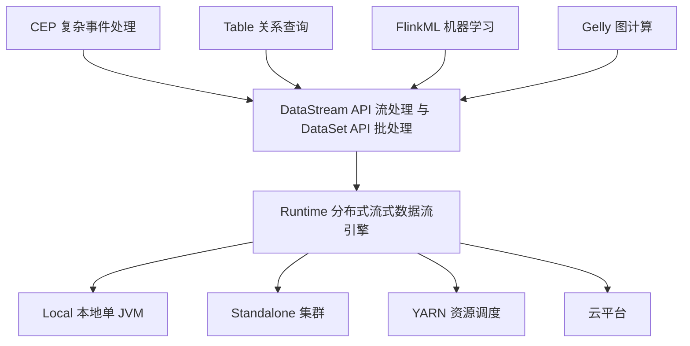

# Flink 是什么：把流处理该干的事全部接管

消费 Kafka 里的设备消息，最容易想到的方案是自己写一个 Java 消费程序。这个方案能跑起来，但往前一步就会撞上四个绕不开的问题：算过去五分钟的统计要自己维护临时存储、滑动窗口的定义时刻在变、数据乱序和丢失要自己兜底、程序宕机要自己恢复。Apache Flink 的存在意义就是把这四类问题整体接管，本课把它的定位、特性、架构分层与容错机制讲清楚，为项目实战里的 cold-flink 实时计算任务备好理论底子。

## 先给结论

- Flink 是开源的分布式流式处理框架，核心承诺三条：乱序与延迟数据下结果依然准确、状态化容错可无缝恢复、上千节点规模下兼顾高吞吐与低延迟。
- 自研消费程序的四个难题（状态存储、滑动窗口、乱序迟到、故障恢复）在 Flink 里都有现成机制。
- Flink 流批一体：DataStream API 管流处理，DataSet API 管批处理，共用同一个 Runtime 引擎。
- 容错靠检查点机制：定期对算子状态做快照，故障后恢复到最近检查点并重放其后数据，配合可重放的数据源达成 Exactly-Once 语义。
- 与 Spark Streaming 的核心差别：微批与纯流，前者延迟下限是批间隔，后者来一条处理一条。

## 自研消费程序的四个难题

假设不用框架，直接写 Java 程序消费 Kafka，问题逐个冒出来。

**第一，无状态。** 要统计过去五分钟内某项指标的和，程序必须在内存或外部存储里把数据临时存下来，存哪里、存多久、怎么清理，持久化方案全要自己设计自己开发。

**第二，滑动的时间定义。** 「过去五分钟」本身是个移动的靶子：十点整的过去五分钟和十点零一分零一秒的过去五分钟是两个不同的区间，程序得随着时间推移不断切换统计边界，这个逻辑自己写极其繁琐。

**第三，数据不可靠。** 数据丢了怎么办、来得晚了怎么办、乱序到达怎么办，消息队列不承诺顺序与完整，这些因素都要在程序里逐一考虑。

**第四，程序不可靠。** 消费程序挂掉了怎么恢复、恢复后从哪里继续算、统计会不会重复，每一个都要额外开发。

Flink 对这四个问题各有一套机制：算子天然带状态、内置事件时间与窗口语义、支持乱序数据处理、检查点加恢复策略兜底故障。这也是它与「Kafka 加自研消费者」方案的本质差距。

## Flink 的定位与三大特性

按代际谱系，Flink 号称第四代数据处理引擎（沿革一句话：它源自欧洲高校的 Stratosphere 研究项目，2014 年底成为 Apache 顶级项目）。它的官方定位是开源的分布式流式处理框架，用 Java 实现，特性可以收拢成三条。

**第一，结果准确。** 即使数据无序或延迟到达，Flink 也能依据事件时间与水位线机制产出正确结果，这一点对监控预警类业务是刚需。

**第二，状态化容错。** Flink 在维护完整应用状态的同时提供容错能力，故障发生时能无缝修复，统计不重不丢。

**第三，大规模运行。** 上千个节点的集群上仍能保持良好的吞吐量与低延迟，扩容即扩能力。

## 数据怎么流经 Flink

从全链路视角看数据的走向：物联网设备、点击、日志、交易各类源头产生数据，一条路径存入数据库系统、文件系统或 MongoDB 这类存储，另一条路径走 Kafka 队列，两类数据统一汇入 Flink 程序。Flink 内部再分两条应用线：事件驱动应用对每个到达的事件即时捕获状态与值，实时响应；流批分析线对接收的数据做统计分析与查询。最终结果可输出到 HDFS、MySQL 等各类存储。整个体系拆开是三个阶段：数据收集、数据处理、数据存储，Flink 对全过程统一处理。



这张图里值得注意的是两条来路的汇合：有界的历史数据和无界的实时消息，在 Flink 这里用同一套引擎处理，这正是流批一体的含义，也是它与纯流式引擎的分野。

## 分层架构：一套 Runtime 撑起两套 API

Flink 的核心组件自下而上分四层：



最底层是部署层，Flink 可以以本地单 JVM 方式运行，可以搭 Standalone 集群，也可以交给 YARN、Kubernetes、Mesos 这类资源管理框架托管，或直接部署到云平台。部署层之上是运行时核心 Runtime，即分布式流式数据流引擎，全框架的执行心脏。核心之上开放两套 API：DataStream API 面向流处理，DataSet API 面向批处理，两套 API 建在同一个引擎上，一套代码思路覆盖两类数据。最上层是面向特定场景的库：CEP 依据规则表达式做事件决策，Table 支持用 SQL 查询数据，FlinkML 做机器学习，Gelly 做图计算。业务开发绝大多数时间停留在 DataStream API 这一层，冷链监控平台的实时计算任务正是如此。

## 容错与 Exactly-Once：检查点机制概览

检查点（Checkpoint）是 Flink 容错的基石：框架周期性地让所有算子把状态快照到可靠存储，检查点之间用屏障对齐，保证快照反映的是某一时刻的一致状态。故障发生时，集群把作业恢复到最近的检查点，数据源从对应位置重放其后数据。只要源头支持按偏移量重放（Kafka 正是如此），下游输出配合幂等或事务写入，端到端就能做到每条数据恰好被处理一次，即 Exactly-Once 语义。

项目实战工程里已经用上了这套机制（来自 cold-flink 工程的真实代码，day6 实时计算任务的骨架）：

```java
//设置容错：每 5 秒做一次检查点
env.enableCheckpointing(5000);
//设置检查点模式
env.getCheckpointConfig().setCheckpointingMode(CheckpointConfig.DEFAULT_MODE);
//设置重启策略：固定延迟重启，最多 4 次，间隔 1 秒
env.getConfig().setRestartStrategy(RestartStrategies.fixedDelayRestart(4, 1000));

//Kafka 消费设备报文，解析成 MessageEntity，经 Redis 补齐档案与阈值后：
outStream.addSink(new SinkToMySQL());
env.execute("冷链设备实时监控任务");
```

`enableCheckpointing(5000)` 打开五秒一次的检查点，`fixedDelayRestart` 声明作业异常时的自动重启策略。开发侧只需这两行配置，恢复细节全部由框架完成，这就是自研程序与 Flink 在容错上的差距。

## 与 Spark Streaming 的对比要点

Spark Streaming 走微批路线：把流数据按批间隔切成一个个小批次，每个批次跑一次批处理作业，延迟下限就是批间隔，通常秒级。这套思路与前面提过的「把批处理间隔越缩越短趋近实时」一脉相承，实现门槛低、复用批处理生态，但语义上仍是批。Flink 是纯流式模型，逐条处理、连续产生结果，延迟可以到毫秒级，窗口、状态、时间语义都是一等公民，Exactly-Once 原生内建。选型上，已有 Spark 生态且秒级延迟可接受的团队常选 Spark Streaming，对延迟、状态管理与正确性要求高的实时场景，Flink 更合适，冷链监控的实时预警属于后者。

接入侧的真实代码也能看出 Flink 与 Kafka 的配合方式（flink-demo 工程的真实代码，消费设备报文主题）：

```java
final StreamExecutionEnvironment env = StreamExecutionEnvironment.getExecutionEnvironment();

Properties properties = new Properties();
properties.setProperty("bootstrap.servers", "172.17.0.143:9092");
properties.setProperty("group.id", "kafkaTest");
properties.setProperty("auto.offset.reset", "earliest");
FlinkKafkaConsumer010<String> consumer =
        new FlinkKafkaConsumer010<>("device_msg_topic", new SimpleStringSchema(), properties);
consumer.setStartFromEarliest();

DataStream<String> dataStream = env.addSource(consumer).setParallelism(1);
dataStream.print();
env.execute();
```

Kafka 连接参数交给 Properties，`FlinkKafkaConsumer` 包装成数据源接入执行环境，偏移量交给检查点托管。这套接入姿势与 cold-flink 实战任务完全一致，差别只在业务转换与输出端。

## 常见误区

- **把 Flink 当成存储系统。** 错例是以为算完的结果自动保存在 Flink 里。正解是 Flink 只做计算，状态服务于计算过程，结果必须经 Sink 写到 MySQL、Kafka、HDFS 等外部存储。
- **以为开了检查点就自动端到端 Exactly-Once。** 错例是给作业加上 enableCheckpointing 就宣称不重不丢。正解是端到端语义还要求源头可重放、输出端幂等或事务写入，三者缺一不可。
- **把微批当成流处理。** 错例是认为 Spark Streaming 与 Flink 能力等价只差 API 风格。正解是微批的延迟下限是批间隔且窗口语义受限，纯流式引擎逐条处理、状态与时间语义更完整。
- **混用两套 API 的类。** 错例是在 DataStream 程序里 import 了 DataSet 体系的算子或类型导致编译报错。正解是分清 `org.apache.flink.streaming.api` 与 `org.apache.flink.api.java` 两个体系，按数据形态选 API。

## 面试可能被问到的问题

1. 面试官追问：「Flink 与 Spark Streaming 的核心区别是什么？」
   答：执行模型不同。Spark Streaming 把流切成微批，每个批次执行一次作业，延迟下限是批间隔；Flink 是纯流式引擎，来一条处理一条，延迟可到毫秒级，且状态、时间、窗口是一等公民，Exactly-Once 原生支持。
2. 面试官追问：「Flink 的检查点机制是怎么工作的？」
   答：作业周期性触发检查点，屏障随数据流经所有算子，各算子把状态快照到可靠存储，屏障对齐保证一致性。故障时恢复到最近检查点，源端按快照记录的偏移量重放数据，作业继续运行。
3. 面试官追问：「端到端 Exactly-Once 需要哪些条件？」
   答：框架内状态一致性由检查点保证，端到端还要两个条件：数据源支持按偏移量重放，比如 Kafka；输出端支持事务或幂等写入。三者齐备，每条数据才恰好产生一次效果。
4. 面试官追问：「怎么理解 Flink 的流批一体？」
   答：DataStream API 与 DataSet API 建在同一个 Runtime 引擎上，无界流与有界数据用统一引擎、统一抽象处理。好处是一套技术栈覆盖实时与离线，业务逻辑可以复用，运维成本也降低。
5. 面试官追问：「自己写 Kafka 消费程序和用 Flink 差距在哪？」
   答：自研要自己实现状态存储、滑动窗口、乱序处理与故障恢复，每项都容易出错；Flink 内置有状态算子、事件时间窗口、水位线与检查点机制，开发只写业务转换，可靠性与扩展性由框架托底。

## 配套资料

- 代码：`materials/code/06/day6 实时计算 - 冷眼项目实战/`，cold-flink 工程的 StreamingJob、MessageAggregate、SinkToMySQL；`materials/code/06/day4 Flink基础与流数据处理/`，flink-demo 工程的 StreamFromKafka、SocketWordCount 与 `pom.xml`（Flink 1.8.0），均为真实随包文件。
- 说明：引用路径截至 day 目录层级，内层目录不再展开；包名与 groupId 已统一改写为 `com.study.coldchain`；发展沿革与 Spark Streaming 对比为按公开主流资料补充的背景；`materials/docs/06/` 无讲义目录。
