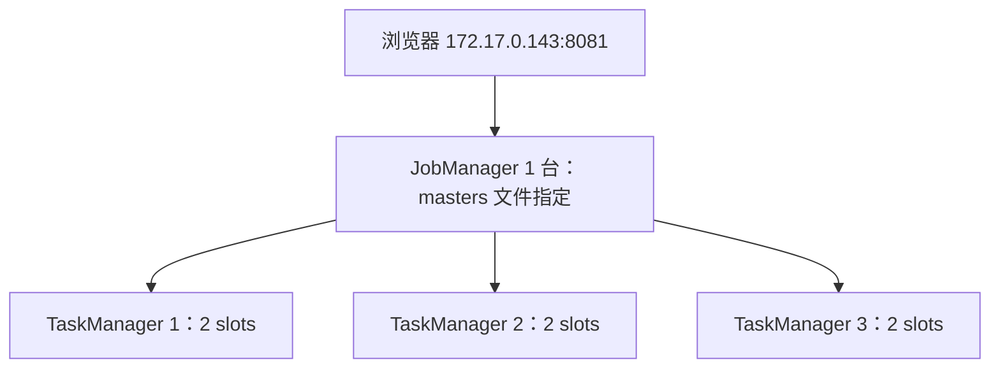

# Flink 安装配置：从 Local 单机到 Standalone 集群

> 🔒 安全提示：文中示例的口令/密钥均为课程教学环境演示口径，生产环境的安全要求见《安全与合规须知》。

Flink 环境搭建看着只是解压的事，动手时常见三类卡点：模式选错（本地调试却按集群装）、端口记错（Web 页面打不开）、配置改了不生效。按 Local 与 Standalone 两条线把完整过程走一遍，三个卡点都会在过程中现出原形。

## 先给结论

- Flink 运行分三种模式：Local（本地单机）、Standalone（自带调度、不依赖外部资源管理器）、On YARN（交给 Hadoop 体系的 YARN 托管）。
- Local 模式 Windows 解压即用：运行 bin 下的 `start-cluster.bat`，浏览器访问 `localhost:8081` 就是管理页面。
- Standalone 模式的核心配置在 `conf/flink-conf.yaml`：`jobmanager.rpc.address`、`rest.address` 与 `rest.port`、`taskmanager.numberOfTaskSlots`、`parallelism.default`。
- 集群形态由 masters 与 slaves 两个文件决定；课程演示一台机器跑 1 个 JobManager 加 3 个 TaskManager，每个 2 个 slot，总 slot 6。
- 启动命令是 bin 下的 `start-cluster.sh`，验证看 Web UI：Overview 的 Task Slots 总数与 Task Managers 列表。

## 一、三种模式怎么选

**Local。** 把 Flink 包下载解压到 Windows 本地直接启动，作业就在本机进程里跑，开发调试用它。

**Standalone。** 把服务器配成 Flink 自管的集群，有 JobManager 和多个 TaskManager，不依赖 YARN 这类外部调度机制，测试环境常这么搭。要做 HA 高可用，需要提前装好 ZooKeeper。

**On YARN。** YARN 是 Hadoop 体系里的资源管理平台，Flink 运行环境交给它托管，生产大规模部署的常见选择。

## 二、下载与解压

官网左侧 Download 菜单进入下载页（可切换中文版），课程演示用的版本是 Flink 1.9.1，二进制包名为 `flink-1.9.1-bin-scala_2.12.tgz`。Windows 下载后解压，目录里 bin、conf、examples、lib 各司其职；服务器上同样下载解压：

```bash
cd /opt
wget -c http://mirrors.tuna.tsinghua.edu.cn/apache/flink/flink-1.9.1/flink-1.9.1-bin-scala_2.12.tgz
tar xf flink-1.9.1-bin-scala_2.12.tgz
```

bin 目录是可执行脚本的家，start-cluster 与 stop-cluster 在 Windows 下是 .bat、在 Linux 下是 .sh 两套；conf 目录放配置文件；examples 带现成示例作业，跑示例时直接用。包名里的 scala_2.12 指的是该发行包编译所用的 Scala 二进制版本号，与 Flink 自身的 1.9.1 版本号是两回事，挑包时别看混。

## 三、Local 模式：解压即用

Windows 下不做任何改动，直接运行 bin 里的 `start-cluster.bat`，浏览器输入 `localhost:8081` 就能看到 Flink 管理页面。左侧菜单五个入口值得逐个点一遍：

- Overview：当前集群全景，任务与资源一览。
- Jobs：执行中的任务与已完成的任务列表。
- Task Managers：Local 模式只有一个 TaskManager，能看到它的资源与日志。
- Job Managers：本机集群的配置，包括堆内存大小与运行日志输出。
- Submit New Job：在页面添加 jar 直接提交执行，免命令行。

## 四、Standalone 模式：把测试集群搭起来

课程演示环境是 Linux 服务器（root 账号登录，密码 123456），一台机器同时充当 JobManager 与 TaskManager。配置三步走。

**第一步改 `flink-conf.yaml`。** 进 conf 目录编辑，关键配置项如下（按画面抄录）：

```yaml
# JobManager 的 IP 地址
jobmanager.rpc.address: 172.17.0.143
# JobManager 的 RPC 端口
jobmanager.rpc.port: 6123
# Web 界面监听地址与端口：0.0.0.0 表示任何机器都能访问
rest.address: 0.0.0.0
rest.port: 8081
# JobManager 与 TaskManager 的 JVM 堆内存
jobmanager.heap.size: 1024m
taskmanager.heap.size: 1024m
# 每个 TaskManager 提供的任务槽数量，默认为 1
taskmanager.numberOfTaskSlots: 2
# 未显式指定并行度时的默认值，默认为 1
parallelism.default: 4
```

slot 数从默认 1 调到 2，默认并行度调到 4，rest 相关配置去注释放开。

**第二步看 masters 与 slaves。** masters 文件里是 `localhost:8081`，不用改；slaves 文件原来只有一个 localhost，再添两行凑成三行，启动时就会在本机拉起 3 个 TaskManager 进程。

**第三步配环境变量并启动。** 修改 /etc/profile 加上 FLINK_HOME：

```bash
vi /etc/profile
export FLINK_HOME=/opt/flink-1.9.1/
export PATH=$FLINK_HOME/bin:$PATH
```

进 bin 目录执行启动脚本：

```bash
./start-cluster.sh
# Starting cluster.
# Starting standalone session daemon on host node2
```

浏览器访问 172.17.0.143:8081，集群已经起来了：Overview 页面显示 Task Slots 总数 6，正好是 3 个 TaskManager 乘以每个 2 个 slot；Task Managers 页列出 3 个节点，对比 Local 模式的 1 个；Job Manager 始终只有 1 个。提交作业的入口与 Local 模式一样，在页面上传 jar 即可。



这张图就是 slaves 文件三个 localhost 的直观结果：一台机器上起了 1 个 master 与 3 个 worker，总 slot 6。

## 五、两套环境的取舍

Local 与 Standalone 的差异不在功能在形态：Local 是单进程的缩小版，master 与 worker 合在一个进程里跑，省掉了集群协调，代价是并行度、slot 分配、多节点汇报这些集群行为验证不了；Standalone 把 master 与 worker 分开配置，能实打实地演练这些行为，是上生产（尤其是 On YARN）前的最后一层沙盘。两边的 Web UI 完全一致，会看一边就会看另一边。

## 常见误区

- **Web UI 端口记成 8080。** 错例是浏览器敲 `localhost:8080` 打不开页面。正解是 Flink Dashboard 的端口由 `rest.port` 控制，默认 8081；6123 是 JobManager 的 RPC 端口，两者不是一回事。
- **Standalone 也要先装 YARN。** 错例是以为 Flink 集群必须依附 Hadoop。正解是 Standalone 自带调度，独立部署即可；On YARN 才需要 Hadoop 环境。
- **配置改了不重启。** 错例是改完 `flink-conf.yaml` 与 slaves 直接刷新页面看效果。正解是先 stop 再 start，启动脚本按 slaves 列表逐台拉起进程，旧配置留在内存里不会热生效。
- **slot 数与并行度混为一谈。** 错例是把 `taskmanager.numberOfTaskSlots` 当成作业并行度。正解是 slot 是每个 TaskManager 的资源切分数，`parallelism.default` 才是作业默认并行度，作业并行度超过集群 slot 总量会起不来。

## 面试可能被问到的问题

1. 面试官追问：「Flink 有哪几种部署模式？」
   答：Local、Standalone、On YARN 三种。Local 适合本地开发调试，Standalone 是 Flink 自管集群、不依赖外部资源管理器，On YARN 把资源交给 YARN 托管，适合生产环境大规模部署。
2. 面试官追问：「flink-conf.yaml 里最关键的配置项有哪些？」
   答：`jobmanager.rpc.address` 指定主节点地址，`rest.address` 与 `rest.port` 控制 Web UI 监听，`taskmanager.numberOfTaskSlots` 决定每个 TaskManager 的槽位数，`parallelism.default` 是作业默认并行度，两个 heap.size 划分 JobManager 与 TaskManager 的堆内存。
3. 面试官追问：「rest.port 和 jobmanager.rpc.port 有什么区别？」
   答：`rest.port` 是 Web Dashboard 与 REST 服务的端口，默认 8081，浏览器访问的是它；`jobmanager.rpc.port` 是内部 RPC 通信端口，默认 6123，作业提交与调度走的是它。
4. 面试官追问：「Standalone 模式怎么搭 HA？」
   答：提前装好 ZooKeeper，在配置里启用高可用并指定 ZooKeeper 地址，masters 里写多个 master；运行时一个 leader 提供服务，其余 standby 待命，leader 失效自动切换，消除单点。
5. 面试官追问：「集群起不来或 slot 不够怎么排查？」
   答：先看 slaves 文件与节点连通性，再查 `flink-conf.yaml` 里地址与端口是否被占用；slot 不够时对比 Overview 里 Task Slots 总数与作业并行度，并行度高于 slot 总量作业无法调度。

## 配套资料

- 代码：`materials/code/06/day4 Flink基础与流数据处理/`，flink-demo 工程的 pom.xml（依赖版本为 Flink 1.8.0）与 SocketWordCount 等示例，可打包提交到本课部署的集群运行。
- 说明：安装版本按课程画面为 Flink 1.9.1，命令与配置项按画面抄录；提交作业时建议集群版本与工程依赖版本对齐（示例按本课写法补充说明）；引用路径截至 day 目录层级；示例中的服务器 IP 为课程演示环境地址。
