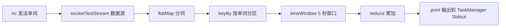

# 把第一个 Flink 流程序跑起来：Socket WordCount 从提交到出结果

环境装好后，最先卡住人的不是写代码，而是三个问题：jar 怎么提交、作业跑没跑起来、结果去哪看。Flink 发行包里自带示例，正好拿流处理目录里的 Socket Window WordCount 把整条链走通，走完这条链，Flink 程序从代码到结果的闭环就齐了。

## 先给结论

- Flink 安装目录的 examples 里带批处理、流处理、Table 处理三类现成示例，`examples/streaming` 里的 SocketWindowWordCount.jar 监听一个 socket 端口实时统计单词数。
- 提交方式两种：命令行用 bin 下的 flink 脚本提交 jar，或 Web 管理页面的 Submit New Job 上传 jar。
- 演示链路：nc 打开 9010 端口，Web UI 上传 jar 并传入 `--hostname localhost --port 9010`，作业进入 RUNNING，nc 里敲单词，TaskManager 的 Stdout 里看计数。
- 作业拓扑四步：socket 数据源、flatMap 分词、窗口聚合、打印输出；flatMap 的并行度是 4。
- 工程里对应的真实代码是 flink-demo 的 SocketWordCount，逻辑与示例 jar 一致，直接读源码就行。

## 一、示例在哪，跑的是什么

安装目录里的 examples 是宝库，进 `examples/streaming` 能看到一排现成的 jar：IncrementalLearning.jar、SessionWindowing.jar、SocketWindowWordCount.jar、WordCount.jar 等。挑 SocketWindowWordCount.jar：它实时监听一个端口，把每个 5 秒窗口里收到的单词分词计数。

```bash
cd /opt/flink-1.9.1/examples/streaming
ll
# SessionWindowing.jar  SocketWindowWordCount.jar  WordCount.jar ...
```

示例 jar 是编译产物，逻辑要从工程源码看。day4 配套工程 flink-demo 里的 SocketWordCount 就是同一个程序，包名按约定改写后全文如下：

```java
package com.study.coldchain.demo.flink;

// 监听 socket 端口，按 5 秒窗口统计单词数量
public class SocketWordCount {
    public static void main(String[] args) throws Exception {
        // 1. 设置执行环境
        final StreamExecutionEnvironment env =
                StreamExecutionEnvironment.getExecutionEnvironment();

        // 2. 定义数据源：socket 文本流
        DataStream<String> text = env.socketTextStream("172.17.0.143", 9000);

        // 3. 业务逻辑：分词、按单词分区、5 秒窗口聚合
        DataStream<WordWithCount> counts = text
            .flatMap(new FlatMapFunction<String, WordWithCount>() {
                @Override
                public void flatMap(String s, Collector<WordWithCount> collector) {
                    for (String word : s.split("\\s")) {
                        collector.collect(new WordWithCount(word, 1L));
                    }
                }
            })
            .keyBy("word").timeWindow(Time.seconds(5))
            .reduce(new ReduceFunction<WordWithCount>() {
                @Override
                public WordWithCount reduce(WordWithCount t0, WordWithCount t1) {
                    return new WordWithCount(t0.word, t0.count + t1.count);
                }
            });

        counts.print().setParallelism(1);

        // 4. 执行程序
        env.execute();
    }

    // POJO：单词与计数，toString 返回 word + " : " + count
    public static class WordWithCount {
        public String word;
        public long count;

        public WordWithCount() {}

        public WordWithCount(String word, long count) {
            this.word = word;
            this.count = count;
        }
    }
}
```

## 二、算子逐个拆：这条链每步在干什么

**socketTextStream，source 算子。** 建立到指定主机与端口的 socket 连接，把收到的每一行文本变成 DataStream 里的一条记录，是整条链的数据入口。

**flatMap，分词。** 对每行文本按空白拆分，每个单词生成一条 (word, 1) 记录，一行进来几个单词，出去就是几条。

**`keyBy("word")`，分区。** 按单词做哈希分区，同一个单词的所有记录被路由到同一个并行子任务，后面的窗口聚合才能各自算各自的账。

**timeWindow(Time.seconds(5))，开窗。** 5 秒一个滚动窗口，窗口内的记录攒起来，窗口关闭时触发聚合。

**reduce，聚合。** 窗口内的记录两两合并，计数累加，每个单词汇出一条最终计数。

**print，sink 算子。** 把结果打印到执行该子任务的 TaskManager 标准输出里。

**env.execute，触发。** Flink 程序是惰性的，前面都是在搭建数据流图，没有这一行什么都不会跑。



这条链就是 Web UI 作业拓扑的原型：页面上的 Socket Stream、Flat Map、Window、Print 四步，与代码里的算子一一对应。

## 三、完整跑一遍

**起数据源。** 用 nc 命令打开 9010 端口，它是一个极简的 socket 服务端，会话里敲什么就发什么；另开终端用 telnet 验证端口连通：

```bash
# 打开 9010 端口的 socket 服务
nc -l 9010

# 另开终端验证端口可连
telnet localhost 9010
```

**提交作业。** Web UI 的 Submit New Job 页选择 SocketWindowWordCount.jar 上传，点开这条记录，传入运行参数 `--hostname localhost --port 9010`，点 Submit。Running Jobs 里出现名为 Socket Window WordCount 的作业，状态 RUNNING。命令行方式等价：bin 下的 flink run 加 jar 路径与同样参数。点开作业能看到拓扑四步，flatMap 的并行度是 4。

**发数据、看结果。** 回到 nc 会话，输入单词后回车：

```bash
abc abc def dfs def
```

到 Web UI 的 Task Managers 页打开一个节点，Stdout 里给出计数：

```text
abc : 2
def : 2
dfs : 1
```

与输入对上了：abc 两次、def 两次、dfs 一次。再输入 ttt、tttgggg，下一个 5 秒窗口立刻给出对应计数。页面上的输出从后台日志读取，显示稍有延迟，但计算本身是实时的，每个窗口独立统计、互不串账。

## 四、这条链练完，day4 收官

跑通这一个示例，Flink 程序的全貌就齐了：读算子链写代码、打包 jar、提交到集群、Web UI 看拓扑与并行度、TaskManager 日志里对结果。换成真实业务只是替换两端的积木：数据源从 socket 换成 Kafka，print 换成写 MySQL，中间的分词、分区、开窗、聚合骨架不变，后续项目实战正是这样改造的。

## 常见误区

- **忘了起 nc 就先提交作业。** 错例是直接 Submit，source 连不上端口，作业反复报错重启。正解是先 `nc -l` 打开端口再提交，顺序不能反。
- **结果在提交终端里找。** 错例是盯着命令行等输出。正解是 print 输出到执行子任务的 TaskManager 标准输出，Web UI 里进对应节点看 Stdout。
- **把页面刷新延迟当成计算延迟。** 错例是看到数字晚几秒就断定流处理卡顿。正解是页面从后台日志读取略有延迟，窗口聚合本身按 5 秒实时滚动。
- **窗口不满就急着看结果。** 错例是敲完单词立刻刷新没数据，就以为程序没跑。正解是 5 秒滚动窗口要等窗口关闭才触发聚合，贴着窗口边界敲数据马上能看到。

## 面试可能被问到的问题

1. 面试官追问：「print 算子的结果输出到哪里？」
   答：输出到执行该算子子任务的 TaskManager 的标准输出；Web UI 的 Task Managers 页进入对应节点，在 Stdout 或 Logs 里查看，不在提交作业的客户端终端里。
2. 面试官追问：「keyBy 为什么必须在窗口聚合之前？」
   答：keyBy 把同一单词的记录路由到同一个并行子任务，聚合只在该子任务的窗口里进行；没有 keyBy，并行子任务各算各的，同一个单词的计数会被拆散到多个节点上。
3. 面试官追问：「timeWindow(Time.seconds(5)) 是滚动窗口还是滑动窗口？」
   答：只传一个长度参数是滚动窗口，5 秒一个、首尾相接、互不重叠；要滑动窗口需要再传滑动步长，写成 timeWindow(Time.seconds(5), Time.seconds(1)) 这样的形式。
4. 面试官追问：「env.execute() 不写会怎样？」
   答：Flink 是惰性执行，前面的算子调用只是在构建数据流图，不写 execute 作业不会提交也不会计算，程序静默结束，这是新手最容易踩的坑。
5. 面试官追问：「Web UI 提交作业要传什么参数？」
   答：上传 jar 后按作业 main 方法的参数传，SocketWindowWordCount 需要指定 socket 服务地址与端口，例如 `--hostname localhost --port 9010`；命令行 flink run 提交时参数一致。
6. 面试官追问：「把示例改成生产作业要动哪里？」
   答：两端替换：source 从 socketTextStream 换成 Kafka 消费者，sink 从 print 换成写 MySQL 或回投队列，中间的分区、开窗、聚合骨架不变，另外补 checkpoint 与重启策略等容错配置。

## 配套资料

- 代码：`materials/code/06/day4 Flink基础与流数据处理/`，flink-demo 工程的 SocketWordCount 真实源码（包名改写为 `com.study.coldchain`）与 pom.xml。
- 代码：`materials/code/06/day6 实时计算 - 冷眼项目实战/`，同一套算子链的工程化版本（StreamingJob、SinkToMySQL 等）为真实代码（该目录名含项目代号，正文统一称冷链监控平台）。
- 说明：命令与运行参数按课程画面演示整理（nc -l 9010、上传 SocketWindowWordCount.jar）；引用路径截至 day 目录层级。
