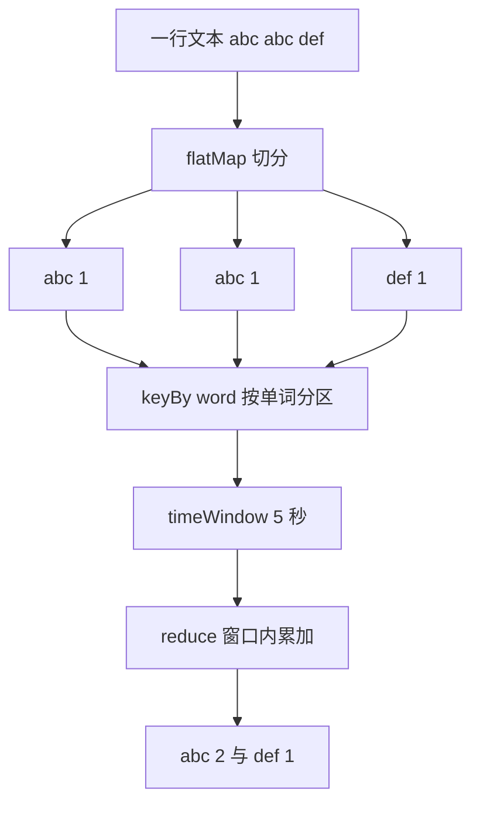

# 流式单词统计逐行拆解：一条 socket 文本流怎么变成每 5 秒一份的计数

上一篇把 socket 进来的文本原样打印，只能算碰到了数据源；要统计每个单词的出现次数，得先定义流里的数据类型，再串起一串算子。这个程序是 Flink 流处理的 Hello World，也是后面冷链监控平台实时计算环节的原型，值得逐行读透。

## 先给结论

- 流里的元素自定义成 POJO：WordWithCount 含 word 与 count 两个 public 字段，必须带无参构造函数，复写 toString 让 print 输出可读。
- 四步骨架不变：设置执行环境、socketTextStream 定义数据源、flatMap 起算子链、执行。
- 算子链 `flatMap → keyBy("word") → timeWindow(Time.seconds(5)) → reduce`：分词发出 (word, 1)、按单词分区、5 秒滚动窗口、窗口内两两合并累加。
- 与批版的差别：批版 flatMap 后接 `groupBy(0).sum(1)` 一次算完落盘；流版 keyBy 后开窗，每 5 秒滚动出一批计数，程序不退出。
- 输入 `abc abc def`，窗口关闭时输出 `abc : 2` 与 `def : 1`。

## 一、先定义流里的数据类型

按单词计数，流里的一条记录天然含两个字段：单词本身和数量。与其反复解析字符串，不如直接定义一个类。这个类同时要满足 Flink 对 POJO 的要求，规矩先记住两条：字段 public、带无参构造（下篇数据类型展开）：

```java
/**
 * 流里的数据类型：单词与计数
 */
public static class WordWithCount {
    public String word;
    public long count;

    // POJO 要求有无参构造函数，缺了它类型会被当成常规类处理
    public WordWithCount() {}

    public WordWithCount(String word, long count) {
        this.word = word;
        this.count = count;
    }

    @Override
    public String toString() {
        return word + " : " + count;
    }
}
```

toString 不复写，print 打出来是默认的对象串，没法看；复写成 `word : count` 后，结果一眼可读。

## 二、主程序：四步骨架填业务

```java
package com.study.coldchain.demo.flink.streaming;

import org.apache.flink.api.common.functions.FlatMapFunction;
import org.apache.flink.api.common.functions.ReduceFunction;
import org.apache.flink.streaming.api.datastream.DataStream;
import org.apache.flink.streaming.api.environment.StreamExecutionEnvironment;
import org.apache.flink.streaming.api.windowing.time.Time;
import org.apache.flink.util.Collector;

public class SocketWordCount {

    /**
     * 监听 socket 端口，统计单词数量
     */
    public static void main(String[] args) throws Exception {
        // 1. 设置执行环境
        final StreamExecutionEnvironment env =
                StreamExecutionEnvironment.getExecutionEnvironment();

        // 2. 定义数据源：socket 文本流
        DataStream<String> text = env.socketTextStream("172.17.0.143", 9000);

        // 3. 业务逻辑：分词、按单词分区、5 秒窗口合并
        DataStream<WordWithCount> wordWithCountDataStream = text
                .flatMap(new FlatMapFunction<String, WordWithCount>() {
                    @Override
                    public void flatMap(String s, Collector<WordWithCount> collector)
                            throws Exception {
                        for (String word : s.split("\\s")) {
                            collector.collect(new WordWithCount(word, 1L));
                        }
                    }
                })
                .keyBy("word")
                .timeWindow(Time.seconds(5))
                .reduce(new ReduceFunction<WordWithCount>() {
                    @Override
                    public WordWithCount reduce(WordWithCount t0, WordWithCount t1)
                            throws Exception {
                        return new WordWithCount(t0.word, t0.count + t1.count);
                    }
                });

        wordWithCountDataStream.print().setParallelism(1);

        // 4. 执行程序
        env.execute();
    }

    // WordWithCount 定义见上一节
}
```

运行前先在服务器上用 nc 打开 9000 端口做数据源，程序启动后连接该端口，等待数据：

```bash
nc -l 9000
# 在 nc 会话里输入：
abc abc def
```

窗口关闭时，IDEA 控制台输出：

```text
abc : 2
def : 1
```

## 三、算子链逐个拆

**flatMap，一行变多条。** 输入是整行字符串，`split("\\s")` 按空白切分，每个单词发出一条 `new WordWithCount(word, 1L)`。输入 `abc abc def` 一行，出去就是 (abc,1)、(abc,1)、(def,1) 三条记录，流里的元素类型从 String 变成了 WordWithCount。

**`keyBy("word")`，按字段分区。** 字段表达式按名字取 POJO 的 word 字段做哈希，同一个单词的所有记录被路由到同一个并行子任务。分区的意义在于把「同一个单词的计数」聚到一处，后面的累加才有前提。

**timeWindow(Time.seconds(5))，5 秒滚动窗口。** 时间轴切成首尾相接的 5 秒段，每段攒到段尾触发一次计算。只传长度一个参数就是滚动窗口，不重叠、不遗漏。

**reduce，窗口内两两合并。** ReduceFunction 收两条返回一条，窗口里的记录滚动应用合并规则：第一个 abc 是 1，遇到第二个 abc 变成 2；def 单独一份是 1。窗口关闭时，每个单词汇出一条最终计数。

**print().setParallelism(1)，输出收口。** print 默认并行度随上游，设成 1 后所有结果汇聚到一个子任务打印，日志不会东一条西一条。

keyBy 之后还有更省事的聚合写法。配套工程 StreamingJob 里能看到 `text.keyBy(0).timeWindow(Time.seconds(30)).sum(1)` 与 `countWindow(100)` 这样的行：聚合只是求和时，不必手写 reduce，`sum(1)` 直接对 Tuple 位置 1 聚合；本例结果装在 WordWithCount 这种自定义类型里，就要自己给 reduce 描述合并规则。



图中是 `abc abc def` 一行的完整路径：flatMap 出三条记录，keyBy 把两个 abc 路由到同一子任务，5 秒窗口关闭时 reduce 把两个 1 合成 2。

## 四、与批版 WordCount 的差异

同一个统计，批版核心行长这样：

```java
DataSet<Tuple2<String, Integer>> counts =
        text.flatMap(new Tokenizer())
            .groupBy(0)
            .sum(1);

counts.writeAsCsv("d:\\dataset-test", "\n", " ");
env.execute("WordCount Example");
```

差异有三处。

**分组算子不同。** 批版 DataSet 用 `groupBy(0)` 按位置分组，流版 DataStream 用 `keyBy("word")` 按字段表达式分区。名字相近、阶段不同：groupBy 面向有限数据集的一次性分组，keyBy 面向持续到来数据的持续分区。

**聚合方式不同。** 批版 `sum(1)` 一步到位，引擎内部自己聚合；流版在 keyBy 之后开 timeWindow，再显式给出 reduce 合并逻辑，因为流处理必须回答「什么时候算一次」，窗口就是答案。

**生命周期不同。** 批版数据读完就结束，结果一次性写 CSV，程序退出；流版 socket 不断数据不停，每 5 秒滚动输出一批计数，程序常驻。这也是「有限数据集」与「无限数据流」的直观区别。

## 常见误区

- **分词正则只想到 `split("\\s")`。** 错例是输入里出现连续空格时切出空串，生成 word 为空的计数记录。正解是流版改用 `split("\\s+")`，批版 Tokenizer 用 `split("\\W+")` 并按长度为 0 过滤。
- **省掉无参构造函数。** 错例是只写有参构造，程序照跑但类型悄悄退化为常规类，走通用序列化，性能打折。正解是 POJO 三件套配齐：public 类、无参构造、字段可访问。
- **keyBy 的字段名写错。** 错例是 `keyBy("words")` 这种手误，编译期不报错，提交或运行时才炸出字段找不到。正解是字段名与 POJO 定义严格一致。
- **没起数据源就先跑程序。** 错例是直接运行 main，source 连不上 9000 端口，任务反复重试报错。正解是先 `nc -l 9000` 打开端口，再启动程序，然后输入单词。

## 面试可能被问到的问题

1. 面试官追问：「flatMap 和 map 的区别？」
   答：map 一对一，一条进来一条出去；flatMap 一对多，本例一行文本按空白切分后发出若干条 (word, 1)，适合拆分、展开类逻辑。
2. 面试官追问：「keyBy 之后流发生了什么变化？」
   答：DataStream 变成 KeyedStream，记录按 key 的哈希路由到对应并行子任务，同一个单词的所有记录落在同一子任务里，窗口聚合才能按单词各自进行。
3. 面试官追问：「reduce 只写了两两合并，为什么最后结果是对的？」
   答：ReduceFunction 描述的是合并规则，窗口内记录从左到右滚动应用：(abc,1) 与 (abc,1) 合成 (abc,2)，再与新记录继续合并，每个 key 最终汇出一条。
4. 面试官追问：「timeWindow(Time.seconds(5)) 是滚动还是滑动？」
   答：只传长度是滚动窗口，5 秒一段首尾相接互不重叠；滑动窗口要传第二个参数步长，例如 timeWindow(Time.seconds(60), Time.seconds(30))。
5. 面试官追问：「这个流式 WordCount 和批版实现差别在哪？」
   答：批版 flatMap 后 groupBy 加 sum，一次性聚合写文件退出；流版 flatMap 后 keyBy 加 timeWindow 加 reduce，按窗口周期性输出且程序常驻，多回答了流处理特有的「何时计算」问题。

## 配套资料

- 代码：`materials/code/06/day4 Flink基础与流数据处理/`，flink-demo 工程的 Streaming/SocketWordCount（主程序与 WordWithCount 的真实源码，包名改写为 `com.study.coldchain`）、Streaming/StreamingJob（keyBy 加 sum 与 countWindow 的窗口写法）、batch/WordCount（批版对照），均为真实随包文件。
- 说明：nc 发送的数据样例与运行输出按课程画面整理；POJO 规矩的展开衔接下一篇；引用路径截至 day 目录层级。
