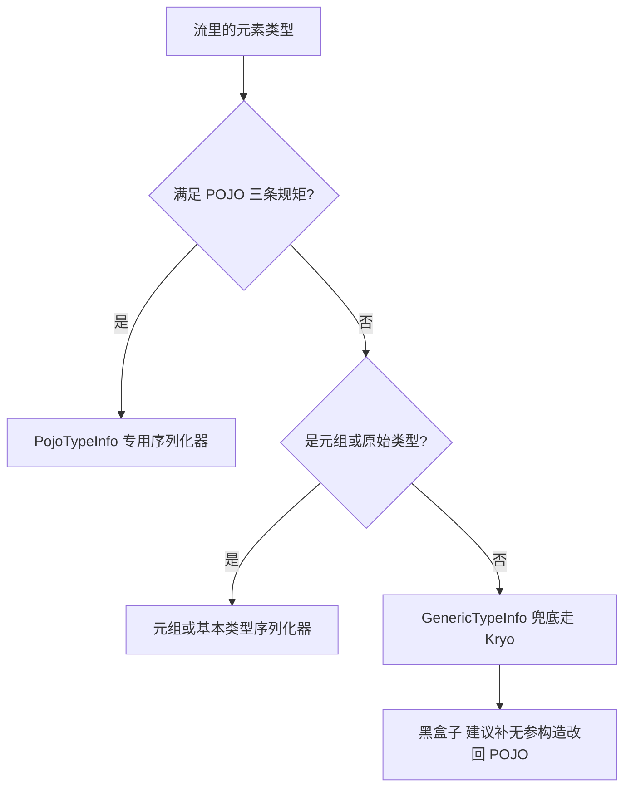

# Flink 数据类型：六类元素、POJO 三条规矩与 Kryo 兜底

`keyBy("word")` 能按字段名分组、Tuple2 能按位置求和，这些能力不是白来的：Flink 对 DataSet 和 DataStream 里能放什么类型的元素设有明确约束，并据此为每种类型分配序列化方案。类型定义不合规，作业照跑但元素会退化成黑盒子，性能悄悄劣化。这一篇把六类元素类型、POJO 的硬规矩和 Kryo 兜底的代价一次讲清。

## 先给结论

- 元素类型共六类：Java 元组与 Scala 案例 class、Java POJO、原始类型、常规类、值类型、Hadoop Writable。
- POJO 三条规矩：public 的类、公共无参构造函数、字段 public 或经 getter 与 setter 访问；三条齐备才享受专用序列化器。
- 元组 Tuple1 到 Tuple25 字段数固定、按位置 f0 与 f1 访问；POJO 按字段名访问，`keyBy("word")` 由此而来。
- 不满足 POJO 规矩的类自动退化为常规类，序列化交给 Kryo，被当成黑盒子，性能与字段级操作都打折。
- 开发中最常用的是元组、POJO 与原始类型；值类型与 Hadoop Writable 按特定场景启用。

## 一、六类元素类型总览

DataStream 和 DataSet 由一条条记录组成，记录的类型就是这里要谈的「数据类型」。Flink 对元素类型设限制的目的写在讲义上：为了更有效地执行。类型信息越明确，序列化越快，按字段排序、分组的优化空间越大。六类一张表看全：

| 类型 | 是什么 | 典型场景 |
|---|---|---|
| 元组 Tuple 与 Scala 案例 class | 固定 1 到 25 个字段的复合类型，按位置访问 | `keyBy(0)`、`sum(1)` 这类位置操作 |
| POJO | 公开类加无参构造加可访问字段，按字段名访问 | WordWithCount 这种业务对象 |
| 原始类型 | Integer、String、Double 等 Java 基本类型 | 流里的裸字符串、数值 |
| 常规类 | 不满足 POJO 规矩的普通类 | 兜底，不建议主动用 |
| 值类型 | 实现 org.apache.flink.types.Value，手写序列化 | 通用序列化效率过低时 |
| Hadoop Writable | 实现 org.apache.hadoop.io.Writable | 结果写 HDFS 场景 |

## 二、元组：按位置访问的复合类型

元组是固定字段数的复合类型，Tuple2 就是两个字段，最多到 Tuple25，每个字段各有自己的类型，字段类型可以是 String、Integer 等各种基本类型。典型用法：

```java
DataStream<Tuple2<String, Integer>> wordCounts = env.fromElements(
        new Tuple2<String, Integer>("hello", 1),
        new Tuple2<String, Integer>("world", 2));

// map 里按位置取字段：f0 是第一个，f1 是第二个
wordCounts.map(new MapFunction<Tuple2<String, Integer>, Integer>() {
    @Override
    public Integer map(Tuple2<String, Integer> value) throws Exception {
        return value.f1;
    }
});

// 按位置分组，两种写法等价
wordCounts.keyBy(0);
wordCounts.keyBy("f0");
```

位置字段名固定为 f0、f1，`keyBy(0)` 与 `keyBy("f0")` 是一回事。元组胜在轻量、创建顺手，缺点是 f1 这类名字毫无业务含义，字段一多可读性骤降，这时就该换 POJO。

## 三、POJO：三条硬规矩

**第一条，类是 public 的。** 非 public 类不参与 POJO 判定，直接滑向常规类。

**第二条，有公共的无参构造函数，也叫默认构造函数。** 这是序列化框架实例化对象的入口；只写有参构造时 Java 会隐式吞掉默认构造，POJO 身份随即丢失，这是实际开发中最常踩的一条。

**第三条，所有字段 public，或通过 getter 与 setter 访问。** 序列化器要按字段读写，字段被藏起来就没法干活。

配套工程里的 WordWithCount 就是标准 POJO（真实源码，包名改写）：

```java
/**
 * 定义 wordwithcount 的 POJO
 */
public static class WordWithCount {
    public String word;
    public long count;

    public WordWithCount() {}

    public WordWithCount(String word, long count) {
        this.word = word;
        this.count = count;
    }
}
```

合规之后，字段名就成了操作入口：

```java
DataStream<WordWithCount> wordCounts = env.fromElements(
        new WordWithCount("hello", 1),
        new WordWithCount("world", 2));

// 按字段表达式分组，keyBy("word") 的来历
wordCounts.keyBy("word");
```

从类型进来到序列化器分配，判定逻辑一张图说清：



背后是 Flink 的运行时类型系统 TypeInformation 在做判定：POJO 得到 PojoTypeInfo 与专用序列化器，元组与原始类型各有对应实现，不合规的类落到 GenericTypeInfo 交 Kryo（TypeInformation 的展开按主流写法补充，课程口播以六类介绍为主）。

## 四、常规类、值类型与 Hadoop Writable

**常规类是兜底。** 所有没有被识别为 POJO 的类型都按常规类处理，Flink 把它们视为黑盒子，无法访问内部内容，序列化交给 Kryo。限制也写明：字段里有文件指针、I/O 流这类不可序列化成员的类不行；遵循 Java Beans 约定的类通常可用。Kryo 是反射式通用序列化，速度与空间都不如专用序列化器，这正是守 POJO 三条规矩的理由。

**值类型是手动档。** 实现 org.apache.flink.types.Value 接口，自己写 read 与 write 方法，不走通用序列化框架。值类型是基本类型的可变变体，值可以被变更，允许程序复用对象，给垃圾回收器减负；通用序列化效率非常低时才值得写。Flink 为基本类型各配了一个实现：ByteValue、ShortValue、IntValue、LongValue、FloatValue、DoubleValue、StringValue、CharValue、BooleanValue。

**Hadoop Writable 对接 Hadoop 体系。** 数据要落到 HDFS 时，实现 org.apache.hadoop.io.Writable 接口的类型可以直接被识别，与 HDFS 读写天然兼容。

日常开发里，元组、POJO、原始类型三类覆盖绝大多数场景，后三类按场景启用，六类类型心里有谱，写算子时该按位置还是按字段名、该不该补无参构造，就都有了依据。

## 常见误区

- **以为任何类都能 `keyBy("字段名")`。** 错例是随手定义字段 private、只有 getter 的类，然后按字段名分组，运行时才发现它没被当成 POJO。正解是三条规矩先配齐，或改用元组按位置操作。
- **只写有参构造。** 错例是构造函数写得很全，唯独没有无参构造，程序不报错但类型退化成常规类走 Kryo。正解是显式补上无参构造，这一条最容易漏。
- **把不可序列化的成员放进数据类。** 错例是字段里挂着文件句柄、网络连接这类资源，提交作业直接序列化失败。正解是数据类只放数据，资源交给算子的 open 与 close 生命周期管理。
- **性能排查时不查类型判定。** 错例是吞吐上不去只盯着算子调优。正解是先确认元素类型有没有退化成 Kryo，必要时补齐 POJO 规矩或显式指定类型信息（排查手段按主流写法补充）。

## 面试可能被问到的问题

1. 面试官追问：「Flink 的元素类型有哪几类？」
   答：六类：Java 元组与 Scala 案例 class、Java POJO、原始类型、常规类、值类型、Hadoop Writable；开发中最常用的是元组、POJO 与原始类型。
2. 面试官追问：「一个类要被 Flink 当成 POJO，需要满足什么条件？」
   答：类是 public 的，必须有公共无参构造函数，所有字段 public 或通过 getter 与 setter 访问；三者缺一就退化为常规类，改走 Kryo 序列化。
3. 面试官追问：「常规类和 POJO 在序列化上的差别？」
   答：POJO 有基于类型信息的专用序列化器，支持字段级访问与优化；常规类被当黑盒子，用 Kryo 反射式通用序列化，性能与空间都更差，也无法做字段级操作。
4. 面试官追问：「Tuple2 怎么按字段分组？」
   答：按位置或位置名：`keyBy(0)` 与 `keyBy("f0")` 等价，f0、f1 是元组字段的固定位置名；POJO 则直接用字段名，如 `keyBy("word")`。
5. 面试官追问：「值类型什么时候用？」
   答：通用序列化效率过低、或需要复用对象减轻垃圾回收压力时，实现 org.apache.flink.types.Value 接口手写 read 与 write；Flink 为每种基本类型提供了对应实现，如 IntValue、StringValue。

## 配套资料

- 代码：`materials/code/06/day4 Flink基础与流数据处理/`，flink-demo 工程的 Streaming/SocketWordCount（内含 WordWithCount POJO 真实定义）与 batch/WordCount（Tuple2 按位置分组求和的真实用法），均为真实随包文件，正文包名改写为 `com.study.coldchain`。
- 说明：元组与 `keyBy("f0")` 示例取自课程画面（Flink 官方文档同款示例）；TypeInformation 判定链路与排查手段为本课之外的补充；引用路径截至 day 目录层级。
