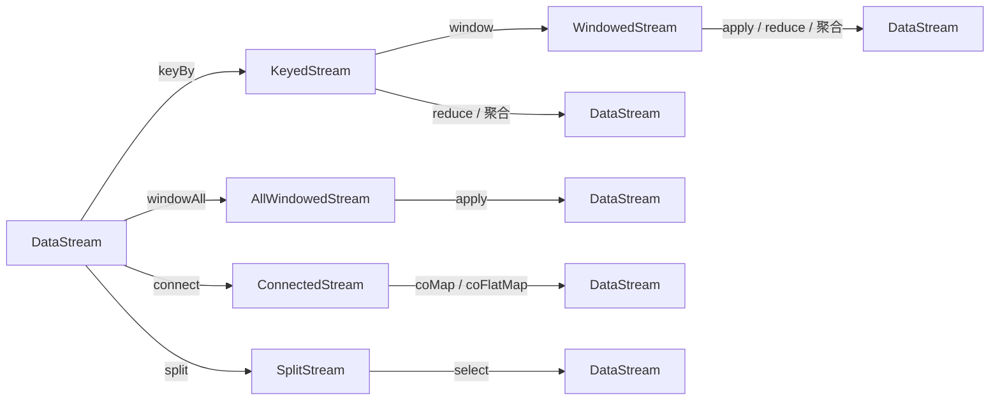

# Flink 数据转换操作：一张图看懂 DataStream 家族的互转关系

对着 Flink 官方文档里的数据流转换图，很多初学者的第一反应是节点太多：DataStream、KeyedStream、WindowedStream、ConnectedStream、SplitStream、AllWindowedStream，每个节点之间还挂着 keyBy、connect、split、reduce、apply 等一排方法名，根本记不住谁指向谁。其实这张图只讲了一件事：不同类型的流之间靠哪些算子互相转换，以及每种流能做哪些事。把图拆开看，逻辑相当清晰。

## 先给结论

- 转换算子的本质是「一种流变成另一种流」：map、flatMap、filter 是 DataStream 到 DataStream 的平级转换；keyBy 是升维，得到带分组的 KeyedStream；reduce、apply 是降维，把分组流、窗口流变回 DataStream。
- 记图只要记住四个入口算子：keyBy 得到 KeyedStream，windowAll 得到 AllWindowedStream，connect 得到 ConnectedStream，split 得到 SplitStream。
- KeyedStream 之上能继续 window（得到 WindowedStream），WindowedStream 与 AllWindowedStream 都靠 apply 或聚合函数回到 DataStream。
- connect 与 union 是两个容易混的合并算子：union 要求两条流元素类型一致，connect 允许两条不同类型的流合在一起再统一处理。
- flink-demo 工程的 StreamTransfer 用一条链把 map、flatMap、keyBy、timeWindow、reduce 串了起来，是这套转换关系最直接的代码对照。

## 一、先把转换图读明白

屏幕上那张图来自 Flink 官方文档，用节点表示流的类型、箭头上的方法名表示转换算子。把它整理成一张方向明确的关系图：



图里可以从左往右读：左边都是 DataStream，keyBy 之后的流类型变了，能做的事也变了；从右往左读则是把特殊流「化简」回普通 DataStream 的过程。所谓会读这张图，就是知道每一步转换之后拿到的是什么类型的流、这个类型上还剩哪些方法可调。

**第一，map、flatMap、filter 这一类是平级转换。** 输入是 DataStream，输出还是 DataStream，变的只是元素的值或个数。map 对每个元素做一对一转换；flatMap 对每个元素做一对零到多的转换；filter 按条件留下子集。这三个算子覆盖了日常绝大多数清洗逻辑。

**第二，keyBy 是从「流」到「分组流」的升维。** 它按某个字段对数据做哈希分区，同一个 key 的所有记录被路由到同一个并行子任务，返回的 KeyedStream 上才能做按组聚合、按组开窗。reduce 只能作用在 KeyedStream 上，原因就在这里：两两合并必须保证同一 key 的两条记录在同一个算子实例里。

**第三，窗口相关是两条对称的支线。** DataStream 直接调 windowAll 进 AllWindowedStream，对整条流（不分组）开窗；KeyedStream 调 window 进 WindowedStream，对每个分组各自开窗。两条支线最后都通过 apply 或聚合函数回到 DataStream。因为窗口的概念放在单独一节展开，这里只需要记住「开窗并不改变上面说的转换骨架，只是把聚合动作推迟到窗口关闭时触发」。

**第四，connect 与 split 处理「合流」与「分流」。** connect 把两条类型可以不同的流合并成 ConnectedStream，之后用 coMap 或 coFlatMap 分别指定两条流各自的处理逻辑，输出统一的 DataStream；split 把一条流按标记拆成多个逻辑上的 SplitStream，再用 select 从中挑出一条或多条。这两个算子是搭建复杂拓扑（比如把告警流和正常流分开走）的基础。

## 二、flink-demo 的转换链：一条代码串起五个算子

工程里的 StreamTransfer 把上面这些转换用在同一条链上：socket 进来的文本先 map 成整数，再 flatMap 转回字符串，接着 keyBy 分组、开 5 秒滚动窗口、reduce 拼接。包名改写后代码如下：

```java
package com.study.coldchain.demo.flink.Streaming;

import org.apache.flink.api.common.functions.FlatMapFunction;
import org.apache.flink.api.common.functions.MapFunction;
import org.apache.flink.api.common.functions.ReduceFunction;
import org.apache.flink.streaming.api.datastream.DataStream;
import org.apache.flink.streaming.api.environment.StreamExecutionEnvironment;
import org.apache.flink.streaming.api.windowing.time.Time;
import org.apache.flink.util.Collector;

public class StreamTransfer {
    public static void main(String[] args) throws Exception {
        // 1. 设置执行环境
        final StreamExecutionEnvironment env = StreamExecutionEnvironment.createLocalEnvironment();

        // 2. 定义数据源
        DataStream<String> dt1 = env.socketTextStream("172.17.0.143", 9000);

        // 3. 处理逻辑/转换逻辑
        dt1.map(new MapFunction<String, Integer>() { // DataStream --map--> DataStream
            @Override
            public Integer map(String s) throws Exception {
                return Integer.valueOf(s);
            }
        }).flatMap(new FlatMapFunction<Integer, String>() { // DataStream --flatMap--> DataStream
            @Override
            public void flatMap(Integer integer, Collector<String> collector) throws Exception {
                collector.collect(String.valueOf(integer));
            }
        })
        .keyBy("key1") // DataStream --keyBy--> KeyedStream
                .timeWindow(Time.seconds(5))
                .reduce(new ReduceFunction<String>() { // KeyedStream --reduce--> DataStream
                    @Override
                    public String reduce(String s, String t1) throws Exception {
                        return s + t1;
                    }
                }).print();

        env.execute();
    }
}
```

链上每个算子右边的注释就是那张转换图的具体落地：map 与 flatMap 进出都是 DataStream，keyBy 把类型换成 KeyedStream，timeWindow 在分组流上开窗，reduce 又把结果化回 DataStream。读别人的 Flink 代码时按这个方法逐个认类型，就不会迷失在算子链里。

map 一对一转换最简单，从集合源构造数据流再做倍增的写法在 StreamFromCollection 里也能看到：

```java
// 集合数据源：10、20、30、40
DataStreamSource<Integer> dataStreamSource = env.fromCollection(data);
DataStream<Integer> dataStream = dataStreamSource.map(new MapFunction<Integer, Integer>() {
    @Override
    public Integer map(Integer integer) throws Exception {
        return integer * 2; // 每个元素乘 2，一对一转换
    }
});
dataStream.print().setParallelism(1);
```

flatMap 一对多的典型场景是分词，SocketWordCount 里对每行文本按空白拆分，一行进来几个单词出去就是几条记录；filter 的写法是传入返回布尔值的条件函数，比如过滤掉数值为 0 的记录，得到的是原流的子集。这两个算子在单词统计那条链里已经出现过，逻辑与 map 同源，不再展开。

## 三、union 与 connect：两种合流方式的差别

转换图里的 ConnectedStream 由 connect 产生，与它相对的还有一个更简单的 union。两者都把多条流合成一条，差别在类型约束与后续处理方式：

```java
// union：两条流元素类型必须一致，直接首尾拼接
DataStream<String> united = streamA.union(streamB);

// connect：两条流类型可以不同，合并后用 coMap 分别处理
ConnectedStreams<Integer, String> connected = intStream.connect(strStream);
DataStream<String> result = connected.map(
        new CoMapFunction<Integer, String, String>() {
            @Override
            public String map1(Integer value) { // 处理第一条流
                return "int: " + value;
            }
            @Override
            public String map2(String value) { // 处理第二条流
                return "str: " + value;
            }
        });
```

这段合流示例是按本课写法补全的说明代码，课程源码包中没有对应文件。记住选择标准即可：类型相同、只想拼在一起，用 union；类型不同、或者要在同一个算子里区分处理两种数据，用 connect 加 coMap。实际项目里，把设备原始消息流与配置更新流接在一起统一加工，用的就是后者。

## 常见误区

- **以为 map 和 flatMap 可以随便互换。** 错例是想把一行文本拆成多个单词却调了 map，编译都过不了，因为 map 的返回值只能是单个元素。正解是一对一用 map，一对零到多用 flatMap，后者靠 Collector 逐条吐出。
- **在普通 DataStream 上直接调 reduce。** 错例是拿到 socketTextStream 的返回值就想 reduce，编译器提示方法不存在。正解是先 keyBy 得到 KeyedStream，分组之后才有按组合并的资格。
- **把 connect 当成 union 用。** 错例是两条类型不同的流直接 union，类型检查直接报错。正解是类型不同时改用 connect，再通过 coMap 或 coFlatMap 为每条流分别给出处理函数。
- **认为 split 之后的流已经物理分开。** 错例是以为 split 会立刻把数据写到两条物理流里。正解是 split 只是给记录打标记的惰性操作，真正把某一支取出来要靠 select，数据依旧在同一条物理链路里流转。

## 面试可能被问到的问题

1. 面试官追问：「keyBy 之后流的类型发生了什么变化？为什么 reduce 只能作用在它上面？」
   答：keyBy 按字段做哈希分区，返回 KeyedStream，同一 key 的记录被路由到同一并行子任务。reduce 是两两合并，必须保证同一 key 的记录落在同一个实例上才有意义，所以它只存在于 KeyedStream 之上。
2. 面试官追问：「map、flatMap、filter 三者的区别？」
   答：map 一对一转换，flatMap 一对零到多（配合 Collector 输出多条），filter 按布尔条件过滤得到子集。三者输入输出都是 DataStream，属于平级转换。
3. 面试官追问：「union 和 connect 有什么区别？」
   答：union 要求参与合并的流元素类型一致，合并后还是普通 DataStream；connect 允许两条类型不同的流合并成 ConnectedStream，之后用 coMap 或 coFlatMap 分别指定处理逻辑，输出统一的 DataStream。
4. 面试官追问：「windowAll 和 window 分别在什么流上调用？」
   答：windowAll 是 DataStream 上的方法，对整条流不分组开窗，进入 AllWindowedStream；window 是 KeyedStream 上的方法，对每个分组各自开窗，进入 WindowedStream。分组开窗的并行度更好，能用 window 优先用 window。
5. 面试官追问：「split 和 select 为什么要成对出现？」
   答：split 负责按条件给记录打标记，把一条流逻辑上拆成多支；select 负责按标记取出其中一支或多支。只有 split 没有 select，拆出来的流无处使用；二者配合才能实现分流拓扑。

## 配套资料

- 代码：`materials/code/06/day4 Flink基础与流数据处理/`，flink-demo 工程的 StreamTransfer、StreamFromCollection、SocketWordCount 真实源码（包名改写为 `com.study.coldchain`）与 pom.xml。
- 说明：第三节 union 与 connect 的合流示例为按本课写法补全的说明代码；文中转换关系图按课程画面整理；引用路径截至 day 目录层级。
