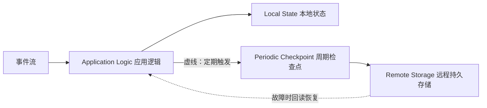

# 有状态的流处理：把中间结果记下来，机器挂了也能接上算

无界流跑起来之后，程序不是一条一条孤立地处理记录：统计「过去五分钟点击量」要记着前面那些点击，温控告警要记得这个设备上次什么时候报过警。这些被记下来的中间数据就是状态。状态只存在内存里当然省事，麻烦在于 Flink 是分布式系统，机器一挂状态就没了，于是就有了 checkpoint 这套保护机制。这一讲把「状态是什么、放哪里、挂了怎么办」一次讲透。

## 先给结论

- 有状态的流处理是一种应用设计模式：处理无界流时，对中间数据做存储与访问，让前后事件在指标层面产生关联。
- 状态可以存在程序变量、本地文件、内置或外部数据库里；Flink 把状态放在本地内存或外部系统中，按作用范围分成算子状态与键控状态两类。
- 分布式环境下状态必须被保护：Flink 定期生成一致性 checkpoint（检查点）并写入持久化存储。
- 故障恢复靠两件套：从 checkpoint 恢复状态，再把事件日志的读取位置重置回去重放，结果与故障前一致。
- 项目里的落点是 cold-flink 的 StreamingJob：每 5 秒一次 checkpoint 加固定延迟重启策略，温控告警所需的设备阈值档案放在 Redis 这类外部存储中。

## 一、为什么无界流必须「有状态」

网站交互、手机上报、服务器日志、传感器信息，这些数据都以持续不断的流式事件形式产生。任何处理流式事件的应用都不会简单地一次处理一条就完事，因为相邻事件之间在指标层面有关联：想看某页面过去五分钟的点击量，点击数量是对窗口内记录的求和，求和就必须记着之前进来过哪些数，这就是状态在应用里的延续。

换个更贴业务的说法：对数据做处理和转换时，操作本身是有状态的。应用收到一个事件，处理时可以从状态里读出此前积累的数据来协助计算，也可以把当前数据写入状态。网页 PV 累计、五分钟窗口聚合、连续报警次数判断，底层靠的都是这套「读状态、改状态」的循环。

状态放在哪里由应用自己选，常见位置有三类：程序变量（最快，进程一死就没）、本地文件、内置或外部数据库。Flink 的做法是把应用状态存储在本地内存里（也可以落地到外部数据库），这样读写延迟极低，聚合算子处理每条记录时都是在内存里更新计数值。

## 二、状态的两类：算子状态与键控状态

Flink 按作用范围把状态分成两类，这个分类决定了状态跟谁走。

**算子状态（Operator State）** 的作用域是一个算子子任务实例，同一子任务处理的所有记录共享一份状态。典型用途是 source 算子记录自己消费到的偏移量：Kafka 消费者每个并行实例各自记着读到哪个分区哪个位置，恢复时按实例分配回去。

**键控状态（Keyed State）** 的作用域是一个 key，keyBy 之后每个键一份独立状态，访问时只看得见自己这个 key 的数据。冷链场景里最常用：按设备号分组后，每个设备各记各的「上次告警时间」，下面这段键控状态示例（按主流写法补全，课程源码包无对应文件）演示了用 `ValueState` 记录上次告警时间戳、实现十分钟内同一设备不重复告警：

```java
public class DedupAlert extends RichFlatMapFunction<MessageEntity, String> {
    private transient ValueState<Long> lastAlertTs;

    @Override
    public void open(Configuration parameters) {
        // 按 key 访问的键控状态：每个设备一份
        lastAlertTs = getRuntimeContext().getState(
                new ValueStateDescriptor<>("lastAlertTs", Long.class));
    }

    @Override
    public void flatMap(MessageEntity msg, Collector<String> out) throws Exception {
        Long prev = lastAlertTs.value();
        long now = System.currentTimeMillis();
        if (prev == null || now - prev > 10 * 60 * 1000L) {
            out.collect("设备 " + msg.getMetercode() + " 温度告警");
            lastAlertTs.update(now); // 更新自己这个 key 的状态
        }
    }
}
```

另外还有一类「外部状态」值得单独点出：day6 实战工程里的 MessageAggregate 就不把设备阈值存在 Flink 内存里，而是每来一条消息从 Redis 反序列化出该表计的上下限档案，比对后打上告警标记（超上限为高温、低于下限为低温）。这种「状态放外部存储」的方式换来了阈值可在线修改、多作业共享档案的好处，代价是每条消息多一次远程访问。

## 三、checkpoint：给状态定期拍照

把状态放内存解决的是「快」，防丢要靠定期存档。Flink 是分布式系统，本地状态信息必须被有效保护，防止应用或硬件挂掉后数据丢失，采用的机制是定期生成状态的一致性 checkpoint，并写入持久化存储。整条链路是这样的：



图中实线是正常处理路径：事件流入应用逻辑，状态在本地内存中更新，处理完输出结果。虚线是保护路径：每隔一段时间，Flink 把各算子的本地状态做成一个全局一致的快照推给 checkpoint，再落到远程持久存储。平时这条虚线悄无声息地工作，故障发生时它就是唯一的救命稻草。

checkpoint 的配置在 day6 实战工程 StreamingJob 里是真实代码，包名改写后如下：

```java
package com.study.coldchain.flink;

import org.apache.flink.api.common.restartstrategy.RestartStrategies;
import org.apache.flink.streaming.api.environment.CheckpointConfig;
import org.apache.flink.streaming.api.environment.StreamExecutionEnvironment;

public class StreamingJob {
    public static void main(String[] args) throws Exception {
        final StreamExecutionEnvironment env = StreamExecutionEnvironment.getExecutionEnvironment();

        // 设置容错：每 5000 毫秒做一次 checkpoint
        env.enableCheckpointing(5000);
        // 设置检查点模式（默认精确一次 EXACTLY_ONCE）
        env.getCheckpointConfig().setCheckpointingMode(CheckpointConfig.DEFAULT_MODE);
        // 设置重启策略：最多重启 4 次，每次间隔 1000 毫秒
        env.getConfig().setRestartStrategy(RestartStrategies.fixedDelayRestart(4, 1000));
        // 后续：Kafka 数据源、MessageAggregate 聚合、SinkToMySQL 写出
    }
}
```

三行配置各管一段：`enableCheckpointing` 定下拍照频率，检查点模式定下语义（默认 EXACTLY_ONCE，故障恢复后数据不重不漏），重启策略定下作业挂掉后自动拉起几次、间隔多久。checkpoint 的具体落盘位置由状态后端决定，按存储介质分三档：`MemoryStateBackend` 存在 TaskManager 内存里，快但怕机器挂；`FsStateBackend` 写到文件系统（如 HDFS）；`RocksDBStateBackend` 借助 RocksDB 落磁盘，状态量大时的选择。生产作业通常至少选文件系统档。

## 四、故障恢复：状态回滚加事件重放

checkpoint 里存的是某一时刻的状态快照，要把作业恢复到「挂掉前正在算的位置」，还需要重放那段没算完的数据，这依赖一个前提：输入可以被重放。Flink 的架构里有一个事件日志（event log）的概念，即持续追加、可以按既定顺序重现的持久化输入流。Kafka 正是理想的事件日志：消息带顺序、可重读，消费位移就是「读取位置」。

故障发生时的恢复流程因此只有两步：从最近的 checkpoint 恢复所有算子的状态，再把事件日志的读取位置重置到快照对应的那一点继续消费。因为状态和读取位置是配套回滚的，重放出的记录从同一个起点再算一遍，结果与故障前一致。

这套机制的用途远不止救火。同一个「恢复状态加重放」的流程，可以用于应用更新、修复 bug 之后重算历史数据，也可以在改完逻辑后从头回放验证结果。有状态的流处理框架因此具备更强的容错性与可维护性，这也是 Flink 相对「无状态跑批」类引擎的核心竞争力之一。

## 常见误区

- **以为开了 checkpoint 状态就永不丢失。** 错例是配了 5 秒 checkpoint 就认为任意崩溃都无损。正解是 checkpoint 是周期性的，两次快照之间的增量在重启后靠重放补回，这要求数据源可重放（如 Kafka）；socket 这类不可重放的源出了故障，两次快照之间的数据就真丢了。
- **把 checkpoint 和「保存点」混为一谈。** 错例是升级作业时直接用最近一次 checkpoint 恢复。正解是 checkpoint 是自动的、为故障恢复服务的周期快照；savepoint 是手动触发的存档，面向升级、迁移、扩缩容这类计划内操作，课程口播里的「保存点」实际上指的就是 checkpoint 这类存档机制。
- **键控状态写在 keyBy 之前。** 错例是想在普通 DataStream 的算子里调 `getRuntimeContext().getState()`，拿不到键控状态。正解是先 keyBy 分组，算子再实现 Rich 函数族接口，在 open 里声明键控状态，每个 key 各有一份。
- **阈值这类「会变的配置」硬编码进算子。** 错例是把每块表计的上下限写成常量，改一次阈值就得重新打包发布。正解是像 MessageAggregate 那样把档案放 Redis 等外部存储，运行时读取，阈值在线生效。

## 面试可能被问到的问题

1. 面试官追问：「什么是有状态的流处理？为什么流处理需要状态？」
   答：有状态的流处理是一种处理无界流的设计模式，应用在处理记录的过程中存储并访问中间数据，让前后事件产生关联。像五分钟窗口求和、累计 PV、连续告警判断，都必须记住此前处理过的数据才能算出正确结果。
2. 面试官追问：「Flink 的状态分哪几类？」
   答：按作用范围分算子状态和键控状态。算子状态作用于单个算子子任务实例，典型如 source 记录消费偏移量；键控状态作用于 keyBy 之后的每个 key，如 `ValueState`、`ListState`，每个键独立一份。
3. 面试官追问：「checkpoint 的工作原理是什么？」
   答：Flink 定期在数据流中插入屏障（barrier），各算子随屏障流动把本地状态做成全局一致快照，写入持久化存储。故障发生时从最近 checkpoint 恢复状态，并把可重放的输入（如 Kafka）的读取位置重置回去继续消费，保证结果一致。
4. 面试官追问：「状态放内存会不会有数据丢失风险？怎么应对？」
   答：会。本地内存状态随进程消失，所以 Flink 用 checkpoint 机制定期把状态快照写入远程持久存储，配合可重放的事件日志实现故障后恢复。状态量大时还可以切换到 RocksDB 这类落盘的状态后端。
5. 面试官追问：「enableCheckpointing(5000) 和 fixedDelayRestart(4, 1000) 各起什么作用？」
   答：前者开启 checkpoint 且周期 5 秒，配合默认 EXACTLY_ONCE 模式决定故障恢复后数据不重不漏；后者是重启策略，作业失败后最多自动重启 4 次、每次间隔 1 秒，超过次数作业才真正失败。
6. 面试官追问：「温控告警这类业务里，状态和外部存储怎么分工？」
   答：与 key 相关的实时计算状态（如上次告警时间、窗口内计数）放 Flink 键控状态，随 checkpoint 一起容错；低频更新、需要在线修改或多作业共享的数据（如设备阈值档案）放 Redis 等外部存储，算子运行时读取并比对打标。

## 配套资料

- 代码：`materials/code/06/day6 实时计算 - 冷眼项目实战/`，cold-flink 工程的 StreamingJob（checkpoint 与重启策略真实代码）、MessageAggregate（从 Redis 读取设备阈值档案并生成温控告警标记）、SinkToMySQL，包名改写为 `com.study.coldchain`（该目录名含项目代号，正文统一称冷链监控平台）。
- 说明：键控状态去重告警示例为按本课写法补全的说明代码，课程源码包无对应文件；checkpoint 架构图按课程画面整理；引用路径截至 day 目录层级。
