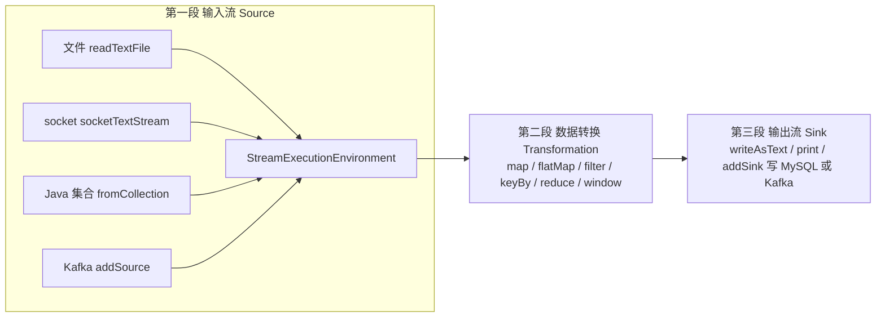

# Flink 数据流编程全景：Source、Transformation、Sink 三段式写一个完整作业

前面把转换算子、窗口、状态挨个学过，各块知识是散的。把它们串起来的，是 Flink 编程的固定骨架：任何流处理程序都长成「数据从哪来（Source）、数据怎么加工（Transformation）、结果去哪（Sink）」三段。理清这个骨架，再去读任何一个 Flink 作业的 main 方法，都能一眼看出层次；自己动手写一个读 Kafka、做转换、写 MySQL 的完整小作业，也只是往三段里各填一块积木。

## 先给结论

- Flink 的数据抽象分两类：流数据 DataStream 与批数据 DataSet，这里聚焦流数据编程，DataSet 留到批处理部分再讲。
- 编程模型三段式：输入流、数据转换操作、输出流，流数据与批数据都遵循这个过程。
- Source 四种来源：文件（readTextFile 逐行读取、readFile 按指定格式）、socket、Java 集合、自定义 addSource；入口统一是 StreamExecutionEnvironment。
- 转换算子二十多种不必死记，按「平级转换、分组、窗口、合流、分流」五组记，核心是 map、flatMap、filter、keyBy、reduce 五个高频算子。
- Sink 既有 writeAsText、writeAsCsv、print、写 socket 这些内置出口，也有 addSink 自定义接收器对接 Kafka、MySQL、Redis；day4 到此收官，三段式骨架直接对接后续项目实战。

## 一、编程模型：把 Flink 当成数据工厂

把 Flink 理解成一个加工数据的工厂：一批数据进来，可能是流数据 DataStream，也可能是批数据 DataSet；工厂内部做计算；计算完的结果要流出去，出口可以是 MySQL、Kafka、文本文件、socket 端口等各种各样的地方。整个过程拆成三部分：



图从左到右就是一条作业的生命周期：环境拿到数据源生成 DataStream，数据流经一串转换算子被加工，最终由 sink 写出。**流数据和批数据的区别只在两端的积木，中间的转换思路完全一致**，所以这三段式既是流处理编程的主线，也是后面批处理编程的预习。

## 二、Source：数据从哪里来

流数据的输入统一由 `StreamExecutionEnvironment` 提供，按来源分四类。方法清单整理如下（方法名与行为按课程讲解整理）：

```java
// 1. 基于文件：逐行读取文本文件，以字符串方式返回
DataStream<String> fromFile = env.readTextFile("input/words.txt");

// 2. 基于 socket：监听端口收数据，单词统计示例用的就是它
DataStream<String> fromSocket = env.socketTextStream("172.17.0.143", 9000);

// 3. 基于 Java 集合：本地少量数据直接变成流
DataStream<Integer> fromColl = env.fromCollection(dataList);

// 4. 自定义数据源：addSource 接一个 SourceFunction，Kafka 消费者就是这么接进来的
DataStream<String> fromKafka = env.addSource(kafkaConsumer);
```

四类来源覆盖了开发和生产两侧：文件与集合适合调试验证逻辑，socket 适合课堂演示，自定义 addSource 接 Kafka 才是生产的常态。选型的判断标准只有一个：数据在真实业务里从哪产生，source 就从哪接。

## 三、Transformation：二十多个算子按五组记

数据转换操作是 Flink 算子最多的一段，课程里一口气列了二十多个。与其背清单，不如按功能分组装进脑子：

| 分组 | 代表算子 | 一句话作用 |
|---|---|---|
| 平级转换 | map、flatMap、filter | 一对一改值、一对零到多展开、按条件过滤 |
| 分组与聚合 | keyBy、reduce、fold、聚合聚合 | 按字段分区后两两合并、带初始值滚动折叠、滚动聚合 |
| 窗口 | window、windowAll、apply、窗口聚合 | 分组或整流开窗，窗口关闭时触发计算 |
| 合流 | union、connect、coMap、coFlatMap | 同型流拼接、异型流合并后分别处理 |
| 分流与循环 | split、select、iterate | 打标记拆流、取支、输出重定向形成反馈循环 |

map 与 flatMap、filter 的分工用一个例子说清。flink-demo 的 StreamFromCollection 从集合构造整型流，map 把原值乘以 2，是与课程示例完全一致的真实代码：

```java
package com.study.coldchain.demo.flink.Streaming;

import org.apache.flink.api.common.functions.MapFunction;
import org.apache.flink.streaming.api.datastream.DataStream;
import org.apache.flink.streaming.api.datastream.DataStreamSource;
import org.apache.flink.streaming.api.environment.StreamExecutionEnvironment;
import java.util.ArrayList;

public class StreamFromCollection {
    public static void main(String[] args) throws Exception {
        // 1. 定义运行环境
        StreamExecutionEnvironment env = StreamExecutionEnvironment.getExecutionEnvironment();

        // 2. 定义数据源：Java 集合
        ArrayList<Integer> data = new ArrayList<>();
        data.add(10);
        data.add(20);
        data.add(30);
        data.add(40);
        DataStreamSource<Integer> dataStreamSource = env.fromCollection(data);

        // 3. 转换：map 返回原值乘 2，一对一改值
        DataStream<Integer> dataStream = dataStreamSource.map(new MapFunction<Integer, Integer>() {
            @Override
            public Integer map(Integer integer) throws Exception {
                return integer * 2;
            }
        });
        dataStream.print().setParallelism(1);

        // 4. 执行数据处理
        env.execute();
    }
}
```

keyBy 是分组一组的入口，值得单独记两条硬规则。能当 key 的：元组、基本类型、字符串这类可直接比较的对象。不能当 key 的：POJO 类型但未覆写 `hashCode`、且依赖 `Object.hashCode` 默认实现的字段；任何类型的数组。踩了这两条，分组的路由就会出问题。

reduce 通常跟在 keyBy 后面对组内数据两两合并，先分组拆任务、再把任务结果合并出来，这个思路与 Hadoop 体系里 MapReduce 的原理一致。fold 略冷门但直观：给定初始值 start，对序列 1、2、3 做滚动折叠，输出依次是 start-1、start-1-2、start-1-3，历史不断累在结果上。合流一组的 union 要求两条流元素类型一致，connect 则允许不同类型合在一起再用 coMap 分别处理；关联一组的 window join 与 SQL 里的 join 心理模型相同，两条流各自在窗口内到达的记录按 key 配对，intervalJoin 进一步限定「一个元素的时间戳加上下限，落在另一个元素时间戳的区间内」才配对。

## 四、Sink 与完整小作业：读 Kafka 到写出

输出流的内置方法有 `writeAsText`（写成文本文件）、`writeAsCsv`（CSV 文件）、print、写 socket；更强的能力是 `addSink` 自定义接收器，绑定 Kafka、MySQL、Redis 等外部系统。最简的文件写出在 flink-demo 的 FlinkSinkTest 里：

```java
// socket 进来的数据直接落成文本文件
final StreamExecutionEnvironment env = StreamExecutionEnvironment.createLocalEnvironment();
DataStream<String> dataStream = env.socketTextStream("172.17.0.143", 9000, "\n");
dataStream.writeAsText("d:\\datastream");
env.execute();
```

把三段拼起来，就是一个生产模样的完整作业。day6 实战工程 StreamingJob 的主干真实代码如下（checkpoint 配置已在前文展开，此处从略），包名改写后：

```java
package com.study.coldchain.flink;

// import 从略：JSON、FlinkKafkaConsumer/Producer、SimpleStringSchema、Properties

public class StreamingJob {
    public static void main(String[] args) throws Exception {
        String kafka_topic = "device_msg_topic";
        final StreamExecutionEnvironment env = StreamExecutionEnvironment.getExecutionEnvironment();

        // Kafka 队列属性与 consumer，接收采集侧发送过来的数据
        Properties properties = new Properties();
        properties.setProperty("bootstrap.servers", "172.17.0.143:9092");
        properties.setProperty("group.id", "coldflink");
        properties.setProperty("auto.offset.reset", "earliest");
        FlinkKafkaConsumer<String> consumer =
                new FlinkKafkaConsumer<>(kafka_topic, new SimpleStringSchema(), properties);
        consumer.setStartFromLatest();

        // Source：Kafka 队列，JSON 字符流反序列化成消息对象
        DataStream<MessageEntity> stream = env.addSource(consumer)
                .setParallelism(1)
                .map(string -> JSON.parseObject(string, MessageEntity.class));

        // Transformation：从 Redis 取设备档案补全消息，并比对阈值生成温控告警标记
        DataStream<MessageEntity> outStream = stream.map(new MessageAggregate());

        // Sink 一：写 MySQL 存设备指标消息
        outStream.addSink(new SinkToMySQL());

        // Sink 二：回投 Kafka 队列，供下游分析组件消费
        outStream.map((MapFunction<MessageEntity, String>) JSON::toJSONString)
                .addSink(new FlinkKafkaProducer<>("all_device_message",
                        new SimpleStringSchema(), properties));

        env.execute("冷链设备实时监控任务");
    }
}
```

对照三段式读这段代码：Source 是 `addSource(consumer)` 接 Kafka；Transformation 是 JSON 反序列化加 MessageAggregate 聚合补全；Sink 是 SinkToMySQL 写库与 FlinkKafkaProducer 回投队列两路输出。三段骨架之外，作业头部的 checkpoint 与重启策略配置负责容错，真实工程的完整模样就齐了。

## 五、day4 收官：从装环境到写作业

回顾 day4 这条线：装好 Flink 集群、跑通 Socket Window WordCount 示例、读懂算子链；随后把转换算子的类型关系、窗口的切分方式、状态与 checkpoint 的容错原理逐层铺开；这一讲又把 Source、Transformation、Sink 三段式编程模型补全。到这一步，写一个 Flink 流作业需要的概念已经没有盲区，后续项目实战所做的，只是把示例两端的积木换成真实业务：source 接 Kafka 设备消息，sink 写 MySQL 并回投分析队列，中间按业务加窗口聚合与告警逻辑。

## 常见误区

- **把三段式当成三个可选步骤。** 错例是写了 source 和转换，没有 sink，也没有 `env.execute()`，程序跑完毫无输出。正解是 source、转换、sink 组成完整数据流图，最后必须显式执行，Flink 是惰性触发，缺一段整条链都不动。
- **拿数组或没覆写 `hashCode` 的 POJO 字段当 key。** 错例是 `keyBy("someArrayField")`，分组路由行为不可控。正解是 key 选元组、基本类型、字符串，POJO 做字段前先正确覆写 `hashCode` 与 `equals`。
- **union 接了两种不同类型的流。** 错例是把整型流和字符串流直接 union，编译报错。正解是类型一致用 union，类型不同改 connect 加 coMap，分别处理后输出统一类型。
- **以为 sink 写出去就是实时落库了。** 错例是用 `writeAsText` 却始终找不到文件或内容滞后。正解是文件类 sink 依赖 checkpoint 周期做最终一致写出，没开 checkpoint 的本地环境要注意数据可能停留在缓冲中；重要落库场景用 addSink 自定义实现并自行控制连接与批量。

## 面试可能被问到的问题

1. 面试官追问：「Flink 流处理程序的编程模型是什么？」
   答：三段式。Source 由 StreamExecutionEnvironment 接入数据生成 DataStream，来源有文件、socket、Java 集合与自定义 addSource；中间经一串 Transformation 算子加工；最后由 Sink 写出，内置 writeAsText、print 等，复杂出口用 addSink 自定义。整个过程由 env.execute 触发。
2. 面试官追问：「哪些字段不能作为 keyBy 的 key？」
   答：POJO 类型但未覆写 `hashCode`、依赖 `Object.hashCode` 默认实现的字段，以及任何类型的数组都不能做 key；可比较的元组、基本类型、字符串是常规选择。
3. 面试官追问：「reduce 和 fold 的区别？」
   答：reduce 对组内记录两两合并，输出类型与输入一致；fold 带一个初始值做滚动折叠，历史结果不断累加进输出，序列 1、2、3 折叠出 start-1、start-1-2、start-1-3 这样的中间累积值。
4. 面试官追问：「union、connect、join 三个合流算子怎么选？」
   答：union 用于元素类型一致的多条流简单拼接；connect 用于两条类型不同的流合并成 ConnectedStream，再用 coMap 或 coFlatMap 分别处理；join 是按 key 与窗口对两条流做关联配对，类似 SQL 的 join，intervalJoin 还能按时间间隔约束配对条件。
5. 面试官追问：「把 socket 换成 Kafka 作为 source，作业要改哪些地方？」
   答：source 换成 addSource 接 FlinkKafkaConsumer 并配 bootstrap.servers、group.id、offset 策略；由于作业有了真实容错需求，再补 enableCheckpointing 与重启策略；sink 侧同理换成 addSink 自定义写库或回投队列，中间转换骨架不变。
6. 面试官追问：「env.execute() 的作用是什么？」
   答：Flink 的算子调用是惰性的，只在客户端构建数据流图；execute 负责把图编译成作业并提交到集群真正运行。不写这一行，程序什么也不算就结束。

## 配套资料

- 代码：`materials/code/06/day4 Flink基础与流数据处理/`，flink-demo 工程的 StreamFromCollection、FlinkSinkTest、StreamFromKafka、SocketWordCount 真实源码（包名改写为 `com.study.coldchain`）与 pom.xml。
- 代码：`materials/code/06/day6 实时计算 - 冷眼项目实战/`，cold-flink 工程的 StreamingJob（读 Kafka 到写出的完整真实作业）、MessageAggregate、SinkToMySQL（该目录名含项目代号，正文统一称冷链监控平台）。
- 说明：Source 方法清单按课程讲解整理；引用路径截至 day 目录层级。
