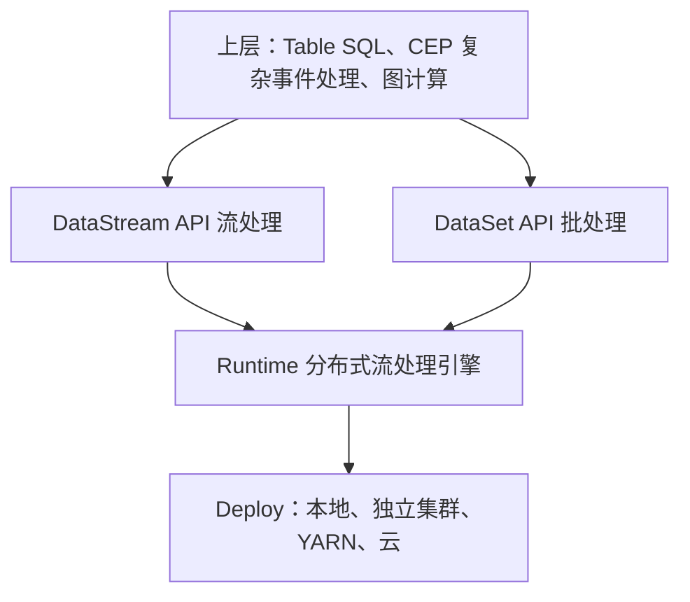
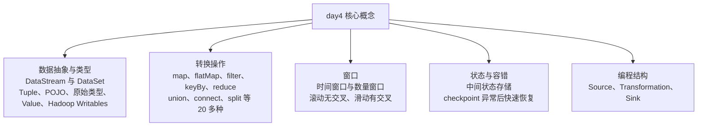

# day4 知识地图复盘：从装好 Flink 到写出一条算子链

day4 一天走完的内容很密：框架定位、安装部署、一串核心概念、DataStream API，最后落到单词统计程序。散着记很容易学完就忘，收口的方式是把概念挂回一张地图，再自查几个必答题：流计算是什么、窗口怎么切、状态拿来干什么、一个程序为什么是四段。答不上来的，顺着地图回原文补。

## 先给结论

- Flink 的定位是流式计算框架：数据像水流、车流一样持续到来，进框架处理后输出到应用程序、消息队列、数据库或文件系统。
- 分层记忆：Runtime 之上有 DataStream 与 DataSet 两套 API，再往上是 Table SQL、CEP 复杂事件处理、图计算；部署层覆盖本地、独立集群、YARN 与云。
- 应用场景三类：事件驱动型应用、数据分析应用、数据管道。
- 核心概念五组：数据抽象与类型、转换操作、窗口、状态与容错、Source 到 Transformation 到 Sink 的编程结构。
- 执行环境创建三选一：getExecutionEnvironment、createLocalEnvironment、createRemoteEnvironment。

## 一、框架层：流计算与分层 API

数据流的类比不抽象：水管里的水、河里的水、路上的车流、电流，都是持续到来的「流」，数据同样有数据流。数据流需要流式计算，Flink 就是做流式计算的框架：多种数据源的事件进入 Flink 框架内处理，处理完输出出去，去向可以是应用程序、消息队列，也可以是数据库、文件系统。

框架内部分层来看，底层 Runtime 是分布式流处理引擎，往上并排两套 API：DataStream API 管流数据，DataSet API 管批数据；两套 API 之上还有 Table SQL、CEP 复杂事件处理引擎和图计算。这套层级对应到部署层，本地、独立集群、YARN、云上都跑得起来。



图从下往上是「引擎撑 API、API 撑上层数」的关系。应用场景按业务形态分三类：事件驱动型应用让数据一来就触发逻辑，冷链监控里阈值告警是典型；数据分析应用对数据做统计洞察，比如分时段的温度报表；数据管道则在两个系统之间搬运加工数据。

## 二、装环境与跑示例：Local 与 Standalone

Flink 的安装走了两条路：Local 本地模式与 Standalone 独立集群模式。独立模式的动作是解压安装包、配环境变量、起集群：

```bash
# 解压安装包
tar xzf flink-<版本>-bin-scala_2.12.tgz

# 修改环境变量，/etc/profile 追加
export FLINK_HOME=/opt/flink-<版本>/
export PATH=$FLINK_HOME/bin:$PATH

# 提交安装包自带的流式示例作业
flink run /opt/flink-<版本>/examples/streaming/SocketWindowWordCount.jar --port 9018
```

安装包里自带的 SocketWindowWordCount 示例程序值得单独一提：跑一遍它，实时计算「数据一来就出结果」的体感就建立了。提交作业有两条路，命令行 flink run 一条，Web 页面上传 JAR 再指定端口一条。作业提交后由 JobClient、JobManager、TaskManager 三类角色协作执行，分工细节在架构原理一课已经拆过，这里把它挂回地图即可。

## 三、核心概念地图：五组概念各就各位

这张图在讲 day4 概念的全景分区，五个分支对应五组必须掌握的概念：



**数据抽象与类型。** DataStream 装无限数据流，DataSet 装有限数据集，流里元素的类型有 Tuple 元组、POJO、原始类型、Value、Hadoop Writables。两行代码回顾元素长相：

```java
DataStream<Tuple2<String, Integer>> wordCounts = env.fromElements(
        new Tuple2<>("hello", 1),
        new Tuple2<>("world", 2)
);

dataStream.map(new MapFunction<Integer, Integer>() {
    @Override
    public Integer map(Integer value) {
        return 2 * value;
    }
});
```

**转换操作。** 对一条条数据做合并、过滤、转换、拆分，课程列了二十多种函数。不必背清单，按「平级转换、分组聚合、窗口、合流、分流」分组装脑子，高频的 map、flatMap、filter、keyBy、reduce 先练熟。

**窗口。** 时间窗口按时间切，数量窗口按条数切；滚动窗口相互之间没有任何交叉，滑动窗口有交叉。配套工程 StreamingJob 把四种写法并排放着，对照读一眼就分清：

```java
// 滚动窗口：30 秒一段互不重叠；数量窗口：100 条一段
text.keyBy(0).timeWindow(Time.seconds(30)).sum(1);
text.keyBy(0).countWindow(100);

// 滑动窗口：60 秒窗口每 30 秒滑一次；数量滑动：100 条窗口每 50 条滑一次
text.keyBy(0).timeWindow(Time.seconds(60), Time.seconds(30)).sum(0);
text.keyBy(0).countWindow(100, 50);
```

**状态与容错。** 有状态的流处理是把计算过程中的中间数据存下来，存储与运行机制保证了 Flink 程序的容错性：出现异常后能从 checkpoint 快速恢复接着算，不用从头再来。

**编程结构。** 一个流处理程序就是输入流、数据转换、输出流三段，转换段的二十多种算子就是前一组概念。

## 四、程序结构四步：把概念落成代码

单词统计案例把全部概念串在了一个 main 方法里，结构固定四步。第一步创建执行环境，方式有三种：getExecutionEnvironment 自动判断当前运行在本地还是集群，示例程序用的就是它；createLocalEnvironment 明确起本地环境；createRemoteEnvironment 连指定主机与端口的远程集群。第二步添加数据源，基于文件的、基于 socket 的、基于集合的、自定义的都在这一步接入。第三步做转换，前面学的各种转换方式在这里组合。第四步输出，写文件、print、写 socket、自定义输出都行。

```java
package com.study.coldchain.demo.flink.streaming;

// import 从略：MapFunction 与相关类

public class Day4Recap {

    public static void main(String[] args) throws Exception {
        // 1. 执行环境：三选一，自动判断用 getExecutionEnvironment
        final StreamExecutionEnvironment env =
                StreamExecutionEnvironment.getExecutionEnvironment();

        // 2. 数据源：文件 与 socket 与 集合 与 自定义 addSource 四类
        DataStream<String> text = env.socketTextStream("172.17.0.143", 9000);

        // 3. 转换：20 多个算子按需组合
        DataStream<String> upper = text.map(new MapFunction<String, String>() {
            @Override
            public String map(String value) {
                return value.toUpperCase();
            }
        });

        // 4. 输出：文件 与 print 与 socket 与 自定义 sink
        upper.print();

        // 执行：惰性触发，缺了这行整张图不动
        env.execute();
    }
}
```

对照这段代码自查一遍：数据类型装在哪一步出现，转换算子在第三步怎么排队，输出怎么收口，execute 为什么必须有。四步都能说清来龙去脉，day4 就算真的拿下了。

## 五、衔接 day5：批处理与 Table SQL

day5 的两块内容在地图上已经留了位置：DataSet 批处理把「有限数据集」那半边补齐，读文件做统计是它的开场；Table API 与 SQL 则把计算表达升级成写 SQL，还要打通 DataStream、DataSet 与 Table 的互相转换。流处理的三段式骨架到了批处理照用不误，换的只是两端的积木，这正是下一步的入口。

## 常见误区

- **滚动与滑动记反。** 错例是以为滚动窗口会重叠。正解是滚动窗口首尾相接互不交叉，滑动窗口步长小于长度才产生重叠，`countWindow(100)` 与 `countWindow(100, 50)` 的参数个数就是提示。
- **环境类张冠李戴。** 错例是批处理代码里 import 了 StreamExecutionEnvironment，或者想连远程集群却写了 `createLocalEnvironment`。正解是流用 StreamExecutionEnvironment，批用 ExecutionEnvironment，本地、远程、自动判断三种创建方式按部署形态选。
- **以为装好 Flink 就自带容错。** 错例是程序挂了指望它自动接上。正解是容错依赖状态与 checkpoint 机制，状态先存住中间结果，checkpoint 周期性做快照，两者配合才有异常后快速恢复。
- **把随包示例当一次性练习。** 错例是跑完 SocketWindowWordCount 就删。正解是安装包 examples 目录下的示例都是可读源码，跑通之后再读一遍，等于白拿一份官方范本。

## 面试可能被问到的问题

1. 面试官追问：「Flink 的 API 分层说一下？」
   答：底层 Runtime 分布式流处理引擎，其上是 DataStream 流处理与 DataSet 批处理两套 API，再往上有 Table SQL、CEP 复杂事件处理与图计算，部署层支持本地、独立集群、YARN 与云。
2. 面试官追问：「Flink 的三类应用场景是什么，各举个例子？」
   答：事件驱动型应用，如监控告警；数据分析应用，如实时报表统计；数据管道，如在系统间搬运加工数据。冷链监控平台三类都用得上：阈值告警、时段统计、采集数据入分析库。
3. 面试官追问：「滚动窗口和滑动窗口的区别？」
   答：滚动窗口只传长度，窗口首尾相接互不重叠；滑动窗口多传一个步长，步长小于长度时窗口相互重叠，同一条数据可能落入多个窗口，如 60 秒窗口每 30 秒滑一次。
4. 面试官追问：「状态和 checkpoint 是什么关系，容错怎么实现？」
   答：状态保存算子计算的中间结果，checkpoint 周期性把各算子状态做快照存到外部存储；作业异常重启后从最近的快照恢复状态重算，中间数据不丢，这就是容错的来源。
5. 面试官追问：「getExecutionEnvironment 和 createLocalEnvironment 有什么区别？」
   答：前者按运行上下文自动判断，本地跑就给本地环境，集群上跑就给集群环境，最常用；后者强制创建本地环境，明确要连远程集群时用 createRemoteEnvironment 指定主机与端口。

## 配套资料

- 代码：`materials/code/06/day4 Flink基础与流数据处理/`，flink-demo 工程的 Streaming/StreamingJob（滚动与滑动窗口四行真实写法）、Streaming/SocketWordCount（四步骨架真实程序）、Streaming/StreamFromCollection（集合数据源），包名改写为 `com.study.coldchain`，均为真实随包文件。
- 说明：分层 API、应用场景、安装与提交流程按课程画面与口播整理；画面里安装包版本号显示不完整，命令中以占位写法给出；引用路径截至 day 目录层级。
