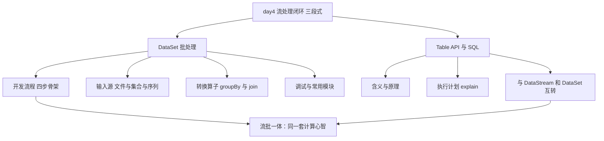

# day5 开篇：给有界数据补上 DataSet，再用 Table SQL 打通流批

day4 收官时，流处理已经闭环：socket、Kafka 进数据，算子链加工，结果落库或回投队列。但手里的活不止这一类：文件里躺着的历史数据、一次算完就走的报表统计，数据有起点也有终点，走流的 API 别扭；而算子链写多了也会冒出一个念头，这类分组求和的活能不能直接写 SQL。day5 就冲这两件事来：DataSet 批处理编程，加上 Table API 与 SQL。

## 先给结论

- day5 分两大部分：DataSet 批处理编程，以及 Table API 与 SQL。
- DataSet 的目标归纳成四条能力线：开发流程、输入源、转换算子、调试；调试经验对流数据程序同样适用。
- Table 的目标有三条：含义与原理、执行计划的执行过程、与 DataStream 和 DataSet 的互相转换。
- 每个目标在 flink-demo 工程的 batch 包与 table 包里都有对应的示例类可以对照。
- 流与批共享同一套转换思路，差别集中在两端的输入源与输出源，三段式骨架直接平移。

## 一、为什么这个时候学 DataSet

批数据的定义一句话：有界的数据。文本文件里读出来的内容、手里现成的一个有限集合，都有算完的时刻，这类数据交给 DataSet 处理。对照流数据：Kafka 队列、socket 端口里的数据持续到来没有终点，交给 DataStream。两套抽象的边界在数据是否有限，API 的形状则高度相似。

课程用一张对照表说明两边的对应关系，输入源与输出源不同，中间的转换几乎同名：

| 位置 | 流处理 DataStream | 批处理 DataSet |
|---|---|---|
| 环境 | StreamExecutionEnvironment | ExecutionEnvironment |
| 输入源 | Kafka、socket 等持续来源 | 文本文件、本地集合等有限来源 |
| 转换 | map、flatMap、filter、keyBy | map、flatMap、filter、groupBy |
| 输出 | print、写库、回投队列，常驻运行 | print、writeAsCsv 等，算完退出 |

三段式骨架原样平移：环境换一个类，输入源换一族方法，中间的过滤、映射、连接、分组还是同一套思路，输出源换一族出口。所以学 DataSet 的成本主要在记差异，不在重建认知。

## 二、七个目标、四条能力线

课程列了七个学习目标，前四条归 DataSet，后三条归 Table。逐条挂上「怎么算掌握」与对应的工程示例：

| 目标 | 怎么算掌握 | 对应工程示例 |
|---|---|---|
| 掌握 DataSet 程序开发流程 | 能默写环境、输入源、处理、执行四步 | batch/WordCount |
| 掌握输入源常见类型 | 会在文件、集合、数字序列之间选型 | batch/util/WordCountData、batch/PiEstimation |
| 掌握转换操作与常用算子 | groupBy、sum、join 上手改需求 | batch/WordCount |
| 掌握 DataSet 程序调试与常用模块 | 能在 IDE 里断点跑通一个批作业 | batch/ParamTest、batch/DistributedCache |
| 了解 Table API 与 SQL 的含义和原理 | 说清表和流、批的关系 | table/DataSetTable、table/StreamTable |
| 了解 Table 的执行过程与执行计划 | 会用 explain 打出执行计划 | table/ExplainTable |
| 掌握 DataStream、DataSet 与 Table 互转 | 两个方向都能写出转换代码 | table/TableTransfer |

这张图在讲 day5 的学习路线，两条支线最后在流批一体汇合：



调试这一条容易被当成凑数，实际它是对付真实工程的第一技能：批程序数据有限、跑完即停，IDE 里打断点一步步看数据变换，比在流程序里调试省心得多；练出来的手感回头处理 DataStream 的断点调试也是同一套办法。

## 三、Table API 与 SQL 预告

Table API 与 SQL 给计算换了种表达。把 DataStream 或 DataSet 注册成一张表，之后要么用 Table API 链式调用，要么直接写 SQL 字符串查询，分组求和这类统计从手写算子链变成一句 `select word, sum(frequency) ... group by word`。真实工程里的两个方向各看一眼：

```java
// 流转表：fromDataStream 起表，SQL 的 where 直接查
Table table1 = tEnv.fromDataStream(stream1, "count, word");
Table result = table1.where("like(word, 'w%')");

// 批转表再转回批：registerDataSet 注册，sqlQuery 查询，toDataSet 收回
tEnv.registerDataSet("WordCount", data, "word, frequency");
Table r = tEnv.sqlQuery(
        "select word, sum(frequency) as frequency from WordCount group by word");
DataSet<WC> output = tEnv.toDataSet(r, WC.class);
```

互转是第三组目标的落点，也是流批一体的门：同一份数据心智，流的代码和批的代码都能变成表、用 SQL 查、再变回流或批继续算。Table 的底层还是同一个 Runtime，执行计划 explain 打出来就能看到程序被翻译成了什么。

## 常见误区

- **把目标清单念完就过。** 错例是七个目标抄在本子上就算学了。正解是每条目标落到一个可运行的示例类上，跑通一遍、改一处需求再跑一遍，目标才算长在手上。
- **以为 DataSet 是过时内容可以跳过。** 错例是听说社区主推 DataStream 就直接跳章。正解是课程所用版本两套 API 并存，批处理心智、分组聚合的思路、看懂存量批作业的能力都要靠 DataSet 补，跳过它批处理认知就有窟窿。
- **以为调试只有加打印一条路。** 错例是一路 System.out 看输出猜问题。正解是批程序本地断点调试，数据有限、执行确定，每步转换的进出都能看清楚。
- **把 Table 当成另一套要重学的引擎。** 错例是觉得 SQL 又是一大块新知识从零开始。正解是表只是流与批之上的关系型视图，底层 Runtime 没变，学的重点是注册、查询、转回这三步衔接。

## 面试可能被问到的问题

1. 面试官追问：「DataSet 程序的开发流程是什么？」
   答：四步。ExecutionEnvironment 创建批执行环境，设置输入源，如读文件或集合，中间做 flatMap、groupBy、sum 等转换，最后输出并执行，批数据的输出多为 print 或写文件，程序算完退出。
2. 面试官追问：「批数据和流数据怎么区分？」
   答：看数据是否有限。文件内容、有限集合有算完的时刻，是批数据，用 DataSet；Kafka、socket 来的数据持续到来没有终点，是流数据，用 DataStream。
3. 面试官追问：「为什么要学 DataStream、DataSet 与 Table 的互转？」
   答：互转让同一份数据在流、批两种形态与关系型表之间自由切换，计算表达可以用 SQL 统一，这是 Flink 流批一体能力的入口，工程里能显著减少重复逻辑。
4. 面试官追问：「Table API 和 SQL 是什么关系？」
   答：同一层 API 的两种写法。Table API 是语言内的链式调用，SQL 是字符串查询，两者可以混用互换，最终都翻译成同一套执行计划交给 Runtime 运行。
5. 面试官追问：「批处理程序的调试和流处理有什么不同？」
   答：批程序数据有限、跑完即停，本地断点调试直观清晰；流程序常驻运行，调试要结合打印、checkpoint 与观测手段，先在批程序里练熟的手法可以迁移过去。

## 配套资料

- 代码：`materials/code/06/day4 Flink基础与流数据处理/`，flink-demo 工程的 batch 包（WordCount、PiEstimation、ParamTest、DistributedCache、util/WordCountData）与 table 包（DataSetTable、StreamTable、ExplainTable、TableTransfer），均为真实随包文件，包名改写为 `com.study.coldchain`。
- 说明：day5 的代码随包未单列目录，本课目标对应的示例沿用上述工程；七条目标与路线图按课程画面与口播整理；引用路径截至 day 目录层级。
