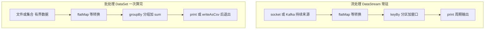

# 第一个 DataSet 程序：读进两行字符串，数出每个单词的次数

流版的单词统计要开 socket、等 5 秒窗口才吐结果；批版干同样的事直接得多：数据现成摆在程序里，flatMap 分词、groupBy 分组、sum 求和，结果打出来程序就结束。Maven 建 Flink 工程时生成的 BatchJob 骨架类，就是这段批处理逻辑的入口，把它填满，第一个 DataSet 程序就立起来了。

## 先给结论

- 批数据就是有界数据：文本文件里的内容、手里现成的有限集合；DataSet 是装它们的容器。
- 开发四步与流处理同构：ExecutionEnvironment 起环境、设置输入源、转换处理、输出执行。
- 最小统计链五步：fromElements 给两行文本、flatMap 拆成 (word, 1)、groupBy(0) 按单词分组、sum(1) 对计数求和、print 输出。
- 依赖分工在 pom 里写明：flink-java 面向批处理，flink-streaming-java 面向流处理。
- 最容易踩的坑在执行上：DataSet 的 print() 会立即触发执行，收尾再调 env.execute() 会抛 No new data sinks have been defined。

## 一、工程从哪来：Maven 原型已经备好批的依赖

流处理开工时用 Maven 命令创建了 Flink 工程，那份工程天生就是流批两用的。pom 文件由原型自动注入两支 Flink 依赖，分工明确：

```xml
<dependency>
    <groupId>org.apache.flink</groupId>
    <artifactId>flink-java</artifactId>
    <version>1.8.0</version>
</dependency>
<dependency>
    <groupId>org.apache.flink</groupId>
    <artifactId>flink-streaming-java_2.11</artifactId>
    <version>1.8.0</version>
</dependency>
```

flink-java 是批数据处理要用的包，flink-streaming-java 是流数据处理要用的包，两支并行不悖。src 目录下同样天生有两个骨架类：StreamingJob 对应流处理，BatchJob 对应批处理。BatchJob 打开就是一片注释好的空地，提示从 env.readTextFile 拿数据，用 filter、flatMap、join、groupBy 做转换，照着填就行。

## 二、四步写出最小批程序

批程序的输入源比流处理省事：读文本文件有 readTextFile，读 CSV 有 readCsvFile，readFile 按指定格式读，本地集合用 fromCollection 或 fromElements，数字序列用 generateSequence；流处理里那些 Kafka、socket 持续来源在这里没有用武之地，因为批处理吃的本来就是有界数据。最小示例连文件都省了，fromElements 直接给两行字符串：

```java
package com.study.coldchain.demo.flink.batch;

import org.apache.flink.api.common.functions.FlatMapFunction;
import org.apache.flink.api.java.DataSet;
import org.apache.flink.api.java.ExecutionEnvironment;
import org.apache.flink.api.java.tuple.Tuple2;
import org.apache.flink.util.Collector;

public class BatchJob {

    public static void main(String[] args) throws Exception {
        // 1. 设置运行环境：批执行环境
        final ExecutionEnvironment env = ExecutionEnvironment.getExecutionEnvironment();

        // 2. 设置数据输入：fromElements 直接给出两行文本
        DataSet<String> txt = env.fromElements(
                "abc abc def",
                "def abc drsd"
        );

        // 3. 处理数据：分词成 (word, 1)，按位置 0 分组，对位置 1 求和
        DataSet<Tuple2<String, Integer>> counts = txt
                .flatMap(new FlatMapFunction<String, Tuple2<String, Integer>>() {
                    @Override
                    public void flatMap(String s, Collector<Tuple2<String, Integer>> out)
                            throws Exception {
                        for (String word : s.split("\\s")) {
                            out.collect(new Tuple2<>(word, 1));
                        }
                    }
                })
                .groupBy(0)
                .sum(1);

        // 4. 输出：print 内部触发执行，不再另调 env.execute()
        counts.print();
    }
}
```

逐段过一遍。flatMap 的泛型签名进 String 出 Tuple2，Tuple2 是二元元组，第一个位置装单词、第二个位置装计数，作用与流版的 WordWithCount POJO 一致，只是换了系统自带的类型省一个类。`split("\\s")` 按空格把一行拆成单词数组，循环里每个单词 `collect(new Tuple2<>(word, 1))` 发出去，收集器可以理解成一个临时出口，发出去的记录组成新的 DataSet。`groupBy(0)` 按位置 0 也就是单词分组，单词相同的记录进同一组；`sum(1)` 对位置 1 的计数累加求和。运行输出：

```text
(abc,3)
(def,2)
(drsd,1)
```

abc 出现三次、def 两次、drsd 一次，与输入串逐词对得上（输入样例按课程演示整理）。到这里批处理的完整链路一目了然：有限数据进来，转换算子加工，结果一次给出，程序退出。

## 三、换文件源、换文件输出：真实 WordCount 的样子

真实工程里的批版 WordCount 走的是另一组组合：数据源换成工具类提供的一批文本行，输出换成写 CSV。核心代码如下：

```java
package com.study.coldchain.demo.flink.batch;

// import 从略：FlatMapFunction、Tuple2、Collector 与 WordCountData

public class WordCount {

    public static void main(String[] args) throws Exception {
        // 设置环境：本地批环境，并行度 2
        final ExecutionEnvironment env = ExecutionEnvironment.createLocalEnvironment();
        env.setParallelism(2);

        // 定义数据源：工具类内部是 env.fromElements(WORDS)，装了一批文本行
        DataSet<String> text = WordCountData.getDefaultTextLineDataSet(env);

        // 处理：分词统一小写、按非单词字符切分、过滤空词，再分组求和
        DataSet<Tuple2<String, Integer>> counts =
                text.flatMap(new Tokenizer())
                    .groupBy(0)
                    .sum(1);

        // 输出：写 CSV，行分隔符 换行，字段分隔符 空格
        counts.writeAsCsv("d:\\dataset-test", "\n", " ");

        // 执行程序
        env.execute("WordCount Example");
    }

    public static final class Tokenizer implements FlatMapFunction<String, Tuple2<String, Integer>> {
        @Override
        public void flatMap(String value, Collector<Tuple2<String, Integer>> out) {
            String[] tokens = value.toLowerCase().split("\\W+");
            for (String token : tokens) {
                if (token.length() > 0) {
                    out.collect(new Tuple2<>(token, 1));
                }
            }
        }
    }
}
```

这段真实代码比最小示例多出三个工程细节：数据源从 fromElements 的两行换成 WordCountData 工具类里的一整个字符串数组，本质仍是同一个方法；分词用 `toLowerCase()` 统一小写、`split("\\W+")` 按非单词字符切分并过滤长度为 0 的空词，比 `split("\\s")` 更抗连续标点与空格；输出用 writeAsCsv 落成文件，参数依次是路径、行分隔符、字段分隔符，然后显式 env.execute 触发。数字序列数据源也有真实用例，PiEstimation 用 `generateSequence(1, numSamples)` 造一万个样本点跑蒙特卡罗求圆周率，批处理吞吐能力可见一斑。

这张图在讲流批两条链的形状差异，中间同构、两端各异：



图里两条链中间的转换段几乎重合，差别集中在两端：流的输入无限、必须用 keyBy 加窗口回答「何时算一次」，批的输入有限、攒齐数据 groupBy 加 sum 一次算完即可。

## 四、与 DataStream 写法差在哪

差异收进一张对照表，每一行都能在前面的代码里找到落点：

| 维度 | DataStream 流处理 | DataSet 批处理 |
|---|---|---|
| 执行环境 | StreamExecutionEnvironment | ExecutionEnvironment |
| 数据容器 | DataStream，无限流 | DataSet，有限集 |
| 数据源 | Kafka、socket 持续来源 | 文件、集合、数字序列 |
| 分组 | `keyBy("word")` 按字段分区 | `groupBy(0)` 按位置分组 |
| 计算边界 | timeWindow 窗口滚动触发 | 数据攒齐一次算完 |
| print 语义 | 惰性注册，等 env.execute | 立即触发一次执行 |
| 生命周期 | 常驻运行 | 算完退出 |

print 的语义差异值得单独解释，它就是本课踩到的那只坑。流处理的 print 只是往执行图里注册一个输出，必须等 env.execute() 才动；批处理的 print 是立即执行操作，调用它就相当于替你执行了一次作业，结果当场打出来。此时收尾再调一次 env.execute()，执行计划里已经没有新的待执行 sink，Flink 直接抛出 No new data sinks have been defined。所以批程序二选一：要么 print 收尾、不再 execute，要么 writeAsCsv 这类 sink 配 execute，真实 WordCount 用的后者。

## 常见误区

- **print 完再补一个 execute。** 错例是 `counts.print(); env.execute();` 连着写，结果打出来了，最后却报 No new data sinks have been defined。正解是记住批版 print 会立即触发执行，与 execute 二选一。
- **照抄 `split("\\s")` 却喂了脏数据。** 错例是文本里带标点或连续空格时切出空串，计数记录里混进空单词。正解是真实 Tokenizer 的组合拳：小写化、`split("\\W+")`、过滤长度为 0。
- **groupBy 的位置参数对错列。** 错例是想按单词分组却写了 `groupBy(1)`，实际对计数列分组，结果每组的 count 都是 1。正解是位置编号与 Tuple2 的字段顺序严格对应，从 0 起算。
- **拿无限数据喂批程序。** 错例是想让 DataSet 去「消费」Kafka 的持续消息。正解是先分清有界与无界，持续来源交给 DataStream，批处理只接文件、集合这类有终点数据。

## 面试可能被问到的问题

1. 面试官追问：「DataSet 和 DataStream 的编程流程差在哪？」
   答：骨架同为环境、输入源、转换、输出四步，差异在两端与环境：批用 ExecutionEnvironment 配文件、集合等有限源，算完退出；流用 StreamExecutionEnvironment 配 Kafka、socket 等持续源，常驻运行。
2. 面试官追问：「groupBy 和 keyBy 的区别？」
   答：同一分组诉求在两套 API 里的名字。批版 groupBy 面向有限数据集按位置或字段表达式做一次性分组；流版 keyBy 面向持续到来的数据做哈希分区，之后还要靠窗口回答何时计算。
3. 面试官追问：「批处理为什么不需要窗口？」
   答：窗口是流处理回答「何时算一次」的机制，无限流没有终点，必须切段周期触发；批数据本身有界，数据攒齐后一次算完天然有触发点，不需要窗口。
4. 面试官追问：「print 之后 execute 报 No new data sinks have been defined 是什么原因？」
   答：DataSet 的 print 是立即执行操作，内部已触发一次作业并消费掉执行计划；再调 execute 时计划里没有新的待执行 sink，就抛这个异常。批程序里 print 与 execute 二选一。
5. 面试官追问：「flink-java 和 flink-streaming-java 两个依赖怎么分工？」
   答：flink-java 提供 DataSet 批处理 API 与 ExecutionEnvironment，flink-streaming-java 提供 DataStream 流处理 API 与 StreamExecutionEnvironment，Maven 原型工程两支都注入，随包的 StreamingJob 与 BatchJob 两个骨架类正好各对应一支。

## 配套资料

- 代码：`materials/code/06/day4 Flink基础与流数据处理/`，flink-demo 工程的 batch/WordCount（文件源加 CSV 输出的真实批程序）、batch/util/WordCountData（fromElements 数据工具类）、batch/PiEstimation（generateSequence 序列源）、Streaming/SocketWordCount（流版对照）与 pom.xml（flink-java 与 flink-streaming-java 依赖），均为真实随包文件，包名改写为 `com.study.coldchain`。
- 说明：day5 无独立代码目录，本课最小示例按课程画面写法补全，输入串与运行输出按课程演示整理；引用路径截至 day 目录层级。
