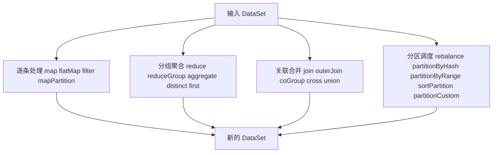

# DataSet 转换操作：从逐条处理到分区重组的批算子全景

输入源把数据装进 DataSet 之后，真正干活的是转换操作：把一个 DataSet 变成一个新的 DataSet，多个转换再组合成复杂的程序。初读批代码的困惑集中在两处，一是算子太多，不知道什么场景用哪个；二是明明和 DataStream 同名的算子，批里却还多出一批分区调度类的成员，这些成员在流 API 里根本找不到。

## 先给结论

- 转换不修改原集合，每个算子都返回新的 DataSet，数据流图靠链式调用串起来。
- 逐条处理四件套：map 一进一出、flatMap 一进多出、filter 按条件放行、mapPartition 按分区批量进出。
- 分组聚合：groupBy 之后接 reduce、reduceGroup、aggregate（sum 与 min 与 max）、distinct 去重，first 取前 N 条。
- 关联合并：join 内联、outerJoin 外联、coGroup 分组关联、cross 笛卡尔积、union 同构合并。
- 分区调度：rebalance 重平衡、partitionByHash 哈希分区、partitionByRange 范围分区、sortPartition 排序分区、partitionCustom 自定义分区。
- 与 DataStream 的差异点：分组叫 groupBy 不叫 keyBy，没有窗口概念；mapPartition 与分区调度族是批特有成员。

## 一、算子全景：按用途分四组



图里把十几个算子归成四张牌：前两张改「元素」本身，第三张把多个数据集搓到一起，第四张只挪动元素的分布、不改内容。写转换链时先判断要动的是元素还是分区，再进对应那组找算子。

**与 DataStream 对照着记。** map、flatMap、filter、union 在两套 API 里同名同义；分组在批里叫 groupBy，流里叫 keyBy；流处理必须开窗口回答「何时计算」，批数据一次到齐，没有 window 这个成员；mapPartition、cross、coGroup 与分区调度族在流 API 里没有同名算子。记住这张对照表，批流代码互改时才知道哪些行能原样搬、哪些行要换名字。

## 二、逐条处理：map、flatMap、filter、mapPartition

**map 与 flatMap。** map 将一个元素生成另一个元素，比如把字符串做去空格处理再转成数字；flatMap 将一个元素生成零个、一个或多个元素，典型用法是把一行字符串按空格拆成多个单词：

```java
// map：一个元素变另一个元素
data.map(new MapFunction<String, Integer>() {
    public Integer map(String value) { return Integer.parseInt(value); }
});

// flatMap：一个元素变零个、一个或多个元素
data.flatMap(new FlatMapFunction<String, String>() {
    public void flatMap(String value, Collector<String> out) {
        for (String s : value.split(" ")) {
            out.collect(s);
        }
    }
});
```

**filter。** 按元素的特征做过滤：数字数据集里留下大于 1000 的，字符串数据集里按长度筛，都是 filter 的用武之地：

```java
data.filter(new FilterFunction<Integer>() {
    public boolean filter(Integer value) { return value > 1000; }
});
```

**mapPartition。** Flink 并行的基本单位是分区，mapPartition 以分区为单位调用一次函数，函数里拿到的是整个分区的元素迭代器，每个分区中的元素数量取决于并行度和之前的分区方式。统计每个分区有多少条数据，用 mapPartition 只数一次：

```java
data.mapPartition(new MapPartitionFunction<String, Long>() {
    public void mapPartition(Iterable<String> values, Collector<Long> out) {
        long c = 0;
        for (String s : values) {
            c++;
        }
        out.collect(c);
    }
});
```

与 map 的差别在调用次数：map 每条数据调用一次，mapPartition 每个分区调用一次。凡是「每个分区只需要做一次」的动作，比如建立连接、加载配置文件、分区级汇总，放进 mapPartition 都比放进 map 划算。

## 三、分组聚合：reduce、reduceGroup、aggregate、distinct、first

**reduce。** 语义与 Hadoop MapReduce 体系里的 Reduce 一致：把同分类的数据两两合并，做求和、累加这类数学计算。全量数据集直接 reduce 就是一次大求和：

```java
data.reduce(new ReduceFunction<Integer>() {
    public Integer reduce(Integer a, Integer b) { return a + b; }
});
```

分组场景下可以指定运行时的组合方式，`setCombineHint(HASH)` 提示用散列组合，在键的数量明显小于元素数量时通常更快：

```java
// 分组求和，并提示在分区端用哈希方式先组合一轮
data.groupBy(0).reduce(new ReduceFunction<Tuple2<String, Integer>>() {
    public Tuple2<String, Integer> reduce(Tuple2<String, Integer> a, Tuple2<String, Integer> b) {
        return new Tuple2<>(a.f0, a.f1 + b.f1);
    }
}).setCombineHint(ReduceHint.HASH);
```

**reduceGroup。** 把一组元素组合成一个或多个元素，函数里拿到整组迭代器，相比 reduce 多了组的概念，也可作用于未分组的全量数据集：

```java
data.reduceGroup(new GroupReduceFunction<Integer, Integer>() {
    public void reduce(Iterable<Integer> values, Collector<Integer> out) {
        int prefixSum = 0;
        for (Integer i : values) {
            prefixSum += i;
        }
        out.collect(prefixSum);
    }
});
```

**aggregate。** 聚合把多个字段上的指标一次算出来，链式 and 再聚合另一列：

```java
DataSet<Tuple3<Integer, String, Double>> input = ...;
// 第 0 列求和，第 2 列求最小值
DataSet<Tuple3<Integer, String, Double>> output = input.aggregate(SUM, 0).and(MIN, 2);
```

配套工程 WordCount 里的 `sum(1)` 就是 aggregate 求和的便捷写法，整条链路是 flatMap 拆词、groupBy(0) 按单词分组、sum(1) 计数：

```java
// 真实工程代码，包名已改写
DataSet<Tuple2<String, Integer>> counts =
        text.flatMap(new Tokenizer())
        .groupBy(0)
        .sum(1);
```

**distinct 与 first。** distinct 与 MySQL 里的 DISTINCT 语义一致，重复元素只留一个：`data.distinct()`。first 取前 N 条，常在 groupBy 之后接 `.first(3)` 拿每组前三条（随包示例无独立运行类，此写法按主流用法补全）。

## 四、关联合并：join、outerJoin、coGroup、cross、union

**join。** 两个数据集按 key 关联，理解上与关系库两表 join 一致：以某个数据集为基准，把另一个数据集匹配的数据并进来。where 指定左边取第几列做 key，equalTo 指定右边：

```java
result = input.join(input2).where(0).equalTo(1);
```

**outerJoin。** 外连接在常规连接之上保留没有匹配的一方，左右外连与全外连分别用 leftOuterJoin、rightOuterJoin、fullOuterJoin 表达，没匹配的一侧会收到 null：

```java
result = input1.leftOuterJoin(input2)
        .where(0)
        .equalTo(1)
        .with(new JoinFunction<String, String, String>() {
            public String join(String v1, String v2) {
                // leftOuterJoin 时 v2 可能为 null
                // rightOuterJoin 时 v1 可能为 null
                // fullOuterJoin 时两侧都可能为 null
            }
        });
```

**coGroup。** 可以理解为 reduce 的二维变体：两个数据集先各自按 key 分组，再对每一对组调用一次转换函数，没匹配的一边也带着空迭代器进来，所以它能写出比 join 更灵活的关联逻辑。

**cross。** 构建两个数据集的笛卡尔积，每对元素组合成单个元素。这是计算密集型操作，两个一千条的数据集会得到一百万条，用之前先掂量规模：

```java
DataSet<Tuple2<Integer, String>> result = data1.cross(data2);
```

**union。** 把两个数据集串联合并，要求两边元素类型一致。它与 join 的区别在于：join 按 key 拼接字段，两个数据集结构可以不同；union 是纵向堆叠，两个数据集必须同构。

## 五、分区调度：rebalance、partitionByHash、partitionByRange、sortPartition、partitionCustom

这类算子不改变元素本身，改变的是元素分布到哪些并行子任务上。

**rebalance。** 均匀重新平衡数据集的分区，消除数据倾斜。上游某路数据特别多时，在下一个 map 类转换之前接一个 rebalance，把负载摊匀：

```java
DataSet<String> result = in.rebalance().map(new Mapper());
```

**partitionByHash 与 partitionByRange。** 前者按指定字段的哈希值分区，后者按字段值的范围分区，比如按天把数据切进不同分区：

```java
DataSet<Integer> r1 = in.partitionByHash(0).mapPartition(new PartitionMapper());
DataSet<Integer> r2 = in.partitionByRange(0).mapPartition(new PartitionMapper());
```

**sortPartition。** 对每个分区内部按指定字段排序，链式调用实现多字段排序：

```java
in.sortPartition(0, Order.ASCENDING).sortPartition(1, Order.DESCENDING);
```

**partitionCustom。** 哈希分区看字段哈希值，范围分区看字段区间，自定义分区由自己实现 Partitioner 决定每个 key 落到哪个分区。注意自定义分区只适用于单个字段作为 key（随包示例无运行类，此写法按主流用法补全）：

```java
in.partitionCustom(new Partitioner<String>() {
    @Override
    public int partition(String key, int numPartitions) {
        return key.length() % numPartitions;
    }
}, 0);
```

## 常见误区

- **reduce 和 reduceGroup 当成一个东西。** 错例是需要「整组进整组出」时写成 reduce。正解是 reduce 两两合并、输出类型与输入一致，reduceGroup 拿到整组迭代器、可以输出一个或多个元素。
- **join 默认丢掉没匹配的数据。** 错例是以为 join 会保留两边全部记录，结果左表有、右表没有的行消失了。正解是需要保留未匹配一方时改用 outerJoin 或 coGroup。
- **不看规模就上 cross。** 错例是对两个十万条的数据集做笛卡尔积，直接产出百亿条。正解是 cross 只用于确需全组合的小规模数据，规模大时改用 join。
- **拿 union 合并异构数据集。** 错例是两个字段结构不同的数据集直接 union。正解是 union 要求元素类型一致，结构不同走 join 或 coGroup。

## 面试可能被问到的问题

1. 面试官追问：「map 和 mapPartition 的区别是什么，什么场景用 mapPartition？」
   答：map 每条数据调用一次，mapPartition 每个分区调用一次，函数拿到整个分区的迭代器。每个分区只做一次的动作，比如建连接、加载配置、分区计数，放 mapPartition 更划算。
2. 面试官追问：「reduce 和 reduceGroup 有什么区别？」
   答：reduce 是两两合并，输出类型与输入一致；reduceGroup 整组进、整组出，可以输出一个或多个元素，还支持对未分组的全量数据集操作，语义上更接近「按组自定义汇总」。
3. 面试官追问：「join、outerJoin、coGroup 三者怎么选？」
   答：只要两边都有匹配的行用 join；要保留无匹配一侧并接受 null 用 outerJoin，左外、右外、全外分别对应三个方法；需要按组自定义关联逻辑、处理空组时用 coGroup。
4. 面试官追问：「rebalance 解决什么问题，还有哪些分区控制算子？」
   答：rebalance 均匀重平衡并行分区，消除数据倾斜。同类成员还有 partitionByHash 按哈希分区、partitionByRange 按范围分区、sortPartition 分区内排序、partitionCustom 自定义分配。
5. 面试官追问：「DataSet 与 DataStream 的转换算子有哪些差异？」
   答：map、flatMap、filter、union 同名同义；分组在批里叫 groupBy、流里叫 keyBy；批数据一次到齐没有窗口；mapPartition、cross、coGroup 与分区调度族是批特有成员，流 API 里没有对应同名算子。
6. 面试官追问：「WordCount 里 sum(1) 是什么，和 aggregate 什么关系？」
   答：sum(1) 是对元组第 1 列求和，等价于 aggregate(SUM, 1) 的便捷写法，它总是配合 groupBy 出现，先按第 0 列分组再对计数列累加。

## 配套资料

- 代码：`materials/code/06/day4 Flink基础与流数据处理/`，flink-demo 工程的 batch/WordCount（flatMap 加 groupBy 加 sum 的真实转换链路与 Tokenizer 实现），真实随包文件，正文包名改写为 `com.study.coldchain`。
- 说明：day5 转换操作无独立源码包；map、mapPartition、filter、reduce、reduceGroup、aggregate、distinct、join、outerJoin、coGroup、cross、union 与分区调度的示例来自本课画面，随包工程无对应运行类，按画面与主流写法补全并已在正文注明；setCombineHint 组合提示按本课口播整理，first 为按主流用法的补充；引用路径截至 day 目录层级。
