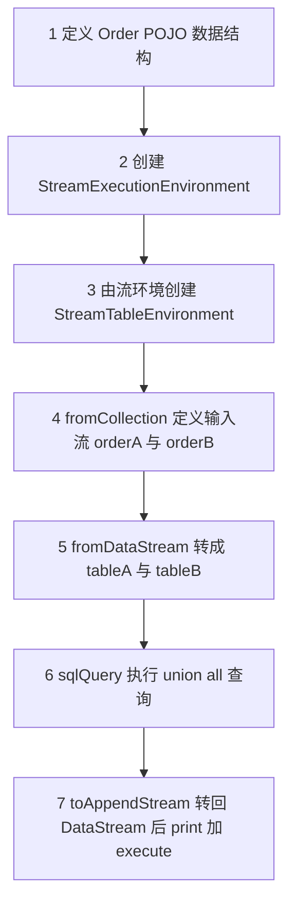

# Flink Table 示例：七步把订单流交给 SQL 查询

DataStream 里写统计要 flatMap、keyBy、window 一路铺下去，查询条件一变整条链都得动。换成 Table 这层，同样的逻辑是一句 SQL 的事，但数据从哪进、结果从哪出、环境怎么起，需要一条完整的路跑通一次。这一节用两条订单流做输入，走「定义 POJO、起双环境、造输入流、流转表、SQL 查询、转回流输出」的七步骨架，每一步都落在真实代码上。

## 先给结论

- 全流程七步：定义 Order POJO、创建 StreamExecutionEnvironment、由它创建 StreamTableEnvironment、fromCollection 定义输入流、fromDataStream 转表、sqlQuery 查询、toAppendStream 转回 DataStream 后 execute。
- POJO 必须带公共无参构造，否则 Flink 无法把它识别成数据模型；想打印出可读结果，必须重写 toString。
- 两条输入流各自 fromDataStream 成 tableA 与 tableB，SQL 用 union all 把两张表的条件查询拼成一句，一次查完。
- 查询产物仍是 Table，用 `tEnv.toAppendStream(result, Order.class)` 转回 DataStream 再 print。
- 同样的查询用 Table API 也能写：`where` 加 `unionAll` 链式调用，效果与 SQL 版等价。

## 一、七步骨架长什么样

动代码之前把流程钉在墙上，每一步对应一小段代码：

这张图在讲 Table 程序从建模到执行的完整顺序，七个节点依次串行：



图里前三是环境准备，四是造数据，五和六是 Table 层的核心动作，第七步回到 DataStream 收尾。值得注意的是第七步：查询结果并不会自己打印，Table 必须转回流才能接 print 这类 sink，这就是上一节说的「数据出口仍由 DataStream 承担」。

## 二、先立数据模型：Order POJO

表要有结构，订单在这里就是数据模型。字段挑订单最基本的三件套：用户 ID、商品、数量：

```java
public static class Order {
    public Long user;
    public String product;
    public int amount;

    public Order() {}

    public Order(Long user, String product, int amount) {
        this.user = user;
        this.product = product;
        this.amount = amount;
    }

    @Override
    public String toString() {
        return "Order{" +
                "user=" + user +
                ", product=" + product +
                ", amount=" + amount +
                "}";
    }
}
```

三个细节都有讲究。字段是 public 的，Flink 转 Table 时要按字段直接取值。无参构造不能省：Flink 把数据流转成 Order 类型靠反射造实例，找不到公共无参构造，类型识别和序列化当场失败，这是最容易漏的一处。toString 看似可有可无，等到第一次跑程序输出一片类名加哈希码时就明白了，它决定结果可不可读。user 声明为 Long，传字面量时要写 `1L`，写成 int 会直接编译报错。

## 三、双环境与两条输入流

环境要起两个，输入流造两条，正好凑齐对照实验：

```java
public static void main(String[] args) throws Exception {
    // 1. 设置流执行环境
    StreamExecutionEnvironment env = StreamExecutionEnvironment.getExecutionEnvironment();
    // 2. 定义 Table 环境：由流执行环境创建，两者绑定
    StreamTableEnvironment tEnv = StreamTableEnvironment.create(env);

    // 3. 定义输入源：直接用 Java 集合构造两条订单流
    DataStream<Order> orderA = env.fromCollection(Arrays.asList(
            new Order(1L, "book1", 3),
            new Order(2L, "book2", 4),
            new Order(3L, "book3", 2)
    ));

    DataStream<Order> orderB = env.fromCollection(Arrays.asList(
            new Order(4L, "book4", 3),
            new Order(5L, "book5", 2),
            new Order(6L, "book6", 1)
    ));
```

`StreamTableEnvironment.create(env)` 这一行体现了 Table 环境对流环境的依赖：先有 StreamExecutionEnvironment，才有 StreamTableEnvironment，Table 层不是凭空起环境，而是包在流环境外面。输入源没走 Kafka 也没开 socket，`fromCollection` 配 `Arrays.asList` 直接把 Java 对象列表变成 DataStream，本地演示最省事。orderA 是用户 1、2、3 分别买 book1、book2、book3，数量 3、4、2；orderB 是用户 4、5、6 买 book4 到 book6，数量 3、2、1。造两条流的目的马上揭晓：SQL 要一次查两张表。

## 四、流转表，SQL 一句查两张

数据进来了，接下来是 Table 层的主戏：

```java
    // 4. 将数据流转换成 Flink Table，显式给出字段名与顺序
    Table tableA = tEnv.fromDataStream(orderA, "user, product, amount");
    Table tableB = tEnv.fromDataStream(orderB, "user, product, amount");

    // 5. 执行 SQL 查询：A 表取 amount 大于 2 的行，B 表取小于 2 的行，union all 合并
    Table result = tEnv.sqlQuery("SELECT * FROM " + tableA + " WHERE amount > 2 union all " +
            "select * from " + tableB + " where amount < 2");

    // 6. 结果 Table 转回 DataStream 并打印，随后执行程序
    tEnv.toAppendStream(result, Order.class).print();
    env.execute();
}
```

`fromDataStream` 的第二个参数把字段名连同顺序一起声明出来，Order 的三个 public 字段从此在表里叫 user、product、amount。SQL 串里直接拼接 tableA、tableB 两个 Table 对象，引擎会展开成对这两张表的引用，所以字符串拼接处必须各留一个空格，`FROM` 与表名黏在一起就是解析异常。

查询逻辑按数据对一遍：A 表 amount 大于 2 的是用户 1 的 3 和用户 2 的 4；B 表 amount 小于 2 的只有用户 6 的 1。union all 不去重直接合并，三条结果全部落地：

```text
Order{user=1, product=book1, amount=3}
Order{user=2, product=book2, amount=4}
Order{user=6, product=book6, amount=1}
```

输出顺序随调度可能变化，内容就是这三条（按课程演示整理）。`toAppendStream` 里必须声明目标类型 `Order.class`，Table 是无类型的行列，转回流要靠它恢复成 POJO。

## 五、第一次跑的输出为什么不可读

课程里程序第一次跑出来的是三行无法辨认的字符，根因不在 Flink 而在 Order 类没重写 toString，打印走的是 Object 的默认实现，出来的是类名拼哈希码。在类里补上 toString 再跑，控制台立刻变成上面那种 `Order{user=1, ...}` 的可读形式。排查这类问题时先分清「没输出」与「输出不可读」：前者查 sink 与 execute，后者查 toString。

## 六、Table API 的等价写法

同一段查询逻辑，不用 SQL 字符串也成立：

```java
// Table API 写法：where 过滤加 unionAll 合并，与 SQL 版语义一致
Table result2 = tableA.where("amount > 2")
        .unionAll(tableB.where("amount < 2"));
```

`where("amount > 2")` 的行内表达式是字符串，但整体操作由方法调用组织成链，漏一步编译就不过。这个例子跑完可以数出四条收获：Java 集合直接赋给 DataStream；DataStream 经 fromDataStream 变 Table；SQL 查询经 toAppendStream 变回 DataStream；POJO 重写 toString 才有可读输出。七步骨架与四条收获合在一起，Table 程序的形状就完整了。

## 常见误区

- **Order 缺公共无参构造。** 错例是只写了带参构造，程序在流转 Table 或序列化阶段报错。正解是 POJO 显式补一个空的无参构造，带参构造照写不冲突。
- **没重写 toString 就断定程序没跑出结果。** 错例是控制台只有类名加哈希码，以为查询没生效。正解是补 toString 后重跑，数据一直都在，只是显示不可读。
- **SQL 拼接漏空格。** 错例是 `"... FROM " + tableA + "WHERE amount > 2"`，拼成 `tableAWHERE` 直接解析失败。正解是拼接片段首尾都留空格，写完把完整串打出来检查一遍。
- **Long 字段传 int 字面量。** 错例是 `new Order(1, "book1", 3)`，user 是 Long 类型，编译报错。正解是字面量带 L，写成 `1L`。
- **把 union 和 union all 混为一谈。** union 会去重，union all 全量合并不去重，结果集不一样，按业务语义选。

## 面试可能被问到的问题

1. 面试官追问：「DataStream 怎么变成 Table？字段名怎么确定？」
   答：用 TableEnvironment 的 fromDataStream 方法，第二个参数以字符串显式声明字段名与顺序，如 `"user, product, amount"`；不声明时按 POJO 字段或元组默认位置名生成。显式声明最稳妥，SQL 里引用字段不会踩默认名的坑。
2. 面试官追问：「SQL 查询的 Table 结果怎么变回 DataStream？」
   答：toAppendStream 指定目标类型转回，追加模式适合查询结果只增不减的场景；如果查询带聚合、结果行会更新，则要走 retract 回撤流语义，用 toRetractStream 携带布尔标记表示插入或撤回。
3. 面试官追问：「POJO 为什么必须有无参构造？」
   答：Flink 在类型识别与序列化时靠反射创建实例，公共无参构造是实例化的入口，缺了它 POJO 无法被识别和填充字段，流转 Table 或输出阶段就会失败。这是 Flink POJO 规范的一部分，字段还要求 public 或提供 getter 与 setter。
4. 面试官追问：「union 和 union all 有什么区别？」
   答：union 对两表结果做去重合并，union all 直接拼接不去重。示例里两张表数据本就不重叠，用 union all 保留全部行；如果业务要求唯一再选 union，代价是多一层去重计算。
5. 面试官追问：「StreamTableEnvironment.create(env) 里传的 env 是干什么的？」
   答：Table 环境复用流执行环境，传入的 StreamExecutionEnvironment 决定了作业的并行度、检查点等底层配置，Table 层的查询最终也翻译成这个环境里的 DataStream 作业执行，所以建表环境必须与流环境绑定创建。

## 配套资料

- 代码：`materials/code/06/day4 Flink基础与流数据处理/`，flink-demo 工程的 table/StreamTable（本节示例的真实源码：Order POJO、双输入流、fromDataStream 转表、sqlQuery union all 查询、toAppendStream 输出、Table API 等价写法、重写 toString），包名改写为 `com.study.coldchain`。
- 说明：day5 无独立代码目录，示例的输入数据与运行输出按课程演示整理；引用路径截至 day 目录层级。
