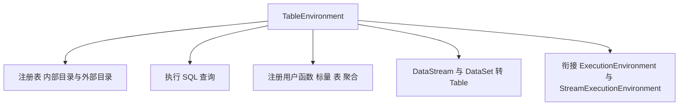
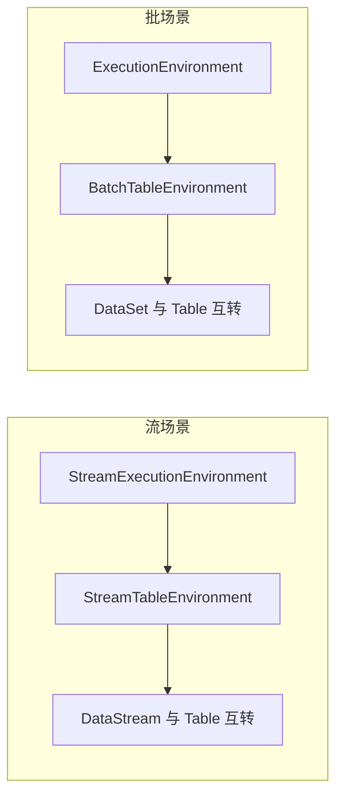

# TableEnvironment：Table 与 SQL 程序的总入口

每个 Table 示例的第一行几乎都是 `StreamTableEnvironment.create(env)`，写多了容易把它当成一句固定咒语抄过去，从没问过它到底管什么。它是 Table API 与 SQL 编程的上下文执行环境，也是整个 Table 体系的入口：注册表、执行 SQL、注册函数、转换 DataStream，全部功能都围绕这个核心类展开。它有哪几副面孔、批流两版怎么选、和底层执行环境怎么分工，这一节把它拆开讲透。

## 先给结论

- TableEnvironment 是创建 Table API 与 SQL 程序的上下文执行环境，Table 与 SQL 程序的一切功能都以它为入口。
- 主要职责六件：在内部目录注册表、在外部目录注册表、执行 SQL 查询、注册用户自定义函数（标量、表、聚合）、把 DataStream 与 DataSet 转换成 Table、衔接底层两种执行环境。
- Flink 1.8 一共有 7 个 TableEnvironment，1.9 重构后收敛为 5 个面向用户的接口；用 Java 开发只需关注 3 个：TableEnvironment、BatchTableEnvironment、StreamTableEnvironment。
- 统一性体现在两点：Java 与 Scala 的各版本都实现同一个顶级接口；有界与无界数据在这一层统一处理。
- 分工记忆法：DataStream 的创建与提交找 StreamExecutionEnvironment，Table 的创建与查询找 TableEnvironment，两边互不越界。

## 一、它是什么，管什么

一句话定位：TableEnvironment 是 Table 和 SQL 程序的上下文。类比 DataStream 程序里 StreamExecutionEnvironment 的地位就清楚了，流程序的所有动作从 env 出发，Table 程序的所有动作从 tEnv 出发。它的职责拆开是六件事：

这张图在讲 TableEnvironment 承担的六类职责，中心节点向外辐射：



六项职责覆盖了 Table 程序的完整生命周期：表先注册进它的目录才能被 SQL 按名引用；`sqlQuery` 方法挂在它身上，查询由它发起；自定义的标量函数、表函数、聚合函数要先在它这里登记才能在 SQL 里调用；DataStream 与 DataSet 想变成表，转换方法也由它提供；底层的 ExecutionEnvironment 与 StreamExecutionEnvironment 则作为它创建时的参数被衔接进来。可以说 Table 程序里凡是跨进 Table 体系的动作，都得经过它。

## 二、从 7 个到 5 个，Java 只关注 3 个

TableEnvironment 不是一个类，而是一族接口。Flink 1.8 里有 7 个 TableEnvironment，1.9 版本社区对它们做了重构与优化，收敛成 5 个面向用户的接口，程序开发时能直接用的就是这 5 个，底层各自有不同的实现类。5 个接口的构成是：1 个顶级的 TableEnvironment，2 个面向批处理的 BatchTableEnvironment（Java 与 Scala 各一），2 个面向流处理的 StreamTableEnvironment（Java 与 Scala 各一）。源码里的组织结构如 Flink 源码目录 `org/apache/flink/table/api/` 所示，顶级接口是 TableEnvironment.java，Java 侧有 `api/java/BatchTableEnvironment.java`，Scala 侧有 `api/scala/BatchTableEnvironment.scala` 与 `api/scala/StreamTableEnvironment.scala`。用 Java 开发时真正要关心的只有 3 个：

| 接口 | 角色 | 对应的数据 |
|---|---|---|
| TableEnvironment | 顶级接口 | 统一入口 |
| BatchTableEnvironment | 批环境，Java 与 Scala 各一 | DataSet，有界 |
| StreamTableEnvironment | 流环境，Java 与 Scala 各一 | DataStream，无界 |

两个流环境分别对应 Java 流计算与 Scala 流计算，操作的对象分别是 Java 的 DataStream 和 Scala 的 DataStream；两个批环境同理对应 Java 与 Scala 的 DataSet。相比顶级接口，StreamTableEnvironment 额外提供 DataStream 与 Table 之间的相互转换接口，批环境则提供 DataSet 与 Table 的互转，这正是前面示例里 `fromDataStream`、`toAppendStream` 能存在的原因。

## 三、两点统一性

TableEnvironment 作为一个统一接口，它的「统一」落在两个维度上。**第一，对语言的统一。** JVM 上的 Scala 与 Java 两个版本实现同一套接口：BatchTableEnvironment 的 Java 版与 Scala 版都继承自 TableEnvironment，StreamTableEnvironment 的两个语言版本同样继承自它。写业务时换语言不用换心智模型。**第二，对数据的统一。** 有界数据与无界数据在这一层被统一处理，TableEnvironment 提供的是纯粹的 Table 生态上下文，整个作业从头到尾都用 Table API 和 SQL 写的场景正适合它：声明的查询不用区分底下垫的是批还是流，翻译的事交给引擎。

两点统一合起来的效果是：Table 体系内的代码与「用什么语言写」「处理什么边界的数据」解耦，这也解释了为什么 1.9 的重构要往收敛接口的方向走，对外暴露的入口越少，体系越稳。

## 四、回到代码：双环境的分工边界

把前面的示例程序拿回来，只看环境与职责分配这一段：

```java
public static void main(String[] args) throws Exception {
    // 1. 定义执行环境：DataStream 的创建与提交归它管
    StreamExecutionEnvironment env = StreamExecutionEnvironment.getExecutionEnvironment();
    // 2. 定义 Table 环境：由流执行环境创建，Table 的创建与 SQL 查询归它管
    StreamTableEnvironment tEnv = StreamTableEnvironment.create(env);

    // 输入流的创建归 env：直接由 Java 集合造出 DataStream
    DataStream<Order> orderA = env.fromCollection(Arrays.asList(
            new Order(1L, "book1", 3),
            new Order(2L, "book2", 4),
            new Order(3L, "book3", 2)
    ));

    // 流转表、SQL 查询归 tEnv：fromDataStream 与 sqlQuery 都是 Table 环境的方法
    Table tableA = tEnv.fromDataStream(orderA, "user, product, amount");
    Table result = tEnv.sqlQuery("SELECT * FROM " + tableA + " WHERE amount > 2");
}
```

（Order 类定义见上一节示例，此处从略。）代码里每个动作都能归到一边：`fromCollection` 造 DataStream，走 env；`fromDataStream` 与 `sqlQuery` 是 Table 世界的动作，走 tEnv。`create(env)` 传参说明 StreamTableEnvironment 依赖 StreamExecutionEnvironment，Table 查询最终翻译成流作业执行，底座就是传进来的这个 env。批处理的场景结构完全对称，把两个类换成 ExecutionEnvironment 与 BatchTableEnvironment 即可：

```java
// 批场景：批执行环境创建批 Table 环境
ExecutionEnvironment benv = ExecutionEnvironment.getExecutionEnvironment();
BatchTableEnvironment btableEnv = BatchTableEnvironment.create(benv);
```

一张图收束两种场景的对应关系：

这张图在讲批与流各自的环境组合，左右对称：



图里左右两列结构相同，差别只在类型：流场景的组合产 DataStream 与 Table 的互转能力，批场景的组合产 DataSet 与 Table 的互转能力。选哪个接口，先看数据有界没界，再看用什么语言。

## 常见误区

- **拿 StreamExecutionEnvironment 去做 Table 的事。** 错例是写 `env.fromDataStream(orderA)` 或 `env.sqlQuery(...)`，这些方法根本不在流环境上。正解是 DataStream 归 env，Table 归 tEnv，先想清楚动作属于哪个世界。
- **批程序里用了 StreamTableEnvironment。** 错例是处理 DataSet 数据时建了流表环境，类型对不上。正解是 DataSet 配 BatchTableEnvironment，DataStream 配 StreamTableEnvironment。
- **把 TableEnvironment 当具体类直接 new。** 它是顶级接口，实例通过各实现类的 `create` 静态方法获得，并且要传入对应的底层执行环境。
- **看资料不核对版本。** 1.8 有 7 个 TableEnvironment，1.9 重构后剩 5 个接口，网上的写法差异多半来自版本，先确认资料口径再照抄。

## 面试可能被问到的问题

1. 面试官追问：「TableEnvironment 的主要职责有哪些？」
   答：六件事：在内部目录与外部目录注册表、执行 SQL 查询、注册用户自定义函数（标量、表、聚合三类）、把 DataStream 或 DataSet 转换成 Table、衔接底层 ExecutionEnvironment 与 StreamExecutionEnvironment。Table 与 SQL 程序的所有功能都围绕它展开。
2. 面试官追问：「Flink 1.8 和 1.9 的 TableEnvironment 有什么变化？」
   答：1.8 有 7 个 TableEnvironment，1.9 社区重构后收敛为 5 个面向用户的接口：1 个顶级 TableEnvironment 加批流各两个语言版本，底层实现各自不同。对外入口变少，体系更统一，看资料时要注意版本口径。
3. 面试官追问：「StreamTableEnvironment 和 StreamExecutionEnvironment 是什么关系？」
   答：依赖与被衔接的关系。Table 环境通过 create 方法由流执行环境创建，持有它的引用；DataStream 的创建与提交在流环境上，Table 的创建与查询在表环境上，Table 查询最终翻译成流环境里的作业执行。
4. 面试官追问：「批和流分别用哪个 TableEnvironment？」
   答：按数据边界选：有界的 DataSet 场景用 BatchTableEnvironment，无界的 DataStream 场景用 StreamTableEnvironment。两者都继承顶级接口 TableEnvironment，前者额外提供 DataSet 与 Table 的互转，后者额外提供 DataStream 与 Table 的互转。
5. 面试官追问：「为什么说 TableEnvironment 做到了统一？」
   答：两个维度：语言上，Java 与 Scala 的各版本实现同一个顶级接口，换语言不换模型；数据上，有界与无界数据在同一层统一处理，整个作业全用 Table API 和 SQL 写时，一套上下文就够了。

## 配套资料

- 代码：`materials/code/06/day4 Flink基础与流数据处理/`，flink-demo 工程的 table/StreamTable（StreamTableEnvironment.create 绑定流环境、fromDataStream 与 sqlQuery 的真实用法）、table/DataSetTable（BatchTableEnvironment.create 绑定批环境的真实用法），均为真实随包文件，包名改写为 `com.study.coldchain`。
- 说明：day5 无独立代码目录，示例为按课程画面写法补全；接口清单与 1.8 到 1.9 的演进按课程讲解与 Flink 源码目录结构整理；引用路径截至 day 目录层级。
