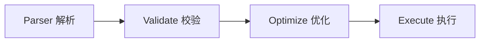
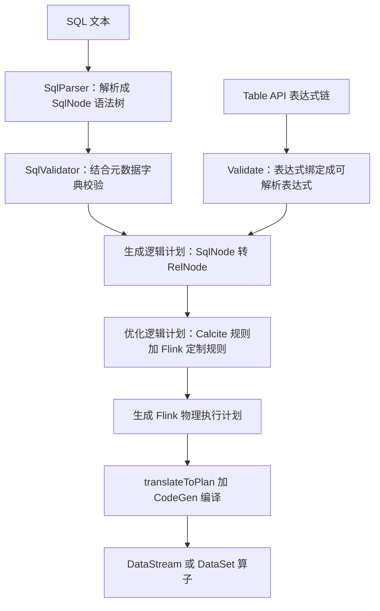

# Table API 与 SQL 的执行过程：一条查询如何变成 Flink 算子

用 Table API 或 SQL 写 Flink 作业，最直观的感受是「写得少」：一行 where 加 unionAll，不用管分区与算子串接，同一套写法流批通吃。省掉的东西并没有凭空消失，只是被挪进了引擎内部。Flink 把 SQL 的解析、校验、优化整套工作交给 Apache Calcite 这个查询优化框架，再把优化后的计划翻译回 DataStream 与 DataSet 的算子去执行。把这条转换链拆开看，才能说清「同一句 SQL 为什么流批都能跑」「写错关键字报错发生在哪一步」这类问题。

## 先给结论

- Flink Table API 与 SQL 复用 Apache Calcite 作为查询优化框架，为流数据与批数据的关系查询保留统一接口；Hive、Drill、Flink、Phoenix、Storm 等平台同样基于 Calcite。
- 执行过程可粗分为四段：Parser 解析、Validate 校验、Optimize 优化、Execute 执行。
- SQL 侧细分为六个阶段：解析成 SqlNode 语法树、校验、转 RelNode 逻辑计划、两轮优化逻辑计划、生成 Flink 物理计划、translateToPlan 翻译成执行计划。
- Table API 侧同样是六个阶段，前三段换成表达式树（TreeNode 加 Expression），从生成逻辑计划开始与 SQL 汇合并轨。
- 两条线殊途同归：最终执行的仍是 map、flatMap 这些熟悉的 Flink 算子，Table 不是另一台引擎，而是算子之上的一层关系代数。

## 一、Calcite 是谁：四段式主流程

Apache Calcite 是一个独立的查询解析与优化框架，可以类比成数据库里负责「听懂 SQL 并找出最优执行方式」的那部分大脑，它自身不存储数据、也不真正执行数据。它在大数据领域的结构化查询里非常出名，Hive、Drill、Flink、Phoenix、Storm 等各种平台都用它做 SQL 解析与优化，这也是 Flink 敢承诺流批统一查询语义的底气所在。

整条链路粗分四段，先用一张图建立整体印象：



四个环节各司其职：解析负责把文本变成树，校验负责把树对上元数据，优化负责把树改写成更省资源的计划，执行负责把计划跑起来。SQL 与 Table API 各自的「六个阶段」，都是这四段的具体展开。

## 二、Flink SQL 的六个阶段

**第一段，SqlParser。** SQL 文本进入引擎后，由 JavaCC 生成的解析器把语句解析成一棵语法树 AST，Calcite 用 SqlNode 表示这棵树的节点。这一步只看语句「形状」：select、insert、update 这类关键字能被识别成语法成分，写成 select1、select2 这种拼错的写法，解析器当场报错，根本走不到后面。

**第二段，SqlValidator。** 校验阶段结合元数据字典检查语法树，确认引用的库、表、字段真实存在，类型是否匹配。它回答的不是「像不像一条 SQL」，而是「这条 SQL 在当前元数据下是否合法」。

**第三段，生成逻辑执行计划。** 校验通过的 SqlNode 被转换成逻辑计划，Calcite 用 RelNode 表示。逻辑计划描述「要做什么」：扫描哪张表、按什么条件过滤、怎么聚合，还不关心具体怎么执行。

**第四段，优化逻辑执行计划。** 优化分两轮：先基于 Calcite 的通用优化规则做一轮改写，再基于 Flink 定制的优化规则做第二轮，产出优化后的逻辑计划。

**第五段，生成 Flink 物理执行计划。** 基于一系列 Flink 规则，把优化后的逻辑计划转换成 Flink 物理执行计划，此时每个节点都有了明确的物理实现。

**第六段，翻译成执行计划。** 调用 translateToPlan 方法，借助 CodeGen 代码生成器把物理计划编译成 Flink 的各种算子，也就是 DataStream 与 DataSet 里 map、flatMap 这类底层运算。上层查询经过多次转换，落地的仍是熟悉的算子任务。

SQL 与 Table API 两条入口的完整旅程，用一张图对照着看：



图中左侧是 SQL 的入口，右侧是 Table API 的入口，两条线在「生成逻辑计划」节点汇合，之后完全同路。这也解释了 Flink 为什么只需维护一套优化与翻译逻辑，就能同时支持两种查询入口。

## 三、Table API 的六个阶段：从表达式树到 RelNode

Table API 不是字符串而是方法调用链，所以它跳过文本解析，直接以表达式树的形式进入引擎。全流程同样六步，前三步与 SQL 不同，后三步并轨。

**第一步，解析成表达式树。** Flink 把 Table API 表达式的计算逻辑组织成一棵树，用 TreeNode 表示，树上每个节点的计算逻辑用 Expression 表达。一段链式调用就是一次树的生长：

```java
package com.study.coldchain.demo.flink.table;

// import 从略：StreamExecutionEnvironment、StreamTableEnvironment、Table、Order
// env 来自 getExecutionEnvironment，orderA、orderB 是两个订单流，定义从略

public class StreamTable {

    public static void main(String[] args) throws Exception {
        StreamTableEnvironment tEnv = StreamTableEnvironment.create(env);

        Table tableA = tEnv.fromDataStream(orderA, "user, product, amount");
        Table tableB = tEnv.fromDataStream(orderB, "user, product, amount");

        // Table API 表达式链：where 与 unionAll 各自对应树上的节点
        Table result = tableA.where("amount > 2")
                .unionAll(tableB.where("amount < 2"));

        tEnv.toAppendStream(result, Order.class).print();
        env.execute();
    }
}
```

tableA.where 与 unionAll 两层调用，在引擎内部就是一棵以过滤、联合为节点的表达式树。同一个查询换成 SQL 写则长这样：

```java
// Flink SQL 写法，与上面的 Table API 链条等价
Table result = tEnv.sqlQuery(
        "SELECT * FROM " + tableA + " WHERE amount > 2 union all " +
        "select * from " + tableB + " where amount < 2");
```

两种写法入口不同，最终生成的是同一批 RelNode，这是两种 API 可以混用的根本原因。

**第二步，校验。** 结合数据字典，把树上每个节点的 unresolved expression（尚未绑定到具体字段的未解析表达式）绑定成 resolved expression（可解析表达式）。这一步相当于把「amount 这个词」落到「订单流的 amount 字段」上。

**第三步，生成逻辑计划。** 依次遍历树的每个节点，把 TreeNode 表示的节点转换成 Calcite 内部的数据结构 RelNode，逻辑计划由此生成。从这里开始，Table API 与 SQL 完全并轨，后面的优化逻辑计划、生成物理计划、translateToPlan 翻译成算子，流程与 SQL 逐段相同。

到第六步为止，Table 任务的底层身份已经揭晓：它就是一组 Flink 算子任务。所以在 Table 上做调优，归根结底还是算子层面的并行度、数据交换这些知识。

## 常见误区

- **以为 Table API 与 SQL 是两套独立引擎。** 错例：同一个查询，SQL 版与 Table API 版行为稍有差异，就断定两套引擎实现不同。正解：两者从生成逻辑计划起完全并轨，出口同为 RelNode 与同一套优化规则，差异通常出在入口绑定（字段名、类型信息）上。
- **以为优化只发生一轮。** 错例：把查询计划里优化前后两段当成重复内容跳过。正解：先 Calcite 通用规则、再 Flink 定制规则，两轮改写目标不同，对照着读能看出引擎替你做了什么。
- **解析报错时反复查元数据。** 错例：关键字拼错（例如把 select 写成 select1），报错后却去检查表和字段是否存在。正解：解析阶段只看语句形状，先核对关键字与语法结构，再查库表元数据。
- **以为写 Table 就可以不懂算子。** 正解：Table 查询最终仍编译成 map、flatMap 等算子执行，算子层面的并行度与链路知识照样适用。

## 面试可能被问到的问题

1. 面试官追问：「Flink Table API 与 SQL 底层共用什么框架？」
   答：共用 Apache Calcite 查询优化框架，为流、批两类数据的关系查询保留统一接口。Hive、Drill、Phoenix、Storm 等平台也在用 Calcite，Flink 在其上定制了自己的优化规则与翻译层。
2. 面试官追问：「一条 SQL 从提交到执行要经过哪些阶段？」
   答：六个阶段：SqlParser 用 JavaCC 解析成 SqlNode 语法树，SqlValidator 结合元数据字典校验，SqlNode 转 RelNode 生成逻辑计划，经 Calcite 规则与 Flink 定制规则两轮优化，生成 Flink 物理计划，最后 translateToPlan 加 CodeGen 编译成算子执行。
3. 面试官追问：「SqlNode 和 RelNode 有什么区别？」
   答：SqlNode 是解析阶段的语法树节点，描述语句的文本结构；RelNode 是逻辑计划节点，描述关系运算本身。两者的边界在校验通过后生成逻辑计划这一步。
4. 面试官追问：「优化阶段具体做了什么？」
   答：分两轮规则改写，先应用 Calcite 通用规则，再应用 Flink 针对流批执行特性的定制规则，把逻辑计划优化成更省资源的形态，随后据此生成物理计划。
5. 面试官追问：「Table API 写的查询如何变成逻辑计划？」
   答：Table API 表达式先组织成 TreeNode 加 Expression 的表达式树，校验阶段把每个节点的 unresolved expression 绑定成 resolved expression，再遍历树把 TreeNode 转成 Calcite 的 RelNode。
6. 面试官追问：「Table 任务最终以什么形式执行？」
   答：物理计划经 translateToPlan 与 CodeGen 生成器编译成 DataStream 或 DataSet 的算子，例如 map、flatMap，底层执行与手写算子程序没有本质区别。

## 配套资料

- 代码：`materials/code/06/day4 Flink基础与流数据处理/`，flink-demo 工程的 table 包 StreamTable（Table API 链与 Flink SQL 等价查询的真实写法），真实随包文件，包名改写为 `com.study.coldchain`。
- 说明：day5 无独立代码目录，示例沿用 day4 随包工程；引用路径截至 day 目录层级。
