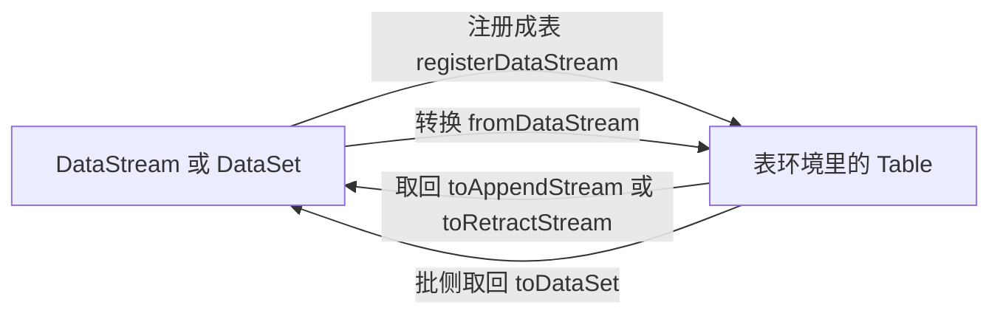

# DataStream、DataSet 与 Table 的双向集成：注册、转换、取回

Table API 与 SQL 的真正价值要放在混合编程里看：流式程序里先拿表查询做预处理，例如过滤、投影、聚合或与元数据做连接，再交回 DataStream 或 DataSet API 继续加工；反过来，表查询的结果也常常需要变回流，接到熟悉的 sink 上输出。这套相互作用靠的就是 DataStream、DataSet 与 Table 之间的相互转换。转换的 API 一共也就几个，但字段名、类型信息这两处最容易翻车，值得一次讲透。

## 先给结论

- 集成只有三类操作：把 DataStream 或 DataSet 注册成表、把 DataStream 或 DataSet 转换成 Table、把 Table 转回 DataStream 或 DataSet，双向都能走。
- 注册与转换的区别：registerDataStream 把流挂进表环境，之后用表名引用它；fromDataStream 直接返回一个 Table 对象，只能通过对象引用。
- 不传字段名，表的字段默认叫 f0、f1；传一个 `word, count` 形式的字符串就能自定义字段名。
- Table 转回流必须给类型信息：Tuple 用 TupleTypeInfo 配合 `Types.STRING()`、`Types.INT()`；POJO 直接传 Class，例如 `toAppendStream(table, Order.class)`。
- 批侧操作一一对应：registerDataSet、toDataSet，字段映射规则与流侧相同。

## 一、三类操作与一张双向图

能用到的操作清单很短：DataStream 或 DataSet 可以在表环境里注册成表，也可以直接转换成 Table；Table 可以转换回 DataStream 或 DataSet。DataSet 程序的转换与 DataStream 类似，先以流侧为主线演示。



图中双向箭头是三个方向的入口，接下来按「转过去、注册、取回来」的顺序逐个落地，全部基于随包工程的真实代码。

## 二、流转表与注册表：TableTransfer

随包工程 table 包里的 TableTransfer 把三类操作串在一条 main 里，先看注册与转换：

```java
package com.study.coldchain.demo.flink.table;

import org.apache.flink.api.java.tuple.Tuple2;
import org.apache.flink.streaming.api.datastream.DataStream;
import org.apache.flink.streaming.api.environment.StreamExecutionEnvironment;
import org.apache.flink.table.api.Table;
import org.apache.flink.table.api.java.StreamTableEnvironment;

public class TableTransfer {

    public static void main(String[] args) {
        StreamExecutionEnvironment env = StreamExecutionEnvironment.getExecutionEnvironment();
        StreamTableEnvironment streamTableEnvironment = StreamTableEnvironment.create(env);
        env.setParallelism(2);

        DataStream<Tuple2<String, Integer>> stream = env.fromElements(
                new Tuple2<>("hello", 2),
                new Tuple2<>("world", 3)
        ).setParallelism(3);

        // 注册成表：不指定字段名，字段默认为 f0、f1
        streamTableEnvironment.registerDataStream("myTable", stream);
        // 注册成表：显式指定字段名 word、count
        streamTableEnvironment.registerDataStream("myTable2", stream, "word, count");

        // 转换成 Table 对象：同样可以指定字段名
        Table table = streamTableEnvironment.fromDataStream(stream, "word, count");
    }
}
```

两条注册语句用的是同一个流，差别只在参数个数：第一种只给表名和流，表的字段由系统默认设置为 f0、f1，一直排下去就是 f0、f1、f2；第二种多传一个字段名字符串，字段变成 word、count。所以字段名不是转换的产物，而是你在注册或转换时声明出来的。两种方式都能拿到可查询的表，差别在于引用手段：注册后的表挂在表环境里，SQL 字符串里可以直接写表名；fromDataStream 返回的是 Table 对象，适合继续用 Table API 链式调用。

## 三、表转回流：类型信息是关键

反方向要麻烦一点，因为必须给 DataStream 设置类型。目标类型是 Tuple2 时，要构造一个 TupleTypeInfo：

```java
// 表转回 DataStream：Tuple 类型需要显式给出 TupleTypeInfo
TupleTypeInfo<Tuple2<String, Integer>> tupleTypeInfo = new TupleTypeInfo<>(
        Types.STRING(),
        Types.INT()
);

DataStream<Tuple2<String, Integer>> dataStream =
        streamTableEnvironment.toAppendStream(table, tupleTypeInfo);
```

TupleTypeInfo 的两个类型参数按顺序对应元组的两个位置，第一个 Types.STRING 对应 word，第二个 Types.INT 对应 count，顺序错了字段类型就全乱了。写法上还有一个版本细节：1.8 版本 Types.STRING 要带括号调用，1.9 之后不带括号。

toAppendStream 之外还有一个 toRetractStream，两者的分界是结果会不会更新。append 模式假设表查询只会追加新行，一旦查询带聚合、结果行要原地更新，append 就表达不了；retract 模式会额外发出删除标记，先撤旧行再插新行。简单说：纯追加的查询用 toAppendStream，聚合更新的查询用 toRetractStream。

如果流上装的是 POJO，类型信息可以直接传 Class，省掉 TupleTypeInfo 的手工构造：

```java
// POJO 流的取回：直接传 Class，字段名与 POJO 属性对应
DataStream<Order> resultStream = tEnv.toAppendStream(result, Order.class);
```

## 四、批侧对称操作：DataSetTable

DataSet 与 Table 的转换思路完全一样，只是环境换成批执行环境与批表环境。随包工程里的 DataSetTable 演示了注册、SQL 聚合、取回的完整闭环：

```java
package com.study.coldchain.demo.flink.table;

import org.apache.flink.api.java.DataSet;
import org.apache.flink.api.java.ExecutionEnvironment;
import org.apache.flink.table.api.Table;
import org.apache.flink.table.api.java.BatchTableEnvironment;

public class DataSetTable {

    public static void main(String[] args) throws Exception {
        // 1. 批执行环境与批 Table 环境
        ExecutionEnvironment env = ExecutionEnvironment.getExecutionEnvironment();
        BatchTableEnvironment tEnv = BatchTableEnvironment.create(env);

        // 2. 输入源：三条 WC 记录
        DataSet<WC> data = env.fromElements(
                new WC("hello", 2),
                new WC("word", 3),
                new WC("hello", 4)
        );

        // 3. 注册成表，字段名为 word、frequency，执行 SQL 聚合
        tEnv.registerDataSet("WordCount", data, "word, frequency");
        Table table = tEnv.sqlQuery(
                "select word, sum(frequency) as frequency from WordCount group by word");

        // 4. 表转回 DataSet：POJO 直接传 Class
        DataSet<WC> result = tEnv.toDataSet(table, WC.class);
        result.print("WC");

        env.execute();
    }

    public static class WC {
        public String word;
        public long frequency;

        public WC() {}

        public WC(String word, long frequency) {
            this.word = word;
            this.frequency = frequency;
        }
    }
}
```

这段代码把字段映射的两种路径都摆出来了：POJO 的公开属性名直接当表字段用，注册时声明成 word、frequency，SQL 里的 sum(frequency) 才有落点；取回时 toDataSet 传 WC.class，框架按属性名回填。Tuple 流的思路相同，只是属性名换成了位置。整条链上注册、查询、取回各司其职，与流侧的 registerDataStream、fromDataStream、toAppendStream 逐一对称。

## 常见误区

- **注册完表却查不到想要的字段。** 错例：`registerDataStream("t", stream)` 后直接在 SQL 里写 word。正解：没传字段名时字段默认是 f0、f1，SQL 里应写 f0；要语义化字段名就在注册或转换时传字段名字符串。
- **聚合查询硬用 toAppendStream。** 错例：group by 求和后的表接 toAppendStream，结果不符合预期或直接报错。正解：append 语义只支持纯追加，带聚合更新的查询改用 toRetractStream。
- **TupleTypeInfo 的类型顺序与字段对不上。** 错例：`new TupleTypeInfo<>(Types.INT(), Types.STRING())` 去接 String 加 Integer 的元组。正解：类型参数按元组位置顺序排列，与声明字段名的顺序一致。
- **版本写法混淆。** 错例：在 1.8 上写 `Types.STRING`，编译报错。正解：1.8 要写方法调用 `Types.STRING()`，1.9 起才是不带括号的字段写法。
- **把 fromDataStream 的返回值丢掉。** 正解：fromDataStream 返回 Table 对象，不会把表挂进表环境，SQL 字符串里引用不到它；需要按表名引用就走注册。

## 面试可能被问到的问题

1. 面试官追问：「DataStream 与 Table 互转分别用什么方法？」
   答：流转表有 registerDataStream（注册）与 fromDataStream（转换）两个入口；表转流用 toAppendStream 或 toRetractStream。批侧对应 registerDataSet、toDataSet。
2. 面试官追问：「注册成表和转换成 Table 有什么区别？」
   答：注册把流挂进表环境，之后 SQL 里按表名引用；转换直接返回 Table 对象，只能用对象引用继续 Table API 调用。两者都可以在转换时声明字段名。
3. 面试官追问：「不指定字段名时，表的字段叫什么？」
   答：Tuple 流默认是 f0、f1 这样按位置排列的名字；要语义化字段名，在注册或转换时传一个逗号分隔的字段名字符串即可。
4. 面试官追问：「toAppendStream 和 toRetractStream 怎么选？」
   答：append 模式要求查询结果只追加不更新，适合过滤、投影类查询；带聚合的查询结果行会原地更新，要用 retract 模式，它通过先撤旧行再插新行来表达变更。
5. 面试官追问：「表转回流为什么必须给类型信息？」
   答：Table 的字段是抽象列，转回流时要落到具体的 Java 类型做序列化与字段映射。Tuple 用 TupleTypeInfo 显式声明每个位置的类型，POJO 可以直接传 Class 由框架反射推断。
6. 面试官追问：「集成的典型应用场景是什么？」
   答：先用表查询对外部数据做过滤、投影、聚合或与元数据连接等预处理，再把结果交回 DataStream 或 DataSet API 做后续计算，两种 API 各用在自己最顺手的那一段。

## 配套资料

- 代码：`materials/code/06/day4 Flink基础与流数据处理/`，flink-demo 工程的 table 包 TableTransfer（注册、转换、toAppendStream 取回的真实链路）、DataSetTable（批侧注册加 SQL 聚合加 toDataSet）、StreamTable（POJO 直接传 Class 取回），均为真实随包文件，包名改写为 `com.study.coldchain`。
- 说明：引用路径截至 day 目录层级。
