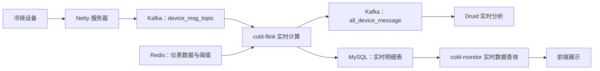

# day6 开篇：实时计算（冷眼）要把哪条链打通

day5 收口 Table SQL，day6 直接进项目实战：冷链监控平台的实时计算模块，课程口径叫冷眼。这个模块拆成两个工程，cold-flink 负责实时数据处理，cold-monitor 负责实时数据查询。开篇课把学习目标摆开，四条目标逐条挂上技术点与工程落点，需求分析也先走一遍，后面几节的代码照着这张地图逐段铺开。

## 先给结论

- day6 两个工程：cold-flink 管实时数据处理，cold-monitor 管实时数据查询，一个算一个查。
- 目标四条：掌握 Flink 数据流开发过程、掌握 Redis 代码编写、掌握定时器语法、了解热数据与冷数据的处理方式。
- 需求先行：设备采集的温度湿度与阈值比对找异常记录，Netty 收报文转 json 提交 Kafka，Flink 监听消息比对阈值做异常预警。
- 每条目标在 cold-flink 工程里都有落点：StreamingJob 主链、MessageAggregate 富化比对、SinkToMySQL 落库。
- 冷热数据是贯穿认知：热数据实时计算即算即走，冷数据沉淀入库供查询，两个工程正好各管一头。

## 一、两个工程，一条数据链

cold-flink 是 Flink 流式计算工程，pom 里 Flink 版本 1.8.0，带上 Kafka 连接器、Redis 连接器与 MySQL 驱动；cold-monitor 是 Spring Boot 服务，基于 2.1.7.RELEASE，挂 Eureka 客户端，用 MyBatis-Plus 查库。一个在算，一个在查，中间隔着 MySQL，整条数据链一张图：



从图上读分工：cold-flink 只管把「当前这条数据有没有异常」算出来并写出去，查询的活整体交给 cold-monitor。计算与查询分离，负载形态不同就能各自伸缩部署，这也是实时模块冷热分治的第一步。

## 二、四条目标与技术点映射

| 目标 | 技术点 | 工程落点 |
|---|---|---|
| 掌握 Flink 数据流开发过程 | Kafka source、map 解析、富化、sink 串链 | cold-flink 的 StreamingJob |
| 掌握 Redis 代码编写 | Jedis 连接池、字节反序列化取缓存对象 | JedisUtil 连接池与 MessageAggregate 查缓存 |
| 掌握定时器语法 | 周期性任务的触发写法 | 实现小节按课程安排展开 |
| 了解热数据和冷数据的处理方式 | 热数据走流算，冷数据落库查 | cold-flink 与 cold-monitor 的分工 |

Redis 这条展开说一句。工程里的 JedisUtil 是单例连接池，MaxTotal 配 100、MaxIdle 配 50、借出连接时 testOnBorrow 校验可用性，Redis 地址与端口在静态块里配好；MessageAggregate 拿到 Jedis 后按设备编码取字节，反序列化成 MeterEntity，设备的名称归属与温度湿度阈值全在这个对象里。这些代码在实现小节逐行过。

定时器语法是四条里唯一在口播里没展开、画面上单列的目标：流式链路与工程代码里周期性触发的场景都要用它，写法按课程安排在实现过程中结合具体代码讲。

热数据与冷数据按「了解」级别对待：热数据是持续产生的实时监控数据，走 Kafka 与 Flink 即算即走；冷数据是沉淀下来的历史明细，落在 MySQL 等存储里供查询统计。处理方式不同，技术实现也不同，这正是两个工程并存的理由。

## 三、需求先行：告警业务一句话说清

画面上的需求分析写得直白：冷链监控平台里，需要把设备采集器数据中的温度湿度等数据与温度阈值比对，从中找到温度异常记录。实现过程两步：Netty 服务器接收的设备数据转换成 json 提交到 Kafka 队列；Flink 程序实时监听 Kafka 中的消息，将当前温度与阈值比对，进行异常预警。

主链在 StreamingJob 里已经成形，先看一眼骨架：

```java
package com.study.coldchain.flink;

// import 从略：FlinkKafkaConsumer、SimpleStringSchema、JSON、MessageEntity

public class StreamingJob {
    public static void main(String[] args) throws Exception {
        // kafka 队列名称
        String kafka_topic = "device_msg_topic";
        final StreamExecutionEnvironment env =
                StreamExecutionEnvironment.getExecutionEnvironment();

        // kafka 队列属性
        Properties properties = new Properties();
        properties.setProperty("bootstrap.servers", "172.17.0.143:9092");
        properties.setProperty("group.id", "coldflink");
        properties.setProperty("auto.offset.reset", "earliest");

        // 实时数据源：kafka 队列，接收 netty 发送过来的数据
        FlinkKafkaConsumer<String> consumer =
                new FlinkKafkaConsumer<>(kafka_topic, new SimpleStringSchema(), properties);
        DataStream<MessageEntity> stream = env.addSource(consumer)
                .setParallelism(1)
                .map(string -> JSON.parseObject(string, MessageEntity.class));

        // 从 redis 中获取设备信息，合并至消息中
        DataStream<MessageEntity> outStream = stream.map(new MessageAggregate());

        // 存储设备指标消息
        outStream.addSink(new SinkToMySQL());
        env.execute("冷链设备实时监控任务");
    }
}
```

四行主链对应四件事：addSource 消费 Kafka，map 把 json 解析成 MessageEntity，MessageAggregate 查 Redis 补阈值并比对，SinkToMySQL 把带告警标识的明细落库。支撑它的依赖三支，pom 里看得见：

```xml
<!-- Flink Kafka 连接器 -->
<dependency>
    <groupId>org.apache.flink</groupId>
    <artifactId>flink-connector-kafka_2.11</artifactId>
    <version>1.8.0</version>
</dependency>
<!-- Redis 连接器，富化查缓存用 -->
<dependency>
    <groupId>org.apache.bahir</groupId>
    <artifactId>flink-connector-redis_2.11</artifactId>
    <version>1.0</version>
</dependency>
<!-- MySQL 驱动，明细落库用 -->
<dependency>
    <groupId>mysql</groupId>
    <artifactId>mysql-connector-java</artifactId>
    <version>5.1.38</version>
</dependency>
```

依赖清单就是目标的技术底座：Kafka 连接器撑起数据流开发，Redis 连接器撑起缓存代码，驱动撑起落库。目标与技术点在这张清单上对齐，day6 剩下的事就是把每一环写到能跑。

## 常见误区

- **把实时计算当成又一个微服务。** 错例：想着给 cold-flink 配 Controller 与 HTTP 接口。正解：它是常驻运行的 Flink 作业，对外没有接口面，查询能力在 cold-monitor。
- **以为阈值跟着报文走。** 错例：在报文 json 里找 maxtem。正解：报文只带当前温湿度与设备编码，阈值在 Redis 的仪表数据里，比对前先富化。
- **冷热数据当成同一类处理。** 错例：前端查询直接打 Kafka。正解：热数据实时算完落库，查询走库，Kafka 只承担流转与缓冲。
- **目标清单念完就开写。** 正解：先跑通一条最小链路，消费一条消息、查出一条阈值、落一条明细，再谈批量与容错。

## 面试可能被问到的问题

1. 面试官追问：「实时计算模块在整个冷链监控平台里承担什么职责？」
   答：消费设备实时报文，关联缓存的阈值与仪表数据，比对出温度湿度的异常标识，把带标识的明细落 MySQL 供查询，同时回投一条 Kafka 队列供实时分析引擎消费，是平台从「采到数据」到「看出异常」的转换环节。
2. 面试官追问：「为什么拆成 cold-flink 和 cold-monitor 两个工程？」
   答：计算与查询的负载形态不同。Flink 作业常驻流式消费，怕阻塞；查询服务按请求伸缩，要连库出接口。拆开后各自独立部署升级，冷热数据也各走各的通道。
3. 面试官追问：「热数据和冷数据怎么划分？」
   答：按数据的时效与用途分。刚产生、需要立即判断的监控数据是热数据，走 Kafka 与 Flink 实时计算；沉淀下来用于查询与统计的历史明细是冷数据，落 MySQL 等存储。热数据即算即走，冷数据按需查询，处理方式与技术实现都不同。
4. 面试官追问：「实时计算要用到哪些中间件，各自干什么？」
   答：Kafka 承接设备报文并供 Flink 消费；Redis 存仪表基础数据与阈值供富化比对；MySQL 存带告警标识的实时明细；另有一条 Kafka 队列给 Druid 这类实时分析引擎消费。
5. 面试官追问：「学习目标里的定时器用在什么地方？」
   答：流式链路与工程代码里周期性触发的场景，比如定时刷新、定时落盘这类任务；课程把它单列为目标，在实现过程中结合具体代码讲语法。

## 配套资料

- 代码：`materials/code/06/day6 实时计算 - 冷眼项目实战/`，cold-flink 工程（StreamingJob、MessageAggregate、SinkToMySQL 与 pom.xml，Flink 1.8.0）与 cold-monitor 工程（Spring Boot 查询服务骨架），真实随包文件，包名改写为 `com.study.coldchain`。
- 说明：StreamingJob 引文有删节，容错与回投 Kafka 的行在实现逻辑一篇出现；引用路径截至 day 目录层级。
