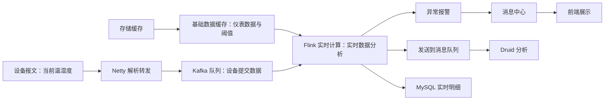

# 实时计算业务分析：温湿度与阈值怎么比出一条告警

冷链监控平台的采集端已经把设备报文源源不断送进了 Kafka，实时计算（冷眼）接手的就是这股数据流：报文里只有当前温度湿度，异常不异常要跟阈值比过才知道。业务分析这一课把需求、数据来源、比对口径与结果去向一次讲清。代码还没开写，先把「算什么、跟谁比、结果给谁」三件事定下来，后面写代码才不会跑偏。

## 先给结论

- 需求一句话：把设备采集器数据中的温度湿度与温湿度阈值比对，从中找出异常记录，对设备与仓库做温湿度预警。
- 数据两路：Kafka 里的设备实时报文带当前温湿度，基础数据缓存里的仪表数据带阈值与归属信息。
- 告警落在两个标识字段上：temalert 与 humalert，取值 1 超上限、0 正常、-1 低于下限。
- 结果三个去向：MySQL 实时明细表供查询服务读，Kafka 队列供 Druid 分析，异常报警经消息中心推前端。

## 一、业务要解决什么：从报文里找异常

冷链仓库里的设备采集器按固定节奏上报温湿度，一条报文代表某台设备某个时刻的读数。单看这条读数没有意义，8 摄氏度对普通仓库是正常值，对疫苗库就是严重事故，判断的依据是每个仪表自己配置的阈值：温度上下限、湿度上下限，存在基础数据里，随设备档案一起维护。

「异常记录」的定义随之清楚：当前温度超出该设备的温度上下限区间，或者湿度超出湿度上下限区间的那条数据。预警的对象有两层，设备本身是一层，设备所在的仓库是另一层，仓库维度靠设备档案里的归属关系聚合出来。找到异常只是开始，把它推给人看、存下来供查，才是完整的业务闭环。

## 二、两路数据在 Flink 汇合

实时计算模块处理的数据包含两部分：缓存中仪表的数据（温度湿度阈值与归属），Kafka 队列中的设备提交数据（当前温度湿度）。两条线在 Flink 实时计算里汇合，全景一张图：



从图上读两条进线与三条出线：进线是 Kafka 里的设备提交数据与缓存里的仪表数据，出线是异常报警走消息中心到前端、明细落 MySQL、另发一份到消息队列给分析引擎。业务过程本身不复杂，难点全在两路数据的对齐上：报文里只有设备编码，缓存里按设备编码才能查到这套阈值，编码对不上的数据要处理得当。

## 三、比对口径：落在字段上的告警级别

报文解析成 MessageEntity 后，消息对象里预留了两个告警标识字段，注释把取值语义写得明明白白：

```java
/** 温度状况： 1：高温， 0： 正常， -1： 低温 */
private int temalert;

/** 湿度状况： 1：高湿， 0： 正常， -1： 低湿 */
private int humalert;
```

比对逻辑按业务口径写成两组三分支，超上限记 1，低于下限记 -1，区间内记 0：

```java
// 当前温度与该设备温度阈值比对，写出温度告警标识
if (value.getTem() > value.getMaxtem()) {
    value.setTemalert(1);   // 高温
} else if (value.getTem() < value.getMintem()) {
    value.setTemalert(-1);  // 低温
} else {
    value.setTemalert(0);   // 正常
}

// 湿度同口径：超上限记 1，低于下限记 -1，区间内记 0
if (value.getHum() > value.getMaxhum()) {
    value.setHumalert(1);
} else if (value.getHum() < value.getMinhum()) {
    value.setHumalert(-1);
} else {
    value.setHumalert(0);
}
```

告警级别由此从「有没有异常」细化成三态：告警方向（高温还是低温、高湿还是低湿）与告警与否都在一个整数里。前端拿到标识就能染色，消息中心拿到非 0 标识就能推送，查询服务按标识过滤就能拉出全部异常明细。有一个读码细节值得记下：工程源码里温度那组判断的上限写的是 `getMaxhum()`，按业务语义应是 `getMaxtem()`，属笔误，读码时按这里的业务口径校正，告警字段也提醒大家写这类代码必须逐字段对。

## 四、结果去向：三个出口各有用处

带告警标识的明细出去之后分三路。落 MySQL 的一路写实时明细表 cz_message_realtime，用 replace into 幂等覆盖，库里每台设备始终是最新一条状态，cold-monitor 的实时数据查询服务直接读它，前端实时列表与告警列表从这里出。

进消息队列的一路供 Druid 消费，Druid 是面向实时分析的数据库，时序趋势、聚合大屏这类需求在它那边算，不给明细查询添负担。异常报警一路进消息中心，由它负责推送到前端，告警的即时性靠这条通道保证。

三路为什么这么分：明细检索要按设备、仓库、时间多维查，这是关系库的主场；趋势分析是列式扫描加聚合，交给 Druid；即时提醒走不了批，必须有一条实时推送通道。出口在业务分析阶段就定清楚，代码阶段的 sink 设计才有了验收标准。

## 常见误区

- **阈值从报文里拿。** 错例：在设备报文里找温度上限。正解：报文只带当前温湿度与设备编码，阈值在基础数据缓存的仪表数据里，比对前先富化。
- **告警只有超上限一种。** 错例：只写 `tem > maxtem` 一个判断。正解：低温低湿同样要告警，标识取 -1，三态才算完整。
- **比对放到入库之后。** 错例：先把报文明细落库，再用定时任务扫库算告警。正解：比对在 Flink 里算完再落库，告警标识随明细一起写，下游不用重复算。
- **预警对象只想到设备。** 正解：设备与仓库两层，仓库维度靠富化出来的仓库与公司字段聚合，比对的粒度决定了预警的粒度。

## 面试可能被问到的问题

1. 面试官追问：「实时计算模块的需求用一句话怎么概括？」
   答：将设备采集器上报的温度湿度与该设备配置的温湿度阈值比对，从中找出异常记录，对设备与仓库进行温湿度预警，并把带告警标识的明细落库供查询。
2. 面试官追问：「参与比对的数据来自哪里，为什么阈值放在缓存里？」
   答：当前温湿度来自 Kafka 里的设备报文，阈值与归属来自基础数据缓存里的仪表数据。阈值随设备档案维护、读取频繁且要求低延迟，放缓存比每条报文查一次关系库经济得多。
3. 面试官追问：「告警级别怎么表示？」
   答：消息实体里 temalert 与 humalert 两个整型字段，1 表示超上限即高温高湿，-1 表示低于下限即低温低湿，0 表示正常，一个字段同时表达有无异常与异常方向。
4. 面试官追问：「计算结果有哪几个去向，为什么这么分？」
   答：三路。MySQL 实时明细表服务多维明细查询，Kafka 队列供 Druid 做实时分析聚合，异常报警走消息中心即时推送前端；三类下游的访问形态不同，出口分开互不拖累。
5. 面试官追问：「两路数据在什么字段上对齐，对不上怎么办？」
   答：以设备编码为关联键，从缓存按编码取出仪表数据并入消息；编码查不到仪表说明设备未登记或缓存缺失，这类数据要兜底处理，不能直接空指针抛出中断整条流。

## 配套资料

- 代码：`materials/code/06/day6 实时计算 - 冷眼项目实战/`，cold-flink 工程 MessageAggregate（富化与比对的真实实现）；实体字段见 `materials/code/06/day1 背景介绍与系统介绍/`，cold-common 模块的 MessageEntity（temalert、humalert 与全部明细字段），真实随包文件，包名改写为 `com.study.coldchain`。
- 说明：比对片段按业务口径整理，工程源码里温度上限一行的笔误已在文中标注；引用路径截至 day 目录层级。
