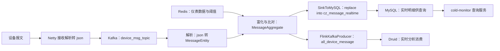

# 实时计算实现逻辑：一条报文从 Kafka 到 MySQL 的完整链路

业务分析定了算什么，实现逻辑回答怎么算：报文长什么样、Netty 与 Kafka 之间发生了什么、Flink 里两路数据怎么合、结果为什么写两份。这一课对着架构图讲设计，代码下一课才逐行铺，但链路上每个决定（中途不落库、查缓存富化、双出口写）的理由都能在这里找到，先理解设计再看代码，效率高得多。

## 先给结论

- 链路五段：设备发报文，Netty 接收解析转成 json 进 Kafka，Flink 消费解析成 MessageEntity，查 Redis 富化并比对，结果双出口落 MySQL 与回投 Kafka。
- 进 Kafka 之前不落库：数据只在内存与队列里流转，不写 MySQL 也不写文件，持久化由下游各自负责。
- 富化把消息从「设备编码加当前温湿度」补成带设备、主机、仓库、公司、阈值全量字段的明细，比对结果写回 temalert 与 humalert 两个标识。
- 双出口分工明确：MySQL 的 cz_message_realtime 表给实时数据查询做数据源，Kafka 的 all_device_message 队列给 Druid 消费。
- 链路对顺序敏感：单并行度消费配合 replace into 幂等覆盖，保证库里始终是该设备的最新状态。

## 一、入流：报文进队列，中途不落库

前端设备发送过来的数据是一个很简单的报文，Netty 服务器用网络编程接收，解析并转换成 json 格式，扔进 Kafka 队列。队列里的一条消息大致长这样，字段按画面内容整理：

```json
{
  "system": "20220117103222",
  "type": "2",
  "terminal": "20220117103222",
  "metercode": "20220117103222",
  "tem": 8,
  "hum": 65,
  "lon": "116.40",
  "lat": "39.90",
  "curtime": "2022-01-17 10:32:22"
}
```

这段设计里最值得琢磨的是一句否定：报文进 Kafka 之前，数据并没有存储到 MySQL 或者文本文件这类持久化存储，只在内存与队列里流转。采集节奏快、峰值不可控，采集链路上多一次落库就多一个瓶颈；Kafka 顶在中间做缓冲与解耦，谁消费谁负责持久化，Flink 落的那份才是业务真正要的明细。持久化不是不做，是推迟到算完再做。

## 二、算流：解析、富化、比对三步

Flink 监听 Kafka 队列，消费到的 json 先解析成 MessageEntity。做实时计算时数据源有两方面：一方面是 Kafka 里这种结构化报文，另一方面是 Redis 里存的温湿度阈值等仪表数据。两者相结合产生的结果数据，主要体现在温度与湿度预警标识的更改上。主程序把三步串起来：

```java
package com.study.coldchain.flink;

// import 从略：FlinkKafkaConsumer、SimpleStringSchema、JSON、MapFunction、
// RestartStrategies、CheckpointConfig、FlinkKafkaProducer

public class StreamingJob {
    public static void main(String[] args) throws Exception {
        // kafka 队列名称
        String kafka_topic = "device_msg_topic";
        final StreamExecutionEnvironment env =
                StreamExecutionEnvironment.getExecutionEnvironment();

        // 容错：5 秒一次 checkpoint，异常后固定延迟重启
        env.enableCheckpointing(5000);
        env.getCheckpointConfig().setCheckpointingMode(CheckpointConfig.DEFAULT_MODE);
        env.getConfig().setRestartStrategy(RestartStrategies.fixedDelayRestart(4, 1000));

        Properties properties = new Properties();
        properties.setProperty("bootstrap.servers", "172.17.0.143:9092");
        properties.setProperty("group.id", "coldflink");
        properties.setProperty("auto.offset.reset", "earliest");

        // kafka 队列 consumer，接收 netty 发送过来的数据
        FlinkKafkaConsumer<String> consumer =
                new FlinkKafkaConsumer<>(kafka_topic, new SimpleStringSchema(), properties);
        consumer.setStartFromLatest();

        // 设置实时数据源：kafka 队列，解析成 MessageEntity
        DataStream<MessageEntity> stream = env.addSource(consumer)
                .setParallelism(1)
                .map(string -> JSON.parseObject(string, MessageEntity.class));

        // 从 redis 中获取设备信息，合并至消息中
        DataStream<MessageEntity> outStream = stream.map(new MessageAggregate());

        // 存储设备指标消息
        outStream.addSink(new SinkToMySQL());

        // 将消息发送到 kafka 队列，Druid 监听此队列保存消息
        FlinkKafkaProducer<String> myProducer =
                new FlinkKafkaProducer<>("all_device_message", new SimpleStringSchema(), properties);
        outStream.map(new MapFunction<MessageEntity, String>() {
            @Override
            public String map(MessageEntity value) throws Exception {
                return JSON.toJSONString(value);
            }
        }).addSink(myProducer);

        env.execute("冷链设备实时监控任务");
    }
}
```

富化是链路的核心一环，MessageAggregate 按设备编码查 Redis，把缓存的仪表数据反序列化后并入消息：

```java
// 从连接池借 Jedis，按设备编码取缓存字节并反序列化
Jedis jedis = jedisUtil.getJedis();
byte[] meterBy = jedis.get(SafeEncoder.encode(value.getMetercode()));
MeterEntity meter = (MeterEntity) SerializeUtil.unserialize(meterBy);

// 仪表归属与阈值并入消息，消息从 5 个字段补到 20 多个
value.setMeterid(meter.getId());
value.setMetername(meter.getMetername());
value.setHostid(meter.getHostid());
value.setHousename(meter.getHousename());
value.setCompanyname(meter.getCompanyname());
value.setMaxtem(Integer.valueOf(meter.getMaxtem()));
value.setMintem(Integer.valueOf(meter.getMintem()));
value.setMaxhum(Integer.valueOf(meter.getMaxhum()));
value.setMinhum(Integer.valueOf(meter.getMinhum()));

// 比对写告警标识：超上限 1、低于下限 -1、区间内 0
if (value.getTem() > value.getMaxtem()) {
    value.setTemalert(1);
} else if (value.getTem() < value.getMintem()) {
    value.setTemalert(-1);
} else {
    value.setTemalert(0);
}
```

借出的 Jedis 在 finally 里归还连接池，异常路径走 returnBrokenResource 把坏连接剔除。有一个读码细节要交代：工程源码里温度上限这行写的是 `value.getMaxhum()`，按业务语义应是 `getMaxtem()`，上面代码已按业务口径修正，告警字段的笔误读码时必须逐行对。

## 三、出流：两份数据两个去处

结果数据的出处有两方面：一份写 MySQL，为下一步的实时数据查询做准备；另一份扔进 Kafka，由监听该队列的 Druid 数据库消费。MySQL 侧的实现是 SinkToMySQL，连接在 open 里建好，invoke 里只做绑定与更新：

```java
package com.study.coldchain.flink;

// import 从略：RichSinkFunction、Configuration、Connection、DriverManager、PreparedStatement

public class SinkToMySQL extends RichSinkFunction<MessageEntity> {
    private String DBUrl = "jdbc:mysql://172.17.0.143:3306/cold?allowMultiQueries=true"
            + "&useUnicode=true&characterEncoding=UTF-8&useSSL=false&autoReconnect=true";
    private Connection connection;
    private PreparedStatement preparedStatement;

    @Override
    public void open(Configuration parameters) throws Exception {
        // 连接在每个并行子任务的生命周期里只建一次
        Class.forName("com.mysql.jdbc.Driver");
        connection = DriverManager.getConnection(DBUrl, "cold", "cold123");
        preparedStatement = connection.prepareStatement(replaceSql());
    }

    @Override
    public void invoke(MessageEntity value, Context context) throws Exception {
        // 按占位符顺序绑定 23 个字段后执行更新
        preparedStatement.executeUpdate();
    }

    @Override
    public void close() throws Exception {
        if (preparedStatement != null) { preparedStatement.close(); }
        if (connection != null) { connection.close(); }
    }
}
```

SQL 用 replace into 写 cz_message_realtime 表，23 个字段与 MessageEntity 一一对应：同主键再插入等于覆盖，库里每台设备始终保留最新一条实时明细，查询服务读这张表就是读实时状态。整条链路一张图：



主干是 Kafka 进、双口出，Redis 只供数不收数。架构图上还有 HBase 一类存储承接历史数据，属于冷数据通道，不在这条实时链上展开。任何一段挂掉，checkpoint 加重启策略负责把作业拉回来续跑。

## 四、并发与顺序的考量

**消费端 setParallelism(1)。** Kafka 单分区内有序，单并行度消费保住这条顺序；下游 replace into 靠「后写的覆盖先写的」表达最新状态，多并行度一旦乱序，旧数据会盖掉新告警。数据量可控的项目里，先保正确再谈吞吐，扩并行度的前提是把设备编码做 key 路由到固定分区。

**容错三件套配齐。** checkpoint 每 5000 毫秒一次，模式取默认；重启策略 fixedDelayRestart(4, 1000)，异常后最多重试 4 次、每次间隔 1 秒；消费位点随 checkpoint 恢复，重启后从上次快照继续，不重放太多也不丢数据。

**offset 有个细节。** properties 里配了 auto.offset.reset 为 earliest，代码又调了 setStartFromLatest，显式 API 优先于配置生效，消费从最新开始。两个都写等于留了一手：去掉 setStartFromLatest 这行，组内无位点的场景就回落到 earliest。

**连接生命周期统一管理。** Redis 从 JedisUtil 连接池借还，MySQL 连接 open 建、invoke 用、close 释放，每个子任务一次握手，invoke 里绝不建连接，这个套路与 day5 写出侧的模板完全一致。

## 常见误区

- **在 invoke 里建数据库连接。** 错例：每条数据都 DriverManager.getConnection。正解：open 里建、close 里释放，子任务生命周期内复用，invoke 只做绑定与 executeUpdate。
- **多并行度直接开。** 错例：消费与写出都开高并行度追求吞吐。正解：replace into 依赖写入顺序表达最新值，乱序覆盖会把旧状态写成最新，顺序敏感链路先保证有序再扩容。
- **以为 auto.offset.reset 一定生效。** 正解：consumer.setStartFromLatest 是显式 API，优先级高于 properties 里的 auto.offset.reset，两者冲突以代码为准。
- **照抄温度比对那一行。** 工程源码里 `value.getTem() > value.getMaxhum()` 是笔误，语义应为与 maxtem 比对，照抄会把湿度上限当温度上限，告警从此失真。

## 面试可能被问到的问题

1. 面试官追问：「整条实时链路怎么走，一句话说清？」
   答：设备报文经 Netty 接收解析转成 json 进 Kafka，Flink 消费解析成 MessageEntity，按设备编码查 Redis 富化出阈值与归属并比对写告警标识，结果双出口：replace into 落 MySQL 的实时明细表，回投 all_device_message 队列供 Druid 消费。
2. 面试官追问：「为什么 Kafka 之前不落库？」
   答：采集节奏快、峰值不可控，采集链路落库会成为写瓶颈；Kafka 做缓冲与解耦，持久化推迟到计算完成之后，由消费端各自负责，链路更短也更好扩展。
3. 面试官追问：「富化为什么查 Redis 而不是 MySQL？」
   答：每条报文都要查一次设备档案，QPS 与采集节奏同量级，Redis 的内存读取扛得住这个频率；仪表数据序列化成字节放缓存，按编码取出反序列化即用，关系库留给落库与查询场景。
4. 面试官追问：「结果为什么写两份？」
   答：两份服务两类下游。MySQL 明细表支撑按设备、仓库、时间的多维实时查询，replace into 保证每设备最新；Kafka 队列给 Druid 做列式聚合与趋势分析，明细检索与分析负载分离。
5. 面试官追问：「并行度为什么设 1，多并行度会出什么问题？」
   答：链路靠 replace into 的覆盖语义表达设备最新状态，依赖写入顺序；多并行度下不同子任务写库顺序不确定，旧数据可能覆盖新告警。要扩容先按设备编码做分区路由，保住单设备内有序。
6. 面试官追问：「作业挂了怎么恢复？」
   答：5 秒一次 checkpoint 做状态快照，重启策略 fixedDelayRestart(4, 1000) 异常后自动拉起，消费位点从最近的 checkpoint 恢复继续算，Redis 与 MySQL 连接在 open 里重建。

## 配套资料

- 代码：`materials/code/06/day6 实时计算 - 冷眼项目实战/`，cold-flink 工程 StreamingJob（主链与容错配置）、MessageAggregate（Redis 富化与比对）、SinkToMySQL（replace into 落库）与 pom.xml，真实随包文件，包名改写为 `com.study.coldchain`。
- 说明：报文 json 样例按画面内容整理，画面抄录里的重复键为抽帧噪声；引用路径截至 day 目录层级。
