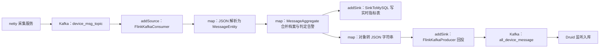

# 实时计算主程序 StreamingJob：从 Kafka 报文到双路输出

主程序是 Flink 作业的装配车间：把数据源、算子、输出按次序接成一条数据流，最后提交给集群。cold-flink 工程的 StreamingJob 职责一句话说得清：从 Kafka 消费设备报文，与 Redis 设备档案合并判断温湿度是否越限，结果一份写 MySQL 供实时查询，一份回投 Kafka 交给下游入库。主程序本身的代码没有算法，全是装配，把装配的次序与每一步的参数读懂，Flink 应用就入门了。

## 先给结论

- Flink 应用的固定次序：设置环境、设置容错、设置数据源、设置流计算、设置输出、执行程序。
- 容错三件套：checkpoint 周期 5000 毫秒，检查点模式取默认值 EXACTLY_ONCE，重启策略为固定延迟重启最多 4 次、间隔 1000 毫秒。
- 数据源是 FlinkKafkaConsumer，消费 `device_msg_topic`，反序列化用 SimpleStringSchema，拿到字符串后用 map 解析成 MessageEntity。
- 输出双路：SinkToMySQL 写实时指标表，FlinkKafkaProducer 回投 `all_device_message` 供 Druid 监听入库。
- 前面所有装配只是构建执行图，env.execute() 提交作业后数据才真正流动。

## 主程序的步骤骨架

动手先搭骨架，类的注释就是开发次序（按真实代码整理，包名已改写）：

```java
package com.study.coldchain.flink;

public class StreamingJob {
    public static void main(String[] args) throws Exception {
        //设置环境信息
        //设置检查点
        //设置流计算
        //设置输出
    }
}
```

四行注释就是 Flink 应用的通用次序：拿到执行环境，配置容错，接入数据源，串起算子做计算，接上输出，执行程序。任何 Flink 程序基本都按这个次序展开，骨架立住之后每一步只往对应的位置填代码。

## 环境与容错配置

```java
// 获取环境信息
final StreamExecutionEnvironment env = StreamExecutionEnvironment.getExecutionEnvironment();

//设置容错：每 5000 毫秒做一次 checkpoint
env.enableCheckpointing(5000);

//设置检查点模式
env.getCheckpointConfig().setCheckpointingMode(CheckpointConfig.DEFAULT_MODE);

//设置重启策略
env.getConfig().setRestartStrategy(RestartStrategies.fixedDelayRestart(4, 1000));
```

`getExecutionEnvironment()` 按运行环境自适配：main 方法本地直接跑，得到本地执行环境；提交到集群，则由集群上下文创建，同一份代码两边通用。

enableCheckpointing(5000) 打开分布式快照，每 5 秒对算子状态与消费位置做一次快照，作业异常恢复后从最近一次快照续算，已处理过的报文不会重算错账。setCheckpointingMode 里 DEFAULT_MODE 的取值就是 EXACTLY_ONCE，每条数据对状态的更新恰好生效一次。重启策略 fixedDelayRestart(4, 1000) 的两个参数是尝试次数与间隔毫秒数：作业异常时最多自动重启 4 次，每次间隔 1 秒，超过次数作业才真正失败。快照加重启策略，容错才算配完整。

## 接入 Kafka：队列属性与消费者

```java
// kafka队列名称
String kafka_topic = "device_msg_topic";

//kafka队列属性
Properties properties = new Properties();
properties.setProperty("bootstrap.servers", "kafka1.example.com:9092");
properties.setProperty("group.id", "coldflink");
properties.setProperty("auto.offset.reset", "earliest");

//kafka队列consumer，接收netty发送过来的数据
FlinkKafkaConsumer<String> consumer =
        new FlinkKafkaConsumer<String>(kafka_topic, new SimpleStringSchema(), properties);
consumer.setStartFromLatest();
```

bootstrap.servers 指向 Kafka 集群地址，group.id 是消费组名 coldflink，auto.offset.reset 控制没有初始位移时的起点，earliest 表示从头消费。构造 FlinkKafkaConsumer 的三个参数分别是队列名、反序列化器与属性对象：采集端 netty 服务把设备报文序列化成 JSON 字符串写入队列，这里用 SimpleStringSchema 把字节还原成字符串，类型参数 String 与之对应。

`consumer.setStartFromLatest()` 是个值得停下的细节：FlinkKafkaConsumer 的 startFrom 系列 API 优先级高于 properties 里的 auto.offset.reset，显式调用之后属性就失效了，两者并存以 API 为准。要真正从头消费应改用 setStartFromEarliest()，工程里保留两种写法属于演示代码的遗留，读懂优先级比记住结论重要。

## 数据流装配：解析、合并、双路输出

```java
//设置实时数据源：kafka队列
DataStream<MessageEntity> stream = env.addSource(consumer)
        .setParallelism(1)
        .map(string -> JSON.parseObject(string, MessageEntity.class));

//从redis中获取设备信息，合并至消息中
DataStream<MessageEntity> outStream = stream.map(new MessageAggregate());

//存储设备指标消息
outStream.addSink(new SinkToMySQL());

// 将消息发送到kafka队列
// Druid监听此队列，将消息保存到druid中
FlinkKafkaProducer<String> myProducer =
        new FlinkKafkaProducer<String>("all_device_message", new SimpleStringSchema(), properties);
outStream.map(new MapFunction<MessageEntity, String>() {
    @Override
    public String map(MessageEntity value) throws Exception {
        return JSON.toJSONString(value);
    }
}).addSink(myProducer);

env.execute("冷链设备实时监控任务");
```

addSource 把消费者包装成数据流入口，setParallelism(1) 把 source 的并行度钉在 1，与采集端单队列的写入方式对齐。map 里一行 lambda 完成 JSON 反序列化，`JSON.parseObject` 把字符串还原成 MessageEntity，从这一步起数据流里流动的是强类型对象。

第二个 map 挂上 MessageAggregate，这是实时计算的核心算子，职责是从 Redis 取设备档案合并进报文并判定告警，实现细节单独成篇讨论。算完的 outStream 走两条出路：addSink(new SinkToMySQL()) 用自定义 Sink 写 MySQL 实时指标表 `cz_message_realtime`；另一条先 map 成 JSON 字符串，再交给 FlinkKafkaProducer 写回 `all_device_message` 队列，Druid 监听这个队列做历史数据入库。producer 的类型参数是 String，回投前必须把对象转回字符串，map 与 producer 的类型一头一尾对上，这是新手最容易编译报错的位置。

末尾的 `env.execute("冷链设备实时监控任务")` 是整段代码真正的开关。Flink 的转换操作都是惰性的，前面所有 addSource、map、addSink 只是在内存里搭执行图，execute 提交后才生成作业发给集群运行。没有这一行，程序瞬间结束，什么也不会发生。myProducer.close() 一行对作业生命周期没有作用，Sink 的打开与关闭由 Flink 运行时在任务部署与撤销时回调管理，主流程里手动 close 属于多余动作，阅读时不必被它带偏。

完整数据流一张图：



从队列进，从队列出，中间挂两个算子、两个 Sink。计算与存储之间始终用队列解耦，与平台整体架构的约定一致。

## 常见误区

- **写完 addSource、map、addSink 就等结果。** Flink 的转换是惰性构建，不调用 env.execute() 作业根本不会提交，程序跑完毫无输出。
- **auto.offset.reset 与 setStartFromLatest 并存，却期待 earliest 生效。** FlinkKafkaConsumer 的 startFrom 系列 API 优先级更高，显式调用会覆盖属性值，两种口径只能留一个。
- **把对象流直接交给 FlinkKafkaProducer。** producer 的类型参数是 String，对象必须先 map 成 JSON 字符串再 addSink，否则编译期就类型不匹配。
- **把 source 并行度当成越大越好。** 单分区队列上并行度超过 1 没有收益，本工程钉在 1，与采集端的写入方式对齐；并行度应该跟着队列分区数走。

## 面试可能被问到的问题

1. 面试官追问：「Flink 作业的开发步骤是什么？」
   答：固定次序六步：获取 StreamExecutionEnvironment，配置 checkpoint 等容错，addSource 接数据源，用 map、keyBy、window 等算子做流计算，addSink 设定输出，最后 execute 提交。前五步只是构建执行图，execute 之后数据才流动。
2. 面试官追问：「enableCheckpointing(5000) 具体做了什么？」
   答：开启周期 5 秒的分布式快照，JobManager 定期向 source 注入 barrier，算子把自身状态与消费位移存入状态后端。故障恢复时从最近一次快照恢复状态与位置，保证算子状态一致，5000 毫秒是恢复速度与快照开销的折中。
3. 面试官追问：「fixedDelayRestart(4, 1000) 是什么策略？」
   答：固定延迟重启策略。作业失败后自动重启，最多尝试 4 次，每次间隔 1000 毫秒，超过次数作业才算失败。适合外部组件瞬时抖动这类可自愈故障，常与 checkpoint 搭配构成完整容错方案。
4. 面试官追问：「计算结果为什么同时写 MySQL 和回投 Kafka？」
   答：两路下游场景不同。MySQL 实时指标表支撑前台按设备查最新读数与告警，要求低延迟点查；回投 Kafka 是把结果交给下一棒，Druid 监听队列做历史数据入库供离线分析。计算一次，两个下游各取所需，中间靠队列解耦。
5. 面试官追问：「本地跑 StreamingJob 和提交集群跑有区别吗？」
   答：代码零改动。getExecutionEnvironment 按上下文自适配，本地跑创建本地环境并启动 mini 集群，集群跑由提交环境注入集群上下文。依赖层面的差异由 pom 里针对 IDEA 的 profile 处理，把 provided 的内核依赖补回本地 classpath。

## 配套资料

- 代码：`materials/code/06/day6 实时计算 - 冷眼项目实战/`，cold-flink 工程的 `StreamingJob.java` 为主程序真实代码（该目录名含项目代号，正文统一称冷链监控平台）。
- 代码：`materials/code/06/day1 背景介绍与系统介绍/`，cold-common 工程的 `MessageEntity` 报文实体，定义了报文字段与温湿度阈值字段。
- 说明：引用路径截至 day 目录层级；Kafka 地址以 example.com 占位；包名统一改写为 `com.study.coldchain`。
