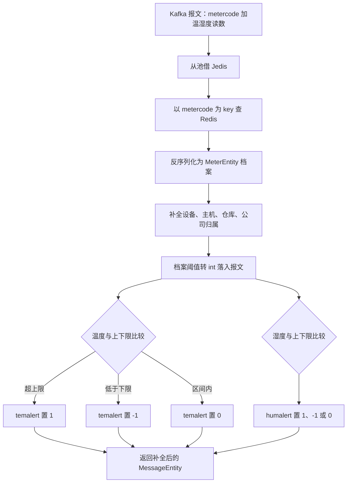

# 数据流与 Redis 档案的合并计算：MessageAggregate 逐行拆解

Kafka 里的设备报文只有编码和温湿度读数，没有设备名称、没有归属关系，更没有阈值，拿着它没法判断这条温度算不算超标。cold-flink 工程把档案比对做成了一个 map 算子 MessageAggregate：进一条光杆报文，出一条补全档案、带告警结论的完整消息。这个类是整个实时计算里唯一真正「算」的地方，也是理解流计算与外部存储协作的好样本。

## 先给结论

- MessageEntity 装着三部分数据：设备基本信息来自 Redis，温湿度读数来自 Kafka，告警结论是本算子的计算结果。
- 算子实现 `MapFunction<MessageEntity, MessageEntity>`，输入输出同型，转换发生在对象内部。
- Redis 的 key 是设备编码 metercode，值是序列化后的 MeterEntity 设备档案，取出后反序列化再逐字段合并。
- 温度、湿度各按上下限比较，结论写 temalert 与 humalert：1 超上限，-1 低于下限，0 正常。
- 真实代码的温度判断有一处笔误，比较对象误写成湿度上限 maxhum，语义应为温度上限 maxtem，改造时必须修正。

## 一条报文缺的两块信息

MessageEntity 的字段分三组（字段摘自 cold-common 的报文实体，注释标注数据来源）：

```java
private String metercode;    // 设备编码，Kafka 报文自带
private int tem;             // 温度读数，Kafka 报文自带
private int hum;             // 湿度读数，Kafka 报文自带

private String metername;    // 设备名称，Redis 档案
private String housename;    // 仓库名称，Redis 档案
private String companyname;  // 公司名称，Redis 档案
private int maxtem;          // 温度上限，Redis 档案
private int mintem;          // 温度下限，Redis 档案
private int maxhum;          // 湿度上限，Redis 档案
private int minhum;          // 湿度下限，Redis 档案

private int temalert;        // 温度状况：1 高温，0 正常，-1 低温
private int humalert;        // 湿度状况：1 高湿，0 正常，-1 低湿
```

第一组是采集端随报文带来的原始读数；第二组是设备档案，原本散落在关系库的设备、主机、仓库、公司几张表里，由后台服务在设备登记时整理成 MeterEntity 存进 Redis；第三组是告警结论，谁都不提供，只能算出来。合并计算要做的，就是把三组字段在同一对象里凑齐。

## 实现 MapFunction：输入输出同型的转换

```java
public class MessageAggregate implements MapFunction<MessageEntity, MessageEntity> {
    final JedisUtil jedisUtil = JedisUtil.getInstance();

    @Override
    public MessageEntity map(MessageEntity value) throws Exception {
        // ...
    }
}
```

MapFunction 的泛型一头一尾都是 MessageEntity：进来的对象带着原始读数，出去的对象已经补全档案并写好告警结论。连接 Redis 的资源由 JedisUtil 单例持有，它内部维护 Jedis 连接池，池的配置集中在工具类里，算子里不出现任何连接参数。

值得对比的是 Flink 的 Rich 系列函数。RichMapFunction、RichFlatMapFunction 比 MapFunction 多出 open 与 close 两个生命周期方法，连接池这类重资源的标准位置是 open 里初始化、close 里释放。本工程的写法是借助池化工具在每条数据进来时借一个 Jedis、用完归还，单例工具类保证池只有一份，功能等价，差别只在资源初始化的时机；工程化改造时把池的获取挪进 open，更贴合 Flink 的生命周期设计。

## 从 Redis 取档案：编码、取值、反序列化

map 方法的第一段工作（按真实代码整理，包名已改写）：

```java
Jedis jedis = jedisUtil.getJedis();
try {
    byte[] meterBy = jedis.get(SafeEncoder.encode(value.getMetercode()));
    MeterEntity meter = (MeterEntity) SerializeUtil.unserialize(meterBy);
    // ...
}
```

三行各干一件事。getJedis 从池里借一个客户端；SafeEncoder.encode 把设备编码字符串转成字节数组当 key，因为档案写入 Redis 时 key 与值都以字节形式存储；SerializeUtil.unserialize 把取回的字节数组反序列化回 MeterEntity 对象。设备档案在后台登记设备时落进 Redis，主键选设备编码 metercode，恰好报文里就带着 metercode，两路数据因此能对上。设备未登记或档案被清理时，get 返回 null，反序列化这一环就会出问题，流程进入 catch 分支，这是后面要展开的坑。

## 档案补全与阈值落位

```java
value.setMeterid(meter.getId());
value.setMetername(meter.getMetername());
value.setHostcode(meter.getHostcode());
value.setHostid(meter.getHostid());
value.setHostname(meter.getHostname());
value.setHouseid(meter.getHouseid());
value.setHousecode(meter.getHousecode());
value.setHousename(meter.getHousename());
value.setCompanyid(meter.getCompanyid());
value.setCompanyname(meter.getCompanyname());

value.setMaxtem(Integer.valueOf(meter.getMaxtem()));
value.setMintem(Integer.valueOf(meter.getMintem()));
value.setMaxhum(Integer.valueOf(meter.getMaxhum()));
value.setMinhum(Integer.valueOf(meter.getMinhum()));
```

档案实体 MeterEntity 的字段与报文实体几乎同名同义，逐个 set 过去，报文从此带上设备、主机、仓库、公司四级归属，下游按公司、按仓库统计告警才有字段可用。四个阈值在档案实体里是 String 类型，报文实体里是 int，用 `Integer.valueOf` 完成转换，没有这一步，后面的比较连编译都过不去。阈值以 Redis 档案为准还带来一个好处：运营侧调整阈值只需更新档案，计算程序一行不用动。

## 告警判定与一处真实笔误

```java
if (value.getTem() > value.getMaxhum()) {   // 笔误：应为 getMaxtem()
    value.setTemalert(1);    // 高温
} else if (value.getTem() < value.getMintem()) {
    value.setTemalert(-1);   // 低温
} else {
    value.setTemalert(0);    // 正常
}

if (value.getHum() > value.getMaxhum()) {
    value.setHumalert(1);    // 高湿
} else if (value.getHum() < value.getMinhum()) {
    value.setHumalert(-1);   // 低湿
} else {
    value.setHumalert(0);    // 正常
}
```

判定规则本身直白：读数超上限记 1，低于下限记 -1，区间内记 0。湿度段完整正确，温度段却有一处随工程留存的笔误：高温分支的比较对象写成了 `value.getMaxhum()`（湿度上限），语义应为 `value.getMaxtem()`（温度上限）。两个取值都是 int，编译器一声不吭；运行时湿度上限通常给得远高于温度读数，这个分支几乎永远为假，高温告警会静默失效，而测试环境若恰好没造高温数据，问题能一直潜伏。这类字段级笔误是流计算上线前逐条核对判断逻辑的原因，阅读真实工程时既要读懂意图，也要带着怀疑核对每个字段名。

算完两个结论，map 返回补全后的 value。异常与正常路径的收尾在 finally：

```java
} catch (Exception e) {
    jedisUtil.returnBrokenResource(jedis);
    e.printStackTrace();
} finally {
    jedisUtil.returnJedis(jedis);
}
return value;
```

catch 里调用 returnBrokenResource 把可能已损坏的连接标记归还，finally 里正常归还，借还配对避免连接池被拖垮。但 catch 之后照常 return value：这条报文没补上档案，temalert 保持 int 默认值 0，会顶着「正常」的结论流向下游写库展示。比抛异常更隐蔽的正是这种默认值，误区一节再展开。

算子内部流程一张图：



Kafka 一路给读数，Redis 一路给档案，汇合点就是这条 map 算子，出口是带结论的完整消息，交给后续的 Sink 双路输出。

## 常见误区

- **catch 之后照常返回原对象。** 异常分支里 value 的档案字段全空、temalert 是默认值 0，下游把它当正常数据写库展示。正解是记录日志后返回 null 让 Flink 过滤，或者用 side output 把脏数据引到单独的流单独处理。
- **以为高温判断在所有环境都生效。** 温度上界比较误用了湿度上限 maxhum，湿度上限通常远高于温度读数，这个分支几乎永远为假。真值应为 maxtem，逐字段核对判断条件是流计算上线的必修课。
- **每条数据都新建 Redis 连接。** 错例是在 map 里 new Jedis，高吞吐下连接数瞬间爆炸。池化是底线，本工程用 JedisUtil 单例借还；更进一步是把池的初始化放进 Rich 函数的 open，随算子实例生灭。
- **忽略档案缺失的情况。** 设备刚登记还没同步进 Redis，或档案被清理，get 返回 null 后直接取字段就是空指针。稳妥写法是先判空再合并，缺失时单独记录，不混入正常数据流。

## 面试可能被问到的问题

1. 面试官追问：「为什么把档案比对做成 map 算子内点查，而不是用流式 join？」
   答：档案数据量小、以设备编码为主键、更新频率低，提前整表放进 Redis 后，算子内一次点查毫秒级拿到全部归属与阈值。流式 join 要在双流间维护状态，状态体积与复杂度都高，这个数据规模下点查更划算。
2. 面试官追问：「Redis 里存的是什么，为什么用序列化字节而不是 JSON？」
   答：存的是完整的 MeterEntity 设备档案对象，以设备编码为 key。序列化字节取回即强类型对象，字段约束由实体类承担；JSON 也可行，取舍点在存储体积与人工可读性。
3. 面试官追问：「MapFunction 和 RichMapFunction 的区别？」
   答：Rich 版本多 open 与 close 生命周期方法，还带运行时上下文。连接池、文件句柄这类重资源应在 open 初始化、close 释放，每条数据只做业务处理；非 Rich 版本没有生命周期钩子，资源管理只能依赖成员变量与外部工具类。
4. 面试官追问：「告警结论为什么在算子里算，而不是入库后用 SQL 判断？」
   答：告警的价值在实时。入库再查再判，链路多一跳、延迟高一截；算子内判完把结论随消息写下去，下游所有系统读到的都是现成结论，也不必各自实现一套阈值逻辑。
5. 面试官追问：「这段代码你第一处会修什么？」
   答：温度上限比较误用了 getMaxhum，高温告警实际失效，改成 getMaxtem；第二处是异常分支静默返回未补全的对象，脏数据会顶着正常结论入库，改为记日志返回 null 或走侧输出隔离。

## 配套资料

- 代码：`materials/code/06/day6 实时计算 - 冷眼项目实战/`，cold-flink 工程的 `MessageAggregate.java` 为真实代码，maxhum 笔误按屏幕与工程原样保留，已在文中勘误（该目录名含项目代号，正文统一称冷链监控平台）。
- 代码：`materials/code/06/day1 背景介绍与系统介绍/`，cold-common 工程的 `MessageEntity`、`MeterEntity` 实体与 `JedisUtil`、`SerializeUtil` 工具类。
- 说明：引用路径截至 day 目录层级；包名统一改写为 `com.study.coldchain`。
