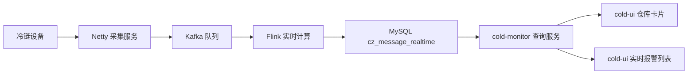

# 实时数据查询的需求与 cz_message_realtime 数据模型

Flink 把带告警结论的消息 `replace into` 进了 MySQL，数据落下来了，谁来读？答案是冷链监控平台的实时数据查询模块，工程名叫 cold-monitor，一个 Spring Boot 微服务。动手写代码之前要先回答三个问题：页面要呈现什么、表长什么样、接口按什么契约给数据。这一课把需求与数据模型定下来，后面的类结构与主程序才有的放矢。

## 先给结论

- 实时查询的数据源只有一张表 `cz_message_realtime`，Flink 持续覆盖写入，每台设备只保留一行最新读数。
- 页面呈现两种形态：仓库监控卡片展示每台设备当前温湿度，约每分钟刷新一次；实时报警列表以分页形式展示表里的数据。
- 表字段分三组：设备归属四级链（公司、仓库、主机、设备）、温湿度读数与上下限阈值、告警结论与设备状态。
- 主键是设备编码 meterCode，覆盖写语义靠它成立；state 字段上另建了普通索引 idx_state。
- 查询接口契约有两个端点：`/device/monitor/list` 供卡片取数，`/device/monitor/realtime` 供报警列表分页取数。

## 需求：卡片与列表两种形态

第一种形态是仓库监控。进入仓库页面，每台设备一张卡片，上面是当前温度、当前湿度，再加上各自的上限与下限。设备多的时候一屏排开几十张卡片，管理员扫一眼就知道哪个仓在告警。卡片数值的刷新节奏是每分钟一次，实现方式是前端定时轮询接口，后端不需要为刷新做任何推送设施。

第二种形态是实时报警列表。列表把表里的数据逐行铺开，设备编码、所属企业、采集时间、温度、温度阈值区间、湿度、湿度阈值区间、温度告警结论、湿度告警结论一应俱全。列表要翻页，所以接口必须带出总数与页数，卡片接口则不需要。两种形态读的是同一张表，差别只在要不要分页元信息。

## 数据从哪来：一条链路看明白

查询服务读的每个字段都有来处：



链路的后半段是关键：Flink 在计算阶段就把 Redis 里的设备档案与阈值合并进了报文，落表时一行数据已经带上完整的归属链、阈值和告警结论，查询服务不做任何二次计算，只做条件过滤与分页。写侧持续覆盖，读侧定时轮询，两侧通过 MySQL 解耦，谁也不用等谁。

## 实时表 cz_message_realtime 的结构

建表语句来自资料包的 SQL 脚本（有删节）：

```sql
CREATE TABLE `cz_message_realtime`  (
  `meterCode` varchar(50) NOT NULL COMMENT '设备编码',
  `meterId` varchar(50) NULL DEFAULT NULL COMMENT '设备ID',
  `meterName` varchar(100) NULL DEFAULT NULL COMMENT '设备名称',
  `hostId` varchar(50) NULL DEFAULT NULL COMMENT '主机Id',
  `hostCode` varchar(50) NULL DEFAULT NULL COMMENT '主机编码',
  `hostName` varchar(100) NULL DEFAULT NULL COMMENT '主机名称',
  `houseId` varchar(50) NULL DEFAULT NULL COMMENT '仓库Id',
  `houseCode` varchar(50) NULL DEFAULT NULL COMMENT '仓库编码',
  `houseName` varchar(100) NULL DEFAULT NULL COMMENT '仓库名称',
  `companyId` varchar(50) NULL DEFAULT NULL COMMENT '公司Id',
  `companyName` varchar(100) NULL DEFAULT NULL COMMENT '公司名称',
  `tem` int(5) NULL DEFAULT NULL COMMENT '温度',
  `maxTem` int(5) NULL DEFAULT NULL COMMENT '温度上限',
  `minTem` int(5) NULL DEFAULT NULL COMMENT '温度下限',
  `hum` int(5) NULL DEFAULT NULL COMMENT '湿度',
  `maxHum` int(5) NULL DEFAULT NULL COMMENT '湿度上限',
  `minHum` int(5) NULL DEFAULT NULL COMMENT '湿度下限',
  `temAlert` int(5) NULL DEFAULT 0 COMMENT '温度状况：1高温 0正常 -1低温',
  `humAlert` int(5) NULL DEFAULT NULL COMMENT '湿度状况：1高湿 0正常 -1低湿',
  `state` int(5) NULL DEFAULT NULL COMMENT '设备状态: 1在用 0停用 2异常',
  `lon` varchar(30) NULL DEFAULT NULL COMMENT '经度',
  `lat` varchar(30) NULL DEFAULT NULL COMMENT '纬度',
  `curtime` varchar(50) NULL DEFAULT NULL COMMENT '提交时间',
  `createTime` timestamp NULL DEFAULT CURRENT_TIMESTAMP COMMENT '创建时间',
  PRIMARY KEY (`meterCode`) USING BTREE,
  INDEX `idx_state`(`state`) USING BTREE
) ENGINE = InnoDB CHARACTER SET = utf8;
```

**第一组是归属链。** 设备、主机、仓库三级各带 id、code、name，公司只有 id 与 name。四级归属全部冗余进这一张表，是为了查询时不与设备档案表做任何 join，一张宽表把页面要展示的名字直接备齐，典型的查询侧换空间做法。

**第二组是读数与阈值。** tem、maxTem、minTem 是温度读数与上下限，hum、maxHum、minHum 是湿度一侧。阈值原本存在 Redis 的设备档案里，Flink 合并阶段写进了报文，这里落的是当次报文携带的快照，页面上「15 / 25」这种阈值区间展示直接取自这两个字段。

**第三组是结论与状态。** temAlert 与 humAlert 是 Flink 算出的告警结论，1 表示超上限、0 正常、-1 低于下限；state 是设备本身的状态；curtime 是报文里的提交时间，以字符串透传，格式形如 20191204134140，只为展示；createTime 是建行时间，数据库默认填当前时间。历史明细不在这张表里，那条线走 Kafka 回投后进 Druid，本表永远只留每台设备的最新一行。

## 实体与接口契约

表对应的实体是公共工程 cold-common 里的 MessageEntity，类上标注 `@TableName("cz_message_realtime")`，字段与表的列一一对应，Flink 的 Sink 与查询服务共用这一个类，两侧字段永不错位。

对前端的接口契约由 MessageController 定义：

```java
@RestController
@RequestMapping("device/monitor")
public class MessageController {
    @Autowired
    private MessageService messageService;

    // 仓库监控卡片：只要当页数据，不带分页元信息
    @RequestMapping("/list")
    public Result deviceList(@RequestParam Map<String, Object> params){
        List<MessageEntity> list = messageService.queryMessageRealtime(params).getRecords();
        Map<String, Object> map = new HashMap<>();
        map.put("items", list);
        return Result.ok(map);
    }

    // 实时报警列表：分页，带 total 与 pages
    @RequestMapping("/realtime")
    public Result realtime(@RequestParam Map<String, Object> params){
        IPage<MessageEntity> list = messageService.queryMessageRealtime(params);
        Map<String, Object> map = new HashMap<>();
        map.put("total", list.getTotal());
        map.put("page", list.getPages());
        map.put("items", list.getRecords());
        return Result.ok(map);
    }
}
```

请求参数是松散的 Map：`page` 与 `pagesize` 控制分页，`companyId` 按公司过滤，后续条件按同样方式扩展。返回统一走公共工程里的 Result 包装，realtime 端点的返回体形态是：

```json
{
  "total": 12,
  "page": 2,
  "items": [ { "metercode": "M402001002", "tem": -9, "maxtem": 20, "mintem": 10, "hum": 4, "temalert": -1, "humalert": 0 } ]
}
```

卡片端点复用同一个 service 方法，只是取 `getRecords()` 丢掉分页元信息。契约就此定死：路径、参数名、返回键名三者一旦有前端在用，就不能随意改动。

## 每分钟刷新为什么查得这么轻

覆盖写把「最新值」这个问题在写侧解决了：表里任何时刻都是每台设备最新一行，查询侧不需要 `order by curtime` 再取第一条，也不需要去重。分页走主键表全表扫描代价可控，state 上还有索引兜底按状态过滤的场景。轮询一分钟一次，每次一条带 limit 的 select，MySQL 毫无压力。真要降低轮询频率或改推送，把这一层换成 WebSocket 或 SSE 也只动前端与接口层，表与链路不用变。

## 常见误区

- **以为实时表存历史。** 每台设备一行，覆盖写，表行数等于设备数。历史明细在 Kafka 回投后的 Druid 链路里，查历史要去那边。
- **查最新值还要 order by 加 limit 1。** 主键覆盖写保证表内即最新，多余的排序只会白花时间。
- **给设备编码另建唯一索引、主键留给自增 id。** 覆盖写必须把 meterCode 放在主键上，replace 的冲突判定看的就是主键，自增 id 会让每次写入都变成新行。
- **把阈值当成页面配置的实时值。** 表里的 maxTem、minTem 是报文落库时的快照，管理员改阈值改在档案里，下一条报文到达后才反映到这张表。

## 面试可能被问到的问题

1. 面试官追问：「为什么用一张宽表存实时值，而不是拆表 join？」
   答：实时查询是读密集场景，四级归属与阈值全部冗余进一行，查询零 join、索引简单；写入侧是 Flink 单点覆盖，多写几个字段的代价远小于每次查询的 join 代价。
2. 面试官追问：「表里怎么保证每台设备只有最新一行？」
   答：meterCode 做主键，写入用 replace into，主键冲突时删旧插新；加上 Flink 侧的故障重放也只会覆盖同一行，最新值语义在写侧成立，查询侧零成本。
3. 面试官追问：「卡片和列表为什么要两个接口？」
   答：数据同源，但契约不同。卡片只要当页记录，列表要 total 与 pages 用于翻页。分开端点让各自返回体保持最小，前端也不用解析用不到的字段。
4. 面试官追问：「每分钟轮询一次，有什么优化空间？」
   答：轮询间隔与页面体验权衡后，可改成 WebSocket 或 SSE 由服务端推送变更，或在服务层加短 TTL 缓存挡住重复查询；设备量大时还可以按仓库维度分片订阅。
5. 面试官追问：「curtime 为什么用 varchar 不用 datetime？」
   答：它是设备报文里 yyyyMMddHHmmss 格式的字符串，原样透传只为展示与排查；排序与比较由 createTime 或写入顺序兜底，若要做时间范围查询应转换类型或另存规范化字段。

## 配套资料

- 代码：`materials/code/06/day6 实时计算 - 冷眼项目实战/`，cold-monitor 工程的 `MessageController.java` 为真实代码（该目录名含项目代号，正文统一称冷链监控平台）。
- 代码：`materials/code/06/day1 背景介绍与系统介绍/`，cold-common 工程的 `MessageEntity.java`，实体与实时表字段一一对应。
- 建表语句：`materials/code/06/day2 微服务框架与基础服务/`，资料包 SQL 脚本内含 `cz_message_realtime` 的完整 DDL 与示例数据。
- 说明：引用路径截至 day 目录层级；返回体 JSON 为按真实字段补的示意；包名统一改写为 `com.study.coldchain`。
