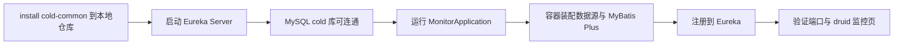

# cold-monitor 主程序：两个配置文件与一个启动类

类的骨架画完了，让服务真正在 Spring Boot 容器里立起来，是主程序这一课要解决的事：两个 yml 决定它监听哪个端口、连哪个库、注册到哪个注册中心；启动类四行代码把容器拉起。这一步跑通了，后面的接口才能在浏览器里联调，实时查询模块才算有了躯壳。

## 先给结论

- application.yml 放通用配置：端口 8183、context-path `/cold`、应用名 cold-monitor、激活 dev profile、Jackson 时间格式与 MyBatis Plus 全局配置。
- application-dev.yml 放环境相关配置：Eureka 注册中心地址与 Druid 数据源，驱动、URL、用户名 cold、密码 cold123。
- 启动类 MonitorApplication 三要素：@SpringBootApplication、@EnableDiscoveryClient、`SpringApplication.run`。
- MyBatis Plus 经 starter 接入，实体扫描与驼峰转换在 yml 声明，分页插件单独注册 Bean。
- 启动前置条件：Eureka Server 与 MySQL 先就绪，公共工程 cold-common 先 install 进本地仓库。

## 两个配置文件怎么分工

主配置 application.yml 与环境无关，任何部署形态都一样：

```yaml
# application.yml，有删节
server:
  tomcat:
    uri-encoding: UTF-8
    max-threads: 1000
    min-spare-threads: 30
  port: 8183
  connection-timeout: 10000ms
  servlet:
    context-path: /cold

spring:
  application:
    name: cold-monitor
  # 环境 dev|test|prod
  profiles:
    active: dev
  # jackson 时间格式化
  jackson:
    time-zone: GMT+8
    date-format: yyyy-MM-dd HH:mm:ss
  servlet:
    multipart:
      max-file-size: 100MB
      max-request-size: 100MB
      enabled: true
```

port 与 context-path 共同决定访问入口，接口全路径是 `http://主机:8183/cold/device/monitor/realtime` 这种形状，少一段 context-path 就是典型的 404。应用名 cold-monitor 会原样出现在 Eureka 的服务列表里，其他服务按这个名字找它。`profiles.active: dev` 把环境开关拧向 dev，Spring Boot 随即叠加加载 application-dev.yml，主配置管不变的骨架，dev 管会变的环境。

## dev 环境：注册中心与数据源

环境相关的两块配置都压在 application-dev.yml 里：

```yaml
# application-dev.yml，域名按课程环境改写，有删节
eureka:
  client:
    service-url:
      defaultZone: http://eureka.example.com:8001/eureka

spring:
  datasource:
    type: com.alibaba.druid.pool.DruidDataSource
    druid:
      driver-class-name: com.mysql.jdbc.Driver
      url: jdbc:mysql://mysql.example.com:3306/cold?allowMultiQueries=true&useUnicode=true&characterEncoding=UTF-8&useSSL=false
      username: cold
      password: cold123

      initial-size: 10
      max-active: 100
      min-idle: 10
      max-wait: 60000
      pool-prepared-statements: true
      max-pool-prepared-statement-per-connection-size: 20
      time-between-eviction-runs-millis: 60000
      min-evictable-idle-time-millis: 300000
      test-while-idle: true
      test-on-borrow: false
      test-on-return: false
      stat-view-servlet:
        enabled: true
        url-pattern: /druid/*
      filter:
        stat:
          log-slow-sql: true
          slow-sql-millis: 1000
        wall:
          config:
            multi-statement-allow: true
```

Eureka 地址指向 day2 搭起的注册中心，服务启动后按这个地址上报。数据源用 Druid 连接池连 MySQL 的 cold 库，与 Flink 的 Sink 写入是同一个库同一张表，查询侧天生能读到计算结果。池参数的含义按量级理解：initial-size 起步 10 条连接，max-active 封顶 100，max-wait 60 秒拿不到连接就报错；test-while-idle 配合逐出线程保活空闲连接。stat-view-servlet 打开 Druid 自带的监控页，路径是 `/cold/druid`，filter 里的 stat 把超过 1 秒的慢 SQL 记进日志，排查分页慢不慢有据可查。账号密码随配置明文放在课程环境里属于演示便利，生产应外置到配置中心。

## 启动类：四行代码三个要素

主程序 MonitorApplication 是整个工程的扳机：

```java
package com.study.coldchain;

import org.springframework.boot.SpringApplication;
import org.springframework.boot.autoconfigure.SpringBootApplication;
import org.springframework.cloud.client.discovery.EnableDiscoveryClient;

@SpringBootApplication
@EnableDiscoveryClient
public class MonitorApplication {
    public static void main(String[] args) {
        SpringApplication.run(MonitorApplication.class, args);
    }
}
```

三要素各司其职。@SpringBootApplication 是组合注解，自动配置、组件扫描、配置类标识全在里面，扫描范围是启动类所在包及其子包。@EnableDiscoveryClient 声明服务发现的客户端身份，配合 classpath 里的 eureka client 依赖，把本服务注册到 defaultZone 指向的注册中心。`SpringApplication.run` 启动内嵌 Tomcat、装配数据源与 MyBatis、发布注册动作，一行代码干完全部杂活。启动类所在包的位置有讲究：要包住 controller、config 与公共包引入的组件，包层级放高了扫不到，放低了多余。

## MyBatis Plus 如何接进来

pom 里三个依赖完成接入（有删节）：

```xml
<dependency>
    <groupId>com.baomidou</groupId>
    <artifactId>mybatis-plus-boot-starter</artifactId>
    <version>3.1.2</version>
</dependency>
<dependency>
    <groupId>mysql</groupId>
    <artifactId>mysql-connector-java</artifactId>
    <scope>runtime</scope>
</dependency>
<dependency>
    <groupId>com.study</groupId>
    <artifactId>cold-common</artifactId>
    <version>0.0.1-SNAPSHOT</version>
</dependency>
```

starter 自动配置补齐 SqlSessionFactory 与 Mapper 扫描；cold-common 带来 MessageDao 与 MessageEntity。yml 里的全局配置决定行为细节：

```yaml
mybatis-plus:
  mapper-locations: classpath*:/mapper/*.xml
  #实体扫描，多个 package 用逗号或者分号分隔
  typeAliasesPackage: com.study.coldchain.common.*.entity
  global-config:
    db-config:
      id-type: INPUT
      field-strategy: NOT_NULL
      column-underline: true
  configuration:
    map-underscore-to-camel-case: true
    cache-enabled: false
    call-setters-on-nulls: true
```

MessageDao 没有单独的 XML，mapper-locations 留给以后扩展；自动扫描规则是启动类包之下带 @Mapper 的接口都会被登记，MessageDao 恰好在公共包的子路径里，一行 @MapperScan 都不用写。分页插件不属于 starter 的默认行为，按 day2 同款写法补一个配置类：

```java
@Configuration
public class MybatisPlusConfig {

    // 分页插件
    @Bean
    public PaginationInterceptor paginationInterceptor() {
        return new PaginationInterceptor();
    }
}
```

加上这个 Bean，`page` 调用才会被拦截改写成 limit 查询，实时报警列表的翻页才算真正生效。

## 跑通启动：顺序与验证

一次成功的启动有先后依赖：



依赖没 install 就点启动，容器找不到 MessageDao 的字节码，报 ClassNotFoundException；注册中心没起，服务本体照样运行，只是注册动作反复失败，控制台刷连接异常。验证按三步走：启动日志出现 Tomcat started on port 8183；打开 Eureka 控制台，服务列表里出现 COLD-MONITOR；浏览器访问 `/cold/druid`，数据源页有活跃连接。三步全绿，主程序就位，后续接口联调只差业务类填充。

## 常见误区

- **只加 starter 不配数据源。** Spring Boot 检测到数据访问依赖却找不到 datasource 配置，启动直接失败，报 Failed to configure a DataSource。
- **把 context-path 漏掉或拼错。** 接口写成 `:8183/device/monitor/realtime`，少了 `/cold` 前缀，页面请求全部 404，后端日志却毫无异常。
- **启动类放在过深的子包里。** 组件扫描只向下覆盖，controller 若在启动类的同级或上级包，Bean 装配不上，接口一个都注册不出来。
- **公共工程改了不重新 install。** 本地仓库里还是旧版 cold-common，字段对不上、方法找不到的诡异编译错误随之而来，改完公共工程先 install 再启动。

## 面试可能被问到的问题

1. 面试官追问：「application.yml 和 application-dev.yml 为什么拆开？」
   答：按配置的生命周期分层，通用的端口、应用名、组件配置随代码走，环境相关的注册中心与数据库地址随环境走；profile 机制让同一份代码在 dev、test、prod 之间只换一个文件，切换成本最小。
2. 面试官追问：「@EnableDiscoveryClient 不加会注册吗？」
   答：较新的 Spring Cloud 版本里，只要 classpath 有注册中心客户端实现，服务发现功能默认开启，不加注解也会注册；显式写出来是声明意图，版本升级或组件替换时语义不发生意外。
3. 面试官追问：「context-path 和 server.port 各管什么？」
   答：port 决定进程监听哪个端口，是传输层入口；context-path 是应用挂在该端口下的路径前缀，同一端口可以由网关按路径分发给多个应用，两者共同拼出接口的完整 URL。
4. 面试官追问：「为什么选 Druid 而不是默认的 HikariCP？」
   答：Druid 的监控体系是决定性因素，自带 stat-view-servlet 展示连接池状态、SQL 执行统计与慢 SQL 明细，配合 wall 防火墙过滤危险语句；课程项目重视可观测性，性能差异在此量级不是瓶颈。
5. 面试官追问：「mybatis-plus-boot-starter 的自动配置做了什么？」
   答：引入 MyBatis 的自动装配，按数据源建 SqlSessionFactory，扫描启动类包下带 @Mapper 的接口生成代理并注入容器，再应用 yml 里的全局配置；开发者只补分页插件这类扩展组件，基础设施全部自动就位。

## 配套资料

- 代码：`materials/code/06/day6 实时计算 - 冷眼项目实战/`，cold-monitor 工程的 `application.yml`、`application-dev.yml`、`MonitorApplication.java`、`pom.xml` 为真实代码（该目录名含项目代号，正文统一称冷链监控平台）。
- 代码：`materials/code/06/day2 微服务框架与基础服务/`，cold-admin 工程的 `MybatisPlusConfig.java`，day6 工程内未单列该文件，分页插件按此同款写法补全。
- 说明：引用路径截至 day 目录层级；Eureka、MySQL 主机名以 example.com 占位；包名统一改写为 `com.study.coldchain`。
