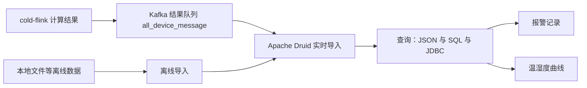

# day7 开篇：统计分析为什么交给 Apache Druid

实时指标表回答得了「这台设备现在多少度」，回答不了「上周哪几个仓库告警最频繁」。设备读数的完整快照一直在 Kafka 的结果队列里排队，缺的是一个擅长时序存储与聚合的引擎把它们接住。day7 的统计分析就补这一段：认识并装起 Apache Druid，打通离线与实时两条导入路，练熟它的查询方式，最后在冷链监控平台里落地报警记录与温湿度曲线的查询。

## 先给结论

- day7 的主角是 Apache Druid，一个为分析而设计的时序 OLAP 数据库，主打快速交互式查询；它与 Java 应用里常见的 Druid 连接池只是重名，不是一个东西。
- 目标五条：了解 Druid 是什么与适用场景、掌握安装配置启动、掌握各种查询方式、掌握离线与实时两类数据导入、在项目里落地报警记录与温湿度曲线查询。
- 查询方式覆盖三种直连格式：JSON 原生查询、SQL 查询、Avatica JDBC；聚合粒度、过滤器、聚合、Search、Select、Scan 等查询形态也都在目标清单里。
- 实时导入一路正好接住 Flink 回投的结果队列，冷链监控平台的历史数据从这条线流进 Druid。
- 工程 cold-druid 已经备好 Java 查询模块，项目实战部分用它把报警记录与曲线查出来。

## 实时链路留下的账

day6 收官时的链路是：计算结果一路覆盖写进 MySQL 实时指标表，只留每台设备的最新读数；另一路回投 Kafka 结果队列，把每条完整快照广播给下游。历史查询的需求全部压在这条队列上：



Druid 在这张图里是历史数据的归宿：实时导入持续消费队列，离线导入兜住存量文件，查询侧给出报警记录与温湿度曲线两个业务出口。day7 的所有目标都挂在这条数据路径上，曲线与图表的可视化呈现属于后续数据可视化阶段的内容，day7 的终点是把数据与查询通道打通。

## 五条目标与技术点映射

| 目标 | 技术点 | 落在 day7 的哪一段 |
|---|---|---|
| 了解 Druid 是什么、适用场景 | 为分析而设计、快速交互式查询、时序多维聚合 | 简介与特性 |
| 掌握安装配置启动 | 运行环境、集群进程、配置文件 | 环境、安装、配置、启动 |
| 掌握各类查询方式 | JSON 原生、SQL、Avatica JDBC，聚合粒度、过滤器与各查询类型 | SQL 查询与查询形态 |
| 掌握数据导入 | 离线导入、实时导入、数据删除 | 数据导入 |
| 项目落地 | 报警记录查询、温湿度曲线 | 项目实战 |

第一与第四条偏认知与数据侧，第二与第三条偏运维与使用侧，最后一条回到业务。学习顺序也建议照这个方向推进：先把引擎装起来、能访问管理界面，再喂数据，最后练查询；反过来先背查询语法，很容易学成纸上谈兵。

OLAP 即联机分析处理，面向的是聚合统计而非逐行事务：一批数据进来，几乎只增不改，查询以时间段、维度的聚合为主。设备读数快照正是这类数据的典型形状，时间一路、设备与仓库等维度几路、指标一路，交给 OLAP 引擎再合适不过。

## 查询方式的三种直连格式

课程把查询方式归成三种直连格式，同一次统计可以用三种姿势表达。JSON 原生查询是 Druid 的母语，过滤器与聚合器直接用 JSON 描述（示例，按 Druid 常用写法补全）：

```json
{
  "queryType": "timeseries",
  "dataSource": "device_message",
  "granularity": "hour",
  "aggregations": [{"type": "max", "name": "max_tem", "fieldName": "tem"}],
  "intervals": ["2026-11-01/2026-11-02"]
}
```

granularity 是聚合粒度，hour 表示按小时聚合，这正是目标清单里查询监控一项的关键词：粒度越粗聚合越快，曲线查询的体验取决于粒度选得对不对。

SQL 查询走 Druid 的 SQL 层，熟悉的语法降低上手门槛：

```sql
SELECT meterCode, MAX(tem) AS max_tem
FROM device_message
WHERE __time >= TIMESTAMP '2026-11-01 00:00:00'
GROUP BY meterCode
```

__time 是 Druid 的一等公民列，所有数据按它组织，时间过滤与聚合粒度都以它为基准。Avatica JDBC 则让 Java 程序用标准的 JDBC 接口连上 Druid 的 SQL 网关，工程查询模块里建连接的地址形如 `jdbc:avatica:remote:url=http://druid.example.com:8888/druid/v2/sql/avatica/`。三种格式各有适用位：调试与运维用 JSON 最直接，报表与临时分析用 SQL，应用集成走 JDBC。

## 项目实战的落点

day7 的项目实战把「报警记录」「温湿度曲线」两个需求落到查询模块 cold-druid：JDBC 工具类负责建连接与释放，Service 层组装查询，Controller 对外开接口。工具类的连接骨架先看一眼（真实代码节选，地址以 example.com 占位）：

```java
public class DruidHelper {

    private String url = "jdbc:avatica:remote:url=http://druid.example.com:8888/druid/v2/sql/avatica/";
    private Properties conf = new Properties();
    private Connection connection;

    /**
     * 获得Druid连接
     */
    public Connection getConnection() {
        try {
            if (null == connection) {
                connection = DriverManager.getConnection(url, conf);
            }
        } catch (SQLException e) {
            e.printStackTrace();
        }
        return connection;
    }
}
```

连接串指向 Druid 的 Avatica 协议端点，惰性初始化后复用连接。这个模块的完整展开，包括查询报警记录与曲线的 Service 与 Controller 写法，随 day7 项目实战的几篇逐一落地。学习目标阶段记住终点即可：能从 Druid 里把指定时间段、指定设备的告警明细与温度曲线查出来。

## 常见误区

- **把 Druid 数据库和 Druid 连接池混为一谈。** 错例是看到工程里的 druid 相关依赖就以为都是同一个产品。正解：一个是应用侧的数据库连接池，一个是本章的时序 OLAP 数据库 Apache Druid，重名而已，本章一切话题指后者。
- **以为 Druid 能替代 MySQL。** 错例是想把实时指标表也搬进 Druid。正解是定位不同：MySQL 管可事务更新的最新状态与业务表，Druid 管只增不改的时序明细与聚合分析，两者在链路里是分工而不是替代。
- **忽略时间列这个第一公民。** 错例是建数据源时随便挑列。正解是 Druid 的一切围绕时间戳组织，聚合粒度与时间过滤都以 __time 列为基准，导入时时间列解析错了，后面所有统计全歪。
- **把导入当一次性动作。** 错例是离线导入完就以为完事。正解是实时导入任务常驻运行，队列断连或数据格式变化都要盯住，数据删除也有专门的方式，导入与治理是持续运维。

## 面试可能被问到的问题

1. 面试官追问：「Apache Druid 是什么？适合什么场景？」
   答：为分析而设计的时序 OLAP 数据库，数据按时间组织、写入后不可变、列式存储，主打快速交互式聚合查询。适合事件流分析、指标曲线、多维统计这类只增不改、读多写多的场景，例如监控平台的报警记录与温湿度曲线。
2. 面试官追问：「项目里已经有 MySQL 了，为什么还要引入 Druid？」
   答：MySQL 的实时表按设备主键覆盖只存最新值，撑不起按时间聚合的历史分析；大量明细写 MySQL 还会挤压业务表。Druid 接队列数据做时序明细与聚合，两者分工：最新状态查 MySQL，历史曲线与统计查 Druid。
3. 面试官追问：「查询 Druid 有哪几种方式？」
   答：JSON 原生查询能力最全，用 queryType 描述时序、分组等查询；SQL 查询语法友好，适合分析与报表；Java 应用通过 Avatica JDBC 连 SQL 网关，用标准 JDBC 编程模型取数。
4. 面试官追问：「离线导入和实时导入有什么区别？」
   答：离线导入一次性加载本地文件或批量数据，适合存量历史；实时导入持续消费 Kafka 这类流式来源，秒级可见，适合设备消息这样的持续数据。冷链监控平台两条都用：历史文件补旧账，结果队列进新账。
5. 面试官追问：「Java 程序里怎么连 Druid 查数据？」
   答：引入 Avatica 依赖，连接串写 jdbc:avatica:remote:url 指向 Druid 的 SQL 端点，用 DriverManager 建连接，之后就是标准 JDBC 的 Statement 与 ResultSet 操作，工具类封装连接与释放即可。

## 配套资料

- 代码：`materials/code/06/day7 统计分析/`，cold-druid 查询工程的 `DruidHelper`、`DruidService`、`DruidController`，项目实战的真实代码。
- 代码：`materials/code/06/day6 实时计算 - 冷眼项目实战/`，cold-flink 工程，结果队列 all_device_message 的生产端。
- 说明：包名统一改写为 `com.study.coldchain`；JSON 与 SQL 查询示例为按 Druid 常用写法补全，非工程源码；连接地址以 example.com 占位；引用路径截至 day 目录层级。
