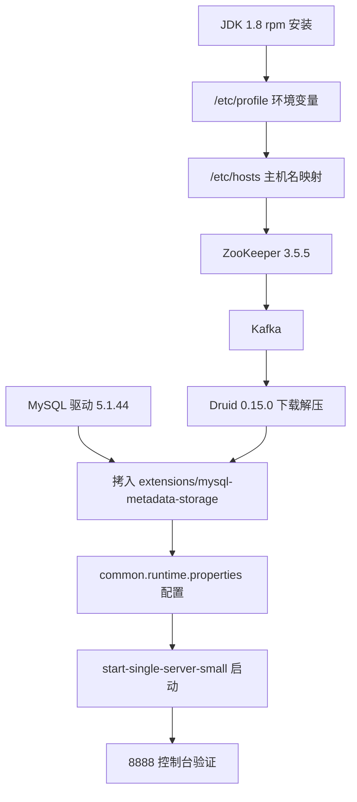

# Apache Druid 安装配置：CentOS 7 单机从 JDK 装到控制台打开

> 🔒 安全提示：文中示例的口令/密钥均为课程教学环境演示口径，生产环境的安全要求见《安全与合规须知》。

Druid 不是一个解压就能跑的 jar 包，它是一组互相配合的进程，身前还站着 ZooKeeper、Kafka、MySQL 驱动一圈前置件。安装的坑几乎都出在顺序与配置项上：驱动没拷对目录，元数据存储连不上库；内存没给够，进程起来又倒下。按课程演示环境把整条安装链走一遍，环境是 2 核 8G 的 CentOS 7，JDK 1.8，Apache Druid 0.15.0。

## 先给结论

- 演示环境与版本：CentOS 7、2 核 8G 起步（生产集群按几十上百 G 内存规划）、JDK 1.8、ZooKeeper 3.5.5、Kafka、MySQL 驱动 5.1.44、Apache Druid 0.15.0。
- 安装顺序固定：JDK、MySQL 驱动、ZooKeeper、Kafka、Druid，下载一律用 `wget -c` 断点续传。
- 配置核心是 `conf/druid/single-server/small/_common/common.runtime.properties`：扩展加载清单、ZooKeeper 地址、元数据存储、深度存储、日志路径五处。
- MySQL 驱动 jar 必须放进 `extensions/mysql-metadata-storage/`，元数据存 MySQL 才能生效。
- 启动命令 `bin/start-single-server-small`，控制台在 8888 端口，Coordinator 8081、Broker 8082、Historical 8083、Overlord 8090、MiddleManager 8091。

## 一、安装顺序：谁先谁后有讲究



依赖关系决定了顺序：Kafka 的运行依赖 ZooKeeper，Druid 的进程协调依赖 ZooKeeper、实时摄入依赖 Kafka、元数据存储依赖 MySQL 驱动，所以前置件全部就位后才轮到 Druid 本体。MySQL 驱动可以先下载备好，等 Druid 解压完再拷进扩展目录。

## 二、JDK：rpm 安装与环境变量

进入存放安装包的目录，下载 Oracle 官网 JDK 下载页上的 rpm 包。`wget -c` 的 `-c` 参数是断点续传：网络中断后重跑同一条命令，从已下载的字节继续，不必从头再来。官网地址会附带一串授权后缀，下载完先改名再用。

```bash
cd /opt/software/
# -c 断点续传：中断后重跑同一命令，从已下载字节继续
wget -c https://download.example.com/jdk/jdk-8u202-linux-x64.rpm
rpm -ivh jdk-8u202-linux-x64.rpm
java -version    # 输出 1.8.0_202 即安装成功
```

安装完要在 `/etc/profile` 里补环境变量，`source` 让配置立即生效：

```bash
vim /etc/profile
# 文件尾部追加以下设定
export JAVA_HOME=/usr/java/jdk1.8.0_202-amd64
export PATH=$JAVA_HOME/bin:$JAVA_HOME/lib:$JAVA_HOME/lib/tools.jar:$JAVA_HOME/lib/dt.jar
export CLASSPATH=.:$JAVA_HOME/lib:$JAVA_HOME/lib/tools.jar:$JAVA_HOME/lib/dt.jar
source /etc/profile
```

主机名映射也要配：编辑 `/etc/hosts`，给本机加一行 `127.0.0.1 主机名`。Druid 各进程之间按主机名互相发现，缺了这行会出现进程起不来或注册异常。

## 三、三个前置件：MySQL 驱动、ZooKeeper、Kafka

**MySQL 驱动。** 下载 `mysql-connector-java-5.1.44-bin.jar` 备用，Druid 的元数据要存进 MySQL 靠的就是它。此时 Druid 还没解压，等扩展目录出现后再拷：

```bash
cp /opt/software/jar/mysql-connector-java-5.1.44-bin.jar /opt/druid/extensions/mysql-metadata-storage/
```

**ZooKeeper。** 3.5.5 版本，同样 `wget -c` 下载、解压，把目录改名为 `zk3.5.5`；进 `conf` 把 `zoo_sample.cfg` 复制一份改名为 `zoo.cfg`，然后启动。多台部署时在启动命令里指定不同配置文件即可：

```bash
tar -xzf zookeeper-3.5.5.tar.gz
mv zookeeper-3.5.5 zk3.5.5
cp conf/zoo_sample.cfg conf/zoo.cfg
bin/zkServer.sh start    # 启动 ZooKeeper
```

**Kafka。** 下载解压后改 `config/server.properties`，三处关键项：`zookeeper.connect` 指向 ZooKeeper 的 IP 与端口（演示机 172.17.0.143:2181，多台用逗号分隔）、`log.dirs` 消息日志目录、`listeners` 与 `advertised.listeners` 监听地址端口。启动与关闭：

```bash
./bin/kafka-server-start.sh config/server.properties &
./bin/kafka-server-stop.sh
```

## 四、Druid 本体：目录结构与单机配置

从 druid.apache.org 的 downloads 页获取 0.15.0 二进制包，断点续传下载、解压，把解压目录挪到 `/opt/druid`。目录里四块最常用：`bin` 放启动脚本与 `dsql` 命令行客户端，后者能直接执行 Druid SQL；`conf` 放配置，分 `cluster` 集群与 `single-server` 单机两大套；`extensions` 放插件，Kafka 摄入的 `druid-kafka-indexing-service`、深度存储的 `druid-hdfs-storage`、元数据存储的 `mysql-metadata-storage` 都在这里；`hadoop_dependencies` 是 Hadoop 相关依赖。

单机配置按内存规模分 small、medium、large、xlarge 几档，差别只是每个进程分到的 JVM 内存不同；学习与演示用 small 足够，生产集群由运维按 cluster 套件部署。small 下每个进程一个目录：broker、coordinator、overlord、historical、middleManager、router，公共配置在各进程目录共享的 `_common/common.runtime.properties`。

这个文件值得花时间的是五处：

```properties
# 扩展加载清单：按需启用插件，逗号分隔
druid.extensions.loadList=["druid-kafka-indexing-service","druid-hdfs-storage","mysql-metadata-storage"]

# ZooKeeper 地址与根路径
druid.zk.service.host=localhost
druid.zk.paths.base=/druid

# 元数据存储：derby、MySQL、PostgreSQL 多选一，选 MySQL 后其余注释掉
druid.metadata.storage.type=mysql
druid.metadata.storage.connector.connectURI=jdbc:mysql://localhost:3306/druid
druid.metadata.storage.connector.user=root
druid.metadata.storage.connector.password=123456

# 深度存储：单机演示用本地盘，生产可换 HDFS 或 S3
druid.storage.type=local
druid.storage.storageDirectory=/opt/druid/var/druid/segments

# 摄入任务日志
druid.indexer.logs.type=file
druid.indexer.logs.directory=/opt/druid/var/druid/indexing-logs
```

扩展清单是插件的开关，`mysql-metadata-storage` 写进清单，前面拷进去的驱动才算被用上；元数据存储三选一，选中 MySQL 就把 derby 与 PostgreSQL 的配置注释掉；深度存储决定数据段落在哪，将来切到 HDFS 时扩展清单里也要带上 `druid-hdfs-storage`。Overlord、Coordinator、监控相关的项保持默认即可。

每个进程目录里还有一个 `jvm.config`，管这个进程的堆内存上下限。small 套件的默认值按 8G 内存的机器调过，机器更充裕时优先在集群层拆分进程，而不是硬调单个进程的堆。

## 五、启动与验证

```bash
cd /opt/druid
bin/start-single-server-small
```

脚本按 small 套件把六个进程全部拉起。启动要等元数据初始化，日志落在 `/opt/druid/var/` 目录下，各进程一个文件，起不来先看这里。验证三步：

- 端口探活：8888、8081、8082、8083 依次应答。
- 控制台：浏览器打开 `http://主机:8888`，首页能看到 0.15.0 与各进程 running 状态。
- 查询通道：`bin/dsql` 进入命令行执行一条 SQL 即算通；后续 cold-druid 工程的 Avatica JDBC 连接串也指向 8888 的 SQL 端点。

各端口对应的进程与职责：

| 端口 | 进程 | 职责 |
|---|---|---|
| 8888 | Router | 统一控制台，SQL 请求经它转发 |
| 8081 | Coordinator | 数据段分配与均衡 |
| 8082 | Broker | 查询路由与合并 |
| 8083 | Historical | 历史数据段查询 |
| 8090 | Overlord | 摄入任务管理 |
| 8091 | MiddleManager | 实时数据摄入 |

## 常见误区

- **元数据存储配了 MySQL，驱动却没拷。** 错例：loadList 写了 `mysql-metadata-storage`，extensions 目录里没有驱动 jar，进程反复重启报驱动类找不到。正解：先把 `mysql-connector-java-5.1.44-bin.jar` 拷进 `extensions/mysql-metadata-storage/` 再启动。
- **内存不够硬起全套。** 错例：1 核 2G 的机器跑 small 套件，进程不断被杀。正解：8G 是下限，资源更紧就调小各进程 `jvm.config` 的堆，或按需减少进程。
- **把公共配置写进进程目录。** 错例：在 broker 目录的 runtime.properties 里改 ZooKeeper 地址。正解：扩展、ZK、元数据、深度存储这些全局项都在 `_common/common.runtime.properties`，进程目录只管自己的端口与 JVM。
- **ZooKeeper 没起就先起 Kafka 或 Druid。** 错例：启动顺序随意，进程互相连不上。正解：按 ZK、Kafka、Druid 的顺序启动，关闭顺序反过来。

## 面试可能被问到的问题

1. 面试官追问：「部署一套 Druid 需要哪些前置组件？」
   答：JDK 1.8 起步；ZooKeeper 负责进程协调；Kafka 供实时摄入监听，不用实时导入时可以不装；元数据若存 MySQL，还要把对应版本的 JDBC 驱动 jar 放进扩展目录。Druid 本体解压后按单机或集群套件配置启动。
2. 面试官追问：「common.runtime.properties 里最关键的配置有哪些？」
   答：五类：扩展加载清单决定启用哪些插件；ZooKeeper 地址供进程协调；元数据存储的类型与连接串，可在 derby、MySQL、PostgreSQL 里多选一；深度存储类型与目录，本地盘、HDFS、S3 都行；摄入任务日志路径。
3. 面试官追问：「元数据存储和深度存储有什么区别？」
   答：元数据存储放 Druid 自身的表结构、任务记录、数据段登记信息，量小但关键，课程环境用 MySQL；深度存储放数据段本体，容量大，单机用本地盘，生产用 HDFS 或 S3，Historical 从这里加载段对外查询。
4. 面试官追问：「单机 small 套件和 cluster 集群配置的差别？」
   答：进程角色完全一样，差别在部署密度与资源档位。small 把六个进程放一台机器、按 8G 内存预设 JVM；cluster 套件按角色分组部署到多台机器，各自再按规模选配置，扩容就是加机器。
5. 面试官追问：「怎么确认 Druid 已经装好可用？」
   答：看端口与控制台：8888 控制台能打开且各进程显示 running，8081、8082、8083 分别是 Coordinator、Broker、Historical；再用 bin/dsql 执行一条 SQL 验证查询通道，或用应用的 Avatica JDBC 连接串连 8888 的 SQL 端点。

## 配套资料

- 代码：`materials/code/06/day7 统计分析/`，day7 的 cold-druid 查询工程，其中 DruidHelper 的 Avatica 连接串指向 8888 端口的 SQL 网关，安装验证时可直接用它测连通。
- 说明：课程无 Druid 安装脚本源码，命令与 `common.runtime.properties` 节选按本课演示环境（CentOS 7、JDK 1.8、Druid 0.15.0）的写法整理；MySQL 密码沿用课程环境的 root/123456。
- 说明：引用路径截至 `materials/code/06/` 的 day 目录层级；工程内包名统一按 `com.study.coldchain` 口径改写。
