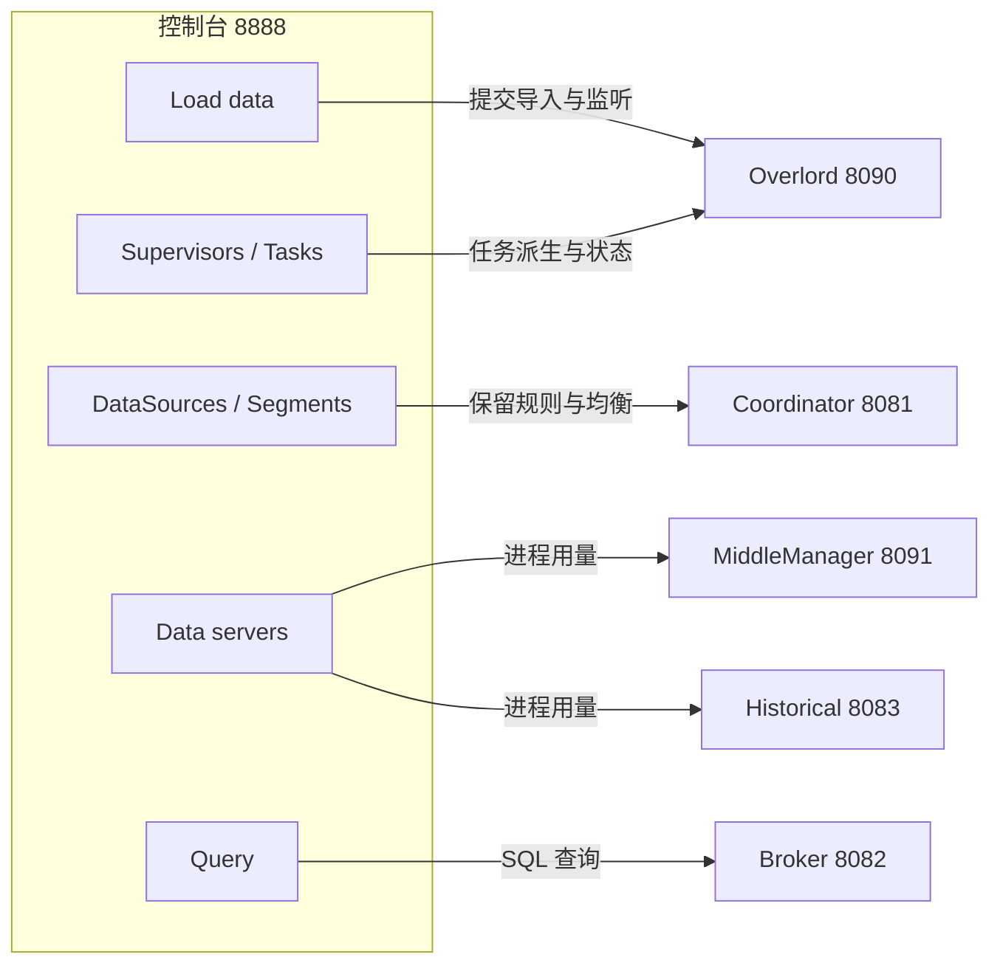

# Druid 控制台 8888 走读：数据、任务与进程的日常巡检

进程全部拉起之后，黑盒焦虑才刚开始：数据到底进来了没有、摄入任务跑没跑成、哪个节点负载高。Druid 自带统一控制台，Router 进程把它挂在 8888 端口，浏览器打开就能把数据、任务、进程三本账一次看全。按页签把日常巡检的入口走一遍，Coordinator 与 Overlord 在页面背后各管什么也一并理清。

## 先给结论

- 控制台地址 `http://主机:8888`，由 Router 承载，首页显示版本号与各进程 running 状态，演示环境为 0.15.0。
- 页签五组：Load data 导数据、DataSources 与 Segments 看数据、Supervisors 与 Tasks 看任务、Data servers 看进程、Query 直接跑 SQL。
- supervisor 可以理解成工头：常驻监听 Kafka 队列，按需把具体的摄入 task 派下去；Tasks 页按运行中、成功、失败分类计数。
- DataSources 页能看到数据源状态、保留规则、大小与行数；Segments 页列出每段的时间范围、版本与行数。
- Query 页与命令行 dsql、后续应用的 Avatica JDBC 走同一条 SQL 通道，写法与查 MySQL 无异。

## 一、控制台页签地图



这张图把页签和背后的进程对上号：导数据与任务类操作经 Overlord，数据源规则与段均衡在 Coordinator 手里，进程状态来自 MiddleManager 与 Historical 本身，SQL 查询经 Broker 路由。巡检顺序建议是：Data servers 确认进程活着，DataSources 与 Tasks 确认数据与任务正常，Query 抽查数据内容兜底。

## 二、看数据：DataSources 与 Segments

DataSources 页列出每个数据源的概况。演示环境里的 `all_device_message` 就是 Flink 结果队列实时导入的那张表：状态 Fully available 表示全部数据段在线可查；大小 36.37 MB、行数 444097；保留规则一栏是按 period 装载与按 period 丢弃两条，画面上为 `loadByPeriod(P100)` 与 `dropByPeriod(P300)`，语义是哪个时间段的数据段留在集群里、哪个时间段被移出，规则的执行者是 Coordinator。

数据删除在规则里也看得见：调整丢弃规则，老数据段就会自动退出集群，不需要手工删行。Segments 页把段摊开，每段能看到时间范围、版本号与行数。排查「统计口径对不上」时，先来这里确认段覆盖的时间范围与业务预期是否一致，时区偏移常在这一页现形。

## 三、看任务：Supervisors 与 Tasks

supervisor 是实时摄入的常驻管理者，理解成工头最贴切：它盯着 Kafka 队列，把具体干活的摄入 task 一个个派下去，task 崩了再补。Tasks 页按状态分类，运行中的、成功的、失败的各自计数，演示环境里能看到 1 个运行中、44 个成功、98 个失败。失败数高不代表数据丢了，点进失败任务读日志，多数是数据格式变更或队列断连，任务日志就在安装配置指定的 `var/druid/indexing-logs` 目录下。

添加 supervisor 的入口也在 Tasks 页：创建一个监听 Kafka 队列的 supervisor，队列数据就会被持续摄入成数据源。这正是冷链监控平台结果队列进 Druid 的通道，与批量导入互为补充，一条管增量、一条管存量。

## 四、看进程与查数据：Data servers 与 Query

Data servers 页把两类数据节点铺开：MiddleManager（8091）与 Historical（8083）各自的主机端口、承载的数据段大小、总容量、使用率与队列状态。巡检看三点：Historical 使用率是否逼近上限、MiddleManager 队列是否积压、节点是否掉线。

Query 页是内嵌的 SQL 编辑器，输入 `select * from all_device_message limit 30` 直接执行，返回行里的 line、companyname、curtime、hostname、hum 这些字段与设备快照一一对应，体验与在客户端里查 MySQL 一致。页面调通的 SQL 可以原样搬进 dsql 命令行，也可以搬进工程代码的 Avatica JDBC 里，三条路走的是同一个 SQL 网关。

不进页面也能巡检，两个高频 HTTP 接口（按官方 0.15 接口补全的示例）：

```bash
# 数据源清单与状态，问 Coordinator
curl -s http://druid.example.com:8081/druid/coordinator/v1/datasources
# 正在运行的摄入任务，问 Overlord
curl -s http://druid.example.com:8090/druid/indexer/v1/runningTasks
```

## 五、Coordinator 与 Overlord：页面背后的两只手

DataSources 页的保留规则、段的时间分布，由 Coordinator 决定，它管数据段的分配与均衡，让各 Historical 的负载摆平。Supervisors 与 Tasks 背后是 Overlord，它接收摄入任务、派给 MiddleManager 执行。日常运维因此可以收敛成三个入口：数据去留找 Coordinator 的规则，任务异常找 Overlord 的任务列表与日志，进程健康看 Data servers。控制台把这两只手的动作都可视化了，多数排查不必再登服务器翻配置。

## 常见误区

- **把 supervisor 当成摄入任务本身。** 错例：看到 Supervisors 页有记录就以为数据已经在进。正解：supervisor 是常驻工头，真正干活的是它派生的 task，数据是否在进要看 Tasks 页的运行中任务与数据源行数变化。
- **控制台打不开就断定 Druid 挂了。** 错例：8888 访问失败就直接重启全套。正解：8888 是 Router 承载的控制台，Router 单独出问题时 Coordinator 8081 等端口可能仍正常，分端口探活再决定动作。
- **把 Tasks 页的失败计数当数据丢失。** 错例：看到大量失败任务以为队列数据没了。正解：失败的是任务执行不是队列数据，修复格式或断连后任务可重跑，数据段以深度存储为准。
- **只看 DataSources 的总行数，不看 Segments 时间范围。** 错例：统计结果比预期少，反复改查询语句。正解：先进 Segments 确认段覆盖的时间范围，保留规则把段移出集群或时区偏移是最常见的根因。

## 面试可能被问到的问题

1. 面试官追问：「Druid 控制台能做哪些事？」
   答：五类：Load data 向导式导入本地或远程数据、创建 Kafka 监听；DataSources 与 Segments 查看数据源概况、保留规则与数据段；Supervisors 与 Tasks 管理实时摄入；Data servers 巡检 MiddleManager 与 Historical 的用量；Query 页直接执行 Druid SQL。
2. 面试官追问：「supervisor 和 task 是什么关系？」
   答：supervisor 是常驻的实时摄入管理者，负责监听 Kafka 队列并按需派生具体的摄入 task；task 才是执行数据写入的单元，失败会被重新派生。一个 supervisor 长期存在，task 有运行中、成功、失败等状态。
3. 面试官追问：「Coordinator 和 Overlord 的分工？」
   答：Coordinator 管数据段：段的分配、均衡、按保留规则装载与丢弃；Overlord 管摄入任务：接收任务、派给 MiddleManager、跟踪状态。前者管存量数据的布局，后者管新数据怎么进来。
4. 面试官追问：「数据源的保留规则在哪里配置，起什么作用？」
   答：在 DataSources 页按数据源配置，典型形式是 loadByPeriod 与 dropByPeriod 两条规则，决定哪个时间段的数据段留在集群、哪个时间段被移出。老数据靠规则自动退出，不需要手工删除。
5. 面试官追问：「不用控制台，怎么巡检 Druid？」
   答：端口探活 8888、8081、8082、8083；HTTP 接口查状态，Coordinator 的 datasources 接口看数据源，Overlord 的 tasks 接口看任务；再配合 var 目录下的进程与任务日志。控制台能看的信息，这些接口同样能拿到。

## 配套资料

- 代码：`materials/code/06/day7 统计分析/`，day7 的 cold-druid 查询工程（DruidHelper、DruidService、DruidController），Query 页调通的 SQL 最终经它的 JDBC 通道跑进生产查询接口。
- 说明：curl 运维接口为按 Apache Druid 0.15 官方接口补全的示例，地址以 example.com 占位。
- 说明：引用路径截至 `materials/code/06/` 的 day 目录层级；工程内包名统一按 `com.study.coldchain` 口径改写。
