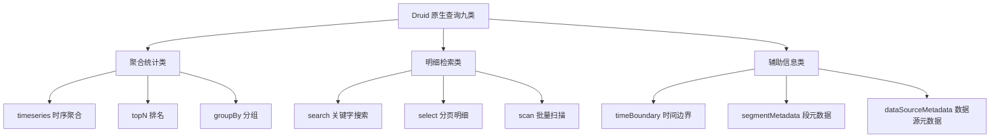

# Druid 原生查询的九种类型与公共属性：一份查询 JSON 到底由什么组成

前面已经能用 API 把查询 JSON POST 给 Broker 拿回结果，可那份 JSON 里的字段并不是随手填的：`queryType` 能填哪些值、`granularity` 到底约束什么、少了 `filter` 会查出什么，都是要回答的问题。这一节把查询类型的全景和公共属性一次讲透，后面几节的粒度与过滤器都建立在这份清单之上。

## 先给结论

- Druid 原生查询有九种类型：timeseries、topN、groupBy、search、select、scan 六类主力，加上 timeBoundary、segmentMetadata、dataSourceMetadata 三类辅助。
- `queryType` 是查询的骨架字段，选了类型就选定了后面能用的属性集合。
- `dataSource` 等价于 MySQL 里的表，`granularity` 是聚合粒度，`intervals` 圈定时间范围，`filter` 对应 SQL 的 where，`aggregations` 声明聚合方式。
- 存储粒度决定查询粒度的上限：数据按分钟存，可以按分钟、小时、天查；按天存就查不出小时级。
- 聚合能这么快，靠的是导入期的 roll-up 预聚合与查询期 `aggregations` 的配合。

## 九种查询类型全景

Druid 天生适合存「某一时刻发生了什么」这类带时间戳的数据：物联网设备上报的读数、电商用户的点击行为，都按时间落库。数据长这样，查询自然围绕时间展开，于是形成了与时序强相关的类型体系。九种类型按用途分成三组：

| 类型 | 关键字 | 回答的问题 |
|---|---|---|
| 时序聚合 | `timeseries` | 过去一小时每分钟的上报量、某指标的求和 |
| 排名 | `topN` | 访问量最高的前五个页面是哪些 |
| 分组 | `groupBy` | 按设备、按区域分组统计各是多少 |
| 搜索 | `search` | 哪些维度值包含某个关键字 |
| 明细 | `select` | 某段时间内的原始记录长什么样 |
| 扫描 | `scan` | 大批量扫出明细行，不排序不评分 |
| 时间边界 | `timeBoundary` | 这张表里数据的最早最晚时间 |
| 段元数据 | `segmentMetadata` | 段的大小、行数等存储信息 |
| 数据源元数据 | `dataSourceMetadata` | 数据源当前的导入进度 |



这张图按用途把九类分成三组：聚合统计类回答「算出来是多少」，明细检索类回答「原始数据长什么样」，辅助信息类不碰业务数据，负责报时间范围与存储状态。冷链监控平台里最常用的是聚合类与明细类：曲线图取数走明细，日报表取数走聚合。

## 一个查询骨架里都有什么

课程文档里给出的查询骨架，补全 `granularity` 之后长这样：

```json
{
  "queryType": "groupBy",
  "dataSource": "wikipedia",
  "granularity": "hour",
  "dimensions": ["language"],
  "aggregations": [{ "type": "count", "name": "count" }],
  "intervals": ["2015-09-12/2015-09-13"]
}
```

这五个公共属性几乎出现在每一类查询里，逐个拆开：

| 属性 | 含义 | 对应 SQL 概念 |
|---|---|---|
| `queryType` | 查询类型，决定整个查询的骨架 | 整条语句的形态 |
| `dataSource` | 要查询的数据源 | `FROM` 后面的表 |
| `granularity` | 聚合粒度，按什么时间单位合并结果 | 时间维度上的 `GROUP BY` |
| `intervals` | 查询的时间范围，ISO-8601 格式 | 对 `__time` 的范围条件 |
| `filter` | 过滤条件 | `WHERE` |
| `aggregations` | 聚合方式，count、sum、avg 等 | `COUNT`、`SUM` 聚合函数 |

`dataSource` 就是个表名，概念上与 MySQL 的表完全对齐。`filter` 省略时不过滤，查全表；`intervals` 在聚合类查询里是必填项，少了它 Broker 不知道该扫哪些时间段。

## 存储粒度决定查询粒度

`granularity` 这个词有两层：一层是存储粒度，导入时数据按什么时间单位预聚合；另一层是查询粒度，查询时按什么时间单位输出。两者的关系是一条单向规则：**查询粒度不能细于存储粒度。** 数据按天存，就查不出小时级的细节；按分钟存，则分钟、小时、天三个层级随便聚合，因为粗粒度总能由细粒度向上汇总。

平台数据流里可以看清这件事的意义：Flink 把设备快照写入 Druid 时就定了分段与聚合策略，之后所有报表的 `granularity` 都在这条上限之内选。如果业务需要小时曲线而导入时按天聚合了，唯一的补救是重新导入。

聚合查询快，除了粒度合并，还靠存储层的预聚合：同一时间窗内维度相同的行在导入阶段就被合并，sum、count 这类指标已经算好存进段里。查询时 `aggregations` 声明的计算直接作用在预聚合结果上，扫描的数据量远小于原始行数。这也是 Druid 适合做监控统计类负载的核心原因。粒度还有 `duration`、`period` 两种动态写法，下一节专门展开。

## 常见误区

- **`queryType` 拼写随意，团队各写各的。** 错例：一份代码里 `"querytype"`、`"queryType"` 混用，Druid 解析时对大小写宽容，能跑，但检索日志、核对配置时容易看漏。正解：字段名统一按文档驼峰式写 `queryType`，类型值按官方原样写 `groupBy`。
- **把 `dataSource` 当成数据库名或连接信息。** 正解：它等价于 MySQL 的表名，填的是导入时指定的数据源名称，如 wikipedia、all_device_message。
- **聚合查询漏写 `intervals`。** 错例：只给 `granularity` 不给时间范围，查询可能扫全表甚至报错。正解：聚合类查询把 `intervals` 当必填项对待，范围尽量收紧到需要的时段。
- **以为 `aggregations` 只能做 count。** 正解：count、sum、min、max、avg 等聚合器都支持，多个聚合器可以并列声明，一次查询同时产出多个指标。

## 面试可能被问到的问题

1. 面试官追问：「Druid 原生查询有哪几种类型？」
   答：九种，按用途分三组：聚合统计类的 timeseries、topN、groupBy；明细检索类的 search、select、scan；辅助信息类的 timeBoundary、segmentMetadata、dataSourceMetadata。日常统计以前三种为主，明细查询用 select 与 scan。
2. 面试官追问：「一份查询 JSON 里最核心的属性有哪些？」
   答：`queryType` 定骨架，`dataSource` 定表，`granularity` 定聚合粒度，`intervals` 定时间范围，`filter` 定过滤条件，`aggregations` 定聚合方式。前两个与类型相关，后四个在聚合类查询里基本是标配。
3. 面试官追问：「查询粒度和存储粒度是什么关系？」
   答：查询粒度不能细于存储粒度。导入时按什么单位预聚合，查询就只能聚合到这个单位或更粗；细粒度存储可以向上汇总出小时与天的结果，反过来不行。
4. 面试官追问：「Druid 的聚合查询为什么快？」
   答：两层原因，导入期的 roll-up 预聚合把同时间窗同维度的行合并，指标提前算好；查询期 `aggregations` 直接作用在预聚合结果上，扫描量远小于原始行数。加上按时间分段存储，`intervals` 之外的段根本不参与查询。
5. 面试官追问：「原生 JSON 查询和 SQL 查询是什么关系？」
   答：SQL 会被 Broker 编译成原生查询再执行，原生 JSON 是底层表达，能力覆盖最全。需要 topN、scan 这类 SQL 表达不便的形态时直接提交原生 JSON，其余统计场景用 SQL 更顺手。

## 配套资料

- 代码：`materials/code/06/day7 统计分析/`，cold-druid 查询工程，`pom.xml` 中除 `avatica-core` 外还引入了 druidry 查询构造库，可用 Java 对象方式拼装本节的原生查询 JSON。
- 说明：查询骨架与示例 JSON 为按本课画面与 Druid 0.15 官方查询文档写法补全；引用路径截至 day 目录层级。
