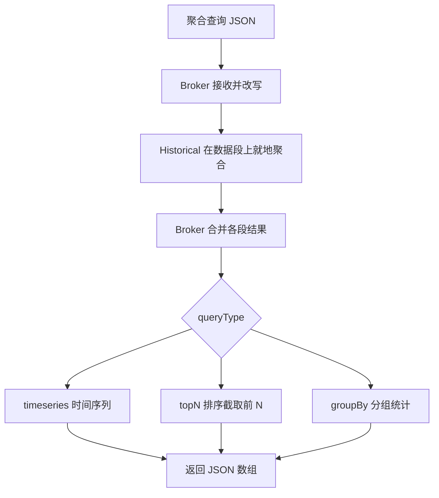

# 用原生聚合查询做统计：timeseries、topN 与 groupBy

在查询页里执行 `select * from wikipedia`，拿到的是一行行原始事件；报表要的却是另一类数字：每小时进来多少条、哪个页面最热、每台设备这一小时的平均温度。把原始行全部拉回应用里再算，网络流量和应用内存都在替数据库干活，Druid 的思路是把计算下推到存数据段的地方就地聚合，只把统计结果传回来。原生查询里的聚合查询就是干这个的，按返回形态分成 timeseries、topN、groupBy 三类。

## 先给结论

- 三类聚合查询靠 queryType 区分：timeseries 输出按时间粒度切开的统计序列，topN 输出单个维度上按指标排序的前 N 条，groupBy 输出按维度分组的统计行，都以 POST 方式提交给 Broker 的 8082 端口。
- 算什么指标由 aggregations 定义：count 数行数不用指定字段，longSum、doubleSum、longMax、longMin 一类要写 fieldName。
- postAggregations 是对聚合结果的再加工，典型场景是拿求和结果除以条数，得到平均值。
- granularity 是聚合粒度：hour 一小时一行，minute 一分钟一行，all 把整个时间区间并成一行。
- topN 只支持单维度：dimension 定维度，threshold 定 N，metric 定排序指标；多维度分组交给 groupBy。

## 三类查询共同的执行路径

提交方式与其它原生查询一致：JSON 查询体 POST 给 Broker。Broker 按查询类型改写后分发给持有数据段的节点，各段先算出段级聚合，再由 Broker 合并成最终结果。



这张图的关键在于聚合发生在数据段所在的节点上，网络上只传每段一份的统计值；queryType 决定的只是合并结果呈现成什么形状。段级聚合可以并行执行，Broker 只做轻量的二次合并，数据规模涨上去时加 Historical 节点就能摊薄扫描压力，这是时序数据库敢把统计查询做在线服务的底气。

## timeseries：把统计摊到时间轴上

timeseries 回答的问题是「每个时间段里发生了多少」。查询体里 queryType 写 timeseries，dataSource 是表名，granularity 定粒度，intervals 定时间范围（ISO 8601 格式），descending 控制结果是否按时间降序，filter 是过滤条件，aggregations 是指标列表，postAggregations 是后聚合，context 传附加参数：

```json
{
  "queryType": "timeseries",
  "dataSource": "wikipedia",
  "granularity": "hour",
  "intervals": [
    "2015-09-12T00:00:00.000Z",
    "2015-09-12T01:00:00.000Z"
  ],
  "aggregations": [
    { "type": "count", "name": "count" }
  ]
}
```

提交后每个小时刻度返回一行，每行是时间戳加结果对象：

```json
[
  { "timestamp": "2015-09-12T00:00:00.000Z", "result": { "count": 266 } },
  { "timestamp": "2015-09-12T01:00:00.000Z", "result": { "count": 133 } }
]
```

granularity 决定切分方式：换成 minute，每分钟一行，行数变多但更细；换成 second，聚合就退到接近原始粒度；换成 all，整个区间只出一条总数。intervals 写成斜杠形式或起止两个元素，在本课环境里都能识别。filter 字段用来在聚合前先收窄数据，比如只统计某个 channel 的编辑量，过滤条件的写法与其它原生查询保持一致；ascending 与 descending 则控制返回序列的时间方向，默认按时间先后输出。

## 对温度湿度做统计

平台数据源 all_device_message 存的是设备快照，tem 与 hum 分别是温度与湿度。要出「每小时温度总和、最高最低值、平均温度」这类报表，把聚合器组合起来就能算（工程里没有这段原生查询，示例按本课写法补全）：

```json
{
  "queryType": "timeseries",
  "dataSource": "all_device_message",
  "granularity": "hour",
  "intervals": ["2021-06-01T00:00:00.000Z/2021-06-02T00:00:00.000Z"],
  "aggregations": [
    { "type": "longSum", "name": "tem_sum", "fieldName": "tem" },
    { "type": "longMax", "name": "tem_max", "fieldName": "tem" },
    { "type": "longMin", "name": "tem_min", "fieldName": "tem" },
    { "type": "doubleSum", "name": "hum_sum", "fieldName": "hum" },
    { "type": "count", "name": "rows" }
  ],
  "postAggregations": [
    {
      "type": "arithmetic",
      "name": "tem_avg",
      "fn": "/",
      "fields": [
        { "type": "fieldAccess", "fieldName": "tem_sum" },
        { "type": "fieldAccess", "fieldName": "rows" }
      ]
    }
  ]
}
```

聚合器分两档：count 只数行数；带 fieldName 的求和与取最值类作用于具体列。postAggregations 里的 arithmetic 用 fn 指定四则运算，fieldAccess 引用的必须是本查询 aggregations 里定义过的输出名。tem_avg 就是温度总和除以快照条数得到的平均温度，这正是「聚合之后再聚合」的用法。

## topN：按指标取前 N 名

topN 回答的是「某个维度上谁排前面」，比如一小时内被编辑最多的十个页面。除公共字段外它多了三个：dimension 是维度，threshold 就是前 N 的 N，metric 是统计并排序的指标：

```json
{
  "queryType": "topN",
  "dataSource": "wikipedia",
  "granularity": "all",
  "dimension": "page",
  "metric": "count",
  "threshold": 10,
  "intervals": [
    "2015-09-12T00:00:00.000Z",
    "2015-09-12T01:00:00.000Z"
  ],
  "aggregations": [
    { "type": "count", "name": "count" }
  ]
}
```

返回的 result 数组按 metric 降序，每项是维度值加聚合值（数值取自课程演示画面）：

```json
[
  {
    "timestamp": "2015-09-12T00:00:00.000Z",
    "result": [
      { "count": 19, "page": "Fanie Pometta" },
      { "count": 17, "page": "Wikipedia:In the news/Candidates" },
      { "count": 15, "page": "Anthony Mantial" }
    ]
  }
]
```

数字对不对可以抽样验证：把结果里的 page 值放进 SQL `select * from wikipedia where page = '...'`，翻页把总行数加起来，课程里对榜首数出 30 条、对末位数出 15 条，与 topN 输出的 count 一致。granularity 换成 hour 再查，返回体不再是一份列表，而是每小时各挂一份前十，同一页面在不同小时的排名会变化，粒度越细返回的条目越多，这就是聚合粒度对 topN 的影响。

## groupBy：按维度分组

groupBy 与 SQL 的 GROUP BY 语义对应。dimensions 是维度集合，可以放多个；limitSpec 控制分组结果的排序与截断，不是必需字段；having 对聚合值做筛选；granularity、intervals、aggregations、postAggregations 与前面相同（示例为按官方字段表补全）：

```json
{
  "queryType": "groupBy",
  "dataSource": "wikipedia",
  "dimensions": ["channel", "cityName"],
  "granularity": "hour",
  "intervals": ["2015-09-12/2015-09-13"],
  "aggregations": [{ "type": "count", "name": "count" }],
  "having": { "type": "greaterThan", "aggregation": "count", "value": 10 }
}
```

同样的统计需求，timeseries 只按时间切，groupBy 按维度值切。维度基数越大，groupBy 返回的行越多，合并开销也越大，这是它通常比 timeseries 慢的原因。

## 常见误区

- **把粒度当成时间范围。** 错例：granularity 写了 hour，以为只查一个小时的数据，intervals 却没跟着改。正解：时间范围由 intervals 决定，granularity 只决定结果怎么切行。
- **想给 topN 传多个维度。** 错例：把 dimension 写成数组，期望按两个维度取前 N。正解：topN 只有单维度能力，多维度分组加排序用 groupBy 配 limitSpec。
- **metric 指向不存在的名字。** 错例：metric 直接写原始列名。正解：metric 必须是 aggregations 里定义过的输出名，排序依据是聚合值而不是原始列。
- **count 聚合器写了 fieldName。** 错例：在 count 里加 fieldName 想按列统计。正解：count 数的是行数，不接收字段；按列求和取最值要换 longSum、longMax 这类聚合器。

## 面试可能被问到的问题

1. 面试官追问：「timeseries、topN、groupBy 三种聚合查询怎么选？」
   答：按返回形态选。看随时间变化的统计序列用 timeseries；要单维度上的排名前 N 用 topN；要按一个或多个维度分组、还可能配筛选排序用 groupBy。三者都把计算下推到数据段就地聚合，区别只在结果的组织形状。
2. 面试官追问：「postAggregations 是干什么的，举个例子？」
   答：它对聚合结果再加工。求平均温度没有现成聚合器，先用 longSum 求温度总和、count 数行数，再用 arithmetic 后聚合拿两个输出名做除法；fieldAccess 引用的必须是本查询里定义过的聚合输出名。
3. 面试官追问：「granularity 取 all 和取 hour 结果差在哪？」
   答：all 把整个时间区间合并成一行，只出一份统计值；hour 按小时切分，每小时一行。粒度越细结果行数越多，second 粒度已接近原始数据，选粒度要同时考虑报表形态和返回量。
4. 面试官追问：「topN 的 threshold 和 metric 分别指什么？」
   答：threshold 是要取前几名，metric 是排序依据且必须是 aggregations 里定义过的输出名。返回的 result 数组按 metric 降序，每项是维度值加聚合值。
5. 面试官追问：「为什么不在应用里把原始数据拉回来自己聚合？」
   答：数据量大了网络传输和应用内存都撑不住。Druid 在存储数据段的节点上就地扫描聚合，网络上只传每段一份的统计结果，由 Broker 合并后返回，计算发生在离数据最近的地方。

## 配套资料

- 代码：`materials/code/06/day7 统计分析/`，cold-druid 查询工程，经 Avatica JDBC 走 SQL 通道取数，含 DruidHelper、DruidServiceImpl、DruidController。
- 说明：wikipedia 数据集上的 timeseries、topN 查询体与返回结果取自课程演示；all_device_message 温湿度统计与 groupBy 查询体为按本课写法补全的示例；引用路径截至 day 目录层级。
