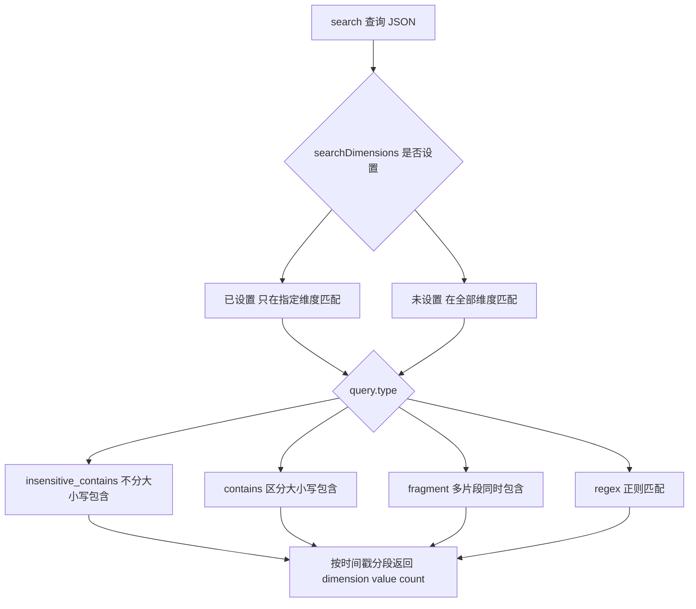

# Search 查询：在维度值里做模糊匹配

统计查询给的是数字，排查现场时遇到的常常是另一类问题：channel 这个维度里到底有哪些值？城市名只记得一半，完整值怎么找出来？这类「找出有哪些维度值」的需求不属于聚合，Druid 为此准备了 search 查询：给一段关键词，在指定维度上做模糊匹配，把命中的维度值本身返回来，再附上出现次数。它介于统计与明细之间，是按内容找维度值的专用工具。

## 先给结论

- search 查询对维度值做字符串匹配，返回命中的维度名、维度值与出现次数，不返回原始行，也不返回聚合统计。
- 匹配方式由 query.type 指定，共四种：insensitive_contains 不分大小写包含，contains 区分大小写包含，fragment 多个片段同时包含，regex 正则匹配。
- searchDimensions 限定在哪些维度里搜；不设置就在全部维度里搜，命中面大，噪音与扫描开销也大。
- limit 控制返回条数，不传默认 1000；sort 控制结果排序，常用 lexicographic 按字典序排。
- 结果按时间戳分段返回，每段内是 dimension、value、count 三元组。

## 查询体长什么样

查询体里 queryType 固定写 search，dataSource 是表名，filter 是过滤条件，limit 是返回条数上限，searchDimensions 是搜索维度数组，granularity 是时间粒度，query 是搜索条件本体，intervals 是时间范围，sort 是排序方式，context 传附加参数。课程演示在 channel 与 cityName 两个维度上搜包含 en 的值：

```json
{
  "queryType": "search",
  "dataSource": "wikipedia",
  "granularity": "hour",
  "searchDimensions": ["channel", "cityName"],
  "query": {
    "type": "insensitive_contains",
    "value": "en"
  },
  "sort": { "type": "lexicographic" },
  "intervals": [
    "2015-09-12T00:00:00.000/2015-09-13T00:00:00.000"
  ]
}
```

返回结构示意如下，外层按时间戳分段，内层 result 数组里每项是命中的维度、维度值与计数：

```json
[
  {
    "timestamp": "2015-09-12T00:00:00.000Z",
    "result": [
      { "dimension": "channel", "value": "#en.wikipedia", "count": 1 },
      { "dimension": "cityName", "value": "Enschede", "count": 1 }
    ]
  }
]
```

对照演示读结果：关键词 en 在 0 点到 1 点有命中，1 点到 2 点区间内没有匹配值时对应时间段就不返回内容；换一个更常见的关键词，命中的维度值数量随之变化。granularity 在这里只影响结果按什么时间分段，不会把维度值聚合掉，每个命中的值都原样给出。



这张图的关键分支在 searchDimensions：设置了就缩小匹配面，没设置就全维度扫描；四种匹配方式在两种范围下都可用，最终都汇成按时间分段的命中列表。

## 四种匹配方式

insensitive_contains 判断包含时不看大小写，比较前把两边归一化，查 abc 时大写 ABC、混合大小写的 aBc 都算命中。contains 同样判断「任何部分包含指定值」，case_sensitive 为 true 时严格区分大小写。fragment 要求维度值把 values 数组里的片段全部包含，case_sensitive 控制是否忽略大小写。regex 用 pattern 里的正则表达式匹配维度值。三种类型的 JSON 片段取自课程演示：

```json
{
  "query": {
    "type": "fragment",
    "case_sensitive": false,
    "values": ["fragment1", "fragment2"]
  }
}
```

```json
{
  "query": {
    "type": "contains",
    "case_sensitive": true,
    "value": "some_value"
  }
}
```

```json
{
  "query": {
    "type": "regex",
    "pattern": "some_pattern"
  }
}
```

字面上要区分清楚：contains 与 fragment 做的都是子串包含匹配，不是全等比较；要全等语义应把值写成 filter 的等值条件，search 的本职是模糊搜索。fragment 与 contains 的字段名不同，前者收 values 数组，后者收单个 value，混用会直接解析失败。

## 结果怎么读、怎么用

执行路径与其它原生查询一致：Broker 收到 search 查询后分发给持有数据段的节点，各段在维度字典上做匹配，Broker 把各段的命中合并去重后按时间分段返回。count 的含义是「该维度值在当前时间段内的命中次数」，不是行数总和，读数时要先看清自己处在哪个时间段里。

落到业务上有两类典型用法。一类是数据探查：接手一个新数据源，先对关心的维度发几个 search 查询，把维度值的真实形态摸出来，再决定 filter 怎么写、维度基数有多大。另一类是交互补全：前端搜索框里用户敲了一半的设备编码，用 insensitive_contains 发一次请求就能拿到候选值列表，配合 limit 控制返回量，配合 sort 保证候选顺序稳定。

## 常见误区

- **以为 search 能搜指标。** 错例：拿 search 找 count 大于某值的行。正解：search 只匹配维度值字符串，对指标数值的过滤用 filter，统计交给聚合查询。
- **两种 contains 记混。** 错例：以为 contains 也忽略大小写，结果漏掉大写变体。正解：insensitive_contains 不分大小写，contains 配合 case_sensitive 才严格区分。
- **fragment 与 contains 的字段名混用。** 错例：fragment 里写单数 value。正解：fragment 收 values 数组且要求全部片段同时包含，contains 收单个 value。
- **不设 searchDimensions 直接搜。** 错例：全维度搜索后结果混进大量不相关维度。正解：把关键词可能出现的维度列进 searchDimensions，匹配面小、结果干净、扫描开销也低。

## 面试可能被问到的问题

1. 面试官追问：「Search 查询和聚合查询的区别是什么？」
   答：聚合查询返回统计数字，search 返回命中的维度值本身加出现次数；前者解决「有多少」，后者解决「有哪些值」。search 不做指标聚合，结果按时间戳分段，每段内是 dimension、value、count。
2. 面试官追问：「insensitive_contains 和 contains 的区别？」
   答：前者匹配前忽略大小写，查 abc 能命中 ABC 与 aBc；后者由 case_sensitive 决定，true 时严格区分大小写。拿不准数据里的大小写形态时优先用 insensitive_contains。
3. 面试官追问：「searchDimensions 不传会怎样？」
   答：会在数据源的全部维度上匹配关键词，命中面最大，但结果噪音多、扫描开销也高；明确知道关键词在哪些维度里时应显式设置，缩小匹配范围。
4. 面试官追问：「search 的结果怎么读？」
   答：外层数组按时间戳分段，每段 result 数组里是 dimension、value、count 三元组，value 是命中的维度值，count 是该值的命中次数；sort 设 lexicographic 时段内按字典序排列。
5. 面试官追问：「举一个你们业务里 search 查询的场景？」
   答：冷链平台里按设备编码片段找候选设备、按城市名片段补全下拉框、按通道名模糊定位数据通道，都属于已知关键词找维度值；一次 search 请求就能拿到候选列表，不必把明细拉回应用里自己过滤。

## 配套资料

- 代码：`materials/code/06/day7 统计分析/`，cold-druid 查询工程，含 DruidHelper、DruidServiceImpl、DruidController，业务取数经 SQL 通道实现。
- 说明：search 查询体、四种匹配方式的 JSON 片段与返回结构取自课程演示与官方字段表；返回结果为结构示意；引用路径截至 day 目录层级。
