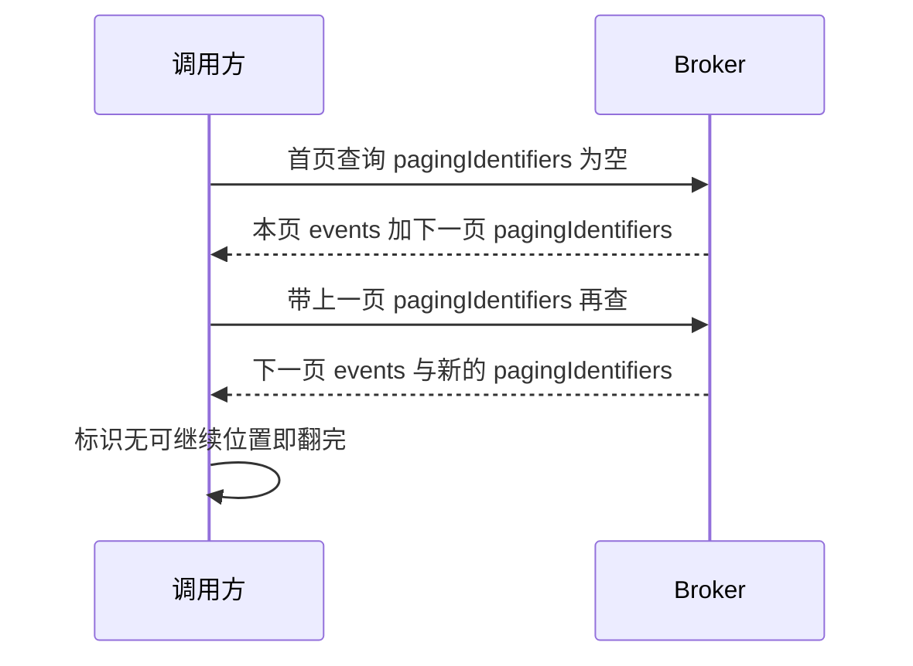

# Select 查询：返回原始行的分页明细查询

聚合查询与 search 给出的是统计数字和维度值，排查问题时更常见的需求是把原始行拿出来看：这条快照里设备到底上报了哪些字段、数值是多少。select 查询返回原始的 Druid 行，并且带分页能力，看起来正是明细读取的答案。它同时也是课程里被明确贴上「慎用」标签的一类查询：官方已不再推荐，位置正在被 scan 查询取代。弄清它的分页机制与被弃用的原因，既能读懂老工程，也能在选择时不出错。

## 先给结论

- queryType 写 select，返回原始数据行，时间戳、维度、指标都在事件对象里，支持 pagingSpec 分页。
- dimensions 与 metrics 传空数组时返回全部列，效果等同 select *；填了列名就只返回指定列，两份清单互相独立。
- 分页由 pagingSpec 控制：pagingIdentifiers 是扫描段的偏移量，threshold 是每页条数；首页传空对象，翻页把上一页返回的标识原样带回。
- select 在返回前会把结果行保留在内存里组织成分页结构，数据量大、分段多时内存与性能开销高，官方已不推荐，明细读取优先改用 scan。

## 查询体与字段

字段清单如下：queryType 固定 select；dataSource 是表名；filter 是过滤条件；descending 控制是否降序；dimensions 指定返回的维度列，空数组返回全部；granularity 是时间粒度；intervals 是时间范围；metrics 指定返回的指标列，空数组返回全部；pagingSpec 是分页参数；context 传附加参数。课程演示查询体如下：

```json
{
  "queryType": "select",
  "dataSource": "wikipedia",
  "descending": false,
  "dimensions": [],
  "granularity": "hour",
  "intervals": ["2015-09-12/2015-09-13"],
  "metrics": [],
  "pagingSpec": {
    "pagingIdentifiers": {},
    "threshold": 10
  }
}
```

dimensions 与 metrics 都留空，返回的是全列数据，等价于 SQL 里的 select *；要裁剪列时把列名分别填进两份数组。返回体按分段组织，events 数组里每条事件带 segmentId、offset、timestamp 与 event 对象（结构示意，具体字段以实际数据为准）：

```json
[
  {
    "content": {
      "pagingIdentifiers": { "wikipedia_2015-09-12T00:00:00.000Z": 9 },
      "events": [
        {
          "segmentId": "wikipedia_2015-09-12T00:00:00.000Z_0",
          "offset": 0,
          "timestamp": "2015-09-12T00:00:00.000Z",
          "event": { "channel": "#en.wikipedia", "page": "Fanie Pometta", "count": 1 }
        }
      ]
    }
  }
]
```

有一点要与聚合查询区分开：select 里的 granularity 不会把明细聚合成统计，返回的仍是原始行，粒度只影响结果按什么时间组织；想要统计数字必须换 timeseries、groupBy 一类聚合查询。

## 分页怎么翻

pagingSpec 里 pagingIdentifiers 传空对象表示从头扫第一页，threshold 定每页条数，课程演示传的是每页 10 条。返回体里的 pagingIdentifiers 记录了本页扫到的位置，把它原样放进下一次请求的 pagingSpec 就能翻到下一页；返回的标识里不再有可继续的位置时，说明已经翻完。



图里的关键是 pagingIdentifiers 的往返：它由服务端在上一页结果里给出，调用方只负责原样带回，不能自己编造偏移量，否则要么漏行要么报错。

## 为什么被 scan 取代

select 是较早一代的明细查询，与 search 属于同一批。问题出在内存：返回给客户端之前，select 要把本页结果行保留在内存里，组织成分页结构再输出，数据量大的分段场景下这份内存驻留就成了负担，行数一多可能把内存吃满。课程画面里的提示也是同样的说法：大数据量下 select 可能内存溢出，建议使用 scan。

scan 在返回前不在内存里攒整页结果，以流的方式把行发回客户端，虽然没有分页能力，却适合一次拉取大量明细。两相权衡后，明细查询的默认选择应该是 scan；select 的角色收敛为兼容旧查询体，读懂老工程里的 select 写法即可，新代码不必再写。

边界也要说清：分页本身不是坏能力，前端表格翻页这种数据量可控、每页几十行的交互场景，select 依然能正常工作，内存驻留只在大行数与大分段数时才成为问题。判断标准是返回总量与段数量级，而不是查询类型本身。

## 常见误区

- **以为 granularity 会把明细聚合成统计。** 错例：granularity 写 hour，期待每小时一行统计。正解：select 返回的始终是原始行，统计需求换聚合查询。
- **把 pagingIdentifiers 当页码。** 错例：自己从 1 开始编页号传进去。正解：它是扫描段偏移量，来自上一页返回体，原样带回才能正确翻页。
- **想要全列却填了部分 dimensions。** 错例：dimensions 只填一列，结果丢了其余列。正解：空数组返回全部列，dimensions 与 metrics 分开控制维度列与指标列。
- **在大数据量上继续用 select。** 错例：百万行明细导出仍用 select 分页拉取，进程内存暴涨。正解：改用 scan 流式拉取，select 留给兼容场景。

## 面试可能被问到的问题

1. 面试官追问：「Select 查询返回什么，和 search 差在哪？」
   答：select 返回原始数据行并支持分页，search 返回命中的维度值与计数。要看明细行用 select 或 scan，要找有哪些维度值用 search。
2. 面试官追问：「pagingSpec 怎么用？」
   答：pagingIdentifiers 传空对象取第一页，threshold 定每页条数；翻页时把上一页返回的 pagingIdentifiers 原样带回，服务端据此继续扫描，返回体里没有可继续的位置时分页结束。
3. 面试官追问：「为什么官方建议用 scan 替代 select？」
   答：select 在返回前把结果行保留在内存里组织分页，大数据量分段场景下内存与性能开销高，行数多时可能吃满内存甚至溢出；scan 以流模式逐批发回，不在内存里攒整页，更适合大量明细。
4. 面试官追问：「dimensions 和 metrics 传空数组是什么含义？」
   答：分别表示返回全部维度列与全部指标列，等同 select *；填了列名就只返回指定列，两份清单互相独立。
5. 面试官追问：「新代码里还该不该写 select 查询？」
   答：不该。它属于早期明细查询，官方已不推荐，保留意义在于兼容旧查询体；新工程的明细读取用 scan，聚合统计用 timeseries、topN、groupBy。

## 配套资料

- 代码：`materials/code/06/day7 统计分析/`，cold-druid 查询工程，明细读取经 SQL 通道实现，含 DruidHelper、DruidServiceImpl、DruidController。
- 说明：select 查询体取自课程演示；返回结构为按官方格式补全的示意；弃用提示按课程画面中「大数据量下可能内存溢出，建议使用 Scan」的说明写入；引用路径截至 day 目录层级。
