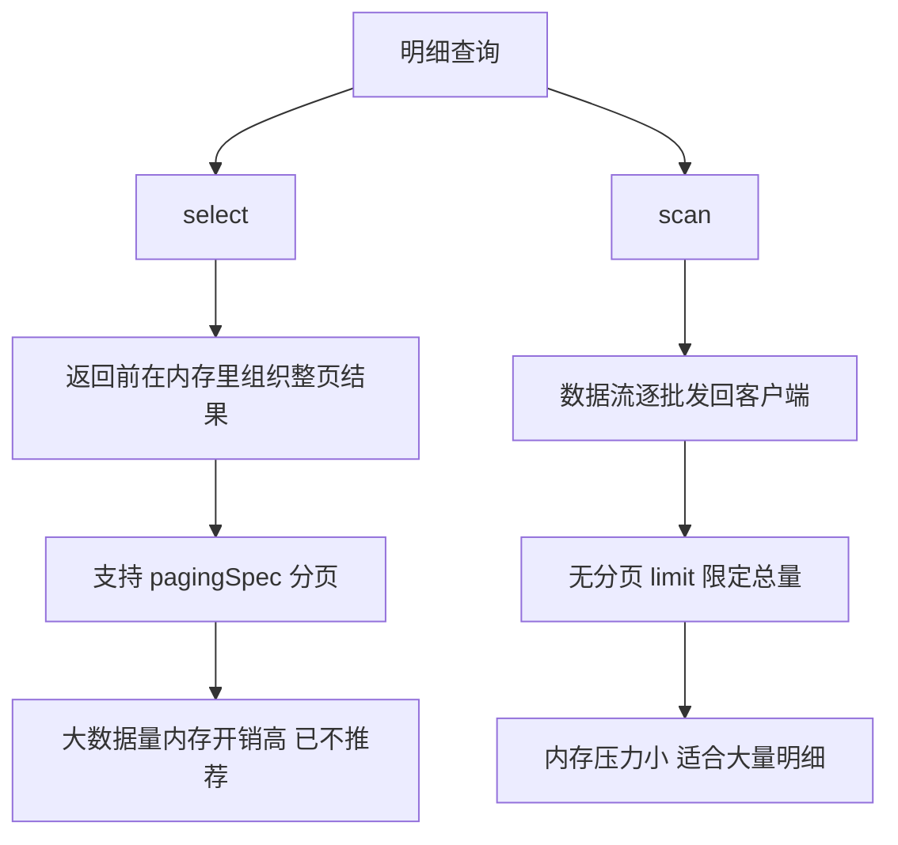
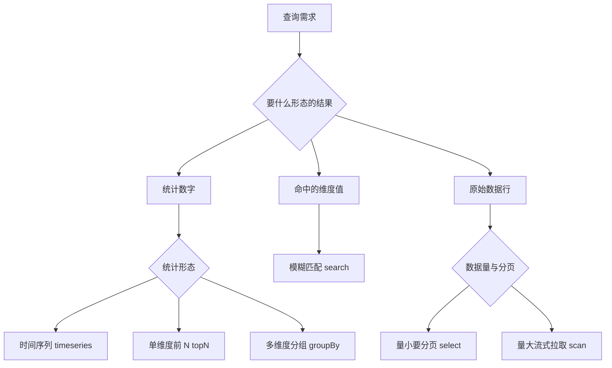

# Scan 查询：流式拉取原始行，四种查询的选型收束

select 能拿原始行却有内存开销，聚合查询又不给明细。scan 查询补上这一格：以流模式返回原始数据行，返回前不在内存里攒整页，一次能拉非常大的量，是明细读取在新版 Druid 里的默认答案。查询专题到这里也把四种查询凑齐了，收尾把选型规则一并交付。

## 先给结论

- queryType 写 scan，以流模式返回原始行，不在内存里保留全部返回行，天然适合大数据量的明细读取。
- limit 不传就返回时间区间内的所有行；batchSize 是流式缓冲的最大行数，默认 20480，只影响批次大小，不影响总量。
- resultFormat 支持 list 与 compactList，默认 list，按普通结果集解析即可。
- columns 指定要扫描的维度与指标列，空数组返回全列；order 控制是否按时间戳排序；legacy 默认 false。
- scan 照常走 Broker，也可以直接下发给持有数据段的 Historical 节点；select 已被它取代。

## 查询体与字段

字段清单如下：queryType 固定 scan；dataSource 是表名；intervals 是时间范围；resultFormat 是返回形式；filter 是过滤条件；columns 是要扫描的列名数组；batchSize 是数据流缓冲的最大行数；limit 是返回行数；order 控制是否按时间戳排序；legacy 决定是否与旧版 contrib 扩展的返回结构保持一致，默认 false；context 传附加参数。课程文档给出的标准示例（columns 留空即全列）：

```json
{
  "queryType": "scan",
  "dataSource": "wikipedia",
  "resultFormat": "list",
  "columns": [],
  "intervals": ["2015-09-12/2015-09-13"],
  "batchSize": 20480,
  "limit": 10
}
```

演示里先把 limit 设为 3，返回正好 3 行，所有列都在事件里；把 limit 改成 10，区间内的前 10 行返回。要裁剪列时把列名列全（列名清单按演示数据裁剪）：

```json
{
  "queryType": "scan",
  "dataSource": "wikipedia",
  "intervals": ["2015-09-12/2015-09-13"],
  "columns": ["__time", "channel", "page", "user"],
  "batchSize": 20480,
  "limit": 10
}
```

返回按数据段组织，每段带 segmentId 与列名清单，events 数组里是原始行（结构示意）：

```json
[
  {
    "segmentId": "wikipedia_2015-09-12T00:00:00.000Z_2015-09-13T00:00:00.000Z_0",
    "columns": ["__time", "channel", "page", "user"],
    "events": [
      { "__time": 1442016000000, "channel": "#en.wikipedia", "page": "Fanie Pometta", "user": "editor_01" }
    ]
  }
]
```

batchSize 与 limit 的分工要分清：batchSize 是「发回客户端之前，数据流中缓冲的最大行数」，它决定多少行打成一个批次往下发，不是截断；limit 才决定总共返回多少行，不传就是全部。流式发送意味着客户端边收边处理，服务端不必把结果攒在内存里。batchSize 也不是越大越好：批次大，单批的编码与传输压力跟着涨，批次小，往返次数变多；默认值覆盖多数场景，带宽紧张时可以调小观察。

## scan 与 select 的差别



关键差异一句话：select 先攒后发，scan 边扫边发；分页能力换来的是内存驻留，流式换来的是没有分页。要翻页交互且数据量可控时 select 仍能工作，明细导出、批量取数一律 scan。

scan 还有一个特殊能力：除了发给 Broker，它可以直接下发给持有数据段的 Historical 进程。Broker 的价值在于统一入口与跨段合并，而 scan 是简单扫描，段级结果本来就是最终结果，直连能省掉一跳转发，适合运维排查与单点大批量取数；常规应用仍建议走 Broker，保留路由与扩展空间。

## 四种查询的选型

四种查询覆盖了四类结果形态，选型只需要回答两个问题：要什么形态的结果，数据量有多大。



读图的方法：统计数字交给 timeseries、topN、groupBy 三型聚合，找维度值用 search，拿原始行时数据量小且要翻页用 select，批量拉取用 scan。落到平台上，cold-druid 工程里设备快照的最近读数与温湿度曲线经 SQL 通道取数，属于小数据量带 limit 的明细；要做整段历史的明细导出或离线分析，对应的正是原生 scan。把四类的边界记住，遇到新需求先归类结果形态，查询类型基本就定了。

## 常见误区

- **把 batchSize 当截断。** 错例：以为 batchSize 20480 就只返回 20480 行。正解：batchSize 只是流式缓冲大小，决定多少行打一个批次，总量由 limit 决定，limit 不传返回全部。
- **不设 limit 直接拉全量。** 错例：区间给了一个月，limit 不传，把下游服务和网络带宽打爆。正解：导出前先评估行数，给 limit 或收窄 intervals，必要时按天分段拉。
- **以为 scan 有分页。** 错例：想用 scan 实现前端翻页。正解：scan 没有分页语义，翻页交互用 select 或 SQL 的 limit，批量取数才用 scan。
- **resultFormat 与 legacy 乱配。** 错例：按旧 contrib 扩展的返回结构去解析 compactList。正解：legacy 保持 false，按现行 list 结构解析，除非在维护旧扩展的兼容代码。

## 面试可能被问到的问题

1. 面试官追问：「scan 和 select 都返回原始行，本质差别是什么？」
   答：select 在返回前把结果行保留在内存里组织分页，行数多时内存压力大；scan 以流模式逐批发回，不在内存里攒整页，代价是没有分页。大数据量明细读取一律用 scan。
2. 面试官追问：「batchSize 和 limit 的区别？」
   答：batchSize 是数据流发回客户端前的缓冲行数，默认 20480，影响批次大小；limit 是总返回行数，不传就返回时间区间内所有行。一个管批次，一个管总量。
3. 面试官追问：「scan 为什么可以直连 Historical 节点？」
   答：scan 是简单扫描，段级结果即最终结果，不依赖 Broker 做复杂合并，直连持有数据段的 Historical 能省掉一跳转发，适合运维排查和单点大批量取数；常规应用仍走 Broker 统一入口。
4. 面试官追问：「四种原生查询怎么选型？」
   答：按结果形态分：统计数字用 timeseries、topN、groupBy，找维度值用 search，拿原始行时量小要分页用 select、量大流式拉取用 scan。明细读取的默认答案是 scan。
5. 面试官追问：「resultFormat 有哪些取值？」
   答：list 与 compactList，默认 list。compactList 把重复列值压缩存储，返回体更小；解析时按对应结构处理，legacy 保持 false 即现行行为。

## 配套资料

- 代码：`materials/code/06/day7 统计分析/`，cold-druid 查询工程，含 DruidHelper、DruidServiceImpl、DruidController，明细与温湿度查询经 SQL 通道实现。
- 说明：scan 查询体、字段说明与演示参数取自课程演示与官方字段表；返回结构为按官方格式补全的示意；引用路径截至 day 目录层级。
