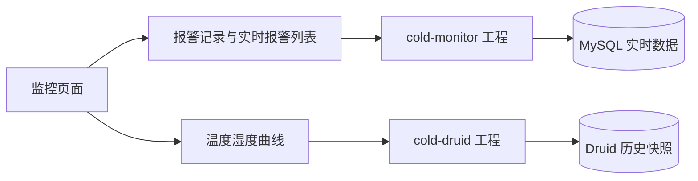

# 统计查询的需求拆解：冷热数据分工与接口契约

功能页面上点「温度曲线」，转了五秒弹出一个 timeout of 5000ms exceeded；列表刷得快，曲线时快时慢。前端的超时是表象，根子在需求没有被拆干净：哪些数据该从 MySQL 取，哪些该从 Druid 取，接口该长什么样，入参出参定成什么。需求拆清楚了，后端才有明确的实现边界。

## 先给结论

- cold-druid 是平台八个工程里的一个，职责单一：把 Druid 里的设备快照查出来，包装成 JSON 给前端。
- 数据分冷热：实时报警、报警记录列表查 MySQL 的实时指标表；温度湿度曲线、历史明细查 Druid。
- 两个页面需求最终收敛成两个接口：`/apache-druid/query/select` 查明细列表，`/apache-druid/query/temhum` 查最近温湿度序列。
- 契约参数固定为 metercode、stTime、endTime、limit 四个：设备必填，时间区间可选，条数默认 10。
- 曲线的取数口径是「当前时间向前推 10 条」，查出按时间倒序的结果后反转成时间正序返回。

## cold-druid 的工程定位

平台按微服务拆成八个工程，用户服务管账号、采集服务管报文接入、监控服务管实时报警，cold-druid 单独扛「查 Druid」这一件事。拆得这么细，图的是职责边界清楚：查询 Druid 的连接管理、SQL 拼装、结果映射都收在一个工程里，别处要用直接调它的接口，Avatica 依赖与工具类不扩散到其他服务。

这张图把页面功能与数据来源的对应关系画了出来：列表走 MySQL，曲线走 Druid，各自有服务工程承接。



关键分支在页面点击的那一下：打开列表与画曲线是两个独立请求，落点不同。把这两个请求混进一个接口，后端就得同时连两种存储，超时与失败互相拖累，拆开才是清晰的做法。

## 冷热数据分工

**MySQL 一侧是热数据。** 实时指标表按设备主键覆盖写，每台设备只留最新一条读数，实时报警页面要的正是「现在几度、超没超限」，一条主键查询就返回，快而稳定。报警记录列表展示的企业名称、设备编号、采集日期、温湿度与状态，都从这一路来。

**Druid 一侧偏温数据。** 摄入链路把每一条快照都沉淀下来，按天切段存储。它不适合「取某台设备最新一条」这种点查，但「向前推 10 条」「查一个时间段」是它的主场。温度曲线要的是过去一小段趋势，正好落在 Druid 的能力区间，它和 MySQL 的数据差的那一点，就是「只留最新」与「全部留痕」的差别。

**分工对应的取舍。** 用类比说：MySQL 像一块白板，永远只写当前状态，擦了重写；Druid 像一摞日记本，每条记录都留着，翻起来要按日期找。白板查询快但只有现在，日记本慢一点但有历史。页面上两类需求并存，后端就必须两条通道并存。

顺带解释那个 timeout：前端请求默认 5 秒超时，Druid 冷启动后的首次查询要加载段文件，偶发拖过 5 秒。联调期把查询控制在秒级、必要时预热一次，比在前端加大超时更治本。

## 从需求到接口契约

需求原文是两句话：报警管理里能看到报警记录；实时报警里能看某台设备过去的温度湿度曲线。拆成接口要回答四个问题：查什么、按什么查、查多少、返回什么。

| 接口 | 参数 | 返回 | 对应需求 |
| --- | --- | --- | --- |
| `/apache-druid/query/select` | metercode 必填；stTime、endTime 可选；limit 默认 10 | items 明细集合 | 报警记录的历史明细 |
| `/apache-druid/query/temhum` | 与 select 相同 | xAxis、tem、hum 三个数组 | 温湿度曲线 |

契约对应的服务接口定义（真实代码，包名按规范改写）：

```java
public interface DruidService {

    /**
     * 查询 Druid 数据列表
     */
    R queryDruidList(@RequestParam Map<String, Object> params);

    /**
     * 查询设备 Druid 温度湿度（最近 10 条）
     */
    R queryDruidTumHum(@RequestParam Map<String, Object> params);
}
```

参数非空即拼条件，四个参数最终拼成一条 SQL，时间过滤基准是内置的 `__time` 列：

```sql
SELECT * from all_device_message
where metercode = 'M001'
  and __time > '2018-11-17 00:00:00'
  and __time < '2018-11-18 00:00:00'
order by __time desc
limit 10
```

曲线接口的返回结构用三个数组对齐前端图表的三条数据源：

```json
{
  "xAxis": ["17:21:10", "17:21:20", "17:21:30"],
  "tem": [10, 11, 9],
  "hum": [20, 22, 21]
}
```

两个细节藏在契约里。limit 默认 10，来自「曲线取当前时间向前推的 10 条读数」这一需求口径，10 个点足够画出趋势，又把单次查询压得很轻。时间倒序查出再反转成正序，是先取「最近」再还原「时间轴」的两步走，省掉按正序扫全量再截尾的浪费。整份契约保持一个原则：能不传的参数不传，缺省行为在服务层补齐，前端只管表达意图。

## 常见误区

- **把曲线需求当成全量查询。** 错例：不给 limit，一次拉设备全部快照，数据量一大直接把前端拖超时。正解：曲线口径就是最近 10 条，limit 缺省 10，需要更长趋势时由前端显式传大一点。
- **时间参数当必填校验。** 错例：前端没传 stTime 就报参数缺失。正解：时间区间是可选条件，为空表示「不限，取最近」，服务层跳过对应条件的拼接。
- **列表也绕道 Druid。** 错例：报警记录列表也从 Druid 查，接口响应明显变慢。正解：列表是实时状态，MySQL 覆盖写的结果直接用，Druid 留给历史与曲线。
- **忽略前端超时预算。** 错例：后端接口不设性能目标，慢查询全靠前端 5 秒超时兜底。正解：查询接口按秒级响应设计，冷启动预热、控制 limit、只映射需要的字段，把超时消灭在后端。

## 面试可能被问到的问题

1. 面试官追问：「平台为什么把查 Druid 单独拆成一个工程？」
   答：微服务按职责拆分，查 Druid 涉及 Avatica 连接管理、SQL 拼装、结果映射这一整套专属逻辑，收口在一个工程里，别的服务经 HTTP 调用即可，避免驱动依赖与工具类在多个工程里重复出现。
2. 面试官追问：「冷热数据是怎么划分的，依据是什么？」
   答：按查询特征划。实时报警要最新状态、要求毫秒级响应，放 MySQL 覆盖写；曲线与统计要历史区间扫描，放 Druid 按时间段取。依据是「点查最新」与「区间扫历史」两类访问模式天然不同，一种存储兼顾两边都会牺牲一方。
3. 面试官追问：「温度曲线为什么取最近 10 条而不是一个时间段？」
   答：产品需求是「看当前趋势」，10 个采样点足够呈现波动，同时单次查询轻、响应快；如果要看更长时间范围，传时间区间与更大 limit 即可，契约预留了扩展空间。
4. 面试官追问：「temhum 接口为什么返回三个数组？」
   答：前端曲线组件需要横轴时间与温湿度两条序列，服务端直接按 xAxis、tem、hum 组装，组件免做数据变换。数组由倒序查询结果反转而来，保证横轴时间递增。
5. 面试官追问：「R 包装是什么，为什么要统一返回结构？」
   答：R 是平台的统一响应体，code 表成功失败，data 带业务数据，msg 放提示。统一结构让前端只需一套解析逻辑，异常也能按约定传递，不会出现每个接口一种返回格式的情况。

## 配套资料

- 代码：`materials/code/06/day7 统计分析/`，cold-druid 查询工程，DruidService、DruidServiceImpl、DruidController 即契约的实现侧。
- 代码：`materials/code/06/day6 实时计算 - 冷眼项目实战/`，cold-monitor 工程，实时报警与报警记录列表的 MySQL 查询侧。
- 说明：页面现象按课程画面整理，timeout 提示来自前端请求默认 5 秒超时；接口契约与返回结构按工程真实代码整理；引用路径截至 day 目录层级。
