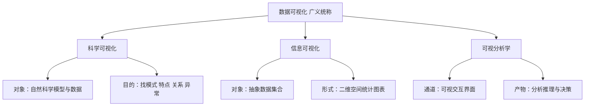

# 数据可视化是什么：用图形放大人的认知能力

拿到一份设备温度流水，盯着表格里的数字看半天，说不出二号冷库这周的温度到底稳不稳；换成一张带超温阈值线的折线图，两秒钟就有结论。做报表、做监控看板、做大屏，背后都压着同一个概念：数据可视化。它研究什么、分几个分支、什么样的图才算好，直接决定后面 Superset 里每一个配置项该往哪儿放。

## 先给结论

- 数据可视化研究的是如何将数据转化为可交互的图形或图像，以视觉可感受的方式表达，增强人的认知能力，服务于发现、解释、分析、探索、决策、学习六类目的。
- 狭义的数据可视化指用统计图表呈现数据；信息可视化面向非数字信息；广义的数据可视化是两者连同科学可视化等多个领域的统称。
- 科学可视化、信息可视化、可视分析学是三个主要分支，对象分别是自然科学模型、抽象数据集合、可视交互中的分析推理。
- 可视化重要的根源在感知效率：把「逐个读数再比对」的认知流程压缩成「一眼看形」，趋势、周期、离群点自动浮现。
- 好的可视化看三点：忠实不失真、观者省力、能直接回答业务问题。

## 定义：一句话说清它研究什么

数据可视化研究的目标，是如何将数据转化成交互的图形或图像等易于感知的形式，以视觉可以感受的方式表达出来，增强人的认知能力，最终达到发现、解释、分析、探索、决策、学习的目的。这六类目的各有对应的产物：发现靠趋势里的拐点，解释靠对比图上的差距，决策靠看板上的关键指标。

《数据可视化之美》一书把概念边界划得更细。狭义上，数据可视化指用统计图表的方式呈现数据；信息可视化则处理非数字的信息，前者用来传递信息，后者用来表达抽象或复杂的概念、技术与方法。广义上，数据可视化成了数据可视化、信息可视化、科学可视化等多个方面的统称，涉及信息技术、自然科学、统计分析、图形学、交互、地理信息等众多学科。工程语境里说的可视化平台、可视化大屏，一般取的都是广义。

## 三个分支：对象不同，目的相同

可视化领域通常把科学可视化、信息可视化、可视分析学看成三个主要分支，三者整合在一起，形成了新的数据可视化。



这张图把三个分支的对象与产出并列：分支的差别在「处理什么」，共同点都在「用视觉放大认知」。

**科学可视化是其中最早、最成熟的领域，** 面向自然科学：物理、化学、气象、航空航天、医学、生物等学科里有大量数学模型与实验数据，需要对它们进行解释和操作。它的主要目的是寻找其中的模式、特点、关系和异常。气象部门发布的全国气温分布图就是典型例子：一张热力图铺开，哪个区域异常升温一眼可见，比逐城查数字快得多；天体与星系的模拟图也属此类。这类图直接解释自然现象，让人更容易理解和吸收。

**信息可视化处理的是抽象数据集合，** 表现形式通常在二维空间里。关键问题是在有限的展现空间内如何直观地传递大量抽象信息：环比上个月增长了百分之几、同比去年涨了多少、部门和部门之间营业额谁高谁低，这些没有物理形态的数据，全靠柱状图、趋势图、流程图、树状图来承载。常见的面积图、箱线图、雷达图、饼图、透视图都在这个范畴里。对业务系统开发人员来说，日常写的报表和看板，绝大多数落在信息可视化这一支。

**可视分析学是一门以可视交互为基础的分析推理学科，** 综合图形学、数据挖掘和人机交互等技术，以可视交互界面为通道，把人的感知与认知能力融入数据处理过程，形成人脑智能与机器智能的优势互补和相互提升，建立螺旋式的信息交互与知识提炼途径，完成数据分析、数据推理和决策。金融风控是典型场景：通过热力图、关系图分析哪些用户属于风险用户、哪些指标在影响风险，图数据库里的节点、关系和关键链路把用户行为摆在明面上。可视分析学大量复用前两个分支的展现手段，重心却落在「交互中推理」。

## 为什么重要：感知效率与模式发现

**感知效率是第一重价值。** 人的视觉系统对长度、位置、颜色的差异极其敏感，而读一个数字要走「识别字符、换算单位、放进记忆里比对」的完整流程。一张柱状图上十个仓库的温度峰值高下立判，表格里则要逐行比出大小。判断耗时从秒级压到毫秒级，认知负担从工作记忆转移到直觉感知，这就是定义里「增强认知能力」的机制。

**模式发现是第二重价值。** 数字是离散的，图形把数值编码成位置、长度、颜色之后，趋势、周期、离群点会自动浮现。科学可视化里找模式找异常，信息可视化里看出增长拐点，用的是同一个机制：让规律以人眼可直接接收的形态出现，而不是靠逐条计算。冷链监控里，一天几千条温度采样本身没有任何规律感，画成折线后「每天下午升温」这种周期模式自己会跳出来。

## 好的可视化长什么样

定义里「增强认知能力」是目的，「有限展现空间传递大量信息」是约束，合起来就是三把尺子。**一是忠实。** 视觉比例不夸大不压缩，坐标轴不被裁剪到误导观者，占比之和完整，配色不暗示不存在的关系。**二是省力。** 一张图只回答一个问题，维度分组恰当，图例、单位、时间范围齐全，观者不需要猜任何一处含义。**三是可行动。** 图要能支撑发现、解释、分析、探索、决策中的一条：冷链监控平台一张温度趋势图，要能直接回答哪个仓库在哪个时段超温；回答不了业务问题的图，画得再精致也只是装饰。

## 用冷链数据感受一次「表变图」

原始流水长这样，四个孤立的采样点（字段与 day7 cold-druid 工程的 `all_device_message` 表一致，数值为示例）：

```json
[
  {"metercode": "M0001", "housename": "一号冷库", "tem": 4,  "hum": 60, "curtime": "20261105103000"},
  {"metercode": "M0002", "housename": "一号冷库", "tem": 6,  "hum": 58, "curtime": "20261105103100"},
  {"metercode": "M0003", "housename": "二号冷库", "tem": 9,  "hum": 71, "curtime": "20261105103200"},
  {"metercode": "M0004", "housename": "二号冷库", "tem": 11, "hum": 73, "curtime": "20261105103300"}
]
```

同一份结果交给前端做视觉编码（示例为按本课写法补全的 ECharts option）：

```javascript
option = {
  xAxis: { type: 'category', data: ['10:30', '10:31', '10:32', '10:33'] },
  yAxis: { type: 'value', name: '温度 ℃', max: 15 },
  series: [{
    name: '二号冷库温度',
    type: 'line',
    data: [9, 10, 9.5, 11],
    markLine: {
      data: [{ yAxis: 8, name: '冷藏上限' }]   // 超温阈值直接画进图里
    }
  }]
};
```

表格里 9、10、9.5、11 是四个需要脑内换算的数；图上变成一条线加一条阈值线，离阈值多远、往哪个方向走，一眼判定。数据没变，变的是编码方式，认知效率的差别就在这里。

## 常见误区

- **把可视化当成报表美化。** 错例：报表做完再挑几张装饰图贴上去。正解：可视化是认知工具，定义问题（想发现什么、解释什么）先于画图。
- **图表类型越多越显得专业。** 错例：一块看板塞满雷达图、3D 饼图、仪表盘。正解：以能回答业务问题为度，一张图一个问题。
- **把数据可视化和信息可视化混为一谈。** 错例：认为可视化就是画统计图。正解：狭义上前者面向统计图表、后者面向非数字信息，广义上还有科学可视化与可视分析学两个分支。
- **忽视交互。** 错例：只出静态截图当「可视化」。正解：可视分析学强调以可视交互为基础，过滤、下钻、联动才能完成分析推理的闭环。

## 面试可能被问到的问题

1. 面试官追问：「什么是数据可视化？它的目的是什么？」
   答：研究如何把数据转化为可交互的图形或图像，以视觉可感受的方式表达，增强人的认知能力；目的覆盖发现、解释、分析、探索、决策、学习六类，比如趋势图支撑发现、对比图支撑解释、监控看板支撑决策。
2. 面试官追问：「可视化的三个主要分支是什么，区别在哪？」
   答：科学可视化面向自然科学模型，找模式、特点、关系、异常；信息可视化处理抽象数据集合，在二维图表里传递抽象信息，业务报表多属于它；可视分析学以可视交互为基础做分析推理，把人的认知融入数据处理过程。
3. 面试官追问：「为什么图形比表格更容易让人理解数据？」
   答：视觉系统对长度、位置、颜色差异高度敏感，读数字却要经历识别、换算、记忆比对的多步流程；图形把数值编码成位置和形状，趋势、周期、离群点直接浮现，判断从秒级压到毫秒级。
4. 面试官追问：「狭义数据可视化和信息可视化有什么区别？」
   答：狭义数据可视化用统计图表呈现数据，目的是传递信息；信息可视化处理非数字信息，目的是表达抽象或复杂的概念、技术与方法；广义的数据可视化则是包含科学可视化在内多个领域的统称。
5. 面试官追问：「你怎么判断一张图表好不好？」
   答：三把尺子：忠实，视觉比例与数值比例一致不误导；省力，一张图回答一个问题，图例、单位、时间范围齐全；可行动，能支撑发现、解释、分析、探索、决策中的一条，回答不了业务问题的图只是装饰。

## 配套资料

- 代码：`materials/code/06/day8 数据可视化/`，本课无配套源码包，JSON 数据行与 ECharts option 示例为按本课写法补全。
- 代码：`materials/code/06/day7 统计分析/`，cold-druid 查询工程，示例所用 `all_device_message` 表字段（metercode、housename、tem、hum、curtime 等）以该工程实体定义为准。
- 说明：Java 包名统一改写为 com.study.coldchain；引用路径截至 day 目录层级。
