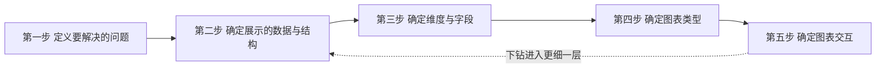
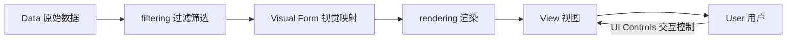

# 数据可视化的目标与过程：从一摊流水到一张图要走五步

需求单上写着「把所有子公司上个月的交易额度放进一张图里」，最容易犯的错是直接开写页面：图先画出来，再发现数据没聚合、维度没想清、用户点进去什么都看不到。可视化开发有一套固定的过程链，把这条链走完，图自然就对了。

## 先给结论

- 数据可视化的目标：把数据用图形图表等易于理解的方式展现出来，让用户容易理解、快速且准确地理解数据。
- 过程中要面对三道约束：展现空间有限、数据之间的关系复杂、如何查看数据细节。
- 过程分五步：定义要解决的问题 → 确定要展示的数据和数据结构 → 确定展示的维度与字段 → 确定图表类型 → 确定图表交互。
- 定义问题可以从趋势、对比、分布、流程、时序、空间、关联性等角度切入；数据要查空值与异常、定规模与时间范围、决定是否聚合分层、前端处理还是后端处理。
- 学术参考模型是一条链：Data → filtering → Visual Form → rendering → View → User，工程上的五步是对它的落地。

## 目标与三道约束

目标一句话：本质上是把数据用图形、图表等易于用户理解的方式展现出来，用户就能容易理解、快速且准确地理解数据。理解数据不是终点，支撑判断和行动才是：运营看趋势决定补货，质量看超温决定排查。

动手前要认清三道现实约束。**第一，展现空间有限。** 页面就那么大，过量数据不可能全画上去，必须取舍。**第二，数据关系复杂。** 多维度、多指标之间的关联不能靠一张图硬塞，要靠分层和联动组织。**第三，细节难以查看。** 聚合后的图看不出明细，要靠交互设计一条从汇总到明细的通道。这三道约束分别对应后面五步里的数据取舍、图表选型和交互设计。

## 五步过程链



流程图里那条虚线是交互步的回流：用户点击某张图表的某一项，进入下一层更细的列表或图表，等于对更小范围的数据重走一遍取数到成图。

**第一步，定义要解决的问题。** 可视化的首要目的是让用户看懂数据、理解数据，所以动手前必须先定义问题。例：想看过去两周销售额的变化，是增长了还是下跌了，什么原因造成的。问题可以从趋势图、对比图、分布图、流程图、时序、空间、关联性等角度来定义。目标模糊是后面返工的总根源，「把数据展示一下」这种需求要先追问成「谁在什么场景下要回答什么问题」。对照冷链监控平台，「所有子公司上月的交易额度放进一张图」会自然落到一个柱状图上，公司与公司并排，差异鲜明，问题定义直接给出了图表形态。

**第二步，确定要展示的数据和数据结构。** 有数据才能可视化，但页面大小有限，过量数据不能直接展示，所以要确定展示的数据。这一步的检查清单：数据是否已经加工好，没有加工好是否要重新加工；是否存在空值和异常数据；是图形数据还是列表数据；数据规模有多大；查询的时间范围有多大；是否要聚合、怎么分层展示；数据如何加载到页面，在前端处理还是在后端处理。清单里一半的问题都指向后端加工：原始流水几十万行，页面只需要几行聚合结果。

**第三步，确定展示的数据维度和字段。** 对字段做选择，选不同的字段，后面环节适合的图表类型也不同。维度的分类方式有两条线：自然的分类方式，名词、有序、间隔、比例；是否连续，分类、有序、无序、数字、时间、对数。这条线和维度与指标的划分一脉相承：能放进分组框的字段，才在这一步被挑出来。

**第四步，确定图表类型。** 柱状图、折线图、饼图、热力图、地图、散点图，可选类型非常多，但要根据要解决的问题、数据的结构、选定的维度来确定，不是越花哨越好。

**第五步，确定图表的交互。** 点击某个列表项之后，是否进入下一层更细化的列表或图表。聚合图配上下钻，细节就有了通道。

## 从取数到成图：一条真实链路

五步落到工程里是一条「查询 → 加工 → 出结构 → 成图」的链。数据来源侧本课有真实工程：day7 统计分析的 cold-druid 查询服务，从 Apache Druid 里查设备温度湿度，后端直接把结果加工成图表要的结构（包名按本博客约定改写为 com.study.coldchain，其余取自该工程真实写法）：

```java
// 后端把查询结果加工成图表需要的结构：xAxis 一条时间轴，加温度、湿度两条数值轴
@Override
public R queryDruidTumHum(Map<String, Object> params) {
    List<MessageEntity> list = (List<MessageEntity>) queryDruidList(params).get("items");

    List<String> times = new ArrayList<>();
    List<Integer> tems = new ArrayList<>();
    List<Integer> hums = new ArrayList<>();
    for (MessageEntity msg : list) {
        String curtime = msg.getCurtime();
        // 只保留时、分、秒，作为折线图的横轴刻度
        times.add(curtime.substring(8, 10) + ":" + curtime.substring(10, 12)
                + ":" + curtime.substring(12, 14));
        tems.add(msg.getTem());
        hums.add(msg.getHum());
    }
    // Druid 查询按时间倒序返回，绘图需要正序，三个轴一起反转
    Collections.reverse(times);
    Collections.reverse(tems);
    Collections.reverse(hums);

    Map<String, Object> chart = new HashMap<>();
    chart.put("xAxis", times);
    chart.put("tem", tems);
    chart.put("hum", hums);
    return R.ok(chart);
}
```

这段代码就是第二步「数据是否已加工好、前端处理还是后端处理」的答案实例：时间轴截取、排序方向、字段命名（xAxis、tem、hum）全部在后端定好，前端拿到即画，不做二次加工。若图表要的是聚合而非流水明细，后端换一条聚合 SQL 就行（示例）：

```sql
-- 按仓库聚合一天的峰值谷值，几十万行流水压成几行（示例，表字段以 cold-druid 工程为准）
SELECT housename,
       MAX(tem) AS max_tem,
       MIN(tem) AS min_tem
FROM all_device_message
WHERE __time >= TIMESTAMP '2026-11-05 00:00:00'
  AND __time <  TIMESTAMP '2026-11-06 00:00:00'
GROUP BY housename
```

学术侧还有一个参考模型，把这件事抽象成一条链：Data（原始数据，如节点、边）经 filtering（过滤）转成 Visual Form（视觉形式），经 rendering（渲染）得到 View（视图），User 通过 UI Controls 与视图交互：



对照五步：定义问题决定 filtering 留什么，维度与指标决定 Visual Form 怎么映射，图表类型与交互决定 View 呈现什么，工程里的取数加工代码则发生在 Data 到 filtering 之间。

## 常见误区

- **先选图表再定问题。** 错例：上来就说「做个饼图」。正解：问题决定维度，维度与数据结构决定图表类型，顺序不能倒。
- **把原始流水全量推给前端。** 错例：一次查出几十万行传给页面画折线。正解：后端聚合或分层，限制时间范围，前端只拿成图所需的最小结构。
- **一张图塞多个问题。** 错例：又看趋势又看占比还要对比，全部画进一张图。正解：拆成多张图，用看板编排加联动。
- **忽略交互步。** 错例：只出静态图，看不到明细。正解：聚合图必配下钻，点击进入下一层列表或图表。

## 面试可能被问到的问题

1. 面试官追问：「数据可视化的目标是什么，会遇到哪些现实问题？」
   答：把数据用图形图表等易于理解的方式展现，让用户快速准确地理解数据。现实问题有三道：展现空间有限、数据关系复杂、细节难以查看，分别靠数据取舍、分层联动、交互下钻来化解。
2. 面试官追问：「数据可视化的过程分哪几步？」
   答：五步：定义要解决的问题；确定要展示的数据和数据结构；确定展示的数据维度或字段；确定图表类型；确定图表交互。每一步都有明确产出，问题定义输出分析角度，数据步输出结构与规模，维度步输出字段清单。
3. 面试官追问：「确定要展示的数据时要考虑哪些问题？」
   答：数据是否加工好、有无空值与异常、是图形数据还是列表数据、规模多大、时间范围多大、是否聚合、如何分层、怎么加载到页面，以及处理放在前端还是后端。
4. 面试官追问：「为什么要尽量在后端完成数据加工？」
   答：页面空间与浏览器计算能力有限，全量流水推给前端既慢又不可控；后端把截取、排序、聚合做完，前端拿到即画。本项目 cold-druid 工程里温度湿度折线图的数据，就是在后端整理成 xAxis 与两条数值轴的结构。
5. 面试官追问：「图表交互为什么要设计下钻？」
   答：聚合图牺牲了明细，下钻提供从汇总到明细的通道，点击某一项进入更细一层的列表或图表，相当于对更小范围的数据重走一遍取数成图过程，空间有限与细节查看两道约束同时得到缓解。

## 配套资料

- 代码：`materials/code/06/day7 统计分析/`，cold-druid 查询工程，queryDruidTumHum 的加工写法、`/apache-druid/query/temhum` 接口与 `all_device_message` 表字段取自该工程，包名已按约定改写。
- 代码：`materials/code/06/day8 数据可视化/`，本课无配套源码包，聚合 SQL 与参考模型图示为按本课写法补全。
- 说明：Java 包名统一改写为 com.study.coldchain；引用路径截至 day 目录层级。
