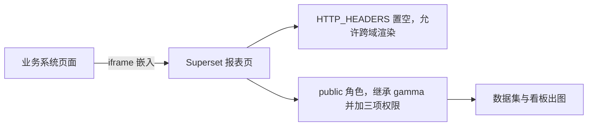

# 把 Superset 报表嵌进业务系统：配置、public 角色与 iframe

报表在 Superset 里做完了，真正的读者是运营和管理人员，不能要求他们为看几张图专门登录另一个平台。公司里系统一堆，真实的诉求是把所有系统的报表汇到一个统一入口查看，免去逐个系统登录；对冷链设备监控平台来说，就是要在自己的页面里直接展示 Superset 的报表。嵌入这件事动两处：服务端的配置与权限，业务系统里的一段 iframe 代码。

## 先给结论

- 嵌入链路三件事：放开 iframe 嵌入限制、给 public 角色授权、把嵌入代码贴进业务页面。
- 配置改容器内的 `superset/config.py` 三项：`PUBLIC_ROLE_LIKE_GAMMA = True` 让 public 继承 gamma 默认权限，`BABEL_DEFAULT_LOCALE = 'zh'` 把界面默认语言设为中文，`HTTP_HEADERS = ()` 放开 iframe 跨域嵌入；改完必须重启容器。
- 权限在「安全 → 角色列表」里给 public 加三个：can explore on Superset、can explore JSON on Superset、database access。
- 报表页的分享入口能复制链接或嵌入代码，嵌入代码就是一个可调宽高的 iframe，贴进任意 HTML 页面即可。
- 安全边界要清醒：这套方案等于免登录只读访问，课程环境假定内网使用；上公网必须用反向代理与网关鉴权收口。

## 为什么嵌入要动配置与权限

Superset 页面默认不是随便谁都能嵌、都能看的。中间隔着两道门：一道是 HTTP 响应头，配置里的 HTTP_HEADERS 默认带着限制 iframe 嵌入的项，浏览器见到就会拒绝把 Superset 页面画进别的站点；另一道是权限，匿名访问走 public 角色，public 默认几乎什么都没有，iframe 里只会看到登录页。所以嵌入的本质就是开这两道门。

课程环境里 Superset 跑在 Docker 中，先进容器再改配置文件：

```bash
# 找到运行中的 Superset 容器（容器名与 ID 以 docker ps 输出为准）
docker ps | grep superset

# 以 root 身份进入容器
docker exec -u root -it superset /bin/bash

# 编辑配置文件（路径以镜像内实际位置为准）
vim /usr/local/lib/python3.6/site-packages/superset/config.py

# 改完退出容器并重启，配置才会加载
docker restart superset
```

config.py 里动三处，注释为讲解：

```python
# public 角色继承 gamma 角色的默认权限，作为匿名访问的底座
PUBLIC_ROLE_LIKE_GAMMA = True

# 界面默认语言设为中文
BABEL_DEFAULT_LOCALE = 'zh'
BABEL_DEFAULT_FOLDER = 'superset/translations'
LANGUAGES = {
    'zh': {'flag': 'cn', 'name': 'Chinese'},
    'en': {'flag': 'us', 'name': 'English'},
}

# 响应头置空，放开 iframe 跨域嵌入限制
HTTP_HEADERS = ()
```

PUBLIC_ROLE_LIKE_GAMMA 是权限的底座：gamma 本身带一套基础查看权限，把它借给 public，匿名访问才有起点。BABEL_DEFAULT_LOCALE 管界面语言，报表给运营看，界面保持中文省很多解释。HTTP_HEADERS 是嵌入的关键：置空之后，浏览器不再拿限制嵌入的响应头拦 iframe，跨域渲染才放行。

## 给 public 角色补三个权限

配置文件解决「能不能被嵌」，角色权限解决「匿名进来能干什么」。用 admin/admin123 登录 Superset，到「安全 → 角色列表」，编辑 public 角色，添加三条权限：can explore on Superset，允许打开图表探索页；can explore JSON on Superset，允许以 JSON 形式从 Superset 取图表数据；database access，放行数据库访问。三条加上，public 身份打开嵌入页才能一路走通到数据。

安全性要不要担心？这个疑问有道理。这套配置等于把报表开放成免登录只读，公网上裸奔肯定不行。课程环境的定位是：数据在内网，报表绝大多数时候给内网用户看，用户对安全性的要求没有到需要逐人鉴权的程度，内网业务系统里能看报表就够了。边界画清楚，方案就成立：内网只读用 public，出了内网换方案。

嵌入的完整链路画成一张图：



请求从业务页面出发，经响应头放行，落到 public 角色鉴权，最后走到数据集。任何一环没配，iframe 里就是登录页、报错页或白屏，排查时按这条链从外往里走。

## 拿到 iframe 代码，贴进业务系统

打开做好的报表，编辑页右上角有两个入口：一个复制链接，别人点链接直接打开报表页；一个复制嵌入代码，内容是一段 iframe 标签，宽度和高度参数可以在弹窗里先调好，点复制到剪贴板。把这段代码贴进业务系统的页面，本课演示用一个最简的 test.html：

```html
<!DOCTYPE html>
<html>
<head>
  <meta charset="utf-8">
  <title>冷链监控平台 - 报表</title>
</head>
<body>
  <!-- 嵌入代码从报表页的分享入口复制，宽高按页面布局调整 -->
  <iframe
    src="http://example.com:7088/superset/explore/?form_data_key=xxxx"
    width="1200" height="600" frameborder="0">
  </iframe>
</body>
</html>
```

浏览器打开 test.html，报表直接渲染出来：数据源 users、柱状图、时间维度毕业日期，与 Superset 里看到的完全一致。HTML 页面能放进哪个系统，报表就能出现在哪个系统，冷链监控平台的前端页面同样如此。

还嫌页面里的 Superset 导航碍事，报表 URL 加上 standalone 参数（通用写法补充），顶部导航与侧边栏隐藏，只剩图表本体，嵌进业务系统更干净：

```text
http://example.com:7088/superset/dashboard/1/?standalone=1
```

自研前端接入还有几件事提前想好。样式上，iframe 宽高要么写死，要么用百分比加自适应布局，别让滚动条出现；性能上，报表加载走 Superset 缓存，图表慢先查缓存与查询本身；安全上，公网环境把 Superset 挂到反向代理后面，统一域名、统一鉴权，别把 7088 端口裸露出去。整个嵌入过程收拢成两步：第一步配置权限，配置文件与角色各一次；第二步把 iframe 代码拷进业务系统，完事。

## 常见误区

- **只改配置文件不加权限。** 错例：HTTP_HEADERS 置空后直接嵌，iframe 里还是登录页。正解：public 角色补齐 can explore、can explore JSON、database access 三个权限，匿名访问才走得通。
- **只加权限不改响应头。** 错例：权限全给了，iframe 白屏或拒绝加载。正解：HTTP_HEADERS 默认带限制嵌入的头，置空并重启容器后才允许跨域渲染。
- **改完 config.py 不重启就验证。** 错例：保存配置直接刷新页面，毫无变化就怀疑改错地方。正解：config.py 在进程启动时加载，`docker restart` 之后才生效。
- **把 public 免登录方案直接挂公网。** 错例：公网域名直接暴露嵌入页。正解：public 等于只读匿名访问，公网场景用反向代理加网关鉴权收口，或改用带登录态的集成方案。

## 面试可能被问到的问题

1. 面试官追问：「Superset 报表嵌入业务系统的完整步骤？」
   答：两步。服务端配置：进容器改 config.py，public 继承 gamma、界面语言设中文、HTTP_HEADERS 置空，重启生效，再在角色管理里给 public 加 can explore、can explore JSON、database access；应用侧：从报表页复制 iframe 嵌入代码，贴进业务页面。
2. 面试官追问：「PUBLIC_ROLE_LIKE_GAMMA 起什么作用？」
   答：public 是匿名访问对应的角色，默认几乎无权限；该项置 True 后 public 继承 gamma 的默认权限集，作为匿名访问的底座，再按需叠加细粒度权限。
3. 面试官追问：「HTTP_HEADERS 置空解决什么问题？」
   答：默认响应头里带有限制 iframe 嵌入的项，浏览器会拒绝跨域渲染 Superset 页面；置空后报表才能嵌进其他系统的页面，是 iframe 方案的前提。
4. 面试官追问：「嵌入方案的安全边界怎么定？」
   答：免登录只读，适合内网报表场景；数据敏感或上公网时，靠反向代理统一域名、网关层鉴权与访问控制收口，不能依赖匿名角色本身。
5. 面试官追问：「嵌入后页面里全是 Superset 自身导航，怎么收干净？」
   答：报表 URL 加 standalone 参数隐藏顶部导航与侧边栏，只留图表本体；外层 iframe 控制宽高，业务系统页头页尾与报表自然拼接。

## 配套资料

- 代码：`materials/code/06/day8 数据可视化/`，本课无配套源码包，config.py 改动与 test.html 页面示例为按本课写法补全，docker 命令与配置项取自课程环境演示。
- 说明：包名统一改写为 com.study.coldchain（本课无 Java 代码，口径沿用）；引用路径截至 day 目录层级；示例地址一律以 example.com 占位。
