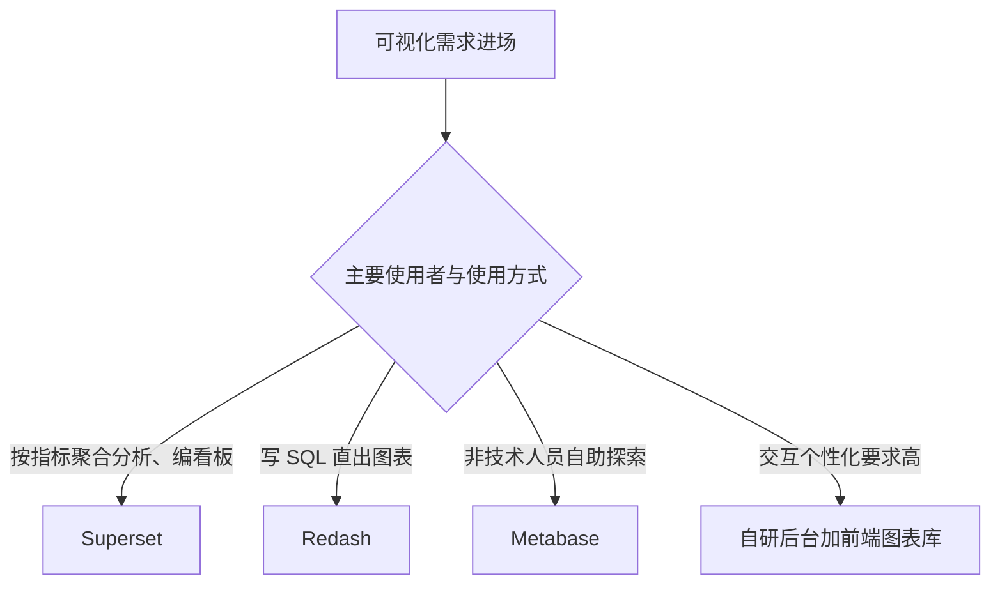
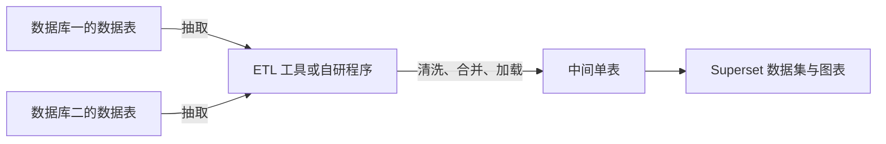

# Superset 常见问题收口：方案选型、多表数据源与环境排障

数据可视化章节到这里收官。课件留了两道高频问题：开源可视化方案怎么选，Superset 能不能用多张表当数据源；再加上这几天环境里真实踩过的乱码、Druid 连接、缓存与重启，一并收口成一份能带走的清单。面试里问到 Superset，多半也从这几条里出。

## 先给结论

- 选型三条生态位：Superset 偏 BI 平台，指标聚合加看板编排；Redash 偏 SQL 查询结果可视化，数据源支持面宽；Metabase 面向非技术人员，界面与部署体验最好。
- Superset 不能把多张表直接当一张图表的数据源，多表合并交给 ETL 生成中间单表。
- ETL 工具一抓一把：Kettle、Talend、DataX、IBM DataStage、DataPipeline，甚至自研程序；冷链监控平台 day6 的 cold-flink 实时计算工程就是一条现成的多源合成单表管道。
- 环境排障四件套：乱码查连接 URI 的 charset，Druid 连不通查 Broker 8082 与容器状态，图表慢查缓存，改完配置必须重启并看 `docker logs`。

## 选型：三个开源方案各占一个生态位

Superset 在可视化方面做得非常出色，是开源领域的佼佼者，把不少商用 BI 工具甩在身后。它还有一个亮点：对时间的支持。商业分析里大量问题与时间强相关，Superset 内置了 4 种专门针对时间序列的图表，指定某个字段为时间维度之后，粒度切换、范围过滤这些时间操作随取随用，冷链监控看板选它做温湿度曲线，用的就是这批时间序列图表。

Redash 的目标更纯粹：做好数据查询结果的可视化。它支持的数据源很宽，常见 SQL 数据库之外，还有 MongoDB、Elasticsearch、Google Spreadsheet，甚至一个 JSON 文件。它不要求像 Superset 那样先定义表和指标，而是直接把一条 SQL 的执行结果变成图表，上手极快。一句话定位：Redash 只实现了 Superset 里 SQL Lab 的功能，却把这个功能做到了极致。

Metabase 注重非技术人员的数据探索与开发，界面 UI 在三者里最出色，模块化做得好，提供完整的 API 文档；部署上给了 JAR 包、Mac 应用、Docker 镜像，几分钟能起一个项目。

| 方案 | 定位 | 突出长处 | 适合谁 |
|---|---|---|---|
| Superset | BI 平台 | 指标聚合、看板编排、4 种时间序列图表 | 数据团队做自助分析 |
| Redash | 查询可视化 | 数据源广、SQL 直出图表 | 会写 SQL 的分析师 |
| Metabase | 自助探索 | 界面出色、部署快、API 完整 | 非技术人员 |

选型决策画成图：



开源之外还有自研路线：自己开发后台，配不同的前端框架与图表工具画图，冷链监控平台本体走的就是这条路，cold-druid 工程用 Java 接口从 Druid 取数、前端画温湿度曲线。按实际情况、开发人员的技术实力与复杂场景要求选即可；平台内已有 Superset 之后，简单统计交给看板，个性化大屏留给自研，两条路线并行不冲突。

## 多表数据源：Superset 不做 join，ETL 来做

问题原话是：Superset 能否使用多个表作为数据源？答案分两半。某一个图表的数据源只能是单个数据集，没法在图表配置里对两张表做关联查询；但可以先用 ETL 把多张表合成一张中间单表，Superset 直接拿这张单表当数据集。ETL 的过程画出来就是三个框：



两张表分别从各自的库抽出来，汇进中间单表，Superset 只认这张单表。ETL 工具的选择很多，Kettle、Talend、DataX、IBM DataStage、DataPipeline 都属常用；更彻底的做法是自己写程序合成，把几个库的数据抽出来拼进一张表，再交给 Superset。

这条「多源合成单表」的路，冷链监控平台其实已经走过：day6 的 cold-flink 实时计算工程就是一条现成的合成管道。设备消息流进来，先与 Redis 里的设备台账合并，补齐主机、仓库、公司信息与告警阈值，算出告警标记，整行落进 MySQL 单表（包名已按统一口径改写）：

```java
// cold-flink 的 MySQL 落表：台账字段与实时数据合并后的宽记录整行写入
public class SinkToMySQL extends RichSinkFunction<MessageEntity> {
    private String userName = "cold";
    private String password = "cold123";
    private String DBUrl = "jdbc:mysql://172.17.0.143:3306/cold"
        + "?allowMultiQueries=true&useUnicode=true&characterEncoding=UTF-8&useSSL=false";

    @Override
    public void invoke(MessageEntity value, Context context) {
        // replace into cz_message_realtime(meterCode, hostName, houseName,
        //   tem, hum, temAlert, humAlert, state, lon, lat, curtime) values(...)
        preparedStatement.executeUpdate();
    }
}
```

上游的 MessageAggregate 把设备消息与 Redis 中的 MeterEntity 合并，hostname、housename、maxtem 一并补齐，temalert 按阈值算出高温、低温、正常三态；SinkToMySQL 整行写进 cz_message_realtime。Druid 侧的 all_device_message 同样是消息富化之后的单表。Superset 面对的永远是单表，表够不够宽是 ETL 层的事，这正是 BI 层与数据集成层的分工线。

## 环境排障清单

这几天环境里真实发生过的故障，归成四类，每一类都有固定的排查入口。

**第一，中文乱码。** 图表里中文变问号，根因在数据库连接的编码，SQLAlchemy URI 补 `?charset=utf8` 保存即可。写出侧同理，cold-flink 的 JDBC URL 里就带着 `characterEncoding=UTF-8`，链路上任何一环漏了编码，最后到图表都是问号。

**第二，连接 Druid 失败。** Druid 不走 MySQL 那样的通用连接入口，Superset 里给它单独的入口，协议与端口都不同，课程环境 Broker 端口 8082。连不上先看容器是否活着，再核对地址端口，最后看 Superset 侧的报错文案：

```bash
# 看 Superset 与 Druid 相关容器是否存活
docker ps | grep -E "superset|druid"

# 改过 config.py 后重启容器使其生效
docker restart superset

# 滚动查看启动与运行日志，报错行通常直接指出配置项
docker logs -f superset
```

**第三，图表加载慢。** Superset 对查询与配置做了缓存，重复访问不穿透到数据库；首次打开慢多半在前端资源加载，之后明显变快。数据明明更新了、看板还是旧图，一般是缓存没过期，等它过期或清缓存再刷新，不要急着怀疑图配错。

**第四，改了配置不生效。** config.py 是进程启动时加载的，改动后必须重启容器，用 `docker logs -f` 盯启动日志，报错行通常直接点名配置项。时间显示差固定 8 小时的，往时区上查，Superset 内部时区与数据库时区不一致是常见根因（此条为通用排查经验补充）。

## 常见误区

- **把选型当站队。** 错例：认定 Superset 后把所有可视化都塞进去，包括强交互大屏。正解：方案各有生态位，聚合分析给 Superset，SQL 直出给 Redash，强交互大屏自研，按使用者与场景分。
- **在 Superset 里硬做多表。** 错例：幻想在图表配置里选两张表 join。正解：图表数据源是单个数据集，多表先经 ETL 合成中间单表再接入。
- **ETL 只认工具。** 错例：没有装 Kettle 就觉得做不了合成。正解：工具是手段，自研 Flink 作业（如 cold-flink）同样能把多源合成单表，按团队技术栈选。
- **故障全往 Superset 身上找。** 错例：乱码去改样式，慢就重启机器。正解：乱码查连接编码，慢查缓存与查询，配置不生效查重启与日志，逐层定位。

## 面试可能被问到的问题

1. 面试官追问：「Superset、Redash、Metabase 怎么选？」
   答：看使用者与场景。Superset 是 BI 平台，适合指标聚合与看板编排；Redash 把 SQL 查询结果直接可视化，数据源广，适合会写 SQL 的分析师；Metabase 界面最友好、部署最快，适合非技术人员自助探索。
2. 面试官追问：「Superset 能用多张表做一张图的数据源吗？」
   答：不能直接 join，单个图表的数据源是单个数据集；先用 ETL 把多表合成中间单表，Superset 以单表建数据集，Kettle、DataX 或自研程序都能做。
3. 面试官追问：「为什么你们报表底层的表总是单表？」
   答：BI 层不做表关联，宽表由数据集成层负责。项目里 Flink 实时作业把设备消息与 Redis 台账合成一张宽表落库，Superset 只面对单数据集，职责分得开，改口径互不影响。
4. 面试官追问：「图表中文乱码与加载慢分别怎么排查？」
   答：乱码查数据库连接编码，SQLAlchemy URI 补 charset=utf8；加载慢先区分首次前端资源加载与后续查询，重复访问命中缓存不穿透数据库，数据更新后旧图等缓存过期或清理。
5. 面试官追问：「Superset 有哪些针对时间的专门能力？」
   答：内置 4 种时间序列图表，指定字段为时间维度后可做粒度切换与范围过滤等操作；冷链监控的温湿度曲线就是时间字段 curtime 加小时粒度配均值指标实现的。

## 配套资料

- 代码：`materials/code/06/day8 数据可视化/`，本课无配套源码包，选型表格与排障命令为按本课写法整理。
- 代码：`materials/code/06/day6 实时计算 - 冷眼项目实战/`，cold-flink 工程的 `MessageAggregate` 与 `SinkToMySQL` 为多源合成单表的真实实现。
- 代码：`materials/code/06/day7 统计分析/`，cold-druid 工程，all_device_message 字段清单以该工程实体定义为准。
- 说明：包名统一改写为 com.study.coldchain；引用路径截至 day 目录层级。
